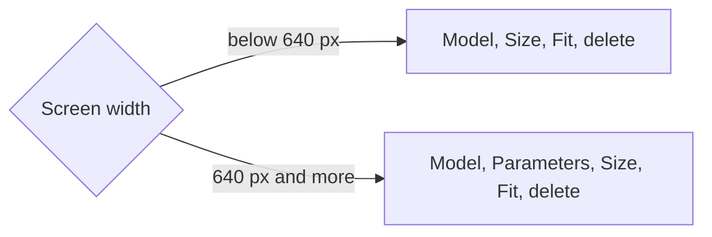

# Task: Local Models Table on a Phone

## Goal
Keep the Local models table in Settings usable on a phone. After Step 6 added the Fit column, a 375 px screen cut the Fit badge and needed a sideways scroll for the delete button.

## Constraints & Context
- Desktop does not change.
- One runner handoff (`mh-1-phone-table.md`). It needs the user's "Yes, apply it". Push only after the user approves.

## Acceptance Criteria
- [x] Below the `sm` breakpoint the Parameters column is hidden, the size stays on one line, and a long model name wraps.
- [x] A unit test checks the classes, and a Mobile Chrome E2E test checks that the delete button is inside the screen.
- [x] Screenshots on a phone and on a desktop show the table as intended.

## Status
`in-progress` (2026-11-09: applied as `3bd7c0f`; archive after the push and CI)
