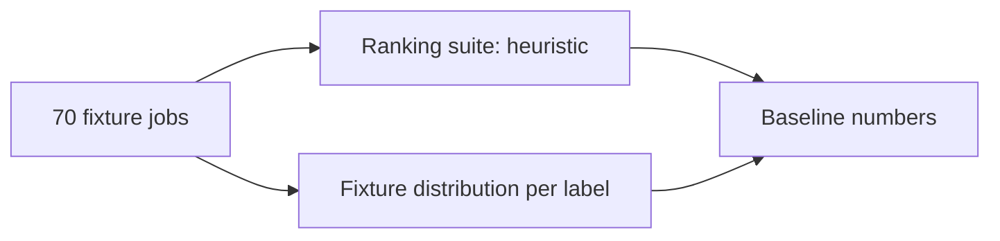
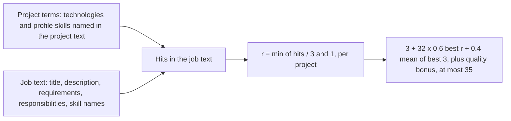
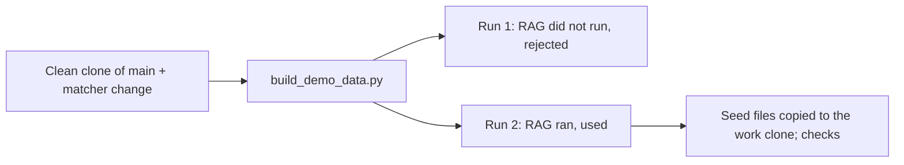
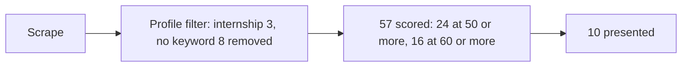
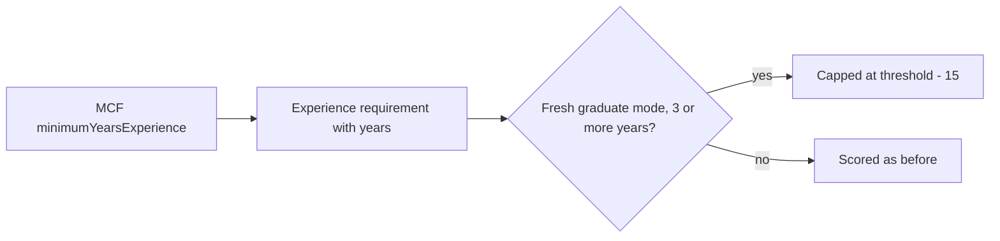

# Notes: project-scoring

Planned 2026-11-16 on the laptop, from the Next Up item in `tasks/todo.md`.

## Baseline on the scratch clone (2026-11-16, before any change)

Clone of `main` at "docs(tasks): record that mid level jobs stay in fresh graduate results", with its own `.venv` (Python 3.11 in the clone's `.tools/`).

Ranking suite (heuristic, `--no-mlflow`): `fresh_ml` NDCG@10 0.8621, recall@10 0.625; `mid_backend` NDCG@10 0.8685, recall@10 0.6364. These are the CI pins.

`fresh_ml`, fresh graduate mode (projects 35, skills 30, education 20, experience 10, location 5; threshold 50). Component columns are mean points.

| Label | Jobs | Min / median / max | At 50 or more | At 60 or more | Projects | Skills | Education | Experience | Location |
|---|---|---|---|---|---|---|---|---|---|
| 2 | 8 | 35 / 63 / 78 | 7 | 5 | 12.5 | 25.1 | 15.0 | 10.0 | 5.0 |
| 1 | 19 | 32 / 53 / 76 | 12 | 3 | 12.4 | 13.1 | 15.0 | 6.9 | 5.0 |
| 0 | 43 | 29 / 32 / 53 | 7 | 0 | 8.3 | 4.1 | 15.0 | 4.7 | 5.0 |

- Project points separate the labels weakly. AUC of project points (the chance that a random job of the first label gets more points than a random job of the second): label 2 against 0: 0.789; 2 against 1: 0.500 (no separation); 1 against 0: 0.816. AUC of the total, label 2 against 0: 0.959.
- The 26 totals at 50 or more: 10 of them are exactly 53, and 19 are inside 53 to 61. The scores are close together, as in the live runs (50 to 63).
- Maximum project points for `fresh_ml` today: 8 (base for 3 projects) + 3 x 4 (2 or more skill matches each) + 3 x 0 (highlights: `int(35 * 0.02)` is 0) = 20 of 35.

`mid_backend` (standard profile; the pipeline uses standard mode, which has no project part): fresh graduate mode, label 2 at 50 or more 11 of 11, label 0 1 of 41; project AUC 2 against 0: 0.864. Standard mode: label 2 median 80, label 0 at 60 or more 1 of 41.

Live baseline: the last runs before this task (`run_0f3302c64278`, `run_d7bc220cfd58`) had a project mean of 5.9 of 35. The live profile is not visible to agents; 5.9 suggests few projects or project technologies that do not occur in the job skill lists.

## Change on the scratch clone (2026-11-16, after the plan check)

- `src/scoring/matcher.py`: new constants `PROJECT_BASE_SHARE` (0.10), `PROJECT_FULL_HITS` (3), `PROJECT_BEST_SHARE` (0.6), `PROJECT_TOP_COUNT` (3); new functions `job_text`, `project_terms`, `projects_relevance`; `_score_projects` uses them. The quality bonus and the no-project credit do not change. Constants as in the plan; no revision.
- Tests: `tests/unit/test_project_relevance.py` (10). Red with `--maxfail=100`: 8 failed (job text without a skill list; requirements, responsibilities, and title, 3 cases; a profile skill named in the project text; whole terms in the job text; project count alone; one strong project against one weak hit per project), 2 guards passed (points within 0 to 35 and no projects gives `weight // 4`; standard mode has no project part). 10 of 10 ran. Green: 10 passed; with the seniority, matcher-term, and scorer tests: 86 passed.

Measurement against the decision rule:

| Guard | Rule | Before | After | Result |
|---|---|---|---|---|
| G1 | `fresh_ml` NDCG@10 at least 0.8621, recall@10 at least 0.625 | 0.8621 / 0.625 | 0.9455 / 0.875 | pass |
| G1 | `mid_backend` NDCG@10 and recall@10 unchanged | 0.8685 / 0.6364 | 0.8685 / 0.6364 | pass |
| G2 | project AUC label 2 against 0 at least 0.85 | 0.789 | 0.977 | pass |
| G2 | project AUC label 2 against 1 at least 0.60 | 0.500 | 0.704 | pass |
| G3 | label-0 jobs at 50 or more at most 9 of 43 | 7 | 0 | pass |
| G3 | label-2 jobs at 50 or more at least 7 of 8 | 7 | 7 | pass |
| G4 | standard mode totals unchanged (both profiles) | | same tables; standard mode does not call `_score_projects` | pass |
| G5 | seniority tests and `test_project_skills_match_whole_terms` pass unchanged | | 28 and 30 passed | pass |

`fresh_ml`, fresh graduate mode, after the change:

| Label | Jobs | Min / median / max | At 50 or more | At 60 or more | Projects (before) |
|---|---|---|---|---|---|
| 2 | 8 | 35 / 70 / 83 | 7 | 7 (5) | 17.9 (12.5) |
| 1 | 19 | 27 / 53 / 81 | 10 (12) | 6 (3) | 12.2 (12.4) |
| 0 | 43 | 24 / 27 / 48 | 0 (7) | 0 | 3.7 (8.3) |

- Totals at 50 or more: 17 (was 26), from 53 to 83; no longer 10 jobs at 53. Total AUC label 2 against 0: 0.971 (was 0.959).
- `mid_backend` in fresh graduate mode (not the pipeline mode for this profile): project AUC unchanged (0.864); label 2 at 60 or more 10 of 11 (was 5).
- Pins raised in `thresholds.json` (`fresh_ml` heuristic NDCG@10 0.9455, recall@10 0.875), with MLflow run `e7ec91558e4c488fb3668a7d2e310e1b` (clone, local store). BM25 metrics unchanged.
- CI checks on the clone: black, ruff, mypy gate (0 new; it also reports 5 baseline errors as fixed, and the baseline stays as it is, because only the user shrinks it). Full backend pytest: 2462 passed, 1 failed: `test_the_scores_are_real_matcher_output` (demo seed, `projects` 16 to 21), as the plan expected.

## Demo seed again (option a, 2026-11-16)

- Run 1 (`~/scratch/demo-seed`): every shortlist reasoning ends with "RAG unavailable, heuristic-only", and each relevance score equals the heuristic total. The embedding step failed, and the script did not stop or print an error. Not used.
- Run 2 (`~/scratch/demo-seed2`, 1 min 41 s per run, one model at a time): RAG ran. Shortlist 17 jobs (was 20). Top: rk-001 "Graduate Machine Learning Engineer" 92.4 (was not in the list), then rk-012, rk-004, rk-003. "Senior Machine Learning Engineer" (rk-006) and three others below 50 left the list. The letter is now for rk-001.
- Letter of run 2 (`qwen2.5:7b`): no placeholders, but one claim is not true for the profile: "During my internship, I developed and deployed an image classifier". The classifier is a personal project, and nothing in the profile says it was deployed. The old letter (rk-012) had no such error. Run 1's letter had the same kind of error (the sentiment tagger placed in the internship). This is the writer, not the scoring change; the user decides what goes into the demo.
- Checks on the work clone with the run 2 seed: full backend pytest 2463 passed (the demo seed test passes again); vitest 392 passed (71 files), eslint, tsc, prettier, `build:demo` pass. Node 20 on the laptop (CI uses Node 24 from `.nvmrc`; Node 24 is not installed in WSL here). The Playwright demo suite runs in CI.
- The mypy gate message "5 baseline errors are fixed" also shows on `main`; it is not from this change.

## Applied to main (2026-11-16, after "Yes, apply it")

- The user chose to apply with the run 2 seed (letter with one inaccurate sentence; the demo is published only with a separate approval).
- Patch from the clone applied with `git apply` (no mode lines); the 7 files on `main` are byte-for-byte the same as on the clone.
- Checks on `main`: black, ruff, mypy gate (0 new), full backend pytest 2463 passed, vitest 392 passed, eslint, tsc, prettier. The demo build ran on the clone only, so it does not replace the production build that `make app` uses; the files are the same.
- Commit "feat(scoring): score projects by their relevance to the job in fresh graduate mode". Not pushed.

## Live run (2026-11-16, user, `run_4d7909177390`)

Settings: dry run, MyCareersFuture, Singapore, fresh graduate on, Min Score 50, Max Jobs 10. App restarted after the apply. Read through `http://localhost:3000/api/proxy/pipeline/results/{run_id}`: `score_and_rank.metadata.distribution` and `filter_by_profile.metadata.removed_by` only.

| | Before (`run_d7bc220cfd58`) | After (`run_4d7909177390`) |
|---|---|---|
| Scored (kept by the profile filter) | 57 | 57 |
| Removed: internship / no keyword match | 3 / 8 | 3 / 8 |
| Levels of the scored jobs | Entry 5, Mid 34, Senior 9, Lead 8, Executive 1 (run of change C) | Entry 5, Mid 33, Senior 10, Lead 8, Executive 1 |
| At 50 or more / at 60 or more | 21 / 6 | 24 / 16 |
| Band 30-39 (capped senior jobs and weak fits) | 29 | 30 |
| Bands 50-59 / 60-69 / 70-79 / 80-89 | most in 50-59, best 63 | 8 / 5 / 9 / 2 |
| Project mean (of 35) | 5.9 | 16.1 |
| Other means: skills / education / experience / location | 18.6 / 17.0 / 3.6 / 5.0 | 18.5 / 17.0 / 3.6 / 5.0 |

- The filter counts, the scored count, and the levels are almost the same, so the scrape returned almost the same jobs as before: this is close to a paired comparison.
- L3 holds: the project mean rose from 5.9 to 16.1, and the passed jobs now spread from 50 to 89 (was 50 to 63). The other components did not change.
- Three more jobs pass (21 to 24). Mid Level jobs stay in the results (33 scored); the senior cap still holds (band 30-39 has 30 jobs).
- L4: the user judges the shortlist.

## Change D on the scratch clone: required years (2026-11-16)

User judgement of `run_4d7909177390`: a full-stack developer job scored 84 but asks for at least 4 years. Cause: MyCareersFuture minimum years were dropped when the listing gives a position level. User decision: cap from 3 or more years.

- D1 `mycareersfuture_scraper.py`: minimum years above 0 become a `JobRequirement` (category "Experience", `years_of_experience`), also when a level is given.
- D2 `matcher.py`: `FRESH_GRAD_MAX_YEARS` (3), `required_years`, `asks_too_many_years`; fresh graduate mode caps such jobs like senior roles. A stated level does not override the years.
- D3 `distribution.py`: `required_years_at_or_above_3`.
- Tests `test_fresh_grad_required_years.py` (11): red 6 failed (MCF keeps years with a level; `required_years`; 3 and 4 years capped; Entry Level with 3 years capped; distribution count), 5 guards passed (0 or missing MCF years add nothing; Mid Level with no years or 2 years keeps its score; standard mode ignores years). 11 of 11 ran. Green: 11 passed.
- D-G1: ranking metrics unchanged (`fresh_ml` 0.9455 / 0.875, `mid_backend` 0.8685 / 0.6364, BM25 unchanged); the fixture distribution is unchanged (the fixture jobs have no structured years). D-G2, D-G3: pass (tests). D-G4: black, ruff, mypy gate (0 new), full backend pytest 2474 passed.
- Applied to `main` together with the job card labels (`tasks/active/job-card-labels/`, choice C2a) after "Yes, apply it" (2026-11-16); in `job-card-labels` the cap is lifted for fresh-grad-friendly postings. Checks on `main` in that task's notes.

User idea during change D (2026-11-16): show the required years as a label on each job card, and a "fresh grad friendly" label when the posting says fresh graduates are welcome even with many years asked. Such a sign should also lift the change D cap.

Follow-ups found (not in this task):
- `scripts/build_demo_data.py` continues when the embedding step fails, with heuristic scores only and no error (run 1). It should stop, as a run that did no work must not look like success.
- The letter writer sometimes places a personal project inside the internship (both seed runs).

Found while planning: `tests/unit/test_demo_data.py::test_the_scores_are_real_matcher_output` compares the committed demo shortlist (`apps/frontend-ts/src/demo/seed/shortlist.json`) with the matcher output for `fresh_ml` in fresh graduate mode. A change to project points makes this test fail until the demo seed runs again (`scripts/build_demo_data.py`, needs `nomic-embed-text` and `qwen2.5:7b` in Ollama and a clean clone).
