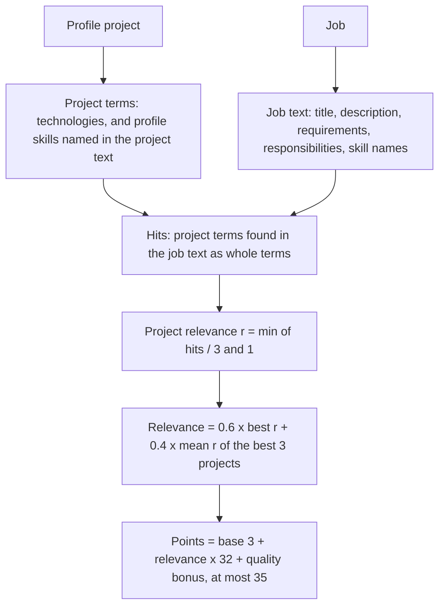
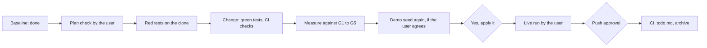

# Task: Project Scoring in Fresh Graduate Mode

## Goal
Make the project points in fresh graduate mode show how relevant the profile's projects are to the job, so the order of the passed jobs separates good jobs from weak ones. Measure the effect before and after on the fixtures and in one live run.

## Problem
- `src/scoring/matcher.py`, `_score_projects`: fresh graduate mode gives projects up to 35 points. The points come from a base for the project count (25 % of the weight for 3 or more projects, 12 % for 1 or 2) and from overlap between each project's text and the job's structured skill list only. The job title, description, and requirements are not read.
- Live runs: project mean 5.9 of 35. Passed totals are close together (50 to 63).
- Fixtures (`notes.md`, baseline): project points do not separate apply jobs from maybe jobs (AUC 0.500); 10 of the 26 totals at 50 or more are exactly 53.

## Proposed change (fixed before any code change)

In `_score_projects` only (fresh graduate mode):

| Part | Today | After the change |
|---|---|---|
| No projects | `weight // 4` (8) | unchanged |
| Base | 8 for 3 or more projects, 4 for 1 or 2 | 3 for 1 or more projects (`PROJECT_BASE_SHARE` 0.10): the count alone says nothing about this job |
| Project terms | the whole project text | the project's technologies, and each profile skill that the project text (name, description, long description, highlights) names as a whole term |
| Job side | structured skill names only | title, description, requirement texts, responsibility texts, and skill names |
| Match | job skill found in project text | project term found in the job text (`term_in_text`, whole terms, as today) |
| Per project | +4 for 2 or more matches, +2 for 1 | `r = min(hits / PROJECT_FULL_HITS, 1)`, `PROJECT_FULL_HITS` = 3 |
| Combination | sum over projects | `0.6 x best r + 0.4 x mean r of the best 3 projects`, times the points above the base (32) |
| Quality bonus (URL, highlights) | +1 per URL, +0 per highlights | unchanged |
| Cap | 35 | 35 |

Not changed: the weights, the thresholds (50 and 60), the pipeline cut-off (Min Score), the senior cap (`is_senior_role`), the internship cap, standard mode, and every other component. Mid Level jobs are not capped or reduced on purpose (user decision 2026-11-16).

## Decision rule (fixed before any code change)
The change goes to the user for "Yes, apply it" only when all of these hold on the scratch clone:

- G1. Ranking suite, heuristic: `fresh_ml` NDCG@10 at least 0.8621 and recall@10 at least 0.625; `mid_backend` NDCG@10 0.8685 and recall@10 0.6364, unchanged (standard mode has no project part).
- G2. Fixtures, `fresh_ml`, fresh graduate mode, project points: AUC label 2 against label 0 at least 0.85 (baseline 0.789), and AUC label 2 against label 1 at least 0.60 (baseline 0.500).
- G3. Fixtures, `fresh_ml`, fresh graduate mode: label-0 jobs at 50 or more at most 9 of 43 (baseline 7, +2 as in the previous task); label-2 jobs at 50 or more at least 7 of 8 (baseline 7).
- G4. Standard mode totals of both profiles do not change for any fixture job.
- G5. The seniority tests (`test_fresh_grad_seniority.py`) and the existing project test (`test_project_skills_match_whole_terms`) pass without changes.

If G1, G2, or G3 fails, one revision of the constants (`PROJECT_BASE_SHARE`, `PROJECT_FULL_HITS`, the 0.6 / 0.4 split) is allowed. Both results go into `notes.md`. If the revision also fails, stop and report to the user with the numbers; no change is applied.

Live check (after "Yes, apply it", before the push):
- L1. The user restarts `make app` and starts one run with the usual settings: dry run, MyCareersFuture, Singapore, fresh graduate on, Min Score 50, Max Jobs 10.
- L2. Agents read only `score_and_rank.metadata.distribution` and `filter_by_profile.metadata.removed_by` through `http://localhost:3000/api/proxy/pipeline/results/{run_id}`.
- L3. Expected: the project mean rises from 5.9; the bands of the passed jobs spread wider than 50 to 63. The scraped jobs differ by date, so the numbers are not an exact pair with the earlier runs. Optional: the user starts one run on the current `main` first, on the same day, for a closer pair.
- L4. The user reads the shortlist. The push happens only when the user judges the fit at least as good as in `run_d7bc220cfd58`. If it is worse, the change is reverted or planned again with the user.

## Steps

1. Baseline on a scratch clone (done; `notes.md`).
2. Red tests (new file `tests/unit/test_project_relevance.py`), run red with `--maxfail=100`. Planned cases:
   - A job whose title and description name the project's technologies, but which has no skill list, gets more project points than a job that names none of them.
   - A project term found in the requirements counts.
   - A profile skill named only in the project description (not in its technologies) counts.
   - Whole terms: a JavaScript project gets no hit from a Java job (guard, passes today too).
   - The project count alone does not add points: three unrelated projects get no more than one unrelated project.
   - A job relevant to one strong project gets more points than a job with one weak hit in each project.
   - Points stay within 0 to 35; no projects still gives `weight // 4`.
   - Standard mode breakdown has no project part (guard).
3. The change in `matcher.py` (named constants, docstrings, type hints). Green tests.
4. Measure: ranking suite and fixture distribution, against G1 to G5. If the heuristic `fresh_ml` metrics rise, the pin test asks to raise the pins: log the run to MLflow from the clone and add a `changes` entry with the run ID to `thresholds.json`.
5. CI checks on the clone: black, ruff, mypy gate (0 new errors), full backend pytest. No frontend code changes, so the frontend checks run only for the demo seed (step 6).
6. Demo seed (user decision): `test_the_scores_are_real_matcher_output` fails after any change to project points. Options:
   - a. Run `scripts/build_demo_data.py` again on a new clean clone (Ollama: `nomic-embed-text`, then `qwen2.5:7b`, one model at a time; the pipeline models must not run at the same time). It rewrites `apps/frontend-ts/src/demo/seed/*.json`, including the letter. Then vitest, eslint, tsc, prettier, the demo build on the clone; the Playwright demo suite runs in CI. Publishing the demo is a separate approval and is not part of this task.
   - b. No other option keeps the test true without a weaker test, so a is the recommended option.
7. "Yes, apply it": apply to `main`, run the same checks on `main`, commit only the named files.
8. Live check L1 to L4, numbers in `notes.md`.
9. Push after approval; read CI; record it; update `tasks/todo.md`; archive this folder.

## Constraints & Context
- Never read `apps/backend-py/.env`, `apps/frontend-ts/.env.local`, `user_settings.json`, or the contents of any `data/` folder. The live profile is not visible; only the distribution numbers are read.
- Playwright cannot start on this laptop (missing system libraries); CI runs the browser suites.
- `config/scoring_config.yaml` is not loaded by any code. This task does not change that; the item stays open in `tasks/todo.md`.
- The fixtures are also the measurement set. The formula is fixed here before the code change, and at most one revision is allowed, so the result is not tuned to the 70 jobs.

## Acceptance Criteria
- [x] Baseline measured on a scratch clone and recorded in `notes.md` (ranking suite, fixture distribution for both profiles, live baseline from earlier runs).
- [x] Plan checked by the user, with the demo seed option chosen (2026-11-16: "Approve, option a").
- [x] Red tests: every new behaviour test fails before the change (failed plus passed equals the number of new tests).
- [x] Green tests after the change.
- [x] G1 to G5 checked and recorded in `notes.md` (with the revision, if any).
- [x] CI checks pass on the clone: black, ruff, mypy gate (0 new), full backend pytest; frontend checks for the demo seed.
- [x] Applied to `main` after "Yes, apply it"; the same checks pass on `main` (2026-11-16).
- [ ] Live run by the user; distribution and filter counts recorded in `notes.md`; the user's judgement of the shortlist recorded.
- [ ] Pushed after approval; the CI run passes.
- [ ] `tasks/todo.md` updated; folder moved to `tasks/archive/`.

## Status
`review`
