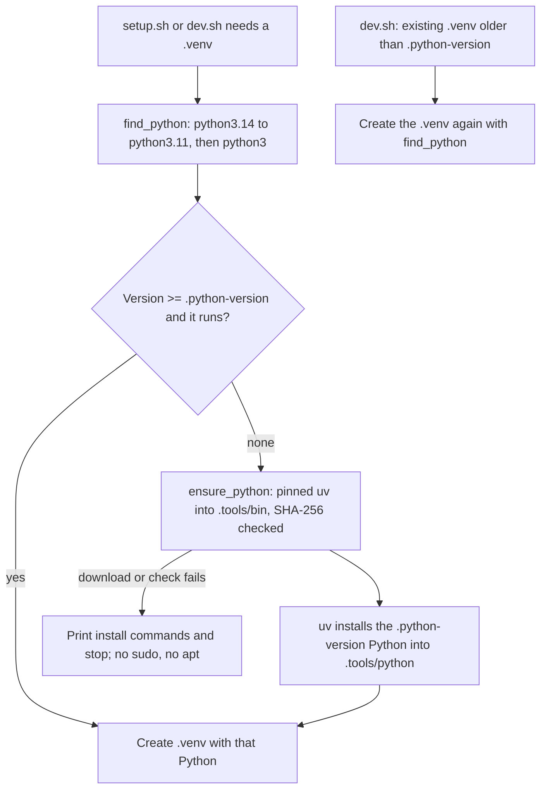

# Task: Setup Finds a Suitable Python

## Goal
`setup.sh` and `make dev` work on a machine whose default `python3` is older than `.python-version` (the user's laptop: Ubuntu 22.04, Python 3.10), when a newer Python is installed next to it.

## Problem
Both scripts called `python3` only. On Ubuntu 22.04 that is 3.10 and must stay 3.10, so the setup stopped even after the user installed Python 3.12.

## Plan
1. New `scripts/find_python.sh` (sourced by both scripts): `python_required_version`, `python_meets`, `find_python`, `install_repo_python`, `ensure_python`, `python_install_help`. User choice (option A, 2026-11-14): when no suitable Python exists, install one inside the repository with a pinned uv 0.13.5 (SHA-256 checked) into the git-ignored `.tools/`; `--no-bin` and `UV_CACHE_DIR` keep everything out of `$HOME`.
2. `setup.sh`: `check_python` uses `ensure_python` and sets `PYTHON_BIN`; `create_venv` uses it.
3. `scripts/dev.sh`: a new `.venv` uses `ensure_python`; an existing `.venv` with an older Python is created again.
4. Tests: `tests/unit/test_find_python.py` (stub Pythons on a closed PATH); the launcher test copies the helper; the dev deps test counts 3 rebuild cases.
5. End-to-end checks in a clean `ubuntu:22.04` container: (a) with deadsnakes 3.12 installed, the helper picks 3.12 and keeps `python3` 3.10; (b) with only 3.10 and no sudo, `setup.sh` installs Python 3.11 into `.tools/python`, builds `.venv` from it, writes nothing under `$HOME`, and a second run downloads nothing.
6. `docs/lessons.md` entry.

## Constraints & Context
- Setup scripts never run `sudo` or `apt` and change nothing outside the repository.
- `.python-version` (3.11, also used by CI) stays the one source of the required version.

## Acceptance Criteria
- [x] Helper and script changes, with comments; no plain `python3 -m venv` left.
- [x] Script tests pass (find_python, launcher, dev deps, mprocs, setup llmfit); black and ruff pass.
- [x] Ubuntu 22.04 container check passes.
- [x] Full backend checks pass (pytest, mypy gate 0 new).
- [ ] Applied after "Yes, apply it"; pushed after approval; `setup.sh` passes on the laptop.

## Status
`review`
