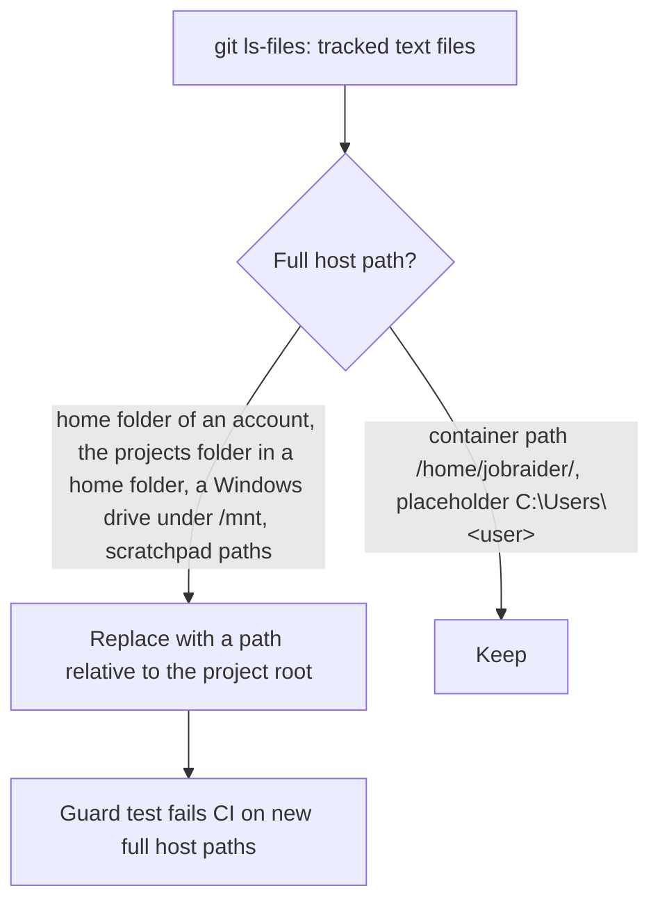

# Task: Relative Paths in Documentation

## Goal
Tracked files show no full host paths. Documentation writes paths relative to the project root, and says "the project root" for the repository folder. A test stops new full host paths in CI.

## Why (user rule, 2026-11-14)
Full host paths in a public repository show the user's account name and folder layout. This is a security concern. The same reason is behind the rule that setup scripts change nothing outside the repository.

## Findings (search of tracked files, 2026-11-14)
Find them again with `git grep -nE` and the patterns in the guard test (step 2). Do not copy the paths into this task.
- Account name in a path: `tasks/archive/generic-phrasing/notes.md` (MLflow artifact path), `tasks/archive/step-3-6-cost-tracking/handoff.md` (Playwright cache path).
- Home folder layout (the repository folder in the home directory): `AGENTS.md` (Environment section), `tasks/todo.md` (Done entry for the move to WSL), `docs/lessons.md`, `tasks/archive/dev-deps-repair/task.md` and `notes.md`, `tasks/archive/review-follow-up/notes.md`.
- Old D: drive layout (the D: drive as seen from WSL): `docs/disk-space.md` (commands to copy), `docs/lessons.md`, `tasks/backlog.md`, `tasks/archive/step-3-3-scam-set/handoff-stage-b-part-2.md`, `tasks/archive/legacy/todo-done.md`.
- Keep: container paths (`/home/jobraider/...` in `docker/docker-entrypoint.sh`, `docs/troubleshooting.md`, `docs/lessons.md`, `tasks/archive/legacy/todo-done.md`), placeholders (`C:\Users\<user>`), and `~/.nvm/nvm.sh` (the standard nvm location, no account name).
- `docker-rebuild.sh` calls Docker Desktop by its standard Windows install path. It shows nothing personal; keep it, or call `docker.exe` from the PATH if that works in WSL (test both commands first).

## Plan
1. Replace each full host path with a path relative to the project root:
   - Commands: run from the project root, for example `find . -name "__pycache__" ...` in `docs/disk-space.md`.
   - Prose: "the project root", or "the repository folder in WSL (ext4)" where the old D: drive is the point of the text.
   - Historic records in `tasks/archive/`: keep the meaning, remove the account name and the folder layout.
2. Guard test `apps/backend-py/tests/unit/test_no_host_paths.py`:
   - Read the tracked files with `git ls-files` (text files only; skip lock files and binary files).
   - Fail on: an account home folder (`/home/` and a name) except `/home/jobraider/`; a tilde path to the projects folder; a Windows drive under `/mnt` (one letter) except the Docker Desktop install path; the Claude scratchpad folder under `/tmp`; `C:\Users\` followed by a name that is not a placeholder in angle brackets.
   - The test file itself builds these patterns from parts, so it does not match its own text.
   - The failure message names the file and the line number.
   - Red first: the test fails on the current files, then passes after step 1.
3. `AGENTS.md`: add the rule under Documentation ("Write paths relative to the project root. Never write a full host path."). Change the Environment line so it does not name the home folder layout.
4. `docs/lessons.md`: add a lesson (paths in tracked files are public; write them relative to the project root; the guard test enforces it).

## Constraints & Context
- Documentation and one test only. No change to the app code.
- Git history keeps the old text. The user did not ask to rewrite history; do not force-push.
- Never read `.env`, `.env.local`, `user_settings.json`, or the contents of `data/`.
- Work on the laptop (`tasks/active/laptop-workstation/task.md`). Follow the workflow: scratch clone, "Yes, apply it", separate approval to push.

## Acceptance Criteria
- [x] All findings fixed or kept with the reason above; `git grep` with the guard patterns finds only allowed paths.
- [x] Guard test written red first, then green; it names the file and line.
- [x] `AGENTS.md` rule and the Environment line updated; lesson added.
- [x] CI checks pass on the clone: black, ruff, mypy gate (0 new), full backend pytest.
- [ ] Applied after "Yes, apply it"; pushed after approval; the CI run passes.
- [ ] `tasks/todo.md` updated; folder archived.

## Status
`in-progress`
