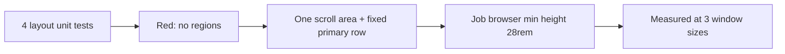

# Notes: responsive-job-detail

Planned 2026-11-15 on the laptop, from the user's screenshot of the Jobs page.

## Build on a scratch clone (2026-11-15)

- `job-detail.tsx`: the card is `flex h-full min-h-0 flex-col`. One scroll area (`data-testid="job-detail-scroll"`) holds the header, a wrapping row of analysis actions (Analyze with AI, Analyze Trust, Explain This Match, Generate Cover Letter, Deep check), the skills, the results (Job Analysis, Trust Analysis, Why This Match, the cover letter with Proofread), and the description (no second scroll area inside it). The fixed row (`data-testid="job-detail-actions"`) has only Apply, Copy Link, Save, and Applied Elsewhere. Found during the change: "Why This Match" and the generated cover letter were in the fixed footer before, so the footer grew after these actions. The diff is large because the header moved one level in (prettier re-indent); the header content does not change.
- `jobs/page.tsx`: the job browser has `lg:min-h-[28rem]`; a shorter window scrolls the page (the app shell `main` scrolls). 32rem was tried first: at 1366 x 768 it made the page scroll by 44 px as well, so 28rem.
- Tests: `tests/components/job-detail-layout.test.tsx` (4): red (no regions), green. Existing `job-detail.test.tsx` (9) passes. E2E: new test in `tests/e2e/jobs-page.spec.ts` at 1366 x 768 (scroll area above 250 px, description in view after scrolling, action row in view; skipped for the Mobile Chrome project). It compiles (`playwright test --list`); it runs in CI (Playwright cannot start on the laptop).
- Checks on the clone: vitest 392 passed (71 files), eslint, tsc, prettier, Next.js build, demo build.

## Measurement in the built-in browser (2026-11-15)

Before: `main` (the user's `make app`). After: the clone's production build on port 3300, against the user's backend (the clone used a copy of `.env.local`, removed afterwards; not read). The demo build could not be used: the built-in browser blocks service workers. Job: the first shortlist job of `run_0f3302c64278`.

| Window | Card before | Description area before | Fixed bottom before | Description area after | Fixed bottom after | Page scroll after |
|---|---|---|---|---|---|---|
| 1280 x 720 | 376 px | 40 px | 247 px | 394 px | 53 px | 48 px |
| 1366 x 768 | 468 px | 40 px | 247 px | 414 px | 53 px | 0 |
| 1920 x 1080 | 780 px | 307 px | 247 px | 726 px | 53 px | 0 |

At 1366 x 768, after scrolling the detail card, the description fills the card and the action row stays in view (screenshot shown to the user).
