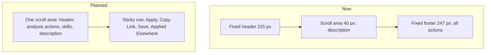

# Task: Job Details Readable on Laptop Screens

## Goal
On the Jobs page, the job description and details are readable at laptop window sizes (for example 1280 x 720 and 1366 x 768), not only on a large monitor. Narrow windows (below 1024 px) keep the bottom sheet that they use today.

## Problem (user report and measurement, 2026-11-15)
- The user works on the laptop now. On the Jobs page the description of the selected job is almost not visible (screenshot from the user).
- Measured in the built-in browser at 1366 x 768 (`run_0f3302c64278` shortlist, first job selected): the detail card is 468 px high. The fixed header (title, company, salary, tags, score) is 225 px, the fixed footer with the action buttons (Apply row, Analyze with AI, Analyze Trust, Explain This Match, Deep check) is 247 px, and the scrolling middle (skills, analyses, description) shows 40 px of 2,310 px of content.
- Cause: `apps/frontend-ts/src/components/jobs/job-detail.tsx` has a fixed header and a fixed footer around one scroll area, and the page (`src/app/jobs/page.tsx`) fits the window height. On a short window, the header and the footer take all the height.
- Other pages checked at 1366 x 768 (dashboard, pipeline, cover letter, applications, profile, settings, metrics, logs): no squeezed scroll area and no horizontal overflow.

## Plan
1. Detail card (`job-detail.tsx`):
   - One scroll area for the header, the analysis actions, the skills, the analyses, and the description.
   - Only the primary row stays fixed at the bottom: "Apply on <source>", Copy Link, Save, Applied Elsewhere.
   - The analysis actions (Analyze with AI, Analyze Trust, Explain This Match, Deep check) move into the scroll area, under the header, as one compact row that wraps.
   - No change to what the buttons do.
2. Page (`jobs/page.tsx`): the job browser area gets a minimum height, so that on a very short window the page scrolls instead of squeezing the list and the details.
3. Tests, red first:
   - Unit (vitest, `tests/components/jobs/`): the Apply button is in the fixed action row; the analysis buttons and the description are inside the scroll area.
   - E2E (Playwright, new spec at 1366 x 768): select a job, scroll the detail card, the description is visible, and the Apply button stays visible. Playwright cannot start on the laptop (missing system libraries, `tasks/active/scoring-calibration/notes.md`), so CI runs it.
4. Measure before and after in the built-in browser at 1280 x 720, 1366 x 768, and 1920 x 1080: the visible height of the scroll area, and that the description is reachable. Screenshots for the user.

## Constraints & Context
- Frontend only; no API change. Follow `apps/frontend-ts/AGENTS.md` (read the Next.js docs in `node_modules/next/dist/docs/` before code changes).
- Checks: eslint, tsc, vitest, prettier, the Next.js build; the Playwright suites run in CI.
- Workflow: plan check, scratch clone, "Yes, apply it", separate approval to push.

## Acceptance Criteria
- [x] Plan checked by the user (2026-11-15).
- [x] Unit tests red first, then green; the E2E spec added.
- [x] Detail card and page changed; frontend checks pass on the clone.
- [x] Before and after measurement at three sizes in `notes.md`, with screenshots for the user.
- [ ] Applied after "Yes, apply it" (done 2026-11-15); pushed after approval; the CI run passes (Playwright included).
- [ ] `tasks/todo.md` updated; folder archived.

## Status
`in-progress`
