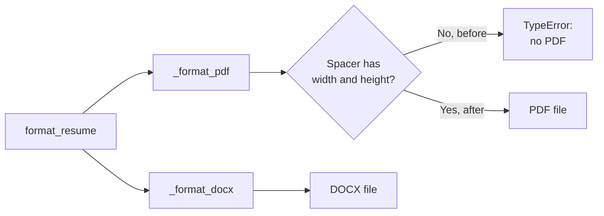

# MH-7: The resume PDF is written

Read `AGENT.md` first.

## Why

The full-mode dry run generated 2 resumes, but no PDF. `ResumeFormatter._format_pdf` calls `Spacer(0.1 * inch)`, and the reportlab `Spacer` needs a width and a height. Each PDF fails with `Spacer.__init__() missing 1 required positional argument: 'height'`. The DOCX is saved, so the run continues without the PDF. The other formatters use `Spacer(1, height)`. After this change, the resume PDF is written.



## Files

- `apps/backend-py/src/generation/formatter.py` (change)
- `apps/backend-py/tests/unit/test_resume_formatter_pdf.py` (new)

## Step 1: add this test file, run it, and see it fail

`apps/backend-py/tests/unit/test_resume_formatter_pdf.py`:

```python
"""
Tests for PDF resume output (resume generation fix, MH-7).

Before this fix, ``ResumeFormatter._format_pdf`` called ``Spacer`` with only
a height. The reportlab ``Spacer`` needs a width and a height, so every PDF
raised ``TypeError``. ``format_resume`` caught it, so the DOCX file was still
written and the PDF file was silently missing.
"""

from pathlib import Path

import pytest

from src.generation.formatter import REPORTLAB_AVAILABLE, ResumeFormatter
from src.generation.resume_writer import GeneratedResume

pytestmark = pytest.mark.skipif(not REPORTLAB_AVAILABLE, reason="reportlab missing")


def make_resume() -> GeneratedResume:
    """Build a resume with every section that adds a spacer to the PDF.

    Returns:
        A generated resume with a summary, experience, projects, and education.
    """
    return GeneratedResume(
        summary="Backend engineer focused on Python services.",
        skills=["Python", "FastAPI", "PostgreSQL"],
        experience=[
            {
                "title": "Software Engineer",
                "company": "Example Pte Ltd",
                "dates": "2024 - 2026",
                "highlights": ["Built a job ingestion service."],
            }
        ],
        projects=[
            {
                "name": "Job Raider",
                "description": "Local-first job search pipeline.",
                "technologies": ["Python", "Next.js"],
                "highlights": ["Deterministic cover-letter grounding."],
            }
        ],
        education=[{"degree": "BSc Computer Science", "school": "NUS", "year": "2024"}],
        raw_response="{}",
        model_used="test-model",
    )


def test_pdf_export_writes_a_pdf_file(tmp_path: Path) -> None:
    """PDF export writes a PDF file and reports no error.

    Args:
        tmp_path: Temporary output directory.
    """
    result = ResumeFormatter(output_dir=str(tmp_path)).format_resume(
        make_resume(), filename="resume_test", formats=["pdf"]
    )

    assert result.errors == []
    assert result.pdf_path is not None
    assert Path(result.pdf_path).read_bytes().startswith(b"%PDF")


def test_pdf_and_docx_are_both_written(tmp_path: Path) -> None:
    """With the default formats, the PDF and the DOCX are both written.

    Args:
        tmp_path: Temporary output directory.
    """
    result = ResumeFormatter(output_dir=str(tmp_path)).format_resume(
        make_resume(), filename="resume_test"
    )

    assert result.errors == []
    assert result.pdf_path is not None
    assert result.docx_path is not None
    assert Path(result.pdf_path).exists()
    assert Path(result.docx_path).exists()
```

## Step 2: change `src/generation/formatter.py`

`_format_pdf` has 4 `Spacer` calls. Give each one a width of `1` before the height:

1. Change `Spacer(0.1 * inch)` to `Spacer(1, 0.1 * inch)`. It occurs 3 times: after the name, after each experience item, and after each project. Change all 3.
2. Change `Spacer(0.15 * inch)` to `Spacer(1, 0.15 * inch)`. It occurs 1 time, after each section.

Do not change other lines. Do not change `format_resume`.

## Done when

Run the new tests and the DOCX test:

```bash
.venv/bin/python -m pytest tests/unit/test_resume_formatter_pdf.py tests/unit/test_resume_formatter_docx.py -q
```

Check that each `Spacer` call has a width. The output must show 4 lines, and each line must contain `Spacer(1, `:

```bash
grep -n "Spacer(" src/generation/formatter.py
```

Format the changed files:

```bash
.venv/bin/python -m black src/generation/formatter.py tests/unit/test_resume_formatter_pdf.py
```

Check the lint:

```bash
.venv/bin/python -m ruff check src/generation/formatter.py tests/unit/test_resume_formatter_pdf.py
```

Commit message: `fix(generation): give reportlab Spacer a width in the resume PDF`
