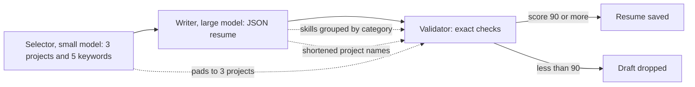

# Notes: Resume Generation Fix

## The flow and where it breaks

## Causes (2026-10-28, Claude)

Evidence: a reproduction (selector, writer, and validator for the two jobs of run `run_9743c03ff714`) from WSL with the real profile and the WSL Ollama. The script is outside the repository. Nothing was changed. The profile has 2 projects and 21 skills.

| | JPMorgan, `qwen2.5:7b` | RMA, `qwen2.5:7b` | JPMorgan, `qwen2.5:14b` |
|---|---|---|---|
| Selector's third project | `"None"` | an invented name | `"None"` |
| Writer's skills shape | `{"Soft Skills": [...], "Technical Skills": [...]}` | 5 category groups | `[{"category": ..., "skills": [...]}, ...]` |
| Writer's project names | exact | exact | shortened ("Agent-C", "Job Raider") |
| Validator | score 63, reject | score 25, reject | crash at `validator.py:116` |

1. **The selector must return 3 projects** (`selector.py:85` and the example at `:97-101`). With 2 profile projects, the model pads with `"None"` or invents one. The writer leaves it out (it must not invent content), and the validator reports `MISSING_PROJECT`. Nothing checks the selector's names against the profile.
2. **The writer prompt says "Group by category"** for skills (`resume_writer.py:107`). The models return a dict or a list of objects. A dict gives its keys when iterated, so the validator checks the category names as skills (`HALLUCINATED_SKILL`) and never checks the real skills. A list of objects makes `s.lower()` raise `'dict' object has no attribute 'lower'` (`validator.py:116`): this is the `qwen2.5:14b` error of run `run_4a13f7167ed1`.
3. **Project names must match exactly** (`validator.py:103`). A shortened name counts as missing.
4. **The score makes it worse.** Each category name counts as a failed item, and strict mode needs 90.

Side findings (in `tasks/backlog.md`): the GPU monitor printed "VRAM usage at 96%, falling back to CPU"; and Docker Compose started from WSL mounted an empty data folder.

## Decisions (2026-10-28)

1. The user moves implementation to a local model because of Cursor usage. This task is the first trial: four micro-handoffs, each one small change with its test given in full, in this order (MH-2 needs MH-1):
    - MH-1: `flatten_skills` and a flat-list prompt (cause 2).
    - MH-2: the validator uses `flatten_skills` and does not crash (cause 2).
    - MH-3: the selector keeps only profile projects (cause 1).
    - MH-4: the writer gives draft projects the profile's names (cause 3).
2. Cause 4 (the score) is not changed. With causes 1 to 3 fixed, the score counts only real issues.
3. Claude checks each micro-handoff: the diff, the named test, and a mutation proof. After MH-4, Claude runs the full gate and the reproduction again with the real profile.

## Dry run of the micro-handoffs (2026-10-28, Claude)

Before the handoffs went to the local agent, Claude applied them to a scratch copy of `apps/backend-py` in WSL (`/tmp/rgf`, not the repository), to make sure that a small model can follow them as written:

- The given test code passes black and ruff.
- Before the change, each new test file fails: MH-1 and MH-4 with an import error (the new function does not exist yet), MH-2 with 3 failures, MH-3 with 2 failures.
- After the changes that the handoffs describe, all 14 new tests pass, and the changed source passes black and ruff.
- Three code snippets were not black-formatted in the first draft; they are fixed, and `AGENT.md` now says to run `black` on the changed files before the checks.
- Each pytest run takes about 80 to 90 s from `/mnt/d` (mostly import time). The agent should run only the named test files.

## Check of MH-1 (2026-10-28, Claude, commit `8f25bf8`)

Done by GLM-5.3-Flash Free in opencode (hosted; zero retention and no training, per the OpenCode docs). The local `qwen2.5-coder:7b` could not be used: through Ollama it returned tool calls as plain text, and Ollama ran it with a 4096-token context.

- The commit changes only `src/generation/resume_writer.py` and the new `tests/unit/test_resume_writer_skills.py`. The test file is the same as the handoff, character for character.
- `flatten_skills` follows the rules of the handoff. It compares names with `casefold()` and also accepts tuples. The prompt line and rule 7 are as written. The inner helpers `add` and `walk` have no docstrings (`CLAUDE.md` asks for them); this is minor and not a reason to reject.
- Checks: the 6 tests pass (5 new and the existing fallback test), black and ruff pass, and the mypy gate has 0 new errors (180 known).
- Mutation proofs (fixed-string replace, count 1, checksum changed, restore matched): X1 a dict gives its keys; X2 duplicates compared with case; X3 no strip; X4 no `"skills"`-key branch; X5 the writer does not flatten; X6 the prompt asks for groups again. All 6 were caught.

Result: accept MH-1.

## Check of MH-2 (2026-10-29, Claude, commit `3847293`)

Started by `qwen3.5-4b-16k` in opencode, finished by GLM-5.3-Flash Free:

- The local 4B model wrote the test file and change 1 (the import), then opencode stopped the session twice with "Response still truncated after two output token limit continuations", also for a one-line change. A short request through the same API made it think for only 192 tokens and return a correct `edit` call, so the cause is probably opencode's long context for a 4B model, not the thinking mode by itself.
- An earlier try with Aider and `qwen2.5-coder-7b-16k` applied nothing: the model put the test code in a nested code fence instead of an edit block, and never wrote the validator changes.
- GLM made changes 2 to 4, ran the checks, and committed.

Findings:
- The commit changes only `validator.py` and the new test file. The validator diff is exactly the four changes of the handoff.
- The test file differs from the handoff in three docstring lines only: double backticks became single backticks (from the 4B model). The report said "verbatim". This does not change a test.
- Checks: 8 tests pass (3 new, 5 of MH-1), black and ruff pass, and the mypy gate has 0 new errors (180 known).
- Mutation proofs (fixed-string replace, count 1, checksum changed, restore matched): Y1 skills not flattened in the check, caught; Y2 keyword not made a string, caught; Y4 import removed, caught; Y3 the resume text not flattened, **not caught**. Y3 changes behaviour only when a grouped skills value reaches the validator directly (a category name then counts as found keyword text). After MH-1 the writer always gives a flat list, so the pipeline is not affected. The handoff had no test for change 4: a gap in the handoff, not in the agent's work.

Result: accept MH-2.

## Check of MH-3 (2026-10-29, Claude, commit `f3f4e6c`)

Done by GLM-5.3-Flash Free in opencode.

- The commit changes only `selector.py` and the new test file. The selector diff matches the handoff line for line (the helper, the `Any` import, `project_count`, the prompt line, the one-line JSON example, and the call in `SelectionOutput`). The test file is the same as the handoff, character for character.
- The commit was made while Claude's MH-2 mutations had `validator.py` changed in the same working tree; the agent staged only its two files, so nothing else went in.
- Checks: 2 tests pass, black and ruff pass, and the mypy gate has 0 new errors (180 known).
- Mutation proofs: Z1 no filtering, caught; Z2 names compared with case, caught; Z4 always 3 projects in the prompt, caught; Z5 reason dropped, caught; Z3 duplicates kept, **not caught**. Z3 lists a project twice when the model names it twice; the validator then finds it twice, so no draft fails. The handoff test has no duplicate: a gap in the handoff, not in the agent's work.

Result: accept MH-3.

## Blockers / Questions

- None. The micro-handoffs are with the local agent: `AGENT.md`, then `mh-1` to `mh-4`.
