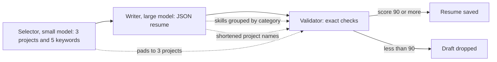

# Notes: Resume Generation Fix

## The flow and where it breaks

## Causes (2026-10-28, Claude)

Evidence: a reproduction (selector, writer, and validator for the two jobs of run `run_9743c03ff714`) from WSL with the real profile and the WSL Ollama. The script is outside the repository. Nothing was changed. The profile has 2 projects and 21 skills.

| | JPMorgan, `qwen2.5:7b` | RMA, `qwen2.5:7b` | JPMorgan, `qwen2.5:14b` |
|---|---|---|---|
| Selector's third project | `"None"` | an invented name | `"None"` |
| Writer's skills shape | `{"Soft Skills": [...], "Technical Skills": [...]}` | 5 category groups | `[{"category": ..., "skills": [...]}, ...]` |
| Writer's project names | exact | exact | shortened ("Agent-C", "Job Raider") |
| Validator | score 63, reject | score 25, reject | crash at `validator.py:116` |

1. **The selector must return 3 projects** (`selector.py:85` and the example at `:97-101`). With 2 profile projects, the model pads with `"None"` or invents one. The writer leaves it out (it must not invent content), and the validator reports `MISSING_PROJECT`. Nothing checks the selector's names against the profile.
2. **The writer prompt says "Group by category"** for skills (`resume_writer.py:107`). The models return a dict or a list of objects. A dict gives its keys when iterated, so the validator checks the category names as skills (`HALLUCINATED_SKILL`) and never checks the real skills. A list of objects makes `s.lower()` raise `'dict' object has no attribute 'lower'` (`validator.py:116`): this is the `qwen2.5:14b` error of run `run_4a13f7167ed1`.
3. **Project names must match exactly** (`validator.py:103`). A shortened name counts as missing.
4. **The score makes it worse.** Each category name counts as a failed item, and strict mode needs 90.

Side findings (in `tasks/backlog.md`): the GPU monitor printed "VRAM usage at 96%, falling back to CPU"; and Docker Compose started from WSL mounted an empty data folder.

## Decisions (2026-10-28)

1. The user moves implementation to a local model because of Cursor usage. This task is the first trial: four micro-handoffs, each one small change with its test given in full, in this order (MH-2 needs MH-1):
    - MH-1: `flatten_skills` and a flat-list prompt (cause 2).
    - MH-2: the validator uses `flatten_skills` and does not crash (cause 2).
    - MH-3: the selector keeps only profile projects (cause 1).
    - MH-4: the writer gives draft projects the profile's names (cause 3).
2. Cause 4 (the score) is not changed. With causes 1 to 3 fixed, the score counts only real issues.
3. Claude checks each micro-handoff: the diff, the named test, and a mutation proof. After MH-4, Claude runs the full gate and the reproduction again with the real profile.

## Dry run of the micro-handoffs (2026-10-28, Claude)

Before the handoffs went to the local agent, Claude applied them to a scratch copy of `apps/backend-py` in WSL (`/tmp/rgf`, not the repository), to make sure that a small model can follow them as written:

- The given test code passes black and ruff.
- Before the change, each new test file fails: MH-1 and MH-4 with an import error (the new function does not exist yet), MH-2 with 3 failures, MH-3 with 2 failures.
- After the changes that the handoffs describe, all 14 new tests pass, and the changed source passes black and ruff.
- Three code snippets were not black-formatted in the first draft; they are fixed, and `AGENT.md` now says to run `black` on the changed files before the checks.
- Each pytest run takes about 80 to 90 s from `/mnt/d` (mostly import time). The agent should run only the named test files.

## Blockers / Questions

- None. The micro-handoffs are with the local agent: `AGENT.md`, then `mh-1` to `mh-4`.
