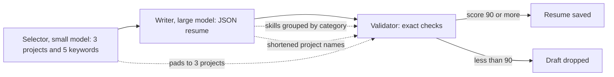
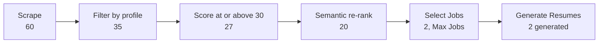

# Notes: Resume Generation Fix

## The flow and where it breaks

## Causes (2026-10-28, Claude)

Evidence: a reproduction (selector, writer, and validator for the two jobs of run `run_9743c03ff714`) from WSL with the real profile and the WSL Ollama. The script is outside the repository. Nothing was changed. The profile has 2 projects and 21 skills.

| | JPMorgan, `qwen2.5:7b` | RMA, `qwen2.5:7b` | JPMorgan, `qwen2.5:14b` |
|---|---|---|---|
| Selector's third project | `"None"` | an invented name | `"None"` |
| Writer's skills shape | `{"Soft Skills": [...], "Technical Skills": [...]}` | 5 category groups | `[{"category": ..., "skills": [...]}, ...]` |
| Writer's project names | exact | exact | shortened ("Agent-C", "Job Raider") |
| Validator | score 63, reject | score 25, reject | crash at `validator.py:116` |

1. **The selector must return 3 projects** (`selector.py:85` and the example at `:97-101`). With 2 profile projects, the model pads with `"None"` or invents one. The writer leaves it out (it must not invent content), and the validator reports `MISSING_PROJECT`. Nothing checks the selector's names against the profile.
2. **The writer prompt says "Group by category"** for skills (`resume_writer.py:107`). The models return a dict or a list of objects. A dict gives its keys when iterated, so the validator checks the category names as skills (`HALLUCINATED_SKILL`) and never checks the real skills. A list of objects makes `s.lower()` raise `'dict' object has no attribute 'lower'` (`validator.py:116`): this is the `qwen2.5:14b` error of run `run_4a13f7167ed1`.
3. **Project names must match exactly** (`validator.py:103`). A shortened name counts as missing.
4. **The score makes it worse.** Each category name counts as a failed item, and strict mode needs 90.

Side findings (in `tasks/backlog.md`): the GPU monitor printed "VRAM usage at 96%, falling back to CPU"; and Docker Compose started from WSL mounted an empty data folder.

## Decisions (2026-10-28)

1. The user moves implementation to a local model because of Cursor usage. This task is the first trial: four micro-handoffs, each one small change with its test given in full, in this order (MH-2 needs MH-1):
    - MH-1: `flatten_skills` and a flat-list prompt (cause 2).
    - MH-2: the validator uses `flatten_skills` and does not crash (cause 2).
    - MH-3: the selector keeps only profile projects (cause 1).
    - MH-4: the writer gives draft projects the profile's names (cause 3).
2. Cause 4 (the score) is not changed. With causes 1 to 3 fixed, the score counts only real issues.
3. Claude checks each micro-handoff: the diff, the named test, and a mutation proof. After MH-4, Claude runs the full gate and the reproduction again with the real profile.

## Dry run of the micro-handoffs (2026-10-28, Claude)

Before the handoffs went to the local agent, Claude applied them to a scratch copy of `apps/backend-py` in WSL (`/tmp/rgf`, not the repository), to make sure that a small model can follow them as written:

- The given test code passes black and ruff.
- Before the change, each new test file fails: MH-1 and MH-4 with an import error (the new function does not exist yet), MH-2 with 3 failures, MH-3 with 2 failures.
- After the changes that the handoffs describe, all 14 new tests pass, and the changed source passes black and ruff.
- Three code snippets were not black-formatted in the first draft; they are fixed, and `AGENT.md` now says to run `black` on the changed files before the checks.
- Each pytest run takes about 80 to 90 s from `/mnt/d` (mostly import time). The agent should run only the named test files.

## Check of MH-1 (2026-10-28, Claude, commit `8f25bf8`)

Done by GLM-5.3-Flash Free in opencode (hosted; zero retention and no training, per the OpenCode docs). The local `qwen2.5-coder:7b` could not be used: through Ollama it returned tool calls as plain text, and Ollama ran it with a 4096-token context.

- The commit changes only `src/generation/resume_writer.py` and the new `tests/unit/test_resume_writer_skills.py`. The test file is the same as the handoff, character for character.
- `flatten_skills` follows the rules of the handoff. It compares names with `casefold()` and also accepts tuples. The prompt line and rule 7 are as written. The inner helpers `add` and `walk` have no docstrings (`CLAUDE.md` asks for them); this is minor and not a reason to reject.
- Checks: the 6 tests pass (5 new and the existing fallback test), black and ruff pass, and the mypy gate has 0 new errors (180 known).
- Mutation proofs (fixed-string replace, count 1, checksum changed, restore matched): X1 a dict gives its keys; X2 duplicates compared with case; X3 no strip; X4 no `"skills"`-key branch; X5 the writer does not flatten; X6 the prompt asks for groups again. All 6 were caught.

Result: accept MH-1.

## Check of MH-2 (2026-10-29, Claude, commit `3847293`)

Started by `qwen3.5-4b-16k` in opencode, finished by GLM-5.3-Flash Free:

- The local 4B model wrote the test file and change 1 (the import), then opencode stopped the session twice with "Response still truncated after two output token limit continuations", also for a one-line change. A short request through the same API made it think for only 192 tokens and return a correct `edit` call, so the cause is probably opencode's long context for a 4B model, not the thinking mode by itself.
- An earlier try with Aider and `qwen2.5-coder-7b-16k` applied nothing: the model put the test code in a nested code fence instead of an edit block, and never wrote the validator changes.
- GLM made changes 2 to 4, ran the checks, and committed.

Findings:
- The commit changes only `validator.py` and the new test file. The validator diff is exactly the four changes of the handoff.
- The test file differs from the handoff in three docstring lines only: double backticks became single backticks (from the 4B model). The report said "verbatim". This does not change a test.
- Checks: 8 tests pass (3 new, 5 of MH-1), black and ruff pass, and the mypy gate has 0 new errors (180 known).
- Mutation proofs (fixed-string replace, count 1, checksum changed, restore matched): Y1 skills not flattened in the check, caught; Y2 keyword not made a string, caught; Y4 import removed, caught; Y3 the resume text not flattened, **not caught**. Y3 changes behaviour only when a grouped skills value reaches the validator directly (a category name then counts as found keyword text). After MH-1 the writer always gives a flat list, so the pipeline is not affected. The handoff had no test for change 4: a gap in the handoff, not in the agent's work.

Result: accept MH-2.

## Check of MH-3 (2026-10-29, Claude, commit `f3f4e6c`)

Done by GLM-5.3-Flash Free in opencode.

- The commit changes only `selector.py` and the new test file. The selector diff matches the handoff line for line (the helper, the `Any` import, `project_count`, the prompt line, the one-line JSON example, and the call in `SelectionOutput`). The test file is the same as the handoff, character for character.
- The commit was made while Claude's MH-2 mutations had `validator.py` changed in the same working tree; the agent staged only its two files, so nothing else went in.
- Checks: 2 tests pass, black and ruff pass, and the mypy gate has 0 new errors (180 known).
- Mutation proofs: Z1 no filtering, caught; Z2 names compared with case, caught; Z4 always 3 projects in the prompt, caught; Z5 reason dropped, caught; Z3 duplicates kept, **not caught**. Z3 lists a project twice when the model names it twice; the validator then finds it twice, so no draft fails. The handoff test has no duplicate: a gap in the handoff, not in the agent's work.

Result: accept MH-3.

## Check of MH-4 and the full check (2026-10-29, Claude, commit `03d60e8`)

MH-4 was done by GLM-5.3-Flash Free in opencode.

- The commit changes only `resume_writer.py` and the new test file. The diff matches the handoff line for line (`import re`, `_project_key`, `match_project_names`, and the call in `write`). The test file is the same as the handoff, character for character.
- MH-4 checks: 4 tests pass, black and ruff pass. Mutation proofs: P1 the "(...)" part is kept, P2 names compared with case, P3 the input item is changed, P4 the writer does not map names, P5 a name that matches nothing is dropped. All 5 were caught.
- Full backend gate after MH-4: black and ruff pass on the CI paths, the mypy gate has 0 new errors (180 known), and pytest has 1691 passed.

Result: accept MH-4.

### The reproduction again (WSL, the real profile, `qwen2.5:3b` and `qwen2.5:7b`, one model on the GPU at a time)

| | Before the fix | After MH-1 to MH-4 |
|---|---|---|
| Selector projects | 3, with `"None"` or an invented name | the 2 profile projects, exact names |
| Writer's skills | category groups (or a crash with `qwen2.5:14b`) | a flat list of strings |
| Writer's project names | sometimes shortened | exact |
| Missing projects or keywords | yes | none |
| Validator | reject (63 and 25), or a crash | reject, score 0 |

Causes 1 to 3 are fixed. The drafts now fail only on `HALLUCINATED_SKILL`: the writer lists 11 and 9 skills that are not in the profile. Some are the selector's job keywords ("AI", "Evaluation", "Scam Detection", "Scalability", "Data Pipeline"): the selector picks them from the job, and the writer prompt says "All keywords MUST be naturally incorporated", so the model puts them in the skills list. Others are invented ("Leadership", "Computer Science", "MySQL", "Neo4j", "Software Architecture"). Each one counts as a failed item against 7 checked items (2 projects and 5 keywords), so the score is 0.

This meets the reproduction part of "Done when" (the drafts fail only on real issues), but a full-mode run would still generate no resume.

Recommendation (needs the user's decision): one more micro-handoff, MH-5. After parsing, `ResumeWriter.write` keeps only skills that are in the profile (compared without case), and the prompt says that job keywords go in the summary and the bullets, not in the skills list. This makes sure that a resume never lists a skill that the user does not have. Cost: a real skill written in another way ("LLMs" for "Large Language Models") is dropped, not matched.

## MH-5 and MH-6 (2026-10-29, Claude)

The user asked for MH-5 (keep only profile skills). A writer filter alone would move the failure: the job keywords that the writer now puts in the skills list would leave the resume, and the validator would report them as `MISSING_KEYWORD`. The keywords come from the selector, so the fix is two micro-handoffs, one file each:

- MH-5 (`selector.py`): the keywords are only profile skills that the job asks for (`profile_skill_names`, `keep_profile_keywords`, and the prompt).
- MH-6 (`resume_writer.py`): the skills list keeps only profile skills and adds the selected keywords; when no skill is left, it uses the profile's skills. One existing MH-1 test changes ("SQL" to "Django"), because "SQL" is not in the sample profile; `AGENT.md` names this as the only allowed change to an existing test.

Dry run on a full scratch copy (`/tmp/rgf2`, not the repository):

- The given test code passes black and ruff. Before the changes, each new test file fails with an import error.
- After the changes, the 22 resume generation tests pass, and the 5 changed files pass black and ruff.
- The full suite on the scratch copy: 1687 passed, 11 failed. All 11 need files that the scratch copy does not have (`VERSION`, `scripts/dev.sh`, `docker-compose.yml`, the git history, the frontend Pipeline page, the notebooks); none is in the resume generation code.
- The reproduction on the scratch copy with the real profile (`qwen2.5:3b` and `qwen2.5:7b`, one model on the GPU at a time): both drafts **pass the validator with score 100 ("approve")**. The selector's keywords are profile skills ("Python", "Docker", "Convex", "Inngest", "FastAPI" for the first job; "Python" for the second), no skill outside the profile is listed, and no project or keyword is missing.

## Check of MH-5 (2026-10-29, Claude, commit `7e8a9b5`)

MH-5 was done by GLM-5.3-Flash Free in opencode. Before that, `qwen3.5-9b-16k` in opencode ran at 5 to 7 tokens per second and stopped before it changed `selector.py`. It wrote only the new test file, which is the same as the handoff.

- The commit changes only `selector.py` and the new test file. The diff matches the handoff line for line (`profile_skill_names`, `keep_profile_keywords`, the two prompt lines, and the call in `select`). The test file is the same as the handoff, character for character.
- Checks: 5 tests pass (3 new, 2 of MH-3). black and ruff pass on the CI paths. The mypy gate has 0 new errors (180 known). It also reports that 2 known errors are now fixed; the baseline is not updated.
- Mutation proofs (fixed-string replace, count 1, checksum changed, restore matched): K1 keyword compared with case, K2 a keyword that is not in the profile is kept, K3 duplicates kept, K4 the model's spelling kept, K6 an item that is not a string is not skipped, K7 `select` does not filter, K8 the prompt asks for job keywords again. All 7 were caught. The first K6 replace gave an indentation error; it was done again with `if False:` and was caught by a test failure.
- Not caught: K5 (a value that is not a list is iterated) and K9 (the input keyword is not stripped). With K5, a string value gives one item for each letter, and a letter is kept only when the profile has a one-letter skill (for example "R"); the sample profile has none. With K9, the test keywords have no spaces at the ends. Both are gaps in the handoff tests, not in the agent's work.

Result: accept MH-5.

## Check of MH-6 and the full check (2026-10-29, Claude, commit `7f7561c`)

MH-6 was done by DeepSeek in opencode.

- The commit changes `resume_writer.py`, the new test file, and the one allowed change in `test_resume_writer_skills.py` ("SQL" to "Django", two lines). The diff matches the handoff line for line (the import, `keep_profile_skills`, the call in `write`, and rule 7). The test file is the same as the handoff, character for character.
- MH-6 checks: the 22 resume generation tests pass. black and ruff pass.
- Mutation proofs (each on its own copy in WSL's native disk; the repository file did not change): W1 a skill that is not in the profile is kept, W2 skills compared with case, W3 keywords not added, W4 keywords before the model's skills, W5 duplicates kept, W6 no fallback to the profile skills, W7 `write` does not filter, W8 `write` passes no keywords, W9 rule 7 as before. All 9 were caught. W10 (the input skill is not stripped) was not caught: the test skills have no spaces at the ends, the same gap as K9.
- Full backend gate after MH-6: black and ruff pass on the CI paths, the mypy gate has 0 new errors (180 known; 2 known errors are now fixed, and the baseline is not updated), and pytest has 1698 passed (1691 before, and 7 new tests).

Result: accept MH-6.

### The reproduction after MH-1 to MH-6 (WSL, the real profile, `qwen2.5:3b` then `qwen2.5:7b`)

The script ran all selections with `qwen2.5:3b`, unloaded it, ran all drafts with `qwen2.5:7b`, and unloaded it. No model was loaded before or after.

| | After MH-1 to MH-4 | After MH-1 to MH-6 |
|---|---|---|
| Selector projects | the 2 profile projects, exact names | the same |
| Selector keywords | job keywords, also skills outside the profile | only profile skills (9 for the first job, 6 for the second) |
| Writer's skills | 11 and 9 skills that are not in the profile | 9 and 6 skills, all profile skills |
| Missing projects or keywords | none | none |
| Validator | reject, score 0 (`HALLUCINATED_SKILL`) | **approve, score 100, valid**, for both drafts |

This meets the reproduction part of "Done when". The full-mode dry run is still to do (the user).

Observation for the backlog (not a blocker): the prompt asks for up to 5 keywords, but the selector gave 9 and 6, because `keep_profile_keywords` does not limit the count. The two lists are almost the same, so some keywords can be profile skills that the job does not ask for. A later change can keep at most 5 keywords, and keep only skills that the job text names.

## The full-mode dry run (2026-10-29, the user, run `run_0e3dbf88`, `pipeline_run_20261029_144117.json`)

Settings: MyCareersFuture, Min Score 30, Max Jobs 2, Dry Run on. The run took 118 seconds.

- Generate Resumes: 2 attempted, 2 generated, 0 validation failures, average score 100. Cover letters: 1 saved, 1 needs review.
- The monitor shows "20 shortlisted". This is the ranked shortlist for the Jobs page (`len(rag_ranked_listings or scored_listings)` in `routes/pipeline.py`), not the jobs that Max Jobs selects. Max Jobs works: Select Jobs presented 2. The label is not clear (backlog).
- New bug: no PDF. `src/generation/formatter.py` calls `Spacer(0.1 * inch)` at 4 places, and the reportlab `Spacer` needs a width and a height (the other formatters use `Spacer(1, height)`). The backend log shows "PDF generation failed: Spacer.__init__() missing 1 required positional argument: 'height'" for each resume. The DOCX files are saved, so the stage reports success. The bug was in the code before the move to `apps/` (`84d4c5d`, 2026-07-09). No resume PDF was ever written, because no draft passed the validator before this task. No test covers the resume PDF (only `test_resume_formatter_docx.py`).

Result: the "Done when" dry run part is met with DOCX resumes. The PDF bug is open.

## Blockers / Questions

- The PDF bug in `formatter.py`: fix it in this task before the task closes.
