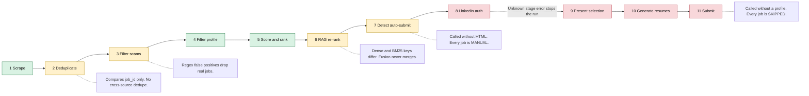
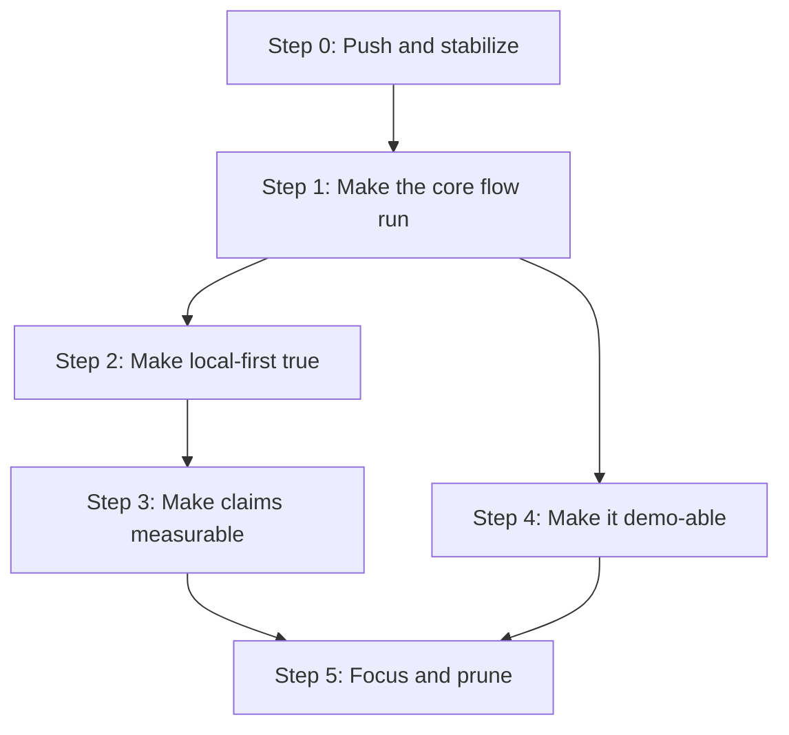

# Job Raider State Review (2026-10-18)

## 1. Summary

Job Raider has a large and well-tested base. The backend has 983 passing tests. Ruff and Black are clean. The design has good ideas: a stage contract, a deterministic grounding layer for cover letters, a duplicate-application guard, and dry-run defaults in every layer.

The review found three main problems:

1. **The core flow does not run end to end.** Full mode stops at stage 8 on every run. The CLI crashes at start. Auto-submit cannot be reached. Most recent work went into the cover-letter tools, not the core pipeline.
2. **The "local-first" claim is not true by default.** The LLM router sends prompts (which contain resume text) to Anthropic when any Ollama call fails. It does not log this. The API listens on all network interfaces and has no authentication by default.
3. **Many claims are asserted, not measured.** The README states an "80% cost reduction", a hybrid RAG ranker, a multi-agent system, and an A/B framework. The cost tracker is never called. The RAG fusion does not merge results. The agent system has one agent that makes no LLM calls. The A/B harness calls a method that does not exist.

These problems are fixable. Most fixes are small. Section 6 gives a step-by-step plan.

## 2. Scope and method

| Item | Value |
|------|-------|
| Commit reviewed | `7cf72be` (2 commits ahead of `origin/main`, not pushed, no CI run) |
| Backend source | 59,069 lines of Python in `apps/backend-py/src` |
| Frontend source | 25,613 lines of TypeScript in `apps/frontend-ts/src` |
| Tests | 20,616 lines of Python tests, 5,989 lines of TypeScript tests |
| Method | Local checks, four parallel read-only reviews, and manual checks of the most severe claims |

Local check results:

| Check | Result |
|-------|--------|
| `pytest tests/` | 983 passed, 0 failed, 4 min 8 s |
| Backend line coverage | 63% |
| `ruff check` | Clean |
| `black --check` | Clean |
| `mypy src/` | 195 errors in 55 files (CI hides this with `\|\| true`) |
| Frontend checks | Not run locally. `node_modules` is a partial install. The last CI run (2026-09-05) passed all frontend jobs. |

The "Verified" column in the tables below has two values:

- **Yes**: the reviewer of this report read the code or ran a check to confirm it.
- **Code read**: a sub-reviewer found it by reading code. It is likely correct but was not checked a second time.

## 3. Where the pipeline breaks

## 4. Findings

### 4.1 Critical: the core flow does not run end to end

| ID | Finding | Location | Verified |
|----|---------|----------|----------|
| C1 | `--interactive` is defined two times in argparse. The CLI raises `ArgumentError` before it runs. Every CLI command in the README fails. | `main.py:579`, `main.py:706` | Yes |
| C2 | `LINKEDIN_AUTH` is in the stage sequence but `_execute_stage` has no branch for it. Full mode always stops with "Unknown stage". Seven saved run records show this error. The integration test asserts only `result is not None`. | `orchestrator.py:316`, `orchestrator.py:561-642`, `tests/integration/test_pipeline.py:73-80` | Yes |
| C3 | Auto-submit cannot be reached. `detect_batch` gets no HTML, so every LinkedIn job is MANUAL. `submit_batch` gets no profile, so every job is SKIPPED. | `stages.py:525`, `stages.py:919` | Code read |
| C4 | If C3 is fixed, the safety guards do not hold. A new `SafetyController` is made per job, so daily and hourly limits never add up. `present_selection` selects the top N with no human step. Low-confidence form answers are submitted. | `submitter.py:310`, `stages.py:685`, `form_filler.py:184` | Code read |
| C5 | Tailored resumes are the headline feature, but the UI does not show generated resumes. | `apps/frontend-ts` (no consumer of `generated_resumes`) | Code read |

### 4.2 Local-first and security

| ID | Finding | Location | Verified |
|----|---------|----------|----------|
| S1 | **Silent cloud fallback.** 13 of 17 task routes fall back to Anthropic on any exception, including "Ollama is down". No log line or UI signal shows this. Resume text then leaves the machine when an Anthropic key is set. The `CloudProvider` enum has no "none" value. | `router.py:81-201`, `router.py:666-684`, `api/settings.py:28-48` | Yes |
| S2 | User Settings (model, host, fallback) apply only through `create_router()`. The pipeline, profile routes, and app start-up use a bare `LLMRouter()`. | `stages.py:109`, `orchestrator.py:189`, `profile.py:141` | Code read |
| S3 | No authentication by default. `.env.example` sets `ENVIRONMENT=development`, and the auth guard skips checks in development when `API_KEY` is empty. | `auth.py:51-58`, `.env.example:15` | Yes |
| S4 | The API binds to `0.0.0.0` in `dev.sh` and the Dockerfile. Compose publishes ports 8000 and 3000 on all interfaces. A device on the same network can read the resume. | `scripts/dev.sh:84`, `docker/Dockerfile:120`, `docker-compose.yml` | Yes |
| S5 | `GET /api/settings/` returns Anthropic and Gemini API keys in plaintext. The frontend client also logs every JSON request body to the browser console, including the Settings PUT. | `routes/settings.py:45-54`, `client.ts:148-154` | Yes (backend) |
| S6 | `ollama_host` is not validated. A changed host receives every prompt. | `api/settings.py:94-100` | Code read |
| S7 | No Host or Origin checks. A cross-site page can send multipart or body-less POSTs (profile upload, settings reset). DNS rebinding gives full access. | `api/main.py` (no `TrustedHostMiddleware`) | Code read |
| S8 | `profile_url` goes to Playwright `page.goto` in a logged-in session without validation (SSRF, `file:///`). | `linkedin_analysis.py:27`, `linkedin/session.py:372` | Code read |
| S9 | The LinkedIn session hides automation (webdriver override, random user agent per launch). This is against LinkedIn's User Agreement and can get the account restricted. Cookies, including `li_at`, are stored as plaintext JSON. | `linkedin/session.py:583-640` | Code read |

### 4.3 Confirmed correctness bugs (found by mypy)

CI makes mypy non-blocking, so these bugs are not caught. Each bug is in a module with low or zero test coverage.

| ID | Finding | Location |
|----|---------|----------|
| B1 | `WorkPace.FAST` does not exist (the member is `FAST_PACED`). The rule-based classifier raises `AttributeError` for any JD that contains "fast-paced". | `classifiers/job_classifier.py:606` |
| B2 | `Paragraph.add_run(..., bold=True)` is not a python-docx signature. DOCX resume export fails for every resume with experience. The error is caught and only logged. | `generation/formatter.py:535-563` |
| B3 | `Path.remove()` does not exist (use `unlink()`). Hard delete of a custom status raises. | `metrics/outcome_tracker.py:992` |
| B4 | `experiment.experiment_name` does not exist on an MLflow `Experiment`. Run listing always returns empty. | `metrics/mlflow_tracker.py:480` |
| B5 | `JobMatcher.match_and_score` does not exist. The A/B framework cannot run. | `experiments/ab_testing.py:223` |
| B6 | `profile.skills[:5].name` calls `.name` on a list. The resume fallback path raises. | `generation/resume_writer.py:285` |

### 4.4 Correctness risks (from code reading)

| ID | Finding | Location |
|----|---------|----------|
| R1 | The batch pipeline saves cover letters that fail grounding. Only the interactive path runs the repair loop. | `stages.py:779-834` |
| R2 | Dedupe compares `job_id` only. IDs carry a source prefix, so the same job from two sources is not merged. | `models/job_listing.py:397-416` |
| R3 | Scam regexes have no word boundaries. `pay.*to.*work` matches "competitive pay and the chance to work". `signal` matches "signal processing". Any description with "bitcoin" is rejected. | `scoring/scam_detector.py:118-131`, `:594` |
| R4 | Skill score goes down when matches go up (0 mentions scores 20/40, 1 mention scores 10/40). Keyword match is plain substring, so "ai" matches "email". | `scoring/matcher.py:238`, `:315-326` |
| R5 | Hybrid RAG: dense results use `job_id` and BM25 results use chunk IDs, so RRF never fuses them. Scores of retrieved and non-retrieved jobs are on different scales. | `rag/ranker.py:292-302`, `:406-485` |
| R6 | The async pipeline route calls the synchronous `orchestrator.run()`. This blocks the event loop for the whole run. Progress events show only start and end. Run state is in memory with 2 workers, so status polls can return 404. | `routes/pipeline.py:37`, `:94` |
| R7 | The submit stage matches `results[i]` to `generated_resumes[i]`, but results cover only auto-submit jobs. Dry-run results are saved as applied records. | `stages.py:924-945` |
| R8 | JSON state files are written without atomic replace or a lock. A corrupt applied record drops out of the duplicate guard. | `outcome_tracker.py:1548-1558`, `applied_tracker.py` |
| R9 | About 48 paths are relative to the working directory. This caused the stray root `data/` folder and the empty `apps/backend-py/backend-py/data` folders. | `stages.py:984`, `health_check.py:350`, `docker/docker-entrypoint.sh:32-45` |
| R10 | The frontend client retries every method, including POST, up to 3 times. TanStack Query adds one more retry. `/pipeline/start` and LLM generation can run more than once. | `apps/frontend-ts/src/lib/api/client.ts:169-256`, `providers.tsx:87` |
| R11 | Keywords and locations split on spaces. "New York" becomes `["New", "York"]`, and the backend searches "New". | `pipeline/page.tsx:153`, `search-bar.tsx:114` |
| R12 | Failed and cancelled runs show a green "Complete" badge. Cancel sets a flag but does not stop the run. | `pipeline/page.tsx:483-534`, `routes/pipeline.py:370` |
| R13 | No `num_ctx` is set for Ollama. JD extraction sends up to 50,000 characters. Truncated output falls back to rule-based parsing without notice. | `extractors/jd_extractor.py:232` |
| R14 | About 13 call sites parse LLM JSON with the regex `\{.*\}` and no schema check. | `selector.py:122`, `resume_parser.py:479`, `jd_extractor.py:278` |

### 4.5 ML engineering and evaluation

| ID | Finding | Location |
|----|---------|----------|
| M1 | `CostTracker.track_call` is never called. The cost page always shows zero. The "80% cost reduction" claim has no measurement. | `routes/metrics.py:24` |
| M2 | MLflow logs one experiment. Seven tracker methods are never called. No prompt hash, git SHA, or temperature is logged. | `metrics/mlflow_tracker.py:178-458` |
| M3 | The model-compare "winner" rests on 3 synthetic cases, 1 sample each at temperature 0.8, scored by the project's own validator. | `docs/decision-log.md:72` |
| M4 | No labeled golden set for grounding, scoring, or retrieval. The scam notebook has a sound method but has no saved outputs. | `notebooks/` |
| M5 | Scoring weights are hard-coded. `scoring_config.yaml`, `scrapers_config.yaml`, `search_config.yaml`, and `app_config.yaml` are not loaded. Outcomes (interview, reject) do not feed back into scoring. | `scoring/matcher.py:56-70` |
| M6 | The "multi-agent" system has one agent. It makes no LLM calls. The coordinator does not wait for tasks. | `agents/coordinator.py:353-355` |
| M7 | Grounding gaps: tokens of 3 characters or fewer are dropped, so a false "90%" claim can pass. "express", "spark", "swift", and "spring" are flagged as fabricated tech in normal English. | `cover_letter_grounding.py:413-414`, `cover_letter_validator.py:66-74` |
| M8 | Claude and Gemini model allowlists and prices are hard-coded and out of date. | `llm/claude_client.py:33-103` |

### 4.6 Frontend and product

| ID | Finding |
|----|---------|
| F1 | There is no demo mode. A visitor needs FastAPI, Ollama, and a resume. Without a backend, every page shows about 15 s of spinners and then "unreachable". |
| F2 | The sidebar has 13 entries. The core loop (Profile, Jobs, Tailor, Apply, Track) is mixed with DISC, Career Coach, Assessment, and Lab. Your own parked "Step E" of the Jobs desk item in `todo.md` already names this. |
| F3 | Types in `src/lib/types/api.ts` are written by hand and have drifted. Example: the UI allows `max_jobs` up to 500, but the backend allows 100. Only 19 of 86 routes declare a `response_model`. |
| F4 | Pages are god components. `cover-letter/page.tsx` has one 1,210-line function with 20 `useState` calls. |
| F5 | 30 `<Label>` elements are not linked to their inputs. 211 hard-coded color classes bypass the theme tokens. |
| F6 | The Applications, Settings, Assessment, Resume Analysis, and Metrics pages have no tests. Two test files assert nothing real. |

### 4.7 CI, setup, and repository hygiene

| ID | Finding |
|----|---------|
| H1 | Gates that cannot fail: mypy, bandit, and safety all use `\|\| true` or `continue-on-error`. E2E tests are not in the release `needs` list. There is no Dependabot, `pip-audit`, or `npm audit`. |
| H2 | Node 20 reached end of life in April 2026. CI and the frontend Dockerfile still use it. `setup-python@v4` and other actions are one or more majors behind. |
| H3 | There is no Python lock file. Every requirement uses `>=`. `dev.sh` does not update an existing `.venv`, which breaks the project rule. The local `.venv` is Python 3.12 but `.python-version` says 3.11. |
| H4 | On a fresh clone, the frontend `.env.example` is ignored by `.env*`. `setup.sh` writes `API_KEY=your_api_key_here`, which is a public string. |
| H5 | Two commits (46 files, 4,845 lines added) are not pushed and have no CI run. |
| H6 | The 8 "modified" frontend files differ only in line endings (CRLF). `.gitattributes` does not pin LF for `.ts` and `.tsx`. Prettier fails on 4 of them. |
| H7 | `frontend-py/` (about 5,000 lines of Streamlit) is dead. It is not in CI, compose, or setup. It breaks the `apps/` rule. |
| H8 | Dead layers: the SQLAlchemy and Alembic Supabase models are not imported outside `src/database`. `reports/report_generator.py` is used only by its own `__main__`. |
| H9 | README numbers are stale: "504 passed" (now 983), "51 passed across 10 test files" (now about 199 in 38 files), "10 pages" (now 14). |
| H10 | `tasks/todo.md` was 5,062 lines. It was hard to see what was open. Fixed on 2026-10-18: completed work moved to `tasks/archive/todo-done.md`. |

## 5. Strengths to keep

- **Stage contract.** Each stage returns a `StageResult`. RAG re-rank falls back to heuristic scores.
- **Duplicate-application guard.** `AppliedGuard` matches by ID, then URL, then company and title.
- **Deterministic cover-letter grounding.** It has an alias-normalized tech allowlist, claim extraction that ignores disclaimers, experience years from merged date intervals, and severity-weighted penalties in a generate, validate, and repair loop. This is the most original part of the project.
- **Safe defaults.** Dry run is on in every layer. Non-dry-run `/jobs/{id}/apply` returns 501. The UI says "Simulate Apply".
- **Responsible Singapore sources.** MyCareersFuture uses the public government API. Careers@Gov reads the public OpenGovSG dump. Each source has a kill switch.
- **Frontend data layer.** TanStack Query is used almost everywhere. The API key stays on the server through the Next proxy.
- **Operations.** Gitleaks scans full history. The CI token has least privilege. The log buffer redacts secrets. The model-compare harness loads one model at a time to protect 8 GB of VRAM.

## 6. Recommended plan

The steps are in order of value. Each step is small enough for one or two pull requests. The same steps are tracked in `tasks/todo.md` under "Review follow-up (2026-10-18)".

### Step 0: Push and stabilize (effort: S)

- [ ] Add `*.ts text eol=lf` and `*.tsx text eol=lf` to `.gitattributes`. Renormalize the 8 CRLF files.
- [ ] Run the full local check set. Push the 2 local commits so CI runs on them.

### Step 1: Make the core flow run (effort: S to M)

- [ ] Remove the duplicate argparse block in `main.py`. Fix `profile.target_job` to `profile.targets`. Add a CLI smoke test.
- [ ] Make one stage registry that the orchestrator, the API, and `requests.py` share. Add the `LINKEDIN_AUTH` handler. Make the full-run test assert `success`.
- [ ] Fix B1 to B6. Then make mypy a real gate with a baseline file, so new errors fail CI.
- [ ] Send the batch pipeline through `cover_letter_service`, so it uses the repair loop (R1).
- [ ] Run the orchestrator with `asyncio.to_thread`. Send real stage events. Use 1 worker or persist run state (R6).
- [ ] Retry only GET and HEAD in `client.ts`. Split list inputs on commas only (R10, R11).

### Step 2: Make local-first true (effort: S)

- [ ] Add `CloudProvider.NONE` and make it the default. Log and return the provider on every LLM call. Show a UI badge when a cloud model was used.
- [ ] Use one router factory everywhere. Add a test that fails if code builds a bare `LLMRouter()`.
- [ ] Bind to `127.0.0.1` in `dev.sh`, compose, and `next dev`. Do not publish the backend port from compose.
- [ ] Generate a random `API_KEY` in `setup.sh` and write it to both env files. Require an explicit `AUTH_DISABLED=1` to skip auth.
- [ ] Return `has_key` flags instead of raw keys from `GET /api/settings/`. Stop logging request bodies in the browser.
- [ ] Add `TrustedHostMiddleware` and an Origin check in the Next proxy. Allowlist `ollama_host`. Validate `profile_url`.

### Step 3: Make claims measurable (effort: M)

- [ ] Call `CostTracker.track_call` from the router. If the numbers do not support "80% cost reduction", remove the claim.
- [ ] Build a golden set of 50 to 100 labeled cover letters. Include fabricated numbers, homonyms ("Spark", "Swift"), and prompt-injection JDs. Log precision and recall per check to MLflow with the prompt hash and git SHA.
- [ ] Fix the RAG key mismatch and score scales. Label 30 to 50 profile and job pairs. Report NDCG@10 for heuristic, dense, and hybrid.
- [ ] Run the scam notebook. Tune the threshold on a held-out split. Log the results to MLflow.
- [ ] Add schema-constrained output (Ollama `format` with a Pydantic schema). Set `num_ctx` per task.
- [ ] After the eval exists, use the harness to compare current local models against qwen2.5.

### Step 4: Make it demo-able (effort: M)

- [ ] Add a demo mode with MSW in the browser. Seed a profile, a scored shortlist with match reasons, a cover letter with grounding results, and tracked applications.
- [ ] Deploy the demo as a static site. Add a short GIF and an architecture diagram to the top of the README.
- [ ] Add an onboarding checklist on the dashboard that reads real state.

### Step 5: Focus and prune (effort: S to M)

- [ ] Group the sidebar into the core loop and a collapsed "Extras" group. Cut themes to 2 or 3.
- [ ] Delete `frontend-py/`, root `data/`, `experiments/ab_testing.py`, the unused agent bus, the unused Supabase layer, and dead YAML config. Or wire each one up and test it.
- [ ] Decide on LinkedIn Easy Apply. Option A: remove the anti-detection code and keep it as a human-in-the-loop assistant. Option B: remove it. Focus on public sources and on tailoring.
- [ ] Split `stages.py`, `outcome_tracker.py`, and `cover-letter/page.tsx` into smaller modules.
- [x] Move done items out of `tasks/todo.md` into an archive file. Done on 2026-10-18: see `tasks/archive/todo-done.md`.

## 7. Resume framing

The strongest story is not "automated job applications". Many projects claim that, and auto-apply has legal and ethical risk. The strongest story is: **"a local-first LLM system with measured, deterministic guards against hallucination."**

After Step 2 and Step 3, these bullet points are true and can be defended in an interview:

- Built a local-first job-search pipeline (FastAPI, Next.js, Ollama) that keeps resume data on the device, with opt-in cloud fallback.
- Designed a deterministic grounding validator for LLM cover letters. Measured precision and recall on a labeled set of N letters, tracked in MLflow.
- Built hybrid retrieval (BM25, dense embeddings, RRF). Measured NDCG@10 against a heuristic baseline.
- Shipped with about 1,000 backend tests and CI gates for lint, types, security scanning, and E2E tests.

Do not claim numbers (cost reduction, accuracy) that no code measures. Interviewers ask about them.
