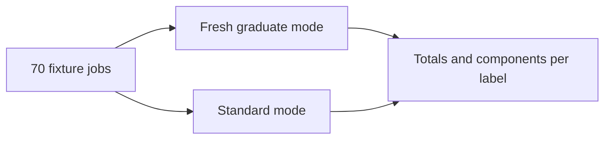
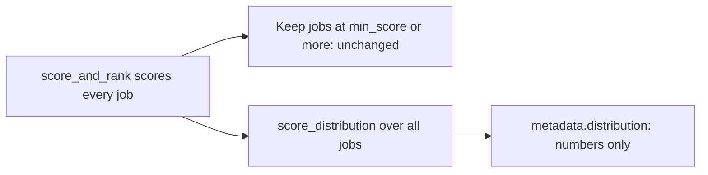
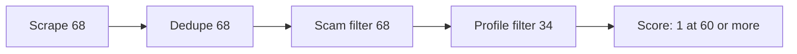
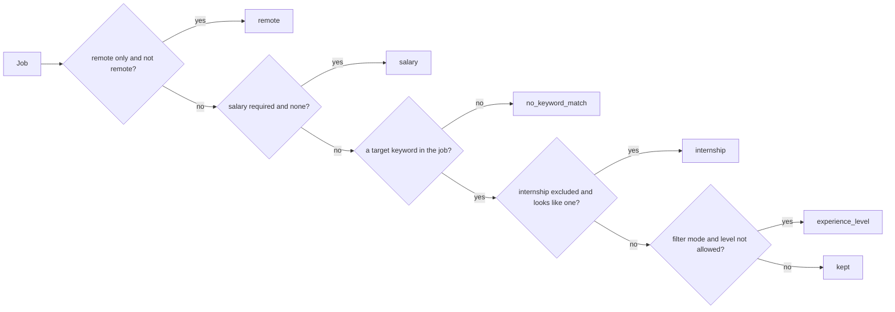
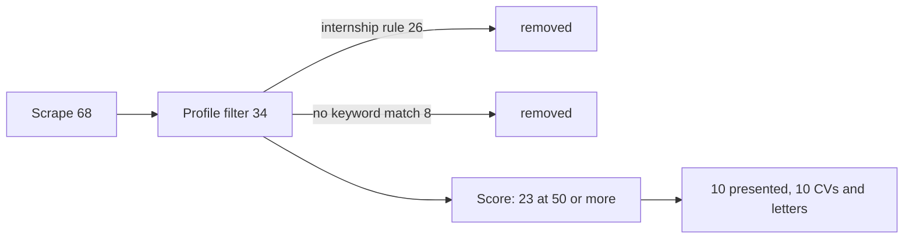
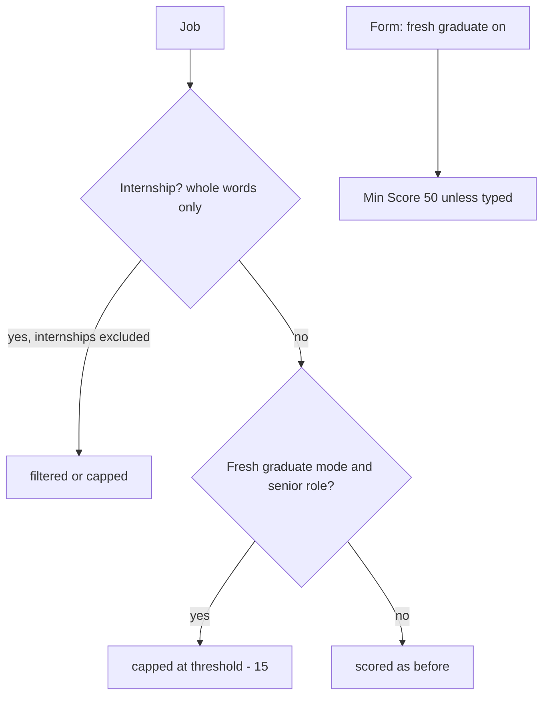
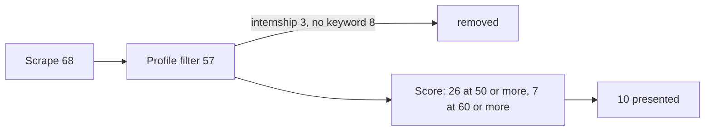

# Notes: scoring-calibration

Planned 2026-11-15 on the laptop, from the Next Up item in `tasks/todo.md` (pipeline test of 2026-11-14).

## Fixture measurement (2026-11-15)

The 70 ranking jobs (`tests/fixtures/eval/ranking/`), scored with `JobMatcher` for each profile in both modes. Labels: 2 apply, 1 maybe, 0 not relevant. Component means are points (weights in brackets).

`fresh_ml` (a fresh graduate profile), fresh graduate mode (projects 35, skills 30, education 20, experience 10, location 5; matcher threshold 50):

| Label | Jobs | Min / median / max | At 50 or more | At 60 or more | Projects | Skills | Education | Experience | Location | Jobs without a skill list |
|---|---|---|---|---|---|---|---|---|---|---|
| 2 | 8 | 35 / 59 / 78 | 6 | 4 | 12.5 | 25.1 | 15 | 10.0 | 5 | 3 (median 58) |
| 1 | 19 | 32 / 53 / 76 | 12 | 3 | 12.4 | 13.1 | 15 | 6.9 | 5 | 0 |
| 0 | 43 | 29 / 32 / 59 | 8 | 0 | 8.3 | 4.1 | 15 | 4.7 | 5 | 8 (median 53) |

`fresh_ml`, standard mode (keyword 30, skills 40, experience 20, location 10; threshold 60): label 2 median 68.5, 6 of 8 at 60 or more; label 1: 1 of 19; label 0: 1 of 43.

`mid_backend` (standard profile), standard mode: label 2 median 80, 10 of 11 at 60 or more; label 1: 6 of 18; label 0: 1 of 41. In fresh graduate mode: label 2 median 58, 5 of 11 at 60 or more.

Findings:
- At the pipeline cut-off 60, fresh graduate mode passes only 4 of 8 apply jobs (standard mode: 6 of 8). This matches the live run (1 of 59 passed).
- A cut-off of 50 alone is not safe: it passes 8 of 43 not-relevant jobs. The 8 not-relevant jobs without a skill list have a median of 53: the fallback credit for jobs without a skill list lifts them.
- Projects do not separate the labels: mean 12.5 (apply) against 12.4 (maybe) of 35.
- Education (15 of 20) and location (5 of 5) are the same for every job: 20 fixed points that lift every total and do not help the order.
- The live run must show how many real postings have no skill list; that decides how much the fallback matters.

## Code change A on a scratch clone (2026-11-15)

- New `src/scoring/distribution.py`, `score_distribution(pairs)`: `count`, `bands` (10-point bands, 100 in "90-100"), `at_or_above_50`, `at_or_above_60`, `component_means` (over all scored jobs), `without_skill_list` (`count`, `median`, the two cut counts). Numbers only; no job text, no profile data. A score without a breakdown dict still counts in the bands.
- `stages_rank.py`, `stage_score_and_rank`: keeps every `(job, score)` pair in `all_scored` and adds `metadata["distribution"] = score_distribution(all_scored)`. The kept jobs, their order, and the other metadata keys do not change.
- Tests: `test_score_distribution.py` (6): bands and cut counts; component means over all jobs; jobs without a skill list apart; no jobs; a score without a breakdown; the stage metadata covers a job below the cut-off while the stage result keeps only the job above it. Red: collection error (no module). Green: 6 passed.
- Checks on the clone: stage and orchestrator tests (39), ranking pins (10), black (after formatting `distribution.py`), ruff, mypy gate (0 new), full backend pytest (2419 passed).
- Reading the live run: `GET /api/pipeline/results/{run_id}` returns each stage's `metadata`; agents print only `score_and_rank.metadata.distribution`.

## Code change A applied (2026-11-15)

Applied after "Yes, apply it" (commit "feat(scoring): record the score distribution of every scored job"); the files on `main` are the same as on the clone. On `main`: 39 stage tests and ranking pins, black, ruff, mypy gate (0 new), full backend pytest (2419 passed). Not pushed yet.

## Live run (2026-11-15, user, `run_fc52416bf9ce`)

Settings as on 2026-11-14: full mode, dry run, MyCareersFuture, Singapore, Max Jobs 2, Min Score 60, fresh graduate scoring on. Read through `GET /api/pipeline/results/{run_id}` (stage counts and `score_and_rank.metadata.distribution` only, with the user's approval).

| Band | 20-29 | 30-39 | 40-49 | 50-59 | 60-69 | 70 or more |
|---|---|---|---|---|---|---|
| Jobs | 1 | 3 | 7 | 22 | 1 | 0 |

- 34 scored: 23 at 50 or more, 1 at 60 or more (61). The run made 1 CV and 1 letter (Max Jobs 2).
- Component means (fresh graduate mode): projects 5.9 of 35, skills 19.3 of 30, education 17.0 of 20, experience 3.1 of 10, location 5.0 of 5.
- Jobs without a skill list: 0 of 34. The fallback credit that lifted not-relevant fixture jobs does not occur in this run (MyCareersFuture gives skills).

Findings:
- The immediate cause is the cut-off: 22 of 34 jobs are in 50-59. The matcher's own fresh graduate threshold (50) would pass 23 instead of 1.
- Projects give almost nothing (5.9 of 35, mostly the base credit): project points come only from overlap with the job's skill list. Experience is low (3.1 of 10).
- The totals are close together (22 jobs inside 10 points), so the scores separate the jobs weakly, and the exact cut-off decides much.

## Code change B on a scratch clone: removal counts of the profile filter (2026-11-15)

The user asked where the other 34 of 68 jobs went: the profile filter removed them before scoring, and the run recorded only the totals.

- `src/scoring/filter.py`: `REMOVAL_RULES`; `FilterResult.rejected_by`; `filter_collection` counts `remote`, `salary`, `no_keyword_match`; `_apply_preference_constraints` adds `internship` and `experience_level`. The counts go into the collection metadata as `removed_by` (all five rules, also with zero). A job counts under the first rule that removes it, in the order of the existing checks. The kept jobs do not change.
- `src/pipeline/stages_collect.py`: the filter stage copies `removed_by` into its metadata.
- Tests: `test_filter_removal_counts.py` (6): one per rule (except salary, which the pipeline does not turn on), the counts add up to the removed jobs, and the stage metadata has the counts. Red: all 6 fail without the change (the stage test checked alone: `pytest.ini` has `--maxfail=5`, so the first red run stopped after 5 failures and did not run the sixth test). Green: 6 passed.
- Checks on the clone: filter, scorer, and stage tests (51), black, ruff, mypy gate (0 new), full backend pytest (2425 passed).
- Seen in the code, not changed: the internship text markers include `" intern"` without a word end, so "internal" and "international" also match. The counts show whether this rule removes many jobs.

## Code change B applied; rerun at Min Score 50 (2026-11-15, user, `run_5dbd023e8f89`)

Change B applied after "Yes, apply it" (commit "feat(scoring): count the jobs that each profile filter rule removes"); on `main`: 47 filter, scorer, and stage tests, black, ruff, mypy gate (0 new), full backend pytest (2425 passed). App restarted (`make app` has no reload). Rerun settings: as before, but Min Score 50 and Max Jobs 10.

| Stage | Result |
|---|---|
| Profile filter, removed per rule | internship 26, no_keyword_match 8, remote 0, salary 0, experience_level 0 |
| Score and rank (cut-off 50) | 34 scored, 23 passed (was 1 at 60), mean of passed 55, best 61 |
| Score distribution | the same as the previous run (bands, component means) |
| Generation | 10 presented, 10 CVs (validation mean 100), 10 letters: 5 saved, 5 need review |

Findings:
- The internship rule removed 26 of 68 jobs (38 %), more than the keyword rule (8). Either the searches return many real internships, or the text markers match words such as "internal" and "international" (`" intern"` has no word end). The counts do not say which.
- At cut-off 50, 23 of 34 scored jobs pass. The user judges whether the presented jobs fit.
- The score distribution is the same in both runs: the scoring is deterministic for the same jobs.

## User judgement of the rerun (2026-11-15)

The user read some of the 10 presented jobs: few fit. Several were senior roles; the user wants junior or fresh-graduate-friendly roles.

## Cause of the senior roles (code reading, 2026-11-15)

- `_score_experience` (fresh graduate weight 10): for 0 to 1 years of experience, a senior job (5 to 10 years) gets 1 point, a mid job 4, an unspecified level 5, an entry job 10. A senior job loses only 9 points. Skills, education, and location give about 41 points on their own (live means 19.3 + 17.0 + 5.0), so a senior job with matching skills passes 50. The live experience mean (3.1 of 10) shows that many scored jobs were mid or senior.
- MyCareersFuture level mapping (`_map_position_levels`): "Junior Executive" maps to MID (the check for "executive" comes before "junior"); "Fresh/entry level" maps to nothing, so the level comes from the minimum years.
- The internship cap already exists (`score_job`: total capped at threshold - 15 when the profile excludes internships and the job looks like one). There is no such cap for senior jobs.

## Proposed change C (for the user's choice)

| Part | Change |
|---|---|
| C1 | Fresh graduate mode: cap the total of senior, lead, principal, and executive jobs at threshold - 15, as for internships |
| C2 | MyCareersFuture mapping: "Fresh/entry level" to ENTRY; check "junior" before "executive" |
| C3 | Internship text markers: whole words only ("intern", "internship", "interns"), so "internal" and "international" do not match |
| C4 | The default pipeline cut-off follows the mode: the matcher threshold (50 in fresh graduate mode, 60 otherwise) when the user does not set Min Score |
| Measurement | The score distribution also counts the scored jobs per experience level (numbers only) |

Guards (from the plan): ranking pins not below; `fresh_ml` label-0 jobs above the cut-off at most +2 of 43; a live rerun with the same settings, judged by the user.

## Change C on a scratch clone (2026-11-15; the user chose all four parts)

- C1 (`matcher.py`): `SENIOR_LEVELS`, `SENIOR_TITLE_RE`, `is_senior_role()`. In fresh graduate mode a senior, lead, principal, or executive job (or a senior title word when the level is not given) is capped at threshold - 15 and does not pass, as the existing internship cap does. Standard mode does not change.
- C2 (`mycareersfuture_scraper.py`): "Fresh/entry level", "Junior Executive", and "Non-executive" map to ENTRY (checked before "executive").
- C3 (`filter.py`): the internship text check is a whole-word regex (`intern`, `interns`, `internship`, `internships`); "internal", "international", and "internet" no longer match.
- C4 (`apps/frontend-ts/src/app/pipeline/page.tsx`): turning fresh graduate scoring on sets Min Score to 50, off to 60, unless the user has typed a value. The Min Score label is linked to its input (`htmlFor`/`id`).
- Measurement: `score_distribution` also counts the scored jobs per experience level (`levels`).
- Tests: backend `test_fresh_grad_seniority.py` (22): red 11 failed (C1 5, C2 3, C3 2, levels 1), 11 guard cases passed; green 22 passed. Frontend `page.test.tsx` (+3): red 3 failed; green 9 passed.
- Ranking suite (heuristic): `fresh_ml` NDCG@10 0.7667 to 0.8621, recall@10 0.500 to 0.625; `mid_backend` unchanged. The pin test asked to tighten; `thresholds.json` now pins 0.8621 and 0.625, with MLflow run `eb4fb12da48e4d47a75e1c1206cfaf33` (logged from the clone to the local store).
- Fixtures, `fresh_ml`, fresh graduate mode: label 2 at 50 or more 7 of 8 (was 6), at 60 or more 5 of 8 (was 4); label 0 at 50 or more 7 of 43 (was 8; guard: at most 10), maximum 53 (was 59).
- Checks on the clone: black, ruff, mypy gate (0 new), full backend pytest 2447 passed; vitest 388 passed (70 files), eslint, tsc, prettier, Next.js build pass. E2E: see below.
- E2E (Playwright) on the laptop could not run, so it is not a result:
  - First try: the app suite found port 3000 in use (the user's `make app`); the demo suite had no demo build. Fix: `PLAYWRIGHT_PORT=3200`, and `npm run build:demo` first.
  - Second try: Playwright 1.60.0 needs Chromium build 1223; WSL had build 1255 only. With the user's approval, `npx playwright install chromium` downloaded build 1223 (into the user cache, outside the repository).
  - Third try: the browser does not start: "error while loading shared libraries: libasound.so.2". The system libraries come from `sudo npx playwright install-deps chromium` (apt), a system change for the user to decide.

## Change C applied; rerun (2026-11-15, user, `run_0f3302c64278`)

Applied after the user's choice "Apply, leave to CI" (commit "feat(scoring): keep senior roles out of fresh graduate results"); the files on `main` are the same as on the clone. On `main`: 50 suite tests, black, ruff, mypy gate (0 new), full backend pytest (2447 passed), vitest (388), eslint, tsc, prettier. App restarted. Settings: as before; Min Score 50 came from the form (C4); Max Jobs 10.

| | Before change C (`run_5dbd023e8f89`) | After change C |
|---|---|---|
| Removed by the internship rule | 26 | 3 |
| Kept by the profile filter | 34 | 57 |
| At 50 or more / at 60 or more | 23 / 1 | 26 / 7 |
| Bands 30-39 / 50-59 / 60-69 | 3 / 22 / 1 | 20 / 19 / 7 |
| Levels of the scored jobs | not recorded | Entry 5, Mid 34, Senior 9, Lead 8, Executive 1 |
| Letters saved / need review | 5 / 5 | 7 / 3 |

Findings:
- 23 of the 26 jobs that the internship rule removed were not internships: the substring markers matched words such as "internal" and "international". The whole-word check (C3) keeps them.
- The 18 senior, lead, and executive jobs are capped (the band 30-39 grew from 3 to 20). No senior job passes.
- The jobs that pass are entry and mid level. Mid level on MyCareersFuture is "Executive" or "Professional" (often 2 to 5 years). The user judges whether these fit.
- Component means are almost the same (projects 5.9, skills 18.6, education 17.0, experience 3.6, location 5.0): projects still give little.
- The Playwright suites are left to CI (user's choice).

## Gap in C1, seen in the shortlist (2026-11-15)

The shortlist of `run_0f3302c64278` still has "Senior Software Engineer - KT" and "Senior Full Stack Software Engineer". C1 reads the title only when the job states no level; these jobs state Mid Level (MyCareersFuture "Executive" or "Professional"), so the "Senior" title word was not used. Proposed fix (C1b, for the user's choice): in fresh graduate mode a senior title word caps the job also when the stated level is Mid Level.
