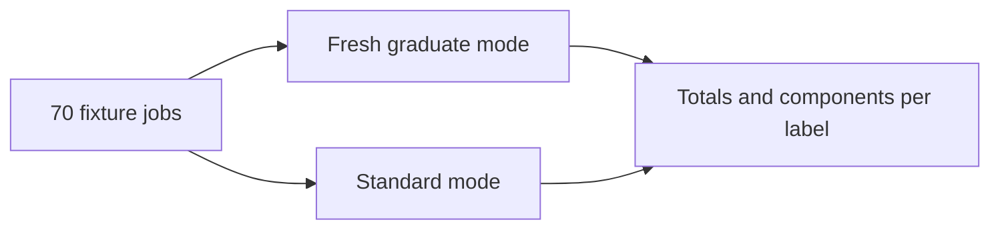
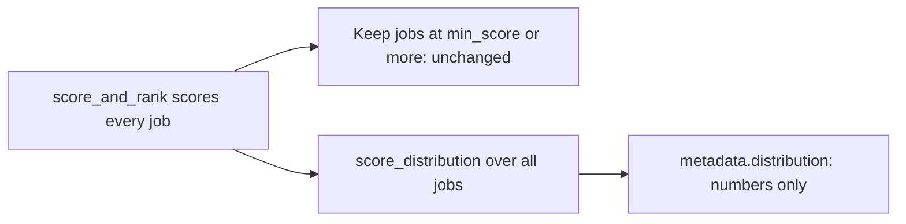
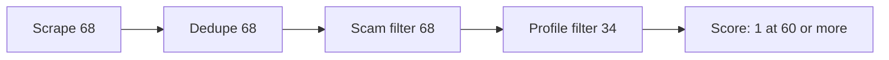
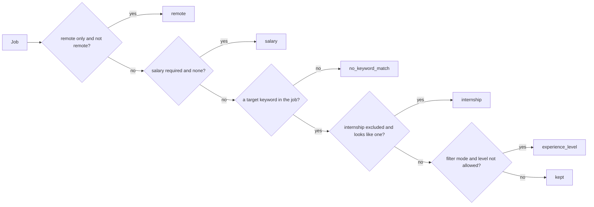

# Notes: scoring-calibration

Planned 2026-11-15 on the laptop, from the Next Up item in `tasks/todo.md` (pipeline test of 2026-11-14).

## Fixture measurement (2026-11-15)

The 70 ranking jobs (`tests/fixtures/eval/ranking/`), scored with `JobMatcher` for each profile in both modes. Labels: 2 apply, 1 maybe, 0 not relevant. Component means are points (weights in brackets).

`fresh_ml` (a fresh graduate profile), fresh graduate mode (projects 35, skills 30, education 20, experience 10, location 5; matcher threshold 50):

| Label | Jobs | Min / median / max | At 50 or more | At 60 or more | Projects | Skills | Education | Experience | Location | Jobs without a skill list |
|---|---|---|---|---|---|---|---|---|---|---|
| 2 | 8 | 35 / 59 / 78 | 6 | 4 | 12.5 | 25.1 | 15 | 10.0 | 5 | 3 (median 58) |
| 1 | 19 | 32 / 53 / 76 | 12 | 3 | 12.4 | 13.1 | 15 | 6.9 | 5 | 0 |
| 0 | 43 | 29 / 32 / 59 | 8 | 0 | 8.3 | 4.1 | 15 | 4.7 | 5 | 8 (median 53) |

`fresh_ml`, standard mode (keyword 30, skills 40, experience 20, location 10; threshold 60): label 2 median 68.5, 6 of 8 at 60 or more; label 1: 1 of 19; label 0: 1 of 43.

`mid_backend` (standard profile), standard mode: label 2 median 80, 10 of 11 at 60 or more; label 1: 6 of 18; label 0: 1 of 41. In fresh graduate mode: label 2 median 58, 5 of 11 at 60 or more.

Findings:
- At the pipeline cut-off 60, fresh graduate mode passes only 4 of 8 apply jobs (standard mode: 6 of 8). This matches the live run (1 of 59 passed).
- A cut-off of 50 alone is not safe: it passes 8 of 43 not-relevant jobs. The 8 not-relevant jobs without a skill list have a median of 53: the fallback credit for jobs without a skill list lifts them.
- Projects do not separate the labels: mean 12.5 (apply) against 12.4 (maybe) of 35.
- Education (15 of 20) and location (5 of 5) are the same for every job: 20 fixed points that lift every total and do not help the order.
- The live run must show how many real postings have no skill list; that decides how much the fallback matters.

## Code change A on a scratch clone (2026-11-15)

- New `src/scoring/distribution.py`, `score_distribution(pairs)`: `count`, `bands` (10-point bands, 100 in "90-100"), `at_or_above_50`, `at_or_above_60`, `component_means` (over all scored jobs), `without_skill_list` (`count`, `median`, the two cut counts). Numbers only; no job text, no profile data. A score without a breakdown dict still counts in the bands.
- `stages_rank.py`, `stage_score_and_rank`: keeps every `(job, score)` pair in `all_scored` and adds `metadata["distribution"] = score_distribution(all_scored)`. The kept jobs, their order, and the other metadata keys do not change.
- Tests: `test_score_distribution.py` (6): bands and cut counts; component means over all jobs; jobs without a skill list apart; no jobs; a score without a breakdown; the stage metadata covers a job below the cut-off while the stage result keeps only the job above it. Red: collection error (no module). Green: 6 passed.
- Checks on the clone: stage and orchestrator tests (39), ranking pins (10), black (after formatting `distribution.py`), ruff, mypy gate (0 new), full backend pytest (2419 passed).
- Reading the live run: `GET /api/pipeline/results/{run_id}` returns each stage's `metadata`; agents print only `score_and_rank.metadata.distribution`.

## Code change A applied (2026-11-15)

Applied after "Yes, apply it" (commit "feat(scoring): record the score distribution of every scored job"); the files on `main` are the same as on the clone. On `main`: 39 stage tests and ranking pins, black, ruff, mypy gate (0 new), full backend pytest (2419 passed). Not pushed yet.

## Live run (2026-11-15, user, `run_fc52416bf9ce`)

Settings as on 2026-11-14: full mode, dry run, MyCareersFuture, Singapore, Max Jobs 2, Min Score 60, fresh graduate scoring on. Read through `GET /api/pipeline/results/{run_id}` (stage counts and `score_and_rank.metadata.distribution` only, with the user's approval).

| Band | 20-29 | 30-39 | 40-49 | 50-59 | 60-69 | 70 or more |
|---|---|---|---|---|---|---|
| Jobs | 1 | 3 | 7 | 22 | 1 | 0 |

- 34 scored: 23 at 50 or more, 1 at 60 or more (61). The run made 1 CV and 1 letter (Max Jobs 2).
- Component means (fresh graduate mode): projects 5.9 of 35, skills 19.3 of 30, education 17.0 of 20, experience 3.1 of 10, location 5.0 of 5.
- Jobs without a skill list: 0 of 34. The fallback credit that lifted not-relevant fixture jobs does not occur in this run (MyCareersFuture gives skills).

Findings:
- The immediate cause is the cut-off: 22 of 34 jobs are in 50-59. The matcher's own fresh graduate threshold (50) would pass 23 instead of 1.
- Projects give almost nothing (5.9 of 35, mostly the base credit): project points come only from overlap with the job's skill list. Experience is low (3.1 of 10).
- The totals are close together (22 jobs inside 10 points), so the scores separate the jobs weakly, and the exact cut-off decides much.

## Code change B on a scratch clone: removal counts of the profile filter (2026-11-15)

The user asked where the other 34 of 68 jobs went: the profile filter removed them before scoring, and the run recorded only the totals.

- `src/scoring/filter.py`: `REMOVAL_RULES`; `FilterResult.rejected_by`; `filter_collection` counts `remote`, `salary`, `no_keyword_match`; `_apply_preference_constraints` adds `internship` and `experience_level`. The counts go into the collection metadata as `removed_by` (all five rules, also with zero). A job counts under the first rule that removes it, in the order of the existing checks. The kept jobs do not change.
- `src/pipeline/stages_collect.py`: the filter stage copies `removed_by` into its metadata.
- Tests: `test_filter_removal_counts.py` (6): one per rule (except salary, which the pipeline does not turn on), the counts add up to the removed jobs, and the stage metadata has the counts. Red: all 6 fail without the change (the stage test checked alone: `pytest.ini` has `--maxfail=5`, so the first red run stopped after 5 failures and did not run the sixth test). Green: 6 passed.
- Checks on the clone: filter, scorer, and stage tests (51), black, ruff, mypy gate (0 new), full backend pytest (2425 passed).
- Seen in the code, not changed: the internship text markers include `" intern"` without a word end, so "internal" and "international" also match. The counts show whether this rule removes many jobs.
