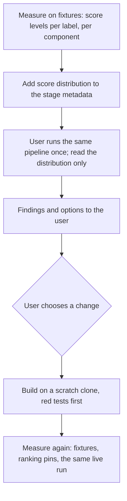

# Task: Scoring Calibration (Fresh Graduate Mode)

## Goal
Find out why almost no job passes the pipeline cut-off in fresh graduate mode, measure before any change, and then fix the cause with a change that the user chooses.

## Problem (pipeline test 2026-11-14, `tasks/archive/scrape-keyword-search/notes.md`)
Settings: full mode, dry run, MyCareersFuture, Max Jobs 2, Min Score 60, fresh graduate scoring on. 100 jobs scraped, 59 passed the profile filter, 58 scored below 60 (best 61), so the run made 1 CV and 1 letter instead of 2.

## Findings so far (code reading, 2026-11-15)
- Scoring is heuristic, no LLM (`src/scoring/matcher.py`). The weights are hard-coded (matcher.py lines 85 to 103). `config/scoring_config.yaml` has the same values but no code loads it.
- Fresh graduate mode: projects 35, skills 30, education 20, experience 10, location 5. Target keywords do not count in the score (they only filter jobs before scoring). Most parts give partial credit:
  - Projects: 25 % or 12 % of the weight as a base, then points per project that matches the job's structured skill list. Jobs with no skill list get the base and small bonuses only.
  - Education: a bachelor's gives 12 of 20, then small bonuses.
  - Experience: a job with no level gives 5 of 10.
- Two cut-offs that do not agree:
  - The matcher's own fresh graduate threshold is 50 (`FRESH_GRAD_THRESHOLD`), and it marks 50 or more as "apply".
  - The pipeline keeps only jobs with a total of 60 or more (`PipelineConfig.min_score`, `stages_rank.py` line 49) and ignores the matcher's result.
- Jobs below the cut-off are not stored, logged, or returned, so the score distribution of a real run cannot be measured today.
- The ranking suite (`main.py eval ranking`, 70 constructed jobs, profiles `fresh_ml` and `mid_backend`) measures the order (NDCG@10, recall@10), not the score level. CI pins: heuristic `fresh_ml` NDCG 0.7667, recall 0.5; `mid_backend` 0.8685, 0.6364.

## Plan
1. Measure on the repository fixtures (no code change, no personal data):
   - Score the 70 ranking jobs for `fresh_ml` in fresh graduate mode and in standard mode. Report per label (2 apply, 1 maybe, 0 not relevant): the score distribution, the share at 50 or more and at 60 or more, and the mean of each component.
   - Find which components hold the totals down (for example the project base, the education base, jobs with no skill list).
2. Code change A, for measurement only (scratch clone, tests first, "Yes, apply it"):
   - The score-and-rank stage records, in its stage metadata, the distribution of all scored jobs: counts per 10-point band, the number at 50 or more and at 60 or more, and the mean of each component. No job text, no profile data.
   - The pipeline behaviour does not change.
3. Live measurement: the user runs the same pipeline as on 2026-11-14 (dry run, MyCareersFuture, fresh graduate on, Min Score 60) from the app. Agents read only the new distribution fields of that run, through the app's results endpoint, with the user's approval.
4. Findings and options for the user. The options depend on the measurements; likely candidates:
   - a. In fresh graduate mode the pipeline uses the matcher's threshold (50) when the user does not set Min Score, or the Min Score default follows the mode.
   - b. Change the partial-credit rules that hold the totals down (for example, match projects to skills found in the job description when the job has no skill list).
   - c. Both, or no change (for example, if the jobs really are a poor fit and the cause is broad keywords).
5. Build the chosen change (scratch clone, red tests first, CI checks, "Yes, apply it"), and measure again: the fixture distribution, the ranking suite, and one live run with the same settings.

Decision guards for any scoring change (fixed before step 5):
- Ranking suite: heuristic NDCG@10 and recall@10 for both profiles not below the CI pins.
- Fixtures, `fresh_ml`: label-0 jobs above the cut-off do not increase by more than 2 of 43.
- Live run with the same settings: at least as many jobs pass as before; the user reads the passed jobs and confirms that they fit.

## Constraints & Context
- Never read `.env`, `.env.local`, `user_settings.json`, or the contents of `data/`. The live run uses the user's profile; agents see only the score distribution numbers.
- A live run scrapes MyCareersFuture. The user starts it from the app (dry run; nothing is submitted).
- `scoring_config.yaml` that no code loads is a separate finding; this task records it and does not change it unless the user chooses so.
- Workflow: plan check, scratch clone, "Yes, apply it", separate approval to push.

## Acceptance Criteria
- [x] Plan checked by the user (2026-11-15).
- [x] Fixture measurement in `notes.md` (distribution per label and mode, component means, the parts that hold totals down).
- [x] Code change A (score distribution in the stage metadata): tests red first, then green; CI checks pass; applied after "Yes, apply it".
- [x] Live run by the user; distribution recorded in `notes.md`.
- [x] Findings and options given to the user; the user's choice recorded.
- [ ] The chosen change built and measured again against the guards; applied after "Yes, apply it"; pushed after approval; the CI run passes.
- [ ] `tasks/todo.md` updated; folder archived.

## Status
`in-progress`
