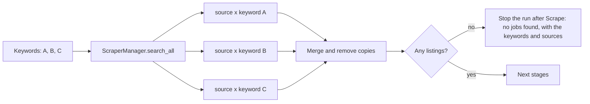

# Task: Search Each Keyword, and Stop a Run That Finds No Jobs

## Goal
Make the pipeline find jobs for a profile with several keywords, and make a run that finds no jobs say so instead of reporting "Complete".

## Constraints & Context
- Test run `run_d6a88288…` (2026-11-14, full mode, dry run, MyCareersFuture, profile keywords "Computer Science, AI Systems, Backend Developer, …", Singapore, Max Jobs 2): 0 scraped, every stage completed within 1 s, no model loaded, status "Complete".
- Cause: every scraper treats the keyword list as "match all". MyCareersFuture, JobStreet, JSearch, and LinkedIn join the keywords into one query (`" ".join(params.keywords)`); CareersAtGov keeps rows "whose searchable text contains every keyword". Checked directly: MyCareersFuture gives 18 jobs for "Backend Developer" and 0 for the three keywords together.
- The intent (Step 1 decision, 2026-10-18): keywords are split on commas because each one is a search phrase ("python engineer" is one phrase). So the search should be "any keyword".
- Silent failure: `ScraperManager.search_all` catches a source's error and only logs it; `stage_scrape` then succeeds with 0 listings, and the run goes on through every stage.
- Resource goal (user, 2026-11-14): use fewer resources without lowering quality. More searches mean more listings to score; keep the total near today's scale.
- Scrapers call public job boards (JSearch: RapidAPI, cloud). Tests use fake scrapers, no network.

## Plan

1. `ScraperManager.search_all`: one search per source and keyword phrase (each with `keywords=[phrase]`), in the existing thread pool; merge and remove copies as now. The per-search limit is the total limit divided by the number of keywords (at least 10), so the number of listings stays near today's scale. One phrase works as before. No scraper changes.
2. Per-source result in the scrape stage metadata: listings found for each source and keyword, and the error of each failed search (so a failing source is visible, not only logged).
3. A run that scrapes 0 listings stops after Scrape with a clear message ("No jobs found for these keywords and sources"), instead of running the other stages on nothing. How it shows (see decision 1).
4. Tests with fake scrapers: one search per keyword; merged and copies removed; the limit split; one failing keyword or source does not lose the others and is reported; a 0-listing run stops after Scrape with the message.
5. Check: a scrape-only run (Discover with "Stop after stage: scrape", or the scraper manager directly) with the user's keywords finds jobs on MyCareersFuture. Then the full-mode dry run again, with the resource recorder.

## Decisions (user, 2026-11-14)
1. A run with 0 scraped jobs ends as complete with a warning message and stops after Scrape (option b).
2. Fix the "Request Cancel" button that stays visible on a completed run, in this task.

## Acceptance Criteria
- [x] One search per keyword phrase per source, merged without copies; per-search limit as above.
- [x] Scrape metadata shows the count for each source and keyword, and each failed search.
- [x] A run with 0 scraped listings stops after Scrape, ends as complete, and the Pipeline page shows the warning.
- [x] "Request Cancel" is hidden when the run is no longer running.
- [x] Unit tests, red step, and mutants; CI checks pass locally.
- [x] Scrape with the user's keywords finds jobs; then the full-mode dry run reaches Generate Resumes with the recorder on.
- [ ] Applied after "Yes, apply it"; pushed after approval; the CI run passes.
- [ ] `tasks/todo.md` updated; folder archived.

## Status
`review`
