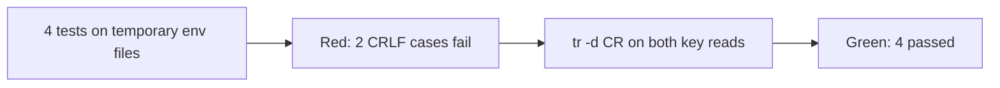

# Notes: setup-env-crlf-key

Planned 2026-11-15 on the laptop, after the lean-setup after run found that the env files had CRLF line endings and an empty API_KEY (`tasks/archive/lean-setup/notes.md`). The user approved the fix ("Yes, fix setup.sh").

## Build on a scratch clone (2026-11-15)

- Red: `test_crlf_empty_key_generates_one_shared_key` failed (the key read as one carriage return, so no key was generated); `test_crlf_real_key_is_synced_without_carriage_return` failed (the frontend got the key with a carriage return). The other two tests passed (same key in both files: no change; LF files: a generated key).
- Fix: `check_env` pipes both key reads through `tr -d '\r'`. A comment says why. `_set_env_api_key` already replaces the whole `API_KEY=` line, so the written key line has no carriage return; the other lines of the file do not change.
- Green: 4 new tests pass; the other setup and launcher tests (24) pass; black, ruff, mypy gate (0 new), full backend pytest (2409 passed), `bash -n setup.sh`.
- `git apply` writes `setup.sh` with mode 644 on disk (the repository has `core.filemode=false`). After the apply on `main`, set the mode back to 744, as for `scripts/dev.sh` in the lean-setup task.

## Applied on `main` (2026-11-15)

- Applied after "Yes, apply it"; the diff on `main` is the same as the checked patch. `setup.sh` mode set back to 744 on disk (git keeps 100755). On `main`: `bash -n`, 4 new tests, black, ruff, mypy gate (0 new), full backend pytest.
