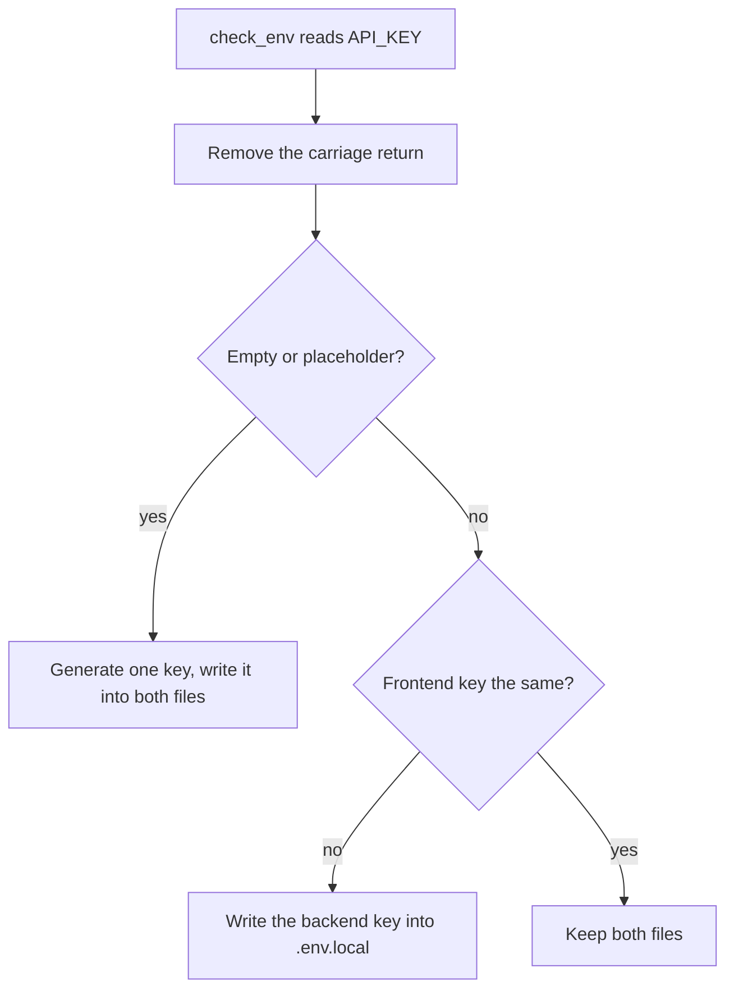

# Task: setup.sh Reads a Carriage Return as an API Key

## Goal
`setup.sh` generates a shared `API_KEY` when the env files have Windows line endings (CRLF) and an empty key, and it syncs a real key into the frontend without a carriage return.

## Problem (found 2026-11-15 on the laptop)
- The env files were copied from Windows and had CRLF line endings. The `API_KEY=` line was empty.
- `check_env` reads the key with `grep '^API_KEY=' | cut -d= -f2-`. The value is the carriage return (1 character), so the empty check fails and `setup.sh` generates no key.
- The backend loads `.env` with python-dotenv, which removes the carriage return. The key is empty, so the backend rejects every request (401), and the Settings form does not load.
- When the backend has a real key with a carriage return, the sync writes the key and the carriage return into `.env.local`.

## Plan
1. Tests (`apps/backend-py/tests/unit/test_setup_env_key.py`), red first. Each test sources `setup.sh` (after the guard check, as in `test_setup_llmfit.py`), sets `BACKEND_DIR` and `PROJECT_ROOT` to a temporary folder, writes the env files, and runs `check_env`. The tests never print a key.
   - CRLF, empty key in both files: one 64-character hex key, the same in both files, no carriage return in the key lines.
   - CRLF, real key in the backend, empty key in the frontend: the frontend gets the backend key without a carriage return; the backend key does not change.
   - CRLF, the same real key in both files: no file changes.
   - LF, empty key in both files: one shared key (the current behaviour, kept).
2. `setup.sh`, `check_env`: remove carriage returns when it reads `CURRENT_KEY` and `FE_KEY` (`tr -d '\r'`). No other change.

## Constraints & Context
- Small change in one function. The rest of each env file (other variables, line endings) does not change; python-dotenv reads CRLF files correctly.
- Setup scripts change nothing outside the repository. The tests use a temporary folder only.
- Never read or print a real env file. The tests use their own temporary files.
- Workflow: build and check on a scratch clone, apply after "Yes, apply it", push after a separate approval.

## Acceptance Criteria
- [x] Tests written red first (the CRLF cases fail on the current `setup.sh`), then green.
- [x] `check_env` removes carriage returns when it reads both keys.
- [x] CI checks pass on the clone: black, ruff, mypy gate (0 new), full backend pytest, `bash -n setup.sh`.
- [ ] Applied after "Yes, apply it" (done 2026-11-15); pushed after approval; the CI run passes.
- [ ] `tasks/todo.md` updated; folder archived.

## Status
`in-progress`
