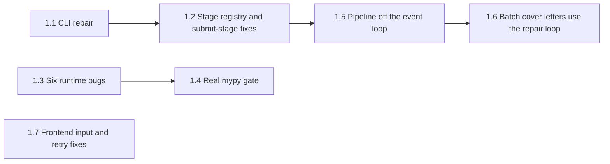

# Notes: Step 1, Make the Core Flow Run

This text moved here from `tasks/todo.md` on 2026-10-24, without changes. Paths in it are as of that date: a reference to a section of `tasks/todo.md` now means a section of this file or of another task's `notes.md`, and a `tasks/handoff-*.md` file is now in its step's task folder (Step 2 and Step 3.2 handoffs are in `tasks/archive/`). `tasks/lessons.md` is now `docs/lessons.md`.

#### Step 1 plan: Make the core flow run

**Goal:** A full-mode pipeline run goes from scrape to the submit stage in dry run. The CLI starts. CI catches new type errors. The UI shows real progress and does not send POST requests two times.

**Constraints:**

- Do not make auto-submit reachable. Detection and submission stay as they are until the Easy Apply decision in Step 5.
- Keep dry run as the default in every layer.
- Each sub-step is one pull request with its own tests. Run all local checks before each push.

Steps 1.1, 1.3, and 1.7 do not depend on other sub-steps. Step 1.4 needs 1.3, so that the baseline does not contain the six bugs. Step 1.6 needs 1.5, because the cover-letter service is async and needs a thread without a running event loop.

##### Step 1.1: CLI repair (effort: S)

- [x] Remove the second `argparse` block in `apps/backend-py/main.py` (the block after the first `parse_args()` at line 701). Move parser construction into `build_parser()`. Define `-i/--interactive` on the top-level parser, and share `--log-level` and `--log-file` with both commands through a parent parser.
- [x] Change `profile.target_job` to the fields of `profile.targets` in `run_pipeline` (`main.py:272-281`).
- [x] Read the allowed `--sources` values from the scraper registry, not from a hard-coded list (`main.py:600`). New `available_sources()` in `src/scrapers/manager.py`; `ScraperManager` uses it too.
- [x] Add `tests/unit/test_cli.py` (36 tests): help for each command, README forms, sources, experience choices, target fields, routing, and the full `analyze` path.
- [x] Update the README CLI examples to match the real commands. No edit needed: `pipeline` is the default command again, so `main.py --resume ...` in the README and `docs/usage.md` works as written.
- [x] Found during the work and fixed:
  - `ResumeParser.parse()` does not exist. `load_user_profile` and `analyze` now call `parse_file()`. `profile.contact_info.name` is now `profile.name`.
  - `--target-experience` choices (`entry`, `mid`) did not match `ExperienceLevel` values ("Entry Level"). The choices now map to enum member names.
  - `analyze` always failed: a local `from pathlib import Path` made `Path` unbound at the resume check (ruff F823). Removed the local import; a test now fails if it comes back.
  - The second `ensure_dependencies()` call inside `main()` is removed. The call before the imports stays. `main()` can now run in tests without `os.execv`.
  - `main.py` was not linted in CI. It is now ruff- and Black-clean, and CI and `make lint` check it.
  - Pinned `Makefile` and `Dockerfile*` to LF in `.gitattributes`, because `make` and Docker fail on CRLF.

##### Step 1.2: One stage registry and an honest submit stage (effort: S to M)

Steps 1.2 parts A and B must land together. When the run reaches the submit stage, the bugs in part B start to write wrong data.

Part A: stage registry

- [x] Define one ordered stage list with one handler per stage. New `src/models/pipeline_stage.py` holds `PipelineStage` and `STAGE_ORDER` (the enum order). Both runners in `src/pipeline/orchestrator.py` use `_stages_to_run()`. `PIPELINE_STAGE_ORDER` and `DISCOVER_LAST_STAGE` in `src/api/models/requests.py` derive from it.
- [x] Replace the `if`/`elif` dispatch in `_execute_stage` with a lookup (`_stage_handlers()`). Add the missing `LINKEDIN_AUTH` handler (`stages.stage_linkedin_auth`).
- [x] Make `stage_linkedin_auth` check only that credentials exist. No code change was needed: it already reads only `LINKEDIN_EMAIL` and `LINKEDIN_PASSWORD`. A test now fails if it starts Playwright.
- [x] Tests (`tests/unit/test_pipeline_orchestrator.py`): every `PipelineStage` has a handler; the request stage order equals `STAGE_ORDER`; a full-mode dry run runs all 11 stages in order and passes each stage's output to the next. `tests/integration/test_pipeline.py` now asserts `success` and the completed stages. A mutation check (handler removed) makes the tests fail.

Part B: submit stage

- [x] Match submission results to generated resumes by `job_id`, not by list index.
- [x] Do not save dry-run results as applied records. They are counted as `simulated`.
- [x] Count `jobs_applied` (`total_applications`) from real submissions only. Before, it equaled the number of generated resumes, so the Dashboard and Pipeline history showed every generated resume as "applied".
- [x] Tests for each of the three items above (`tests/unit/test_pipeline_stages.py`).
- [x] Found during the work and fixed: `stage_generate_resumes` failed when no job was selected ("0/0 successful", no error message), so a full run with an empty shortlist ended as failed. An empty selection is now a success. When every selected job fails, the stage fails with a message.

##### Step 1.3: Fix six runtime bugs that mypy found (effort: S)

- [x] `src/classifiers/job_classifier.py:606`: `WorkPace.FAST` to `WorkPace.FAST_PACED`. Rule-based classification of any JD with "fast-paced", "rapidly", or "startup environment" returned `success=False`. Tests: `tests/unit/test_job_classifier.py`.
- [x] `src/generation/formatter.py:535-563`: set `run.bold` and `run.italic` on the returned run, not as `add_run` arguments. DOCX resumes were silently missing; PDF still worked. Test: `tests/unit/test_resume_formatter_docx.py`.
- [x] `src/metrics/outcome_tracker.py:992`: `Path.remove()` to `Path.unlink()`. The status left the cache but its file stayed, so it came back after a restart. Tests: `tests/unit/test_outcome_tracker_custom_status.py`.
- [x] `src/metrics/mlflow_tracker.py:480`: `experiment.experiment_name` to `experiment.experiment_id` in `get_run_history`; run history was always empty. (`get_best_run` was already correct.) Test: `tests/unit/test_mlflow_run_history.py`.
- [x] `src/experiments/ab_testing.py`: deleted the `src/experiments/` package (decision 1). Nothing imported it. Removed its line from the README source tree.
- [x] `src/generation/resume_writer.py:285`: the template fallback, which runs when the LLM fails, now joins the names of the first five skills. Test: `tests/unit/test_resume_writer_fallback.py`.
- [x] Mutation check: with the five source fixes stashed, the bug tests fail with the original errors.

##### Step 1.4: Make mypy a real gate (effort: S)

- [x] Add a `[tool.mypy]` section to `apps/backend-py/pyproject.toml` (`ignore_missing_imports = true`). `python_version` is not set: the local `.venv` is Python 3.12 with a numpy whose stubs only parse on 3.12, so forcing 3.11 stops mypy.
- [x] Add `apps/backend-py/scripts/mypy_gate.py`. It compares errors by file, error code, and message (line numbers and "line N" in messages are ignored), counts duplicates, fails on new errors, and fails when mypy crashes. `--update` writes a new baseline. Tests: `tests/unit/test_mypy_gate.py` (12).
- [x] Remove `|| true` and `continue-on-error` from the CI `type-check` job and from `make lint`. Both run the gate. CI pins `mypy==2.4.0`, `types-requests==2.33.0.20261006`, and `types-PyYAML==6.0.12.20260906` (the versions CI used on 2026-10-18). The local `.venv` uses the same pins.
- [x] Done: the baseline (`apps/backend-py/mypy-baseline.txt`) was built from the CI Type Check log of run 39143155828 and has 183 errors. It does not contain the nine Step 1.3 errors. A deliberate new error makes the gate exit 1; clean code exits 0.
- [x] Found during the work and fixed: local and CI differed only in `src/metrics/mlflow_tracker.py`, because `mlflow` is not pinned and newer releases type `search_runs()` as `list[Run] | DataFrame`. Pass `output_format="pandas"` and cast to `DataFrame`; annotate the compare report as `Dict[str, Any]`. Local and CI now give the same 183 errors.
- [x] Lint `scripts/mypy_gate.py` in CI and `make lint`. Docs: "mypy Baseline Gate" in `docs/testing.md`; README code-style commands; `COMPREHENSIVE_TESTING_STRATEGY.md`.

##### Step 1.5: Run the pipeline off the event loop (effort: M)

- [x] In `src/api/routes/pipeline.py`, `_execute_pipeline()` runs in a worker thread (`asyncio.to_thread`). It builds the orchestrator, runs the stages, and backfills shortlist descriptions; all of these block.
- [x] Use the orchestrator stage hooks to send `stage_started`, `stage_completed`, and `stage_progress` (0 to 100) events with `asyncio.run_coroutine_threadsafe`. The hooks also set `current_stage`, `stage_progress`, `stages_planned`, and `stages_completed`, which `GET /status` now returns, so the monitor is correct even when the WebSocket connects late.
- [x] `PipelineOrchestrator.run(should_stop=...)` checks the cancel status before each stage, so cancel stops the run at the next stage boundary. A running stage is not interrupted.
- [x] Set the default `UVICORN_WORKERS` to 1 in `docker/Dockerfile`, because run state is in memory (decision 2).
- [x] Frontend: progress uses the backend 0 to 100 value (no extra `* 100`). The badge shows Running, Complete, Failed, or Cancelled, and a failed run shows its error. Logic is in `src/lib/pipeline-run-state.ts`. Added the missing `linkedin_auth` and `present_selection` stages to `PIPELINE_STAGES`.
- [x] Tests: `tests/unit/test_pipeline_run_async.py` (worker thread, the loop keeps running during a blocking stage, event order, failed status, cancel), a cancel test in `test_pipeline_orchestrator.py`, `/status` and `/results` tests in `test_pipeline_routes.py`, `src/lib/pipeline-run-state.test.ts`, and `tests/app/pipeline/live-monitor.test.tsx`. A mutation check (pipeline called on the event loop again) fails 3 of the 4 async tests.
- [x] Found during the work and fixed:
  - A run with `success=False` was reported as "completed". It is now "failed", with the failing stage's error.
  - `GET /api/pipeline/results/{run_id}` raised for every completed run: it called `.value` on stage names that are already strings.

##### Step 1.6: Batch cover letters use the repair loop (effort: M)

- [x] `stage_generate_resumes` now gets each cover letter from the shared service (`_generate_cover_letter` in `src/pipeline/stages.py`). The service writes, validates, and rewrites one time on hard-fail grounding issues, like the Cover Letter page. The service body moved to `generate_cover_letter_sync()`; `generate_cover_letter_for_profile()` is a thin async wrapper for the routes. A new `selection` argument lets the stage reuse its resume selection, so there is no second selector call per job.
- [x] A letter that still hard-fails after the rewrite is not saved. It is kept as `cover_letter_status="needs_review"` with `cover_letter_issues`. Stage metadata counts `cover_letters_saved`, `cover_letters_needs_review`, and `cover_letters_failed`. A letter error no longer drops the job's resume.
- [x] Tests (`tests/unit/test_pipeline_stages.py`, `TestBatchCoverLetters`): the service gets the resume selection; a clean letter is saved; a hard-fail letter is not saved; soft issues alone do not block saving; a letter error keeps the resume. A mutation check (hard-fail rule disabled) fails the hard-fail test.
- [x] Removed the unused `cover_letter_writer` and `cover_letter_validator` from `PipelineStages`.
- Follow-up (not in Step 1): the API routes still call the synchronous service from async handlers, so a cover-letter request blocks the event loop while the LLM runs. Use `asyncio.to_thread` in `generate_cover_letter_for_profile`.

##### Step 1.7: Frontend input and retry fixes (effort: S)

- [x] `src/lib/api/client.ts`: retry only `GET` and `HEAD` (`canRetry`). Honor `Retry-After` on 429, capped at 30 s (`retryDelayMs`). TanStack query retries are off in `src/app/providers.tsx`, so the client is the only retry layer (mutations already defaulted to 0). A caller abort (`AbortError`) is rethrown unchanged and not retried.
- [x] The proxy sets `X-Proxy-Error: backend-unreachable` on its 503 for a down backend. The client maps exactly that case to `ConnectionError`, so the "Is the backend running?" message appears. A 503 from the backend itself stays an `ApiError`.
- [x] `splitList` (comma-only) is now `src/lib/utils/split-list.ts`. The Pipeline form, the Jobs search bar, and the profile job targets use it (decision 3). The placeholders already show comma-separated examples, so they did not change.
- [x] The UI `max_jobs` limit is 100, the same as the backend.
- [x] Tests: `canRetry`, `retryDelayMs`, and `request` retry behavior in `src/lib/api/client.test.ts` (POST sent once on 503; GET retried; proxy 503 is `ConnectionError`; backend 503 is `ApiError`; abort rethrown); `src/lib/utils/split-list.test.ts`; a Pipeline form test that "New York, Remote" gives two locations.

##### Verification for Step 1

- [x] Backend: pytest, ruff, Black, and the mypy gate. CI run 39188312697 on `5a8232f`: 1,067 passed; gate 182 known errors, 0 new.
- [x] Frontend (Node 20): ESLint, tsc, Prettier, Vitest, `next build`, and Playwright. CI run 39188312697: 41 Vitest files passed; Playwright 40 passed, 2 flaky (see the Backlog item "Flaky Mobile Chrome navigation smoke test").
- [ ] Manual: start a full-mode dry run from the Pipeline page with Ollama running. Confirm that the stage list moves during the run, and that the run reaches `submit_applications` with zero real submissions.

##### Out of scope for Step 1

- Silent cloud fallback, API binding, and auth (Step 2).
- Scoring, dedupe, scam regex, and RAG fusion fixes (Step 3, after there is an eval set).
- Auto-submit reachability and the Easy Apply decision (Step 5).

##### Decisions (2026-10-18)

1. `ab_testing.py`: delete it. Nothing imports it, and it calls a method that does not exist.
2. Uvicorn workers: change the default to 1. One local user does not need more, and run state is in memory.
3. Keywords: split on commas only. "python engineer" is one search phrase.
