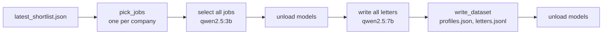

# MH-A: The generator of the real-letter set

Read `AGENT.md` first.

## Why

The grounding validator is measured on constructed letters. The realistic measure needs letters that the app itself writes for real jobs. This script makes them: it picks shortlisted jobs, makes the selection and the final letter for each job through the app's own code, and writes an unlabeled dataset folder. Claude and the user label the letters later.

Two rules make the labels honest:

- The script does not save or print what the validator found, and it sets the app's logs to errors only (the app logs lines such as "Cover letter rewritten" that show the validator's verdict).
- It writes `letters.jsonl`, not `cases.jsonl`, so the eval cannot run before the letters are labeled.

You do not run this script on real data. The tests use the synthetic sample profile and the sample job only.



## Files

- `apps/backend-py/scripts/make_real_grounding_set.py` (new)
- `apps/backend-py/tests/unit/test_make_real_grounding_set.py` (new)

## Step 1: add this test file, run it, and see it fail

`apps/backend-py/tests/unit/test_make_real_grounding_set.py`:

```python
"""Tests for the real-letter grounding set generator (Step 3.2 real letters, MH-A)."""

import json
import logging
from pathlib import Path
from typing import Any, Dict, List

import pytest

from scripts import make_real_grounding_set as gen
from src.generation.selector import SelectionOutput
from src.models.job_listing import JobListing
from src.models.user_profile import UserProfile

LONG_TEXT = "We build payment services in Python and run them on PostgreSQL. " * 5


def shortlist_job(
    base: Dict[str, Any], job_id: str, company: str, description: str = LONG_TEXT
) -> Dict[str, Any]:
    """Build one shortlist item from the sample job.

    Args:
        base: The sample job as a JSON dict.
        job_id: The job ID.
        company: The company name.
        description: The job description.

    Returns:
        A shortlist item with a score field, as the Jobs page stores it.
    """
    return dict(
        base,
        job_id=job_id,
        company=company,
        description=description,
        relevance_score=72,
    )


def selection_for(job: JobListing) -> SelectionOutput:
    """Build a fixed selection for one job.

    Args:
        job: The job.

    Returns:
        A selection whose raw response is the job ID.
    """
    return SelectionOutput(
        selected_projects=[],
        keywords_to_emphasize=["Python"],
        key_achievements=[],
        summary_suggestion="",
        raw_response=job.job_id,
    )


class FakeApp:
    """Fake selector and writer that record the call order."""

    def __init__(self, empty_for: str = "") -> None:
        """Start with no calls.

        Args:
            empty_for: The job ID whose letter is empty.
        """
        self.calls: List[str] = []
        self.empty_for = empty_for

    def select(self, job: JobListing, profile: UserProfile) -> SelectionOutput:
        """Record a selection call.

        Args:
            job: The job.
            profile: The profile.

        Returns:
            A fixed selection for the job.
        """
        self.calls.append(f"select {job.job_id}")
        return selection_for(job)

    def write(
        self, job: JobListing, profile: UserProfile, selection: SelectionOutput
    ) -> str:
        """Record a letter call.

        Args:
            job: The job.
            profile: The profile.
            selection: The selection of the job.

        Returns:
            A letter with spaces at the ends, or only spaces for ``empty_for``.
        """
        self.calls.append(f"write {job.job_id}")
        if job.job_id == self.empty_for:
            return "   "
        return f"  Dear team, this letter is for {selection.raw_response}.  "

    def between(self) -> None:
        """Record the step between the selections and the letters."""
        self.calls.append("between")


def test_pick_jobs_takes_one_job_per_company_in_order(
    sample_job_listing: JobListing,
) -> None:
    """Jobs keep the shortlist order; a repeated company or a short text is skipped."""
    base = sample_job_listing.model_dump(mode="json")
    items = [
        shortlist_job(base, "j1", "Acme Pay"),
        shortlist_job(base, "j2", " acme  PAY "),
        shortlist_job(base, "j3", "Beta Labs", description="Short text."),
        "not a job",
        shortlist_job(base, "j4", "Gamma Data"),
        shortlist_job(base, "j5", "Delta Cloud"),
    ]

    assert [job.job_id for job in gen.pick_jobs(items, limit=3)] == ["j1", "j4", "j5"]
    assert [job.job_id for job in gen.pick_jobs(items, limit=2)] == ["j1", "j4"]


def test_make_records_selects_every_job_before_the_first_letter(
    sample_job_listing: JobListing, sample_user_profile: UserProfile
) -> None:
    """All selections run first, then the between step, then the letters."""
    jobs = [
        sample_job_listing.model_copy(update={"job_id": f"j{i}"}) for i in (1, 2, 3)
    ]
    app = FakeApp(empty_for="j2")

    records = gen.make_records(
        jobs, sample_user_profile, app.select, app.write, between=app.between
    )

    assert app.calls == [
        "select j1",
        "select j2",
        "select j3",
        "between",
        "write j1",
        "write j2",
        "write j3",
    ]
    assert [r["case_id"] for r in records] == ["real__01", "real__02"]
    assert [r["letter"] for r in records] == [
        "Dear team, this letter is for j1.",
        "Dear team, this letter is for j3.",
    ]


def test_records_hold_no_validator_output(
    sample_job_listing: JobListing, sample_user_profile: UserProfile
) -> None:
    """A record has only the case fields, and its job and selection load again."""
    app = FakeApp()
    records = gen.make_records(
        [sample_job_listing], sample_user_profile, app.select, app.write
    )

    record = json.loads(json.dumps(records[0]))
    assert set(record) == {"case_id", "profile_id", "job", "selection", "letter"}
    assert record["profile_id"] == "real"
    assert JobListing.model_validate(record["job"]).job_id == sample_job_listing.job_id
    assert SelectionOutput(**record["selection"]) == selection_for(sample_job_listing)


def test_write_dataset_writes_profiles_and_letters_only(
    tmp_path: Path, sample_job_listing: JobListing, sample_user_profile: UserProfile
) -> None:
    """The folder gets profiles.json and letters.jsonl, and is kept without force."""
    app = FakeApp()
    records = gen.make_records(
        [sample_job_listing], sample_user_profile, app.select, app.write
    )
    out = tmp_path / "grounding_real"

    path = gen.write_dataset(out, sample_user_profile, records)

    assert sorted(p.name for p in out.iterdir()) == ["letters.jsonl", "profiles.json"]
    lines = path.read_text(encoding="utf-8").splitlines()
    assert [json.loads(line)["case_id"] for line in lines] == ["real__01"]
    profiles = json.loads((out / "profiles.json").read_text(encoding="utf-8"))
    assert UserProfile.model_validate(profiles["real"]).name == sample_user_profile.name
    with pytest.raises(FileExistsError):
        gen.write_dataset(out, sample_user_profile, records)
    gen.write_dataset(out, sample_user_profile, [], force=True)
    assert path.read_text(encoding="utf-8") == ""


def test_quiet_app_logs_hides_the_warnings_of_the_app() -> None:
    """After quiet_app_logs, an app logger shows errors only."""
    child = logging.getLogger("job_raider.generation")
    previous = gen.quiet_app_logs()
    try:
        assert not child.isEnabledFor(logging.WARNING)
        assert child.isEnabledFor(logging.ERROR)
    finally:
        for name, level in previous.items():
            logging.getLogger(name).setLevel(level)


def test_unload_models_unloads_each_loaded_model(
    monkeypatch: pytest.MonkeyPatch,
) -> None:
    """Every model that /api/ps lists is unloaded."""

    class Response:
        """Fake /api/ps response."""

        def raise_for_status(self) -> None:
            """Accept the response."""

        def json(self) -> Dict[str, Any]:
            """Return two loaded models.

            Returns:
                The /api/ps body.
            """
            return {"models": [{"name": "qwen2.5:3b"}, {"name": "qwen2.5:7b"}]}

    unloaded: List[str] = []
    monkeypatch.setattr(gen.requests, "get", lambda url, timeout: Response())
    monkeypatch.setattr(gen, "unload_model", lambda url, name: unloaded.append(name))

    gen.unload_models("http://ollama.test")

    assert unloaded == ["qwen2.5:3b", "qwen2.5:7b"]


def test_main_stops_when_the_letters_exist(tmp_path: Path) -> None:
    """main does not replace letters.jsonl without --force."""
    out = tmp_path / "grounding_real"
    out.mkdir()
    (out / "letters.jsonl").write_text("keep\n", encoding="utf-8")

    code = gen.main(["--out", str(out), "--shortlist", str(tmp_path / "none.json")])

    assert code == 1
    assert (out / "letters.jsonl").read_text(encoding="utf-8") == "keep\n"


def test_main_stops_when_a_model_is_loaded(
    tmp_path: Path, monkeypatch: pytest.MonkeyPatch
) -> None:
    """main does not start while another model is on the GPU."""
    monkeypatch.setattr(gen, "loaded_models", lambda url: ["agent-model:9b"])
    out = tmp_path / "grounding_real"

    code = gen.main(["--out", str(out), "--shortlist", str(tmp_path / "none.json")])

    assert code == 1
    assert not out.exists()
```

Run it (from `apps/backend-py`). It must fail with `ImportError` (the script does not exist yet):

```bash
.venv/bin/python -m pytest tests/unit/test_make_real_grounding_set.py -q
```

## Step 2: add the script

`apps/backend-py/scripts/make_real_grounding_set.py`:

```python
#!/usr/bin/env python3
"""
Job Raider - Make the real-letter grounding set (Step 3.2 real letters, MH-A)

Generates the cover letters that the app makes for real shortlisted jobs with
the active profile, so that they can be labeled with the grounding guide
(``tests/fixtures/eval/grounding/README.md``). The output holds the real
profile, so it stays in the gitignored ``data/eval/grounding_real/`` folder.

The script writes ``profiles.json`` and ``letters.jsonl``. It does not write
``cases.jsonl``, so the eval cannot run on unlabeled letters. It does not save
or print validator output, and it sets the app's logs to errors only, so the
labels are written before anyone sees the validator's verdict.

Usage (from apps/backend-py, with Ollama running and no model loaded):

    python scripts/make_real_grounding_set.py --limit 15

Author: Job Raider
Date: 2026-10-30
"""

from __future__ import annotations

import argparse
import json
import logging
import sys
from dataclasses import asdict
from pathlib import Path
from typing import Any, Callable, Dict, List, Optional, Sequence

import requests

# Allow ``from src...`` when run as a script.
_BACKEND_ROOT = Path(__file__).resolve().parents[1]
if str(_BACKEND_ROOT) not in sys.path:
    sys.path.insert(0, str(_BACKEND_ROOT))

from src.generation.selector import SelectionOutput  # noqa: E402
from src.models.job_listing import JobListing  # noqa: E402
from src.models.user_profile import UserProfile  # noqa: E402

PROFILE_ID = "real"
MIN_DESCRIPTION_CHARS = 200
DEFAULT_SHORTLIST = _BACKEND_ROOT / "data" / "results" / "latest_shortlist.json"
DEFAULT_PROFILES_DIR = _BACKEND_ROOT / "data" / "profiles"
DEFAULT_OUT = _BACKEND_ROOT / "data" / "eval" / "grounding_real"
DEFAULT_OLLAMA_URL = "http://localhost:11434"

SelectFn = Callable[[JobListing, UserProfile], SelectionOutput]
WriteFn = Callable[[JobListing, UserProfile, SelectionOutput], str]


def pick_jobs(shortlist_jobs: Sequence[Any], limit: int) -> List[JobListing]:
    """
    Pick jobs in shortlist order: one per company, each with a description.

    Args:
        shortlist_jobs: The ``jobs`` list of ``latest_shortlist.json``.
        limit: The largest number of jobs to pick.

    Returns:
        At most ``limit`` jobs. An item that is not a valid job, a second job
        of the same company, and a job whose description is shorter than
        ``MIN_DESCRIPTION_CHARS`` are skipped.
    """
    picked: List[JobListing] = []
    companies: set[str] = set()
    for item in shortlist_jobs:
        if len(picked) >= limit:
            break
        if not isinstance(item, dict):
            continue
        company = " ".join(str(item.get("company") or "").lower().split())
        description = str(item.get("description") or "").strip()
        if not company or company in companies:
            continue
        if len(description) < MIN_DESCRIPTION_CHARS:
            continue
        try:
            job = JobListing.model_validate(item)
        except ValueError:
            continue
        companies.add(company)
        picked.append(job)
    return picked


def letter_record(
    index: int, job: JobListing, selection: SelectionOutput, letter: str
) -> Dict[str, Any]:
    """
    Build one unlabeled letter record.

    Args:
        index: The 1-based number of the letter.
        job: The job of the letter.
        selection: The selection that the letter used.
        letter: The final letter text.

    Returns:
        The case ID, profile ID, job, selection, and letter. There is no
        validator field.
    """
    return {
        "case_id": f"real__{index:02d}",
        "profile_id": PROFILE_ID,
        "job": job.model_dump(mode="json"),
        "selection": asdict(selection),
        "letter": letter,
    }


def make_records(
    jobs: Sequence[JobListing],
    profile: UserProfile,
    select: SelectFn,
    write: WriteFn,
    between: Optional[Callable[[], None]] = None,
) -> List[Dict[str, Any]]:
    """
    Make all selections first, then write one letter for each job.

    Selecting first lets the caller unload the selection model before the
    writing model loads, so only one model is on the GPU at a time.

    Args:
        jobs: The picked jobs.
        profile: The candidate profile.
        select: Makes the selection for one job.
        write: Writes the final letter for one job and its selection.
        between: Runs after the selections and before the letters.

    Returns:
        One record for each job whose letter is not empty, numbered in order.
    """
    selections: List[SelectionOutput] = []
    for count, job in enumerate(jobs, start=1):
        print(f"Selection {count} of {len(jobs)}", flush=True)
        selections.append(select(job, profile))
    if between is not None:
        between()
    records: List[Dict[str, Any]] = []
    for count, (job, selection) in enumerate(zip(jobs, selections), start=1):
        print(f"Letter {count} of {len(jobs)}", flush=True)
        letter = write(job, profile, selection).strip()
        if letter:
            records.append(letter_record(len(records) + 1, job, selection, letter))
    return records


def write_dataset(
    out_dir: Path,
    profile: UserProfile,
    records: Sequence[Dict[str, Any]],
    force: bool = False,
) -> Path:
    """
    Write ``profiles.json`` and ``letters.jsonl``.

    Args:
        out_dir: The dataset folder.
        profile: The candidate profile, stored under ``PROFILE_ID``.
        records: The letter records.
        force: Replace an existing ``letters.jsonl``.

    Returns:
        The path of ``letters.jsonl``.

    Raises:
        FileExistsError: When ``letters.jsonl`` exists and ``force`` is false.
    """
    out_dir.mkdir(parents=True, exist_ok=True)
    letters_path = out_dir / "letters.jsonl"
    if letters_path.exists() and not force:
        raise FileExistsError(f"{letters_path} exists; use --force to replace it")
    profiles = {PROFILE_ID: profile.model_dump(mode="json")}
    (out_dir / "profiles.json").write_text(
        json.dumps(profiles, indent=2, ensure_ascii=False) + "\n", encoding="utf-8"
    )
    lines = [json.dumps(record, ensure_ascii=False) + "\n" for record in records]
    letters_path.write_text("".join(lines), encoding="utf-8")
    return letters_path


def quiet_app_logs() -> Dict[str, int]:
    """
    Set the app's ``job_raider`` loggers to errors only.

    The letter service and the validator log lines that show the validator's
    verdict. The labels must be written before anyone sees it.

    Returns:
        The previous level of each changed logger, by logger name.
    """
    names = ["job_raider"] + [
        name
        for name in list(logging.root.manager.loggerDict)
        if name.startswith("job_raider.")
    ]
    previous: Dict[str, int] = {}
    for name in names:
        logger = logging.getLogger(name)
        previous[name] = logger.level
        logger.setLevel(logging.ERROR)
    return previous


def loaded_models(ollama_url: str) -> List[str]:
    """
    List the models that Ollama has loaded.

    Args:
        ollama_url: The Ollama base URL.

    Returns:
        The model names, or an empty list when Ollama cannot be reached.
    """
    try:
        response = requests.get(f"{ollama_url}/api/ps", timeout=10)
        response.raise_for_status()
        models = response.json().get("models") or []
    except Exception:  # noqa: BLE001 - a missing Ollama means no model is loaded
        return []
    return [
        str(model["name"])
        for model in models
        if isinstance(model, dict) and model.get("name")
    ]


def unload_model(ollama_url: str, name: str) -> None:
    """
    Ask Ollama to unload one model (``keep_alive`` 0).

    Args:
        ollama_url: The Ollama base URL.
        name: The model name.
    """
    try:
        requests.post(
            f"{ollama_url}/api/generate",
            json={"model": name, "keep_alive": 0},
            timeout=120,
        )
    except Exception as exc:  # noqa: BLE001 - unloading is best effort
        print(f"Could not unload {name}: {exc}")


def unload_models(ollama_url: str) -> None:
    """
    Unload every model that Ollama has loaded.

    Args:
        ollama_url: The Ollama base URL.
    """
    for name in loaded_models(ollama_url):
        unload_model(ollama_url, name)


def load_active_profile(profiles_dir: Path) -> UserProfile:
    """
    Load the active profile from the app's profile store.

    Args:
        profiles_dir: The app's ``data/profiles`` folder.

    Returns:
        The active profile.

    Raises:
        RuntimeError: When there is no active profile.
    """
    from src.api.profile_storage import ProfileStorage

    storage = ProfileStorage(profiles_dir)
    storage.load()
    profile_id = storage.active_id.read()
    if not profile_id or profile_id not in storage.profiles:
        raise RuntimeError("No active profile. Upload a resume in the app first.")
    profile = storage.profiles[profile_id].get("profile")
    if isinstance(profile, UserProfile):
        return profile
    return UserProfile.model_validate(profile)


def select_with_app(job: JobListing, profile: UserProfile) -> SelectionOutput:
    """
    Make the selection for one job with the app's selector.

    Args:
        job: The job.
        profile: The candidate profile.

    Returns:
        The selection, as the pipeline makes it.
    """
    from src.generation.selector import ResumeSelector
    from src.llm.router import create_router

    selector = ResumeSelector(llm_router=create_router(prefer_local=True))
    return selector.select(job, profile)


def write_with_app(
    job: JobListing, profile: UserProfile, selection: SelectionOutput
) -> str:
    """
    Write the final letter for one job with the app's cover letter service.

    The service writes, validates, and rewrites one time on a hard-fail
    issue, as in the pipeline. Only the letter text is kept.

    Args:
        job: The job.
        profile: The candidate profile.
        selection: The selection of the job.

    Returns:
        The final letter text, or an empty string.
    """
    from src.generation.cover_letter_service import generate_cover_letter_sync

    response = generate_cover_letter_sync(job, profile, selection=selection)
    return str(response.cover_letter.get("content") or "")


def main(argv: Optional[Sequence[str]] = None) -> int:
    """
    Generate the letters and write the dataset folder.

    Args:
        argv: Command-line arguments (default: ``sys.argv[1:]``).

    Returns:
        0 when the folder is written, 1 when the script stops first.
    """
    parser = argparse.ArgumentParser(
        description=(
            "Write real cover letters for the grounding labels "
            "(no labels, no validator output)."
        )
    )
    parser.add_argument(
        "--limit", type=int, default=15, help="Largest number of jobs (default 15)"
    )
    parser.add_argument(
        "--shortlist", type=Path, default=DEFAULT_SHORTLIST, help="Shortlist file"
    )
    parser.add_argument(
        "--profiles-dir",
        type=Path,
        default=DEFAULT_PROFILES_DIR,
        help="Folder of the app's stored profiles",
    )
    parser.add_argument("--out", type=Path, default=DEFAULT_OUT, help="Dataset folder")
    parser.add_argument(
        "--ollama-url", default=DEFAULT_OLLAMA_URL, help="Ollama base URL"
    )
    parser.add_argument(
        "--force", action="store_true", help="Replace an existing letters.jsonl"
    )
    args = parser.parse_args(argv)

    letters_path = args.out / "letters.jsonl"
    if letters_path.exists() and not args.force:
        print(f"{letters_path} exists; use --force to replace it")
        return 1
    already = loaded_models(args.ollama_url)
    if already:
        print(f"Models are loaded: {', '.join(already)}. Unload them first.")
        return 1

    shortlist = json.loads(args.shortlist.read_text(encoding="utf-8"))
    shortlist_jobs = shortlist.get("jobs") or []
    jobs = pick_jobs(shortlist_jobs, args.limit)
    if not jobs:
        print("No shortlisted job has a description and a new company.")
        return 1
    print(f"Picked {len(jobs)} of {len(shortlist_jobs)} shortlisted jobs")

    quiet_app_logs()
    profile = load_active_profile(args.profiles_dir)
    try:
        records = make_records(
            jobs,
            profile,
            select_with_app,
            write_with_app,
            between=lambda: unload_models(args.ollama_url),
        )
    finally:
        unload_models(args.ollama_url)
    path = write_dataset(args.out, profile, records, force=args.force)
    print(f"Wrote {len(records)} letters to {path}")
    return 0


if __name__ == "__main__":
    sys.exit(main())
```

## Done when

Run the new tests:

```bash
.venv/bin/python -m pytest tests/unit/test_make_real_grounding_set.py -q
```

Format the new files:

```bash
.venv/bin/python -m black scripts/make_real_grounding_set.py tests/unit/test_make_real_grounding_set.py
```

Check the lint:

```bash
.venv/bin/python -m ruff check scripts/make_real_grounding_set.py tests/unit/test_make_real_grounding_set.py
```

Do not run the script itself. Commit message: `feat(eval): add the generator of the real-letter grounding set`
