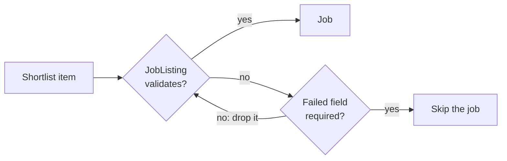

# MH-A2: The generator takes real shortlist items

## Apply with the runner

The handoff runner applies this file: it writes the new test file, runs the red command (it must fail), makes the three edits, runs the "Done when" checks (they must pass), and commits. See `docs/handoff-runner.md`.

Apply this handoff (WSL, from `apps/backend-py`):

```bash
.venv/bin/python scripts/run_handoff.py ../../tasks/active/step-3-2-real-letters/mh-a2-shortlist-items.md
```

## Why

The first real run of `make_real_grounding_set.py` (2026-10-30) stopped with "No shortlisted job has a description and a new company". `save_latest_shortlist` writes the shortlist with `json.dump(..., default=str)`, so `salary_range` is stored as display text ("SGD 9,000 - 18,000 (monthly)"). `JobListing` expects a salary object there, so all 20 items failed `JobListing.model_validate`, and `pick_jobs` skipped each one. The MH-A tests built their items from the sample job, which still has the right shape.

After this change, `shortlist_job` drops an optional field that does not validate (such as the salary text) and keeps the job. A job whose required field (title, company, job ID, or source) does not validate is still skipped. A letter does not use the salary.



## Files

- `apps/backend-py/scripts/make_real_grounding_set.py` (change)
- `apps/backend-py/tests/unit/test_make_real_grounding_set_shortlist.py` (new)

## Step 1: add this test file, run it, and see it fail

```python new=apps/backend-py/tests/unit/test_make_real_grounding_set_shortlist.py
"""Tests for shortlist items in the real-letter generator (Step 3.2, MH-A2)."""

from typing import Any, Dict

from scripts import make_real_grounding_set as gen
from src.models.job_listing import JobListing

LONG_TEXT = "We build payment services in Python and run them on PostgreSQL. " * 5


def shortlist_item(job: JobListing, **changes: Any) -> Dict[str, Any]:
    """Build one shortlist item as the Jobs page stores it.

    Args:
        job: The sample job.
        **changes: Fields to change.

    Returns:
        A shortlist item with the salary as display text and score fields.
    """
    item = dict(
        job.model_dump(mode="json"),
        description=LONG_TEXT,
        salary_range="SGD 9,000 - 18,000 (monthly)",
        relevance_score=72,
        matched_keywords=["Python"],
    )
    item.update(changes)
    return item


def test_a_display_salary_is_dropped(sample_job_listing: JobListing) -> None:
    """The shortlist's salary text does not stop the job; the salary is left out."""
    job = gen.shortlist_job(shortlist_item(sample_job_listing))

    assert job is not None
    assert job.job_id == sample_job_listing.job_id
    assert job.title == sample_job_listing.title
    assert job.salary_range is None


def test_pick_jobs_takes_shortlist_items(sample_job_listing: JobListing) -> None:
    """pick_jobs keeps real shortlist items, one per company."""
    items = [
        shortlist_item(sample_job_listing, job_id="j1", company="Acme Pay"),
        shortlist_item(sample_job_listing, job_id="j2", company="Beta Labs"),
    ]

    assert [job.job_id for job in gen.pick_jobs(items, limit=5)] == ["j1", "j2"]


def test_a_bad_required_field_skips_the_job(sample_job_listing: JobListing) -> None:
    """A job whose title does not validate is skipped, not changed."""
    assert gen.shortlist_job(shortlist_item(sample_job_listing, title=None)) is None
```

Run it. It must fail (`shortlist_job` does not exist yet, and `pick_jobs` skips every item):

```bash red cwd=apps/backend-py
.venv/bin/python -m pytest tests/unit/test_make_real_grounding_set_shortlist.py -q
```

## Step 2: change `scripts/make_real_grounding_set.py`

1. Import `ValidationError`:

```python edit=apps/backend-py/scripts/make_real_grounding_set.py
<<<<<<< OLD
import requests
=======
import requests
from pydantic import ValidationError
>>>>>>> NEW
```

2. Add `shortlist_job` before `pick_jobs`:

```python edit=apps/backend-py/scripts/make_real_grounding_set.py
<<<<<<< OLD
def pick_jobs(shortlist_jobs: Sequence[Any], limit: int) -> List[JobListing]:
=======
def shortlist_job(item: Dict[str, Any]) -> Optional[JobListing]:
    """
    Turn one shortlist item into a job listing.

    The shortlist stores some fields for display (for example
    ``salary_range`` as text), and ``JobListing`` rejects them. Such an
    optional field is dropped. A job whose required field does not validate
    is skipped.

    Args:
        item: One item of the ``jobs`` list of ``latest_shortlist.json``.

    Returns:
        The job listing, or None when a required field does not validate.
    """
    data = dict(item)
    required = {
        name for name, field in JobListing.model_fields.items() if field.is_required()
    }
    while True:
        try:
            return JobListing.model_validate(data)
        except ValidationError as exc:
            failed = {str(error["loc"][0]) for error in exc.errors() if error["loc"]}
            if not failed or failed & required:
                return None
            for name in failed:
                data.pop(name, None)


def pick_jobs(shortlist_jobs: Sequence[Any], limit: int) -> List[JobListing]:
>>>>>>> NEW
```

3. Use it in `pick_jobs`:

```python edit=apps/backend-py/scripts/make_real_grounding_set.py
<<<<<<< OLD
        try:
            job = JobListing.model_validate(item)
        except ValueError:
            continue
=======
        job = shortlist_job(item)
        if job is None:
            continue
>>>>>>> NEW
```

## Done when

Run the new tests and the MH-A tests:

```bash check cwd=apps/backend-py
.venv/bin/python -m pytest tests/unit/test_make_real_grounding_set_shortlist.py tests/unit/test_make_real_grounding_set.py -q
```

Format the changed files:

```bash check cwd=apps/backend-py
.venv/bin/python -m black scripts/make_real_grounding_set.py tests/unit/test_make_real_grounding_set_shortlist.py
```

Check the lint:

```bash check cwd=apps/backend-py
.venv/bin/python -m ruff check scripts/make_real_grounding_set.py tests/unit/test_make_real_grounding_set_shortlist.py
```

Commit message:

```text commit
fix(eval): take real shortlist items in the real-letter generator

The shortlist stores salary_range as display text, so every real item
failed JobListing validation and the generator picked no job.
shortlist_job drops an optional field that does not validate and skips a
job only when a required field fails.
```
