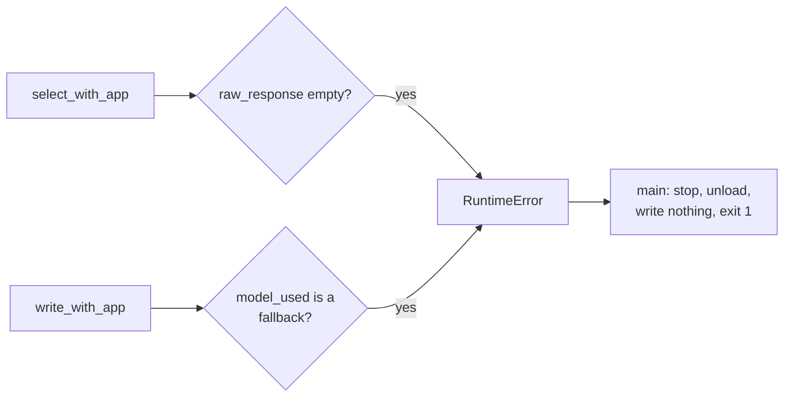

# MH-A3: The generator stops on a fallback selection or letter

## Apply with the runner

The handoff runner applies this file: it writes the new test file, runs the red command (it must fail), makes the four edits, runs the "Done when" checks (they must pass), and commits. See `docs/handoff-runner.md`.

Apply this handoff (WSL, from `apps/backend-py`):

```bash
.venv/bin/python scripts/run_handoff.py ../../tasks/active/step-3-2-real-letters/mh-a3-generator-fallback-guard.md
```

## Why

In the first real run (2026-10-30), Ollama could not be reached (see MH-H1). The selector then used its rule-based fallback (`raw_response` empty), and the writer used its template fallback (`model_used` is `template_fallback`). The generator still wrote 15 letters, but no model wrote them, so they do not measure the validator.

After this change, `select_with_app` and `write_with_app` raise `RuntimeError` on a fallback, and `main` stops, unloads the models, and writes nothing.



## Files

- `apps/backend-py/scripts/make_real_grounding_set.py` (change)
- `apps/backend-py/tests/unit/test_make_real_grounding_set_fallback.py` (new)

## Step 1: add this test file, run it, and see it fail

```python new=apps/backend-py/tests/unit/test_make_real_grounding_set_fallback.py
"""Tests for the fallback guards of the real-letter generator (Step 3.2, MH-A3)."""

import json
from pathlib import Path
from types import SimpleNamespace
from typing import Any

import pytest

from scripts import make_real_grounding_set as gen
from src.generation.selector import SelectionOutput
from src.models.job_listing import JobListing
from src.models.user_profile import UserProfile


def selection(raw_response: str) -> SelectionOutput:
    """Build a selection with a given raw model answer.

    Args:
        raw_response: The raw answer; empty means the rule-based fallback.

    Returns:
        A selection.
    """
    return SelectionOutput(
        selected_projects=[],
        keywords_to_emphasize=[],
        key_achievements=[],
        summary_suggestion="",
        raw_response=raw_response,
    )


class FakeSelector:
    """Selector stand-in that returns the class attribute ``result``."""

    result = selection("{}")

    def __init__(self, llm_router: Any) -> None:
        """Accept the router.

        Args:
            llm_router: Not used.
        """

    def select(self, job: JobListing, profile: UserProfile) -> SelectionOutput:
        """Return the fixed selection.

        Args:
            job: Not used.
            profile: Not used.

        Returns:
            ``FakeSelector.result``.
        """
        return FakeSelector.result


@pytest.fixture
def fake_selector(monkeypatch: pytest.MonkeyPatch) -> None:
    """Replace the app's selector and router with stand-ins.

    Args:
        monkeypatch: The pytest monkeypatch fixture.
    """
    monkeypatch.setattr("src.generation.selector.ResumeSelector", FakeSelector)
    monkeypatch.setattr("src.llm.router.create_router", lambda prefer_local: None)


def test_a_fallback_selection_stops_the_run(
    fake_selector: None,
    monkeypatch: pytest.MonkeyPatch,
    sample_job_listing: JobListing,
    sample_user_profile: UserProfile,
) -> None:
    """An empty raw answer means the rule-based fallback; the run stops."""
    monkeypatch.setattr(FakeSelector, "result", selection(""))

    with pytest.raises(RuntimeError, match="rule-based fallback"):
        gen.select_with_app(sample_job_listing, sample_user_profile)


def test_a_model_selection_is_returned(
    fake_selector: None,
    monkeypatch: pytest.MonkeyPatch,
    sample_job_listing: JobListing,
    sample_user_profile: UserProfile,
) -> None:
    """A selection with a model answer is returned unchanged."""
    answer = selection('{"selected_projects": []}')
    monkeypatch.setattr(FakeSelector, "result", answer)

    assert gen.select_with_app(sample_job_listing, sample_user_profile) is answer


@pytest.mark.parametrize("model", ["template_fallback", "fallback"])
def test_a_fallback_letter_stops_the_run(
    monkeypatch: pytest.MonkeyPatch,
    sample_job_listing: JobListing,
    sample_user_profile: UserProfile,
    model: str,
) -> None:
    """A letter from the writer's fallback stops the run."""
    response = SimpleNamespace(
        cover_letter={"content": "Dear team, thank you.", "model_used": model}
    )
    monkeypatch.setattr(
        "src.generation.cover_letter_service.generate_cover_letter_sync",
        lambda job, profile, selection: response,
    )

    with pytest.raises(RuntimeError, match="template fallback"):
        gen.write_with_app(sample_job_listing, sample_user_profile, selection("{}"))


def test_a_model_letter_is_returned(
    monkeypatch: pytest.MonkeyPatch,
    sample_job_listing: JobListing,
    sample_user_profile: UserProfile,
) -> None:
    """A letter that a model wrote is returned."""
    response = SimpleNamespace(
        cover_letter={"content": "Dear team, thank you.", "model_used": "qwen2.5:7b"}
    )
    monkeypatch.setattr(
        "src.generation.cover_letter_service.generate_cover_letter_sync",
        lambda job, profile, selection: response,
    )

    letter = gen.write_with_app(
        sample_job_listing, sample_user_profile, selection("{}")
    )

    assert letter == "Dear team, thank you."


def test_main_writes_nothing_after_a_fallback(
    tmp_path: Path,
    monkeypatch: pytest.MonkeyPatch,
    sample_job_listing: JobListing,
    sample_user_profile: UserProfile,
) -> None:
    """main stops with exit code 1 and writes no letters after a fallback."""
    item = dict(
        sample_job_listing.model_dump(mode="json"),
        description="We build payment services in Python. " * 10,
    )
    shortlist = tmp_path / "shortlist.json"
    shortlist.write_text(json.dumps({"jobs": [item]}), encoding="utf-8")
    monkeypatch.setattr(gen, "loaded_models", lambda url: [])
    monkeypatch.setattr(gen, "unload_models", lambda url: None)
    monkeypatch.setattr(gen, "quiet_app_logs", lambda: {})
    monkeypatch.setattr(gen, "load_active_profile", lambda path: sample_user_profile)

    def fail(job: JobListing, profile: UserProfile) -> SelectionOutput:
        """Fail like a fallback selection.

        Args:
            job: Not used.
            profile: Not used.

        Raises:
            RuntimeError: Always.
        """
        raise RuntimeError("the selector used its rule-based fallback")

    monkeypatch.setattr(gen, "select_with_app", fail)
    out = tmp_path / "grounding_real"

    code = gen.main(["--out", str(out), "--shortlist", str(shortlist)])

    assert code == 1
    assert not (out / "letters.jsonl").exists()
```

Run it. It must fail (no guard exists yet):

```bash red cwd=apps/backend-py
.venv/bin/python -m pytest tests/unit/test_make_real_grounding_set_fallback.py -q
```

## Step 2: change `scripts/make_real_grounding_set.py`

1. Name the fallback models:

```python edit=apps/backend-py/scripts/make_real_grounding_set.py
<<<<<<< OLD
DEFAULT_OLLAMA_URL = "http://localhost:11434"
=======
DEFAULT_OLLAMA_URL = "http://localhost:11434"
FALLBACK_MODELS = ("template_fallback", "fallback")
>>>>>>> NEW
```

2. Stop on a fallback selection:

```python edit=apps/backend-py/scripts/make_real_grounding_set.py
<<<<<<< OLD
    Returns:
        The selection, as the pipeline makes it.
    """
    from src.generation.selector import ResumeSelector
    from src.llm.router import create_router

    selector = ResumeSelector(llm_router=create_router(prefer_local=True))
    return selector.select(job, profile)
=======
    Returns:
        The selection, as the pipeline makes it.

    Raises:
        RuntimeError: When the selector used its rule-based fallback, so no
            model answered.
    """
    from src.generation.selector import ResumeSelector
    from src.llm.router import create_router

    selector = ResumeSelector(llm_router=create_router(prefer_local=True))
    selection = selector.select(job, profile)
    if not selection.raw_response:
        raise RuntimeError(
            "the selector used its rule-based fallback; check that Ollama answers"
        )
    return selection
>>>>>>> NEW
```

3. Stop on a fallback letter:

```python edit=apps/backend-py/scripts/make_real_grounding_set.py
<<<<<<< OLD
    Returns:
        The final letter text, or an empty string.
    """
    from src.generation.cover_letter_service import generate_cover_letter_sync

    response = generate_cover_letter_sync(job, profile, selection=selection)
    return str(response.cover_letter.get("content") or "")
=======
    Returns:
        The final letter text, or an empty string.

    Raises:
        RuntimeError: When the writer used its template fallback, so no
            model wrote the letter.
    """
    from src.generation.cover_letter_service import generate_cover_letter_sync

    response = generate_cover_letter_sync(job, profile, selection=selection)
    if response.cover_letter.get("model_used") in FALLBACK_MODELS:
        raise RuntimeError(
            "the writer used its template fallback; check that Ollama answers"
        )
    return str(response.cover_letter.get("content") or "")
>>>>>>> NEW
```

4. Stop the run and write nothing:

```python edit=apps/backend-py/scripts/make_real_grounding_set.py
<<<<<<< OLD
            between=lambda: unload_models(args.ollama_url),
        )
    finally:
=======
            between=lambda: unload_models(args.ollama_url),
        )
    except RuntimeError as exc:
        print(f"Stopped: {exc}. Nothing was written.")
        return 1
    finally:
>>>>>>> NEW
```

## Done when

Run the new tests and all generator tests:

```bash check cwd=apps/backend-py
.venv/bin/python -m pytest tests/unit/test_make_real_grounding_set_fallback.py tests/unit/test_make_real_grounding_set_shortlist.py tests/unit/test_make_real_grounding_set.py -q
```

Format the changed files:

```bash check cwd=apps/backend-py
.venv/bin/python -m black scripts/make_real_grounding_set.py tests/unit/test_make_real_grounding_set_fallback.py
```

Check the lint:

```bash check cwd=apps/backend-py
.venv/bin/python -m ruff check scripts/make_real_grounding_set.py tests/unit/test_make_real_grounding_set_fallback.py
```

Commit message:

```text commit
fix(eval): stop the real-letter generator on a fallback

When Ollama could not be reached, the selector and the writer used their
fallbacks, and the generator still wrote 15 template letters. It now
stops on an empty selection answer or a template_fallback letter,
unloads the models, and writes nothing.
```
