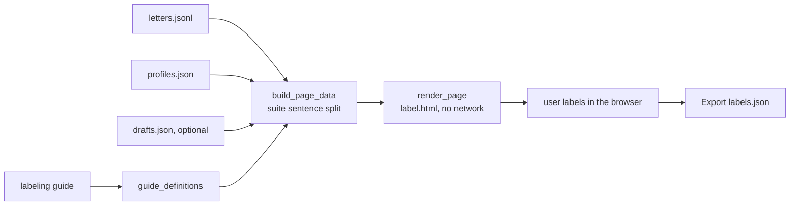

# MH-B: The labeling page of the real-letter set

Read `AGENT.md` first.

## Apply with the runner

The handoff runner applies this file: it writes the two new files, runs the red command (it must fail), runs the "Done when" checks (they must pass), and commits. See `docs/handoff-runner.md`.

Apply this handoff (WSL, from `apps/backend-py`):

```bash
.venv/bin/python scripts/run_handoff.py ../../tasks/active/step-3-2-real-letters/mh-b-label-page.md
```

## Why

MH-A writes `letters.jsonl` and `profiles.json`. Claude then writes draft labels in `drafts.json`, and the user corrects them. This script builds the page for that work: one self-contained `label.html` beside the data. It opens from the file in a browser and makes no network call. For each letter, it shows the job and the letter split into the sentences that the grounding suite reads. The user ticks each ungrounded sentence and each label, writes a note, marks the letter as reviewed, and exports `labels.json` (MH-C imports it).

The page splits each letter with `split_letter_sentences`, the same function that the suite uses, so each exported sentence is exactly a sentence that `GroundingCase` accepts. `ungrounded_claims` is not a free checkbox: the page sets it when at least one sentence is ticked, as the labeling guide says.

You do not run this script on real data. The tests use the sample job, the sample profile, and fixed letters only.



## Files

- `apps/backend-py/scripts/build_grounding_label_page.py` (new)
- `apps/backend-py/tests/unit/test_build_grounding_label_page.py` (new)

## Step 1: add this test file, run it, and see it fail

`apps/backend-py/tests/unit/test_build_grounding_label_page.py`:

```python new=apps/backend-py/tests/unit/test_build_grounding_label_page.py
"""Tests for the labeling page of the real-letter set (Step 3.2 real letters, MH-B)."""

import json
import re
from pathlib import Path
from typing import Any, Dict

import pytest

from scripts import build_grounding_label_page as page
from src.evaluation.suites.grounding import GROUNDING_LABELS
from src.generation.cover_letter_grounding import split_letter_sentences
from src.models.job_listing import JobListing
from src.models.user_profile import UserProfile

LETTER = (
    "Dear team, I am applying for the backend role. "
    "I built a FastAPI service for payments! "
    "Did I also run Kafka for five years? "
    "Thank you for your time."
)
DRAFT = {
    "expected_issues": ["fabricated_technology", "ungrounded_claims"],
    "ungrounded_sentences": ["Did I also run Kafka  for five years?"],
    "note": "Kafka is not in the profile.",
}


def letter_record(
    job: JobListing, case_id: str = "real__01", letter: str = LETTER
) -> Dict[str, Any]:
    """Build one letter record in the MH-A format.

    Args:
        job: The job.
        case_id: The case ID.
        letter: The letter text.

    Returns:
        A letter record.
    """
    return {
        "case_id": case_id,
        "profile_id": "real",
        "job": job.model_dump(mode="json"),
        "selection": None,
        "letter": letter,
    }


def embedded_data(html: str) -> Dict[str, Any]:
    """Read the JSON data that the page embeds.

    Args:
        html: The page.

    Returns:
        The decoded page data.
    """
    match = re.search(
        r'<script type="application/json" id="page-data">(.*?)</script>', html, re.S
    )
    assert match is not None
    return json.loads(match.group(1))


def test_guide_definitions_reads_every_label() -> None:
    """The committed guide gives a definition for each of the 8 labels."""
    definitions = page.guide_definitions(page.GUIDE_PATH.read_text(encoding="utf-8"))

    assert set(definitions) == set(GROUNDING_LABELS)
    assert definitions["fabricated_technology"].startswith(
        "Use this label when the letter claims a technology"
    )
    assert "Sentence labels" not in definitions["ungrounded_claims"]


def test_cases_use_the_suite_sentence_split(
    sample_job_listing: JobListing, sample_user_profile: UserProfile
) -> None:
    """Each case has the suite's sentences and empty start values without a draft."""
    data = page.build_page_data(
        [letter_record(sample_job_listing)],
        {"real": sample_user_profile.model_dump(mode="json")},
        {},
        {},
    )

    case = data["cases"][0]
    assert case["sentences"] == split_letter_sentences(LETTER)
    assert len(case["sentences"]) == 4
    assert case["start"] == {
        "expected_issues": [],
        "ungrounded": [],
        "note": "",
        "reviewed": False,
    }
    assert data["labels"] == list(GROUNDING_LABELS)


def test_drafts_become_the_start_values(sample_job_listing: JobListing) -> None:
    """A draft gives the start labels; ungrounded_claims comes from the sentences."""
    data = page.build_page_data(
        [letter_record(sample_job_listing)], {}, {"real__01": DRAFT}, {}
    )

    assert data["cases"][0]["start"] == {
        "expected_issues": ["fabricated_technology"],
        "ungrounded": [2],
        "note": "Kafka is not in the profile.",
        "reviewed": False,
    }


@pytest.mark.parametrize(
    ("drafts", "message"),
    [
        ({"real__09": {}}, "unknown cases"),
        ({"real__01": {"expected_issues": ["made_up_label"]}}, "unknown labels"),
        (
            {"real__01": {"ungrounded_sentences": ["I led a team of ten."]}},
            "not in the letter",
        ),
    ],
    ids=["unknown case", "unknown label", "sentence not in the letter"],
)
def test_bad_drafts_stop_the_build(
    sample_job_listing: JobListing, drafts: Dict[str, Any], message: str
) -> None:
    """A draft for an unknown case, label, or sentence raises a clear ValueError."""
    with pytest.raises(ValueError, match=message):
        page.build_page_data([letter_record(sample_job_listing)], {}, drafts, {})


def test_page_is_self_contained_and_escapes_the_data(
    sample_job_listing: JobListing,
) -> None:
    """Letter text cannot close the data script, and the page loads nothing."""
    letter = "Dear team, see </script><script>alert(1)</script> here. Thank you."
    data = page.build_page_data(
        [letter_record(sample_job_listing, letter=letter)], {}, {}, {}
    )

    html = page.render_page(data)

    assert "<script>alert(1)" not in html
    assert embedded_data(html)["cases"][0]["sentences"] == split_letter_sentences(
        letter
    )
    assert "<script src" not in html
    assert "<link" not in html
    assert "fetch(" not in html
    assert "XMLHttpRequest" not in html
    assert "labels.json" in html


def test_main_writes_the_page_next_to_the_letters(
    tmp_path: Path, sample_job_listing: JobListing, sample_user_profile: UserProfile
) -> None:
    """main reads the folder, uses drafts.json, and writes label.html."""
    record = letter_record(sample_job_listing)
    (tmp_path / "letters.jsonl").write_text(json.dumps(record) + "\n", encoding="utf-8")
    (tmp_path / "profiles.json").write_text(
        json.dumps({"real": sample_user_profile.model_dump(mode="json")}),
        encoding="utf-8",
    )
    (tmp_path / "drafts.json").write_text(
        json.dumps({"real__01": DRAFT}), encoding="utf-8"
    )

    assert page.main(["--dataset", str(tmp_path)]) == 0

    data = embedded_data((tmp_path / "label.html").read_text(encoding="utf-8"))
    assert [case["case_id"] for case in data["cases"]] == ["real__01"]
    assert data["cases"][0]["start"]["ungrounded"] == [2]
    assert set(data["definitions"]) == set(GROUNDING_LABELS)
    assert data["profiles"]["real"]["name"] == sample_user_profile.name


def test_main_stops_without_letters(tmp_path: Path) -> None:
    """main writes nothing when letters.jsonl is missing."""
    assert page.main(["--dataset", str(tmp_path)]) == 1
    assert not (tmp_path / "label.html").exists()
```

Run it (from `apps/backend-py`). It must fail with `ImportError` (the script does not exist yet):

```bash red cwd=apps/backend-py
.venv/bin/python -m pytest tests/unit/test_build_grounding_label_page.py -q
```

## Step 2: add the script

`apps/backend-py/scripts/build_grounding_label_page.py` (the page template is a raw string, `r"""..."""`, so that `\n` in the JavaScript stays as written):

```python new=apps/backend-py/scripts/build_grounding_label_page.py
#!/usr/bin/env python3
"""
Job Raider - Build the labeling page of the real-letter grounding set
(Step 3.2 real letters, MH-B)

Reads ``letters.jsonl`` and ``profiles.json`` (written by MH-A) and an
optional ``drafts.json`` (draft labels) in a dataset folder, and writes one
self-contained ``label.html`` beside them. The page opens from the file in a
browser and makes no network call. It shows the profile, each job, and each
letter split into the sentences that the grounding suite reads. The labeler
ticks the ungrounded sentences and the labels, writes a note, marks each
letter as reviewed, and exports ``labels.json`` for MH-C.

Usage (from apps/backend-py):

    python scripts/build_grounding_label_page.py --dataset data/eval/grounding_real

Author: Job Raider
Date: 2026-10-30
"""

from __future__ import annotations

import argparse
import json
import re
import sys
from pathlib import Path
from typing import Any, Dict, List, Optional, Sequence

# Allow ``from src...`` when run as a script.
_BACKEND_ROOT = Path(__file__).resolve().parents[1]
if str(_BACKEND_ROOT) not in sys.path:
    sys.path.insert(0, str(_BACKEND_ROOT))

from src.evaluation.suites.grounding import GROUNDING_LABELS  # noqa: E402
from src.generation.cover_letter_grounding import (  # noqa: E402
    split_letter_sentences,
)

GUIDE_PATH = _BACKEND_ROOT / "tests" / "fixtures" / "eval" / "grounding" / "README.md"
DEFAULT_DATASET = _BACKEND_ROOT / "data" / "eval" / "grounding_real"
SENTENCE_LABEL = "ungrounded_claims"
DATA_MARKER = "__PAGE_DATA__"


def guide_definitions(guide_text: str) -> Dict[str, str]:
    """
    Read the definition of each label from the labeling guide.

    Args:
        guide_text: The text of the guide (Markdown).

    Returns:
        The definition text of each label that has a heading of the form
        ``### `label_name` ``, by label name. A definition ends at the next
        label heading or at the next ``##`` heading.
    """
    definitions: Dict[str, str] = {}
    parts = re.split(r"^### `([a-z_]+)`[ \t]*$", guide_text, flags=re.M)
    for name, body in zip(parts[1::2], parts[2::2]):
        definitions[name] = body.split("\n## ", 1)[0].strip()
    return definitions


def read_letters(path: Path) -> List[Dict[str, Any]]:
    """
    Read the letter records that MH-A wrote.

    Args:
        path: The ``letters.jsonl`` file.

    Returns:
        One dict for each line that is not empty.
    """
    lines = path.read_text(encoding="utf-8").splitlines()
    return [json.loads(line) for line in lines if line.strip()]


def build_page_data(
    letters: Sequence[Dict[str, Any]],
    profiles: Dict[str, Any],
    drafts: Dict[str, Dict[str, Any]],
    definitions: Dict[str, str],
) -> Dict[str, Any]:
    """
    Build the data that the page shows, with the drafts as start values.

    Args:
        letters: The letter records of MH-A.
        profiles: The profiles by profile ID.
        drafts: The draft labels by case ID (may be empty).
        definitions: The label definitions from the guide.

    Returns:
        A dict with ``labels``, ``definitions``, ``profiles``, and ``cases``.
        Each case has its sentences (the suite's split) and its start values:
        the labels other than ``ungrounded_claims``, the indexes of the
        ungrounded sentences, the note, and ``reviewed`` (always false).

    Raises:
        ValueError: When a draft names an unknown case, an unknown label, or
            a sentence that is not in its letter.
    """
    unknown_cases = sorted(set(drafts) - {record["case_id"] for record in letters})
    if unknown_cases:
        raise ValueError(f"drafts for unknown cases: {unknown_cases}")
    cases: List[Dict[str, Any]] = []
    for record in letters:
        case_id = record["case_id"]
        sentences = split_letter_sentences(record["letter"])
        draft = drafts.get(case_id, {})
        issues = list(draft.get("expected_issues", []))
        unknown_labels = sorted(set(issues) - set(GROUNDING_LABELS))
        if unknown_labels:
            raise ValueError(f"{case_id}: unknown labels {unknown_labels}")
        marked = [
            " ".join(text.split()) for text in draft.get("ungrounded_sentences", [])
        ]
        for text in marked:
            if text not in sentences:
                raise ValueError(
                    f"{case_id}: draft sentence not in the letter: {text!r}"
                )
        cases.append(
            {
                "case_id": case_id,
                "profile_id": record["profile_id"],
                "job": record["job"],
                "selection": record.get("selection"),
                "sentences": sentences,
                "start": {
                    "expected_issues": [i for i in issues if i != SENTENCE_LABEL],
                    "ungrounded": [sentences.index(text) for text in marked],
                    "note": str(draft.get("note", "")),
                    "reviewed": False,
                },
            }
        )
    return {
        "labels": list(GROUNDING_LABELS),
        "definitions": definitions,
        "profiles": profiles,
        "cases": cases,
    }


def page_json(data: Dict[str, Any]) -> str:
    """
    Encode the page data for a ``<script type="application/json">`` tag.

    Every ``<`` becomes ``\\u003c``, so no text in the data can close the tag.

    Args:
        data: The page data.

    Returns:
        JSON text that is safe inside the tag.
    """
    return json.dumps(data, ensure_ascii=False).replace("<", "\\u003c")


def render_page(data: Dict[str, Any]) -> str:
    """
    Render the self-contained labeling page.

    Args:
        data: The page data from ``build_page_data``.

    Returns:
        The HTML text of ``label.html``.
    """
    return PAGE_TEMPLATE.replace(DATA_MARKER, page_json(data))


def main(argv: Optional[Sequence[str]] = None) -> int:
    """
    Build ``label.html`` in a dataset folder.

    Args:
        argv: Command-line arguments (default: ``sys.argv[1:]``).

    Returns:
        0 when the page is written, 1 when ``letters.jsonl`` is missing.
    """
    parser = argparse.ArgumentParser(
        description="Write label.html for the real-letter grounding set."
    )
    parser.add_argument(
        "--dataset", type=Path, default=DEFAULT_DATASET, help="Dataset folder"
    )
    args = parser.parse_args(argv)

    letters_path = args.dataset / "letters.jsonl"
    if not letters_path.exists():
        print(f"{letters_path} is missing; run make_real_grounding_set.py first")
        return 1
    profiles_path = args.dataset / "profiles.json"
    profiles = (
        json.loads(profiles_path.read_text(encoding="utf-8"))
        if profiles_path.exists()
        else {}
    )
    drafts_path = args.dataset / "drafts.json"
    drafts = (
        json.loads(drafts_path.read_text(encoding="utf-8"))
        if drafts_path.exists()
        else {}
    )
    definitions = guide_definitions(GUIDE_PATH.read_text(encoding="utf-8"))
    data = build_page_data(read_letters(letters_path), profiles, drafts, definitions)
    out = args.dataset / "label.html"
    out.write_text(render_page(data), encoding="utf-8")
    print(f"Wrote {out}: {len(data['cases'])} letters, {len(drafts)} drafts")
    return 0


PAGE_TEMPLATE = r"""<!doctype html>
<html lang="en">
<head>
<meta charset="utf-8">
<meta name="viewport" content="width=device-width, initial-scale=1">
<title>Grounding labels</title>
<style>
:root {
  color-scheme: light dark;
  --bg: #ffffff; --fg: #1d1d1f; --muted: #6b6b70; --line: #d8d8dc;
  --card: #f6f6f8; --mark: #fff1c2; --accent: #2457c5;
}
@media (prefers-color-scheme: dark) {
  :root {
    --bg: #161618; --fg: #ececee; --muted: #a0a0a8; --line: #34343a;
    --card: #202024; --mark: #4a3d10; --accent: #7ea2ff;
  }
}
* { box-sizing: border-box; }
body { margin: 0; background: var(--bg); color: var(--fg); font: 15px/1.5 system-ui, sans-serif; }
header {
  position: sticky; top: 0; z-index: 2; display: flex; flex-wrap: wrap; gap: 12px;
  align-items: center; padding: 10px 16px; background: var(--card);
  border-bottom: 1px solid var(--line);
}
header h1 { font-size: 17px; margin: 0 12px 0 0; }
button {
  font: inherit; padding: 4px 12px; border: 1px solid var(--line); border-radius: 6px;
  background: var(--bg); color: var(--fg); cursor: pointer;
}
.layout { display: grid; grid-template-columns: minmax(0, 2fr) minmax(0, 3fr); gap: 16px; padding: 16px; }
aside { position: sticky; top: 64px; align-self: start; max-height: calc(100vh - 80px); overflow: auto; }
pre {
  white-space: pre-wrap; word-break: break-word; font-size: 13px; background: var(--card);
  border: 1px solid var(--line); border-radius: 6px; padding: 8px;
}
section.case { border: 2px solid var(--line); border-radius: 8px; padding: 12px 16px; margin-bottom: 20px; }
section.case.done { border-color: var(--accent); }
h2 { font-size: 16px; margin: 0 0 8px; }
ol.sentences { padding-left: 24px; }
ol.sentences li { margin: 4px 0; }
ol.sentences label, .labels label, label.reviewed { display: flex; gap: 8px; align-items: flex-start; }
ol.sentences li.ungrounded span { background: var(--mark); }
.labels { display: grid; grid-template-columns: repeat(auto-fill, minmax(230px, 1fr)); gap: 4px 12px; margin: 8px 0; }
.muted { color: var(--muted); font-size: 13px; }
textarea {
  width: 100%; min-height: 56px; font: inherit; background: var(--bg); color: var(--fg);
  border: 1px solid var(--line); border-radius: 6px; padding: 6px; margin: 8px 0;
}
dl.defs dt { font-weight: 600; margin-top: 8px; }
dl.defs dd { margin: 0 0 4px; white-space: pre-wrap; font-size: 13px; }
@media (max-width: 800px) {
  .layout { grid-template-columns: 1fr; }
  aside { position: static; max-height: none; }
}
</style>
</head>
<body>
<header>
<h1>Grounding labels</h1>
<span id="progress" class="muted"></span>
<button type="button" id="export">Export labels.json</button>
<button type="button" id="discard">Discard my changes</button>
</header>
<div class="layout">
<aside>
<details open><summary>Profile</summary><pre id="profile"></pre></details>
<details><summary>Label definitions</summary><dl class="defs" id="defs"></dl></details>
</aside>
<main id="cases"></main>
</div>
<script type="application/json" id="page-data">__PAGE_DATA__</script>
<script>
(() => {
  "use strict";
  const data = JSON.parse(document.getElementById("page-data").textContent);
  const SENTENCE_LABEL = "ungrounded_claims";
  const storeKey = "grounding-labels:" +
    data.cases.map((c) => `${c.case_id}/${c.sentences.length}`).join(",");

  function startState() {
    const state = {};
    for (const c of data.cases) state[c.case_id] = JSON.parse(JSON.stringify(c.start));
    return state;
  }

  function loadState() {
    try {
      const saved = JSON.parse(localStorage.getItem(storeKey) || "null");
      if (saved && data.cases.every((c) => saved[c.case_id])) return saved;
    } catch (err) {
      // Browser storage is optional; start from the drafts.
    }
    return startState();
  }

  let state = loadState();

  function el(tag, text, className) {
    const node = document.createElement(tag);
    if (text !== undefined && text !== null) node.textContent = String(text);
    if (className) node.className = className;
    return node;
  }

  function checkbox(checked, onChange) {
    const box = document.createElement("input");
    box.type = "checkbox";
    box.checked = checked;
    box.addEventListener("change", () => onChange(box.checked));
    return box;
  }

  function showProgress() {
    const done = data.cases.filter((c) => state[c.case_id].reviewed).length;
    document.getElementById("progress").textContent =
      `Reviewed ${done} of ${data.cases.length}`;
    for (const c of data.cases) {
      document.getElementById(`case-${c.case_id}`)
        .classList.toggle("done", state[c.case_id].reviewed);
    }
  }

  function saveState() {
    try {
      localStorage.setItem(storeKey, JSON.stringify(state));
    } catch (err) {
      // Browser storage is optional; the export still has the labels.
    }
    showProgress();
  }

  function buildLabels() {
    const out = {};
    for (const c of data.cases) {
      const s = state[c.case_id];
      const ungrounded = s.ungrounded.slice().sort((a, b) => a - b)
        .map((index) => c.sentences[index]);
      out[c.case_id] = {
        expected_issues: data.labels.filter((label) => (label === SENTENCE_LABEL
          ? ungrounded.length > 0 : s.expected_issues.includes(label))),
        ungrounded_sentences: ungrounded,
        note: s.note,
        reviewed: s.reviewed,
      };
    }
    return out;
  }
  window.buildLabels = buildLabels;

  function renderCase(c) {
    const s = state[c.case_id];
    const job = c.job || {};
    const section = el("section", null, "case");
    section.id = `case-${c.case_id}`;
    section.appendChild(el("h2", `${c.case_id}: ${job.title || ""} at ${job.company || ""}`));

    const jobBox = el("details");
    jobBox.appendChild(el("summary", "Job description"));
    jobBox.appendChild(el("pre", job.description || ""));
    section.appendChild(jobBox);

    const selection = c.selection || {};
    const projects = (selection.selected_projects || []).map((p) => p.name).join(", ");
    const keywords = (selection.keywords_to_emphasize || []).join(", ");
    section.appendChild(el("p",
      `Selected projects: ${projects || "none"}. Keywords: ${keywords || "none"}.`, "muted"));

    const derived = checkbox(s.ungrounded.length > 0, () => {});
    derived.disabled = true;

    section.appendChild(el("p", "Tick each ungrounded sentence:", "muted"));
    const list = el("ol", null, "sentences");
    c.sentences.forEach((sentence, index) => {
      const item = el("li");
      const label = el("label");
      const box = checkbox(s.ungrounded.includes(index), (on) => {
        s.ungrounded = s.ungrounded.filter((i) => i !== index);
        if (on) s.ungrounded.push(index);
        item.classList.toggle("ungrounded", on);
        derived.checked = s.ungrounded.length > 0;
        saveState();
      });
      item.classList.toggle("ungrounded", box.checked);
      label.appendChild(box);
      label.appendChild(el("span", sentence));
      item.appendChild(label);
      list.appendChild(item);
    });
    section.appendChild(list);

    section.appendChild(el("p", "Labels (hover a label for its definition):", "muted"));
    const labels = el("div", null, "labels");
    for (const name of data.labels) {
      const label = el("label");
      label.title = data.definitions[name] || "";
      if (name === SENTENCE_LABEL) {
        label.appendChild(derived);
        label.appendChild(el("span", `${name} (set from the sentences)`));
      } else {
        label.appendChild(checkbox(s.expected_issues.includes(name), (on) => {
          s.expected_issues = s.expected_issues.filter((n) => n !== name);
          if (on) s.expected_issues.push(name);
          saveState();
        }));
        label.appendChild(el("span", name));
      }
      labels.appendChild(label);
    }
    section.appendChild(labels);

    const note = el("textarea");
    note.placeholder = "Note: the reason for each label";
    note.value = s.note;
    note.addEventListener("input", () => {
      s.note = note.value;
      saveState();
    });
    section.appendChild(note);

    const reviewed = el("label", null, "reviewed");
    reviewed.appendChild(checkbox(s.reviewed, (on) => {
      s.reviewed = on;
      saveState();
    }));
    reviewed.appendChild(el("span", "Reviewed: the labels of this letter are final"));
    section.appendChild(reviewed);
    return section;
  }

  function render() {
    const profileIds = [...new Set(data.cases.map((c) => c.profile_id))];
    document.getElementById("profile").textContent = profileIds
      .map((id) => JSON.stringify(data.profiles[id] || {}, null, 2)).join("\n\n");
    const defs = document.getElementById("defs");
    for (const name of data.labels) {
      defs.appendChild(el("dt", name));
      defs.appendChild(el("dd", data.definitions[name] || ""));
    }
    const main = document.getElementById("cases");
    for (const c of data.cases) main.appendChild(renderCase(c));
    showProgress();
  }

  document.getElementById("export").addEventListener("click", () => {
    const text = JSON.stringify(buildLabels(), null, 2) + "\n";
    const url = URL.createObjectURL(new Blob([text], { type: "application/json" }));
    const link = document.createElement("a");
    link.href = url;
    link.download = "labels.json";
    link.click();
    setTimeout(() => URL.revokeObjectURL(url), 1000);
  });

  document.getElementById("discard").addEventListener("click", () => {
    if (!window.confirm("Discard your changes and start again from the drafts?")) return;
    try {
      localStorage.removeItem(storeKey);
    } catch (err) {
      // Browser storage is optional.
    }
    window.location.reload();
  });

  render();
})();
</script>
</body>
</html>
"""


if __name__ == "__main__":
    sys.exit(main())
```

## Done when

Run the new tests:

```bash check cwd=apps/backend-py
.venv/bin/python -m pytest tests/unit/test_build_grounding_label_page.py -q
```

Format the new files:

```bash check cwd=apps/backend-py
.venv/bin/python -m black scripts/build_grounding_label_page.py tests/unit/test_build_grounding_label_page.py
```

Check the lint:

```bash check cwd=apps/backend-py
.venv/bin/python -m ruff check scripts/build_grounding_label_page.py tests/unit/test_build_grounding_label_page.py
```

Do not run the script on real data, and do not open `apps/backend-py/data/`.

Commit message:

```text commit
feat(eval): add the labeling page of the real-letter grounding set
```
