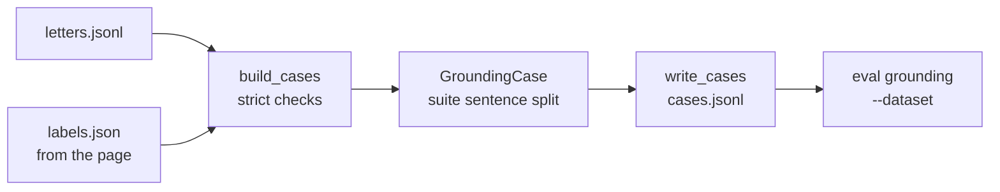

# MH-C: The import of the labels

Read `AGENT.md` first. Do MH-B first: this step uses `read_letters` from `scripts/build_grounding_label_page.py`.

## Apply with the runner

The handoff runner applies this file: it writes the two new files, runs the red command (it must fail), runs the "Done when" checks (they must pass), and commits. See `docs/handoff-runner.md`.

Apply this handoff (WSL, from `apps/backend-py`):

```bash
.venv/bin/python scripts/run_handoff.py ../../tasks/active/step-3-2-real-letters/mh-c-import-labels.md
```

## Why

The MH-B page exports `labels.json`: for each letter, the labels, the ungrounded sentences, a note, and `reviewed`. The grounding suite reads `cases.jsonl`, one `GroundingCase` for each line. This script joins `letters.jsonl` (MH-A) and `labels.json` into `cases.jsonl`, so that `python main.py eval grounding --dataset data/eval/grounding_real` can run.

The import is strict, because the labels are the measure:

- Every letter has labels, and every label entry belongs to a letter.
- Every letter is marked as reviewed (the user checked each one).
- Each label is a grounding label, and each ungrounded sentence is a sentence of its letter (`GroundingCase` checks this with the suite's sentence split).
- `ungrounded_claims` is set from the sentence list, as the labeling guide says.
- An existing `cases.jsonl` is not replaced without `--force`, because the labels are frozen once the eval has run.

The browser saves `labels.json` in the Downloads folder, so `--labels` takes any path. The script keeps a copy of the imported file in the dataset folder.

You do not run this script on real data. The tests use the sample job and fixed letters only.



## Files

- `apps/backend-py/scripts/import_grounding_labels.py` (new)
- `apps/backend-py/tests/unit/test_import_grounding_labels.py` (new)

## Step 1: add this test file, run it, and see it fail

`apps/backend-py/tests/unit/test_import_grounding_labels.py`:

```python new=apps/backend-py/tests/unit/test_import_grounding_labels.py
"""Tests for the label import of the real-letter set (Step 3.2 real letters, MH-C)."""

import json
from pathlib import Path
from typing import Any, Dict, List

import pytest

from scripts import import_grounding_labels as imp
from src.evaluation.datasets import load_jsonl
from src.evaluation.suites.grounding import GroundingCase
from src.models.job_listing import JobListing

LETTER = (
    "Dear team, I am applying for the backend role. "
    "I built a FastAPI service for payments! "
    "Did I also run Kafka for five years? "
    "Thank you for your time."
)


def letter_record(job: JobListing, case_id: str = "real__01") -> Dict[str, Any]:
    """Build one letter record in the MH-A format.

    Args:
        job: The job.
        case_id: The case ID.

    Returns:
        A letter record.
    """
    return {
        "case_id": case_id,
        "profile_id": "real",
        "job": job.model_dump(mode="json"),
        "selection": None,
        "letter": LETTER,
    }


def label_entry(**changes: Any) -> Dict[str, Any]:
    """Build one reviewed label entry, as the MH-B page exports it.

    Args:
        **changes: Fields to change.

    Returns:
        A label entry.
    """
    entry: Dict[str, Any] = {
        "expected_issues": ["fabricated_technology", "ungrounded_claims"],
        "ungrounded_sentences": ["Did I also run Kafka for five years?"],
        "note": "Kafka is not in the profile.",
        "reviewed": True,
    }
    entry.update(changes)
    return entry


def write_dataset(folder: Path, records: List[Dict[str, Any]]) -> None:
    """Write letters.jsonl in a dataset folder.

    Args:
        folder: The dataset folder.
        records: The letter records.
    """
    folder.mkdir(parents=True, exist_ok=True)
    lines = [json.dumps(record) + "\n" for record in records]
    (folder / "letters.jsonl").write_text("".join(lines), encoding="utf-8")


def test_build_cases_sets_ungrounded_claims_from_the_sentences(
    sample_job_listing: JobListing,
) -> None:
    """ungrounded_claims follows the sentence list, and labels keep the suite order."""
    letters = [
        letter_record(sample_job_listing, "real__01"),
        letter_record(sample_job_listing, "real__02"),
    ]
    labels = {
        "real__01": label_entry(
            expected_issues=[
                "scope_inflation",
                "fabricated_experience",
                "inflated_duration",
            ],
            ungrounded_sentences=["Did I also run Kafka  for five years?"],
        ),
        "real__02": label_entry(
            expected_issues=["ungrounded_claims"], ungrounded_sentences=[]
        ),
    }

    cases = imp.build_cases(letters, labels)

    assert cases[0].expected_issues == [
        "inflated_duration",
        "fabricated_experience",
        "scope_inflation",
        "ungrounded_claims",
    ]
    assert cases[0].ungrounded_sentences == ["Did I also run Kafka for five years?"]
    assert cases[0].note == "Kafka is not in the profile."
    assert cases[1].expected_issues == []
    assert cases[1].ungrounded_sentences == []


@pytest.mark.parametrize(
    ("labels", "message"),
    [
        ({}, "letters without labels"),
        (
            {"real__01": label_entry(), "real__09": label_entry()},
            "labels for unknown cases",
        ),
        ({"real__01": label_entry(reviewed=False)}, "not marked as reviewed"),
        (
            {"real__01": label_entry(expected_issues=["made_up_label"])},
            "unknown labels",
        ),
        (
            {"real__01": label_entry(ungrounded_sentences=["I led a team of ten."])},
            "not a letter sentence",
        ),
    ],
    ids=["missing", "unknown case", "not reviewed", "unknown label", "bad sentence"],
)
def test_bad_labels_stop_the_import(
    sample_job_listing: JobListing, labels: Dict[str, Any], message: str
) -> None:
    """Each problem in labels.json stops the import with a clear message."""
    with pytest.raises(ValueError, match=message):
        imp.build_cases([letter_record(sample_job_listing)], labels)


def test_main_writes_cases_that_the_suite_loads(
    tmp_path: Path, sample_job_listing: JobListing
) -> None:
    """main writes cases.jsonl in the suite format and keeps a copy of the labels."""
    dataset = tmp_path / "grounding_real"
    write_dataset(dataset, [letter_record(sample_job_listing)])
    downloads = tmp_path / "downloads"
    downloads.mkdir()
    labels_text = json.dumps({"real__01": label_entry()})
    (downloads / "labels.json").write_text(labels_text, encoding="utf-8")

    code = imp.main(
        ["--dataset", str(dataset), "--labels", str(downloads / "labels.json")]
    )

    assert code == 0
    cases = load_jsonl(dataset / "cases.jsonl", GroundingCase)
    assert [case.case_id for case in cases] == ["real__01"]
    assert cases[0].expected_issues == ["fabricated_technology", "ungrounded_claims"]
    assert (dataset / "labels.json").read_text(encoding="utf-8") == labels_text


def test_main_keeps_frozen_cases(
    tmp_path: Path, sample_job_listing: JobListing
) -> None:
    """An existing cases.jsonl is replaced only with --force."""
    write_dataset(tmp_path, [letter_record(sample_job_listing)])
    (tmp_path / "labels.json").write_text(
        json.dumps({"real__01": label_entry()}), encoding="utf-8"
    )
    (tmp_path / "cases.jsonl").write_text("frozen\n", encoding="utf-8")

    assert imp.main(["--dataset", str(tmp_path)]) == 1
    assert (tmp_path / "cases.jsonl").read_text(encoding="utf-8") == "frozen\n"

    assert imp.main(["--dataset", str(tmp_path), "--force"]) == 0
    assert len(load_jsonl(tmp_path / "cases.jsonl", GroundingCase)) == 1


def test_main_writes_nothing_when_the_import_stops(
    tmp_path: Path, sample_job_listing: JobListing
) -> None:
    """Missing files or a bad label give exit code 1 and no cases.jsonl."""
    assert imp.main(["--dataset", str(tmp_path)]) == 1

    write_dataset(tmp_path, [letter_record(sample_job_listing)])
    assert imp.main(["--dataset", str(tmp_path)]) == 1

    (tmp_path / "labels.json").write_text(
        json.dumps({"real__01": label_entry(reviewed=False)}), encoding="utf-8"
    )
    assert imp.main(["--dataset", str(tmp_path)]) == 1
    assert not (tmp_path / "cases.jsonl").exists()
```

Run it (from `apps/backend-py`). It must fail with `ImportError` (the script does not exist yet):

```bash red cwd=apps/backend-py
.venv/bin/python -m pytest tests/unit/test_import_grounding_labels.py -q
```

## Step 2: add the script

`apps/backend-py/scripts/import_grounding_labels.py`:

```python new=apps/backend-py/scripts/import_grounding_labels.py
#!/usr/bin/env python3
"""
Job Raider - Import the labels of the real-letter grounding set
(Step 3.2 real letters, MH-C)

Reads ``letters.jsonl`` (written by MH-A) and ``labels.json`` (exported by
the MH-B page) and writes ``cases.jsonl`` in the dataset folder, one
``GroundingCase`` for each letter. The import stops when a letter has no
labels, a label entry names an unknown case, a letter is not marked as
reviewed, a label is unknown, or an ungrounded sentence is not a sentence of
its letter. ``ungrounded_claims`` is set from the sentence list, as the
labeling guide says. An existing ``cases.jsonl`` is not replaced without
``--force``, because the labels are frozen once the eval has run.

Usage (from apps/backend-py; the browser saves labels.json in Downloads):

    python scripts/import_grounding_labels.py --labels /path/to/labels.json

Author: Job Raider
Date: 2026-10-30
"""

from __future__ import annotations

import argparse
import json
import shutil
import sys
from pathlib import Path
from typing import Any, Dict, List, Optional, Sequence

# Allow ``from src...`` and ``from scripts...`` when run as a script.
_BACKEND_ROOT = Path(__file__).resolve().parents[1]
if str(_BACKEND_ROOT) not in sys.path:
    sys.path.insert(0, str(_BACKEND_ROOT))

from scripts.build_grounding_label_page import read_letters  # noqa: E402
from src.evaluation.suites.grounding import (  # noqa: E402
    GROUNDING_LABELS,
    GroundingCase,
)

DEFAULT_DATASET = _BACKEND_ROOT / "data" / "eval" / "grounding_real"
SENTENCE_LABEL = "ungrounded_claims"


def build_cases(
    letters: Sequence[Dict[str, Any]], labels: Dict[str, Dict[str, Any]]
) -> List[GroundingCase]:
    """
    Join the letters and their labels into grounding cases.

    Args:
        letters: The letter records of MH-A.
        labels: The exported label entries by case ID.

    Returns:
        One case for each letter, in letter order. The labels follow the
        order of ``GROUNDING_LABELS``. ``ungrounded_claims`` is present
        exactly when the sentence list is not empty.

    Raises:
        ValueError: When a letter has no labels, an entry names an unknown
            case, a letter is not reviewed, a label is unknown, or a sentence
            is not a sentence of its letter.
    """
    letter_ids = [record["case_id"] for record in letters]
    unknown_cases = sorted(set(labels) - set(letter_ids))
    if unknown_cases:
        raise ValueError(f"labels for unknown cases: {unknown_cases}")
    missing = [case_id for case_id in letter_ids if case_id not in labels]
    if missing:
        raise ValueError(f"letters without labels: {missing}")
    unreviewed = [
        case_id for case_id in letter_ids if labels[case_id].get("reviewed") is not True
    ]
    if unreviewed:
        raise ValueError(f"letters not marked as reviewed: {unreviewed}")

    cases: List[GroundingCase] = []
    for record in letters:
        case_id = record["case_id"]
        entry = labels[case_id]
        issues = set(entry.get("expected_issues", []))
        unknown_labels = sorted(issues - set(GROUNDING_LABELS))
        if unknown_labels:
            raise ValueError(f"{case_id}: unknown labels {unknown_labels}")
        sentences = [
            " ".join(text.split()) for text in entry.get("ungrounded_sentences", [])
        ]
        if sentences:
            issues.add(SENTENCE_LABEL)
        else:
            issues.discard(SENTENCE_LABEL)
        cases.append(
            GroundingCase(
                case_id=case_id,
                profile_id=record["profile_id"],
                job=record["job"],
                selection=record.get("selection"),
                letter=record["letter"],
                expected_issues=[
                    label for label in GROUNDING_LABELS if label in issues
                ],
                note=str(entry.get("note", "")),
                ungrounded_sentences=sentences,
            )
        )
    return cases


def write_cases(
    path: Path, cases: Sequence[GroundingCase], force: bool = False
) -> None:
    """
    Write ``cases.jsonl``, one case for each line.

    Args:
        path: The ``cases.jsonl`` file.
        cases: The grounding cases.
        force: Replace an existing file.

    Raises:
        FileExistsError: When the file exists and ``force`` is false.
    """
    if path.exists() and not force:
        raise FileExistsError(f"{path} exists; the labels are frozen")
    lines = [
        json.dumps(case.model_dump(mode="json"), ensure_ascii=False) + "\n"
        for case in cases
    ]
    path.write_text("".join(lines), encoding="utf-8")


def main(argv: Optional[Sequence[str]] = None) -> int:
    """
    Import ``labels.json`` into ``cases.jsonl``.

    Args:
        argv: Command-line arguments (default: ``sys.argv[1:]``).

    Returns:
        0 when ``cases.jsonl`` is written, 1 when the import stops.
    """
    parser = argparse.ArgumentParser(
        description="Write cases.jsonl from letters.jsonl and the exported labels."
    )
    parser.add_argument(
        "--dataset", type=Path, default=DEFAULT_DATASET, help="Dataset folder"
    )
    parser.add_argument(
        "--labels",
        type=Path,
        default=None,
        help="Exported labels.json (default: labels.json in the dataset folder)",
    )
    parser.add_argument(
        "--force", action="store_true", help="Replace an existing cases.jsonl"
    )
    args = parser.parse_args(argv)

    letters_path = args.dataset / "letters.jsonl"
    labels_path = args.labels or args.dataset / "labels.json"
    cases_path = args.dataset / "cases.jsonl"
    for path in (letters_path, labels_path):
        if not path.exists():
            print(f"{path} is missing")
            return 1
    if cases_path.exists() and not args.force:
        print(
            f"{cases_path} exists; the labels are frozen. "
            "Use --force only before the eval runs."
        )
        return 1

    labels = json.loads(labels_path.read_text(encoding="utf-8"))
    try:
        cases = build_cases(read_letters(letters_path), labels)
    except ValueError as exc:
        print(f"Import stopped: {exc}")
        return 1

    kept_labels = args.dataset / "labels.json"
    if labels_path.resolve() != kept_labels.resolve():
        shutil.copyfile(labels_path, kept_labels)
    write_cases(cases_path, cases, force=args.force)
    labeled = sum(1 for case in cases if case.expected_issues)
    sentences = sum(len(case.ungrounded_sentences or []) for case in cases)
    print(
        f"Wrote {len(cases)} cases to {cases_path}: "
        f"{labeled} with labels, {sentences} ungrounded sentences"
    )
    return 0


if __name__ == "__main__":
    sys.exit(main())
```

## Done when

Run the new tests and the MH-B tests:

```bash check cwd=apps/backend-py
.venv/bin/python -m pytest tests/unit/test_import_grounding_labels.py tests/unit/test_build_grounding_label_page.py -q
```

Format the new files:

```bash check cwd=apps/backend-py
.venv/bin/python -m black scripts/import_grounding_labels.py tests/unit/test_import_grounding_labels.py
```

Check the lint:

```bash check cwd=apps/backend-py
.venv/bin/python -m ruff check scripts/import_grounding_labels.py tests/unit/test_import_grounding_labels.py
```

Do not run the script on real data, and do not open `apps/backend-py/data/`.

Commit message:

```text commit
feat(eval): add the label import of the real-letter grounding set
```
