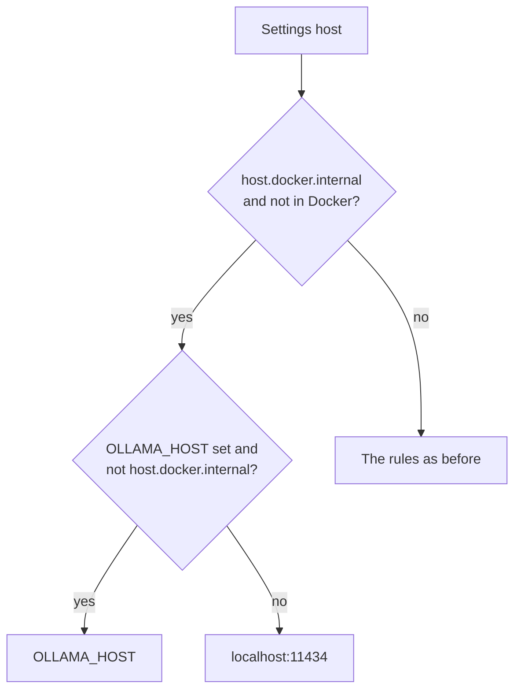

# MH-H1: Use localhost for a Docker Ollama host outside Docker

## Apply with the runner

The handoff runner applies this file: it writes the new test file, runs the red command (it must fail), makes the three edits, runs the "Done when" checks (they must pass), and commits. See `docs/handoff-runner.md`.

Apply this handoff (WSL, from `apps/backend-py`):

```bash
.venv/bin/python scripts/run_handoff.py ../../tasks/active/step-3-2-real-letters/mh-h1-ollama-host-outside-docker.md
```

## Why

The first real run of the letter generator (2026-10-30) ran in WSL, outside Docker. Every Ollama call failed with "Ollama is not running at http://host.docker.internal:11434". The saved Settings hold `host.docker.internal:11434`, the Compose name for the host machine, because the app normally runs in Docker. `resolve_effective_ollama_host` always keeps a Settings host that is not loopback, but outside a container that name does not resolve. A native run of the backend (`dev.sh`) with the same Settings has the same problem.

After this change, outside Docker, a Settings host of `host.docker.internal` gives `OLLAMA_HOST` (when it is set and is not also `host.docker.internal`) or `localhost:11434`. Inside Docker, nothing changes.



## Files

- `apps/backend-py/src/api/ollama_models.py` (change)
- `apps/backend-py/tests/unit/test_ollama_host_outside_docker.py` (new)

## Step 1: add this test file, run it, and see it fail

```python new=apps/backend-py/tests/unit/test_ollama_host_outside_docker.py
"""Tests for a Docker Ollama host used outside Docker (Step 3.2, MH-H1)."""

from src.api.ollama_models import is_docker_gateway_host, resolve_effective_ollama_host


def test_docker_gateway_settings_use_localhost_outside_docker() -> None:
    """Outside Docker, host.docker.internal does not resolve; localhost is used."""
    assert (
        resolve_effective_ollama_host(
            "http://host.docker.internal:11434", env_host="", in_docker=False
        )
        == "localhost:11434"
    )


def test_docker_gateway_settings_use_the_env_host_outside_docker() -> None:
    """Outside Docker, OLLAMA_HOST is used when it is set."""
    assert (
        resolve_effective_ollama_host(
            "host.docker.internal:11434", env_host="127.0.0.1:11500", in_docker=False
        )
        == "127.0.0.1:11500"
    )


def test_a_docker_gateway_env_host_is_not_used_outside_docker() -> None:
    """An OLLAMA_HOST of host.docker.internal does not resolve either."""
    assert (
        resolve_effective_ollama_host(
            "host.docker.internal:11434",
            env_host="host.docker.internal:11434",
            in_docker=False,
        )
        == "localhost:11434"
    )


def test_docker_gateway_settings_are_kept_inside_docker() -> None:
    """Inside Docker, host.docker.internal is the right host and is kept."""
    assert (
        resolve_effective_ollama_host(
            "host.docker.internal:11434", env_host="", in_docker=True
        )
        == "host.docker.internal:11434"
    )


def test_is_docker_gateway_host() -> None:
    """The check reads the host name with any scheme, letter case, or port."""
    assert is_docker_gateway_host("http://HOST.docker.internal:11434")
    assert is_docker_gateway_host("host.docker.internal")
    assert not is_docker_gateway_host("localhost:11434")
    assert not is_docker_gateway_host("ollama:11434")
```

Run it. It must fail (`is_docker_gateway_host` does not exist yet):

```bash red cwd=apps/backend-py
.venv/bin/python -m pytest tests/unit/test_ollama_host_outside_docker.py -q
```

## Step 2: change `src/api/ollama_models.py`

1. Add `is_docker_gateway_host` before `running_in_docker`:

```python edit=apps/backend-py/src/api/ollama_models.py
<<<<<<< OLD
def running_in_docker() -> bool:
=======
def is_docker_gateway_host(ollama_host: str) -> bool:
    """
    Return True when the host is Docker's name for the host machine.

    Args:
        ollama_host: Host string from settings or env.

    Returns:
        True for ``host.docker.internal`` (any scheme, letter case, or port).
    """
    name, _port = parse_ollama_host_port(ollama_host)
    return name.lower() == "host.docker.internal"


def running_in_docker() -> bool:
>>>>>>> NEW
```

2. Say the new rule in the docstring of `resolve_effective_ollama_host`:

```python edit=apps/backend-py/src/api/ollama_models.py
<<<<<<< OLD
    shared Ollama service), then Settings, then env, then localhost.
=======
    shared Ollama service), then Settings, then env, then localhost. Outside
    Docker, a Settings host of ``host.docker.internal`` (the Compose name for
    the host machine) does not resolve, so ``OLLAMA_HOST`` or localhost is
    used instead.
>>>>>>> NEW
```

3. Add the rule before the first Settings rule:

```python edit=apps/backend-py/src/api/ollama_models.py
<<<<<<< OLD
    docker = running_in_docker() if in_docker is None else in_docker

    if settings and not (
=======
    docker = running_in_docker() if in_docker is None else in_docker

    if settings and not docker and is_docker_gateway_host(settings):
        if env and not is_docker_gateway_host(env):
            return env
        return "localhost:11434"
    if settings and not (
>>>>>>> NEW
```

## Done when

Run the new tests and the existing host tests:

```bash check cwd=apps/backend-py
.venv/bin/python -m pytest tests/unit/test_ollama_host_outside_docker.py tests/unit/test_ollama_models.py tests/unit/test_router_model_override.py -q
```

Format the changed files:

```bash check cwd=apps/backend-py
.venv/bin/python -m black src/api/ollama_models.py tests/unit/test_ollama_host_outside_docker.py
```

Check the lint:

```bash check cwd=apps/backend-py
.venv/bin/python -m ruff check src/api/ollama_models.py tests/unit/test_ollama_host_outside_docker.py
```

Commit message:

```text commit
fix(llm): use localhost for a Docker Ollama host outside Docker

Settings saved for the Compose stack hold host.docker.internal:11434.
resolve_effective_ollama_host kept that host on a native run (WSL,
dev.sh), where the name does not resolve, so every Ollama call failed.
Outside Docker such a host now gives OLLAMA_HOST, or localhost:11434.
Inside Docker nothing changes.
```
