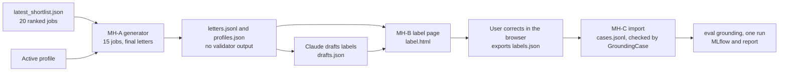

# Notes: Step 3.2 Real Letters

## Plan (2026-10-30, Claude; approved by the user)

**Goal:** the realistic measure of the grounding validator. About 15 letters that the app generates for real shortlisted jobs with the real profile, labeled with the guide (`apps/backend-py/tests/fixtures/eval/grounding/README.md`), then scored one time with `python main.py eval grounding --dataset data/eval/grounding_real`.

**Decisions (2026-10-30, the user):**

1. **Labels: Claude drafts, the user corrects.** This changes decision 1 of 2026-10-22 (the user labels). Cost: the labels lean toward Claude's reading, so the report says "labels drafted by Claude and corrected by the user". Rule 2 of the guide still holds: nobody sees validator output for these letters before the labels are frozen.
2. **Tool: a local HTML labeling page** in the gitignored data folder. It opens in the user's browser from the file; nothing leaves the machine.
3. **Letters: the final letter** of each job (after the service's one grounding rewrite), the letter that the app shows and saves.
4. **Builder: the agent, through micro-handoffs** (the same way as the resume generation fix). Claude writes and dry-runs each handoff and checks each commit.

**Privacy rules:**

- The real profile, the letters, and the labels stay in `apps/backend-py/data/eval/grounding_real/` (gitignored). The scripts are committed; their tests use the synthetic sample profile and fictional jobs only.
- The hosted agent does not open `apps/backend-py/data/`. The user (or Claude, with the user's approval) runs the scripts on real data.
- Claude reads the real profile and the letters only to draft the labels (decision 1).

**Micro-handoffs (one commit each, test-first, synthetic test data only):**

- **MH-A, the generator** (`scripts/make_real_grounding_set.py`). Reads `data/results/latest_shortlist.json` and the active profile. Picks up to N jobs (default 15) in shortlist order, one per company, each with a description of at least 200 characters. Makes all selections first (`qwen2.5:3b`), unloads the loaded models, then writes all letters with `generate_cover_letter_sync` (`qwen2.5:7b`), and unloads again at the end. Writes `profiles.json` (`{"real": profile}`) and `letters.jsonl` (case ID `real__NN`, profile ID, job, selection, final letter). It does not write `cases.jsonl`, so the eval cannot run on unlabeled letters. It sets the app's `job_raider` loggers to ERROR, because the service and the validator log lines that show the validator's verdict ("Cover letter rewritten", `rewrite_ms`, "references project not in profile"). It prints only counts and the output path. It stops when `letters.jsonl` exists, unless `--force`.
- **MH-B, the labeling page** (`scripts/build_grounding_label_page.py`). Reads `letters.jsonl`, `profiles.json`, and an optional `drafts.json`. Writes one self-contained `label.html`: the profile and the job beside each letter, the letter split with `split_letter_sentences` (the same split as the suite, so the exported sentences match exactly), a checkbox for each sentence (ungrounded) and for each of the 8 labels, a note field, the definitions from the guide, the draft values filled in, progress kept in the browser, and an Export button for `labels.json`. Tests: the page contains each sentence of a synthetic letter, the 8 labels, the draft values, and no external script or network call.
- **MH-C, the import** (`scripts/import_grounding_labels.py`). Reads `letters.jsonl` and `labels.json` and writes `cases.jsonl`. Each case goes through `GroundingCase`; `ungrounded_claims` is set from the sentence list; a sentence that is not in its letter, an unknown label, or a missing letter stops the import. Tests: a synthetic round trip, then each error.

**Run steps after the handoffs:**

1. Generate the letters (local Ollama, the models one at a time, no agent model loaded).
2. Claude drafts `drafts.json` from the profile, the jobs, and the letters, with the guide. No validator runs.
3. Build `label.html`; the user corrects every letter and exports `labels.json`.
4. Import to `cases.jsonl`, and freeze the labels.
5. Run `eval grounding` on the folder one time. Record the per-label precision and recall, the sentence scores, and the clean false-positive rate here, next to the main set and the holdout (`tasks/archive/step-3-2-grounding-validator/notes.md`).

## MH-A written and dry-run (2026-10-30, Claude)

Checked before writing: the latest shortlist (`run_8e8837ffb270`) has 20 jobs; 17 remain after one job per company (3 repeated companies), and every description has more than 2000 characters, so 15 letters are possible. `setup_logging` runs only in `main.py` and the orchestrator, not on the letter path, so setting the `job_raider` loggers to errors at the start lasts for the whole run.

Dry run on a scratch copy in WSL's native disk (`/tmp/rla`, not the repository):

- Before the script, the test file fails at collection (`ImportError`). After the script, the 8 tests pass. The given code passes black and ruff.
- Mutation preview (each on its own copy): M1 two jobs of one company, M2 a short description kept, M3 no unload step between selections and letters, M4 an empty letter kept, M5 numbering by job instead of by record, M6 a validation field in the record, M7 writing `cases.jsonl`, M8 replacing without `--force`, M9 logs left at warning, M10 unload doing nothing, M11 starting with a model loaded, M12 a changed profile ID. All 12 were caught.

## Blockers / Questions

- None. MH-A is with the agent.
