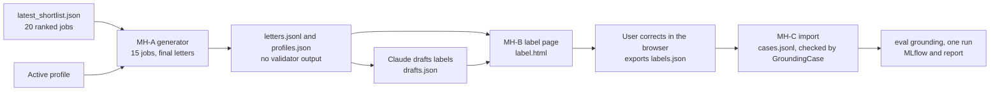

# Notes: Step 3.2 Real Letters

## Plan (2026-10-30, Claude; approved by the user)

**Goal:** the realistic measure of the grounding validator. About 15 letters that the app generates for real shortlisted jobs with the real profile, labeled with the guide (`apps/backend-py/tests/fixtures/eval/grounding/README.md`), then scored one time with `python main.py eval grounding --dataset data/eval/grounding_real`.

**Decisions (2026-10-30, the user):**

1. **Labels: Claude drafts, the user corrects.** This changes decision 1 of 2026-10-22 (the user labels). Cost: the labels lean toward Claude's reading, so the report says "labels drafted by Claude and corrected by the user". Rule 2 of the guide still holds: nobody sees validator output for these letters before the labels are frozen.
2. **Tool: a local HTML labeling page** in the gitignored data folder. It opens in the user's browser from the file; nothing leaves the machine.
3. **Letters: the final letter** of each job (after the service's one grounding rewrite), the letter that the app shows and saves.
4. **Builder: the agent, through micro-handoffs** (the same way as the resume generation fix). Claude writes and dry-runs each handoff and checks each commit.

**Privacy rules:**

- The real profile, the letters, and the labels stay in `apps/backend-py/data/eval/grounding_real/` (gitignored). The scripts are committed; their tests use the synthetic sample profile and fictional jobs only.
- The hosted agent does not open `apps/backend-py/data/`. The user (or Claude, with the user's approval) runs the scripts on real data.
- Claude reads the real profile and the letters only to draft the labels (decision 1).

**Micro-handoffs (one commit each, test-first, synthetic test data only):**

- **MH-A, the generator** (`scripts/make_real_grounding_set.py`). Reads `data/results/latest_shortlist.json` and the active profile. Picks up to N jobs (default 15) in shortlist order, one per company, each with a description of at least 200 characters. Makes all selections first (`qwen2.5:3b`), unloads the loaded models, then writes all letters with `generate_cover_letter_sync` (`qwen2.5:7b`), and unloads again at the end. Writes `profiles.json` (`{"real": profile}`) and `letters.jsonl` (case ID `real__NN`, profile ID, job, selection, final letter). It does not write `cases.jsonl`, so the eval cannot run on unlabeled letters. It sets the app's `job_raider` loggers to ERROR, because the service and the validator log lines that show the validator's verdict ("Cover letter rewritten", `rewrite_ms`, "references project not in profile"). It prints only counts and the output path. It stops when `letters.jsonl` exists, unless `--force`.
- **MH-B, the labeling page** (`scripts/build_grounding_label_page.py`). Reads `letters.jsonl`, `profiles.json`, and an optional `drafts.json`. Writes one self-contained `label.html`: the profile and the job beside each letter, the letter split with `split_letter_sentences` (the same split as the suite, so the exported sentences match exactly), a checkbox for each sentence (ungrounded) and for each of the 8 labels, a note field, the definitions from the guide, the draft values filled in, progress kept in the browser, and an Export button for `labels.json`. Tests: the page contains each sentence of a synthetic letter, the 8 labels, the draft values, and no external script or network call.
- **MH-C, the import** (`scripts/import_grounding_labels.py`). Reads `letters.jsonl` and `labels.json` and writes `cases.jsonl`. Each case goes through `GroundingCase`; `ungrounded_claims` is set from the sentence list; a sentence that is not in its letter, an unknown label, or a missing letter stops the import. Tests: a synthetic round trip, then each error.

**Run steps after the handoffs:**

1. Generate the letters (local Ollama, the models one at a time, no agent model loaded).
2. Claude drafts `drafts.json` from the profile, the jobs, and the letters, with the guide. No validator runs.
3. Build `label.html`; the user corrects every letter and exports `labels.json`.
4. Import to `cases.jsonl`, and freeze the labels.
5. Run `eval grounding` on the folder one time. Record the per-label precision and recall, the sentence scores, and the clean false-positive rate here, next to the main set and the holdout (`tasks/archive/step-3-2-grounding-validator/notes.md`).

## MH-A written and dry-run (2026-10-30, Claude)

Checked before writing: the latest shortlist (`run_8e8837ffb270`) has 20 jobs; 17 remain after one job per company (3 repeated companies), and every description has more than 2000 characters, so 15 letters are possible. `setup_logging` runs only in `main.py` and the orchestrator, not on the letter path, so setting the `job_raider` loggers to errors at the start lasts for the whole run.

Dry run on a scratch copy in WSL's native disk (`/tmp/rla`, not the repository):

- Before the script, the test file fails at collection (`ImportError`). After the script, the 8 tests pass. The given code passes black and ruff.
- Mutation preview (each on its own copy): M1 two jobs of one company, M2 a short description kept, M3 no unload step between selections and letters, M4 an empty letter kept, M5 numbering by job instead of by record, M6 a validation field in the record, M7 writing `cases.jsonl`, M8 replacing without `--force`, M9 logs left at warning, M10 unload doing nothing, M11 starting with a model loaded, M12 a changed profile ID. All 12 were caught.

## MH-B and MH-C written and dry-run (2026-10-30, Claude)

Checked before writing: the suite reads only `cases.jsonl` (with `load_jsonl` and `GroundingCase`) and `profiles.json`, and its dataset SHA-256 covers only those two files, so `letters.jsonl`, `drafts.json`, `labels.json`, and `label.html` in the same folder do not change the measure. `GroundingCase` already checks each ungrounded sentence against `split_letter_sentences` and the `ungrounded_claims` rule.

**MH-B, the labeling page** (dry runs on `/tmp/rlb`):

- Before the script, the test file fails at collection. After the script, the 9 tests pass, and the given code passes black and ruff. The first draft needed black's layout in 4 places; the handoff now has it.
- Mutation preview: N1 an own sentence split, N2 an unknown case accepted, N3 an unknown label accepted, N4 the sentence check removed, N5 draft whitespace not joined, N6 `ungrounded_claims` kept in the start labels, N7 `reviewed` true at the start, N8 no `<` escape, N9 `drafts.json` ignored, N10 no stop without letters, N11 a definition not cut at the next heading. All 11 were caught. N4 first survived (without the explicit check, `sentences.index` still raises a `ValueError`); each bad-draft case now also checks its message.
- Browser check (built-in browser, a page built from 3 committed synthetic grounding cases, served from WSL on `127.0.0.1:8765`): the page renders the profile, the 3 letters, and the draft ticks; `buildLabels()` (what Export saves) returns the draft labels, the sentence counts (4, 2, 0), and `reviewed` false; ticking a sentence sets the derived `ungrounded_claims`, a label tick and the reviewed mark change the export and the progress ("Reviewed 1 of 3"), and the state comes back after a reload; no console errors. The Export click itself was not tried, because it downloads a file. The test state and the server were removed after the check.

**MH-C, the import** (dry run on `/tmp/rlc`, with MH-B's script and test in the copy):

- Before the script, the test file fails at collection. After the script, the 9 MH-C tests and the 9 MH-B tests pass, and the given code passes black and ruff (after black's layout in 3 places).
- Mutation preview: C1 an unknown case accepted, C2 missing labels accepted, C3 review not required, C4 an unknown label not named, C5 `ungrounded_claims` not added, C6 `ungrounded_claims` not removed, C7 labels sorted by name, C8 sentence whitespace kept, C9 frozen cases replaced, C10 the labels not copied, C11 the note dropped. All 11 were caught. (C7 needed labels whose name order differs from the suite order; the test now uses `inflated_duration` and `fabricated_experience`.)

## Check of MH-A (2026-10-30, Claude, commit `7465502`)

The agent (opencode) wrote both files, then its free quota ran out before the checks and the commit. Claude finished the handoff here.

- The two files are the same as the handoff, character for character, with LF line endings.
- MH-A checks: the 8 tests pass, and black and ruff pass. The mutation preview of the dry run (12 of 12 caught) ran on the same code.
- Full backend gate: black and ruff pass on the CI paths, the mypy gate has 0 new errors (180 known), and pytest has 1709 passed and 1 failed. The failure is `tests/unit/agents/test_task_store.py::TestTaskStore::test_records_expire_after_ttl`, which MH-A does not touch. It passed 6 of 6 times alone. `TaskStore` measures the TTL with `datetime.now()` (the wall clock, which WSL can set back), and the test has a 50 ms margin. Moved to the backlog.

Result: accept MH-A.

## Check of MH-B and MH-C (2026-10-30, Claude, commits `befc870` and `f7c5d7a`)

The handoff runner (`docs/handoff-runner.md`) applied both handoffs in the repository, after a scratch run on a clone.

- MH-B: the red command failed (`ImportError`), the 9 tests pass, black and ruff pass. MH-C: the red command failed, the 18 tests (MH-C and MH-B) pass, black and ruff pass.
- Each commit holds exactly the two files of its handoff, the same text character for character, with LF line endings. The mutation previews of the dry runs ran on the same code: MH-B 11 of 11 (N5 again after black's layout), MH-C 11 of 11.
- Full backend gate: black and ruff pass on the CI paths, the mypy gate has 0 new errors (180 known), and pytest has 1747 passed.

Result: accept MH-B and MH-C. The tooling is complete; the next step is the run on real data (step 1 of "Run steps").

## The run on real data (2026-10-30, Claude, with the user's approval)

Three problems came up in the first runs. Each fix is a micro-handoff that the handoff runner applied after a scratch run on a clone.

1. **No job picked.** The shortlist stores `salary_range` as display text (`json.dump(..., default=str)`), so every item failed `JobListing` validation. The MH-A tests built items from the sample job, which has the right shape. Fix MH-A2 (`99149da`): `shortlist_job` drops an optional field that does not validate; a failed required field still skips the job. With the fix, 15 of 20 items are picked, from 15 companies. Lesson: test an import with the shape that the app writes, not with the shape of the model.
2. **No model reached.** The saved Settings hold `host.docker.internal:11434` (for Compose), and `resolve_effective_ollama_host` kept it outside Docker, where the name does not resolve. Fix MH-H1 (`731748a`): outside Docker, such a host gives `OLLAMA_HOST` or `localhost:11434`; inside Docker nothing changes. This also fixes a native backend run (`dev.sh`) with Compose Settings.
3. **Fallback letters were written.** With no model, the selector and the writer used their fallbacks, and the generator still wrote 15 template letters (removed by the next run with `--force`; not labeled). Fix MH-A3 (`de7e889`): the generator stops on an empty selection answer or a `template_fallback` letter and writes nothing.

Checks of the three fixes (scratch clone): MH-A2 11 tests; MH-H1 20 tests, mutations 5 of 5; MH-A3 17 tests, mutations 4 of 4. Each commit matches its handoff (black's layout of the MH-A3 test is now in the handoff).

Full backend gate after the three fixes: black and ruff pass on the CI paths, the mypy gate has 0 new errors (180 known), and pytest has 1761 passed (1747 before, and 3, 5, and 6 new tests).

Then the generator ran: the router used `localhost:11434`, 15 selections and 15 letters with no error line, no model loaded after the run.

## Draft labels (2026-10-30, Claude)

Claude read the profile (without contact details) and the 15 letters, split with `split_letter_sentences`, and wrote `drafts.json` (gitignored). No validator ran on these letters. Counts: 36 ungrounded sentences in 14 letters, 8 `analogical_claim`, 2 `scope_inflation`, 1 `fabricated_experience`, 1 `fabricated_technology`; no letter is clean.

How the guide was applied, so that the user corrects in the same way:

- `ungrounded_claims`: a sentence that states something about the candidate that the profile does not support, including a misattribution (for example, the 52% to 78% gain credited to the evaluation graders instead of the ablation studies) and an outcome or purpose the profile does not state.
- `analogical_claim`: a sentence that maps the candidate's work onto a duty that only the job names (robotics, machine control, Windows GUIs, air navigation) with "aligns with", "directly relates to", "reflects the kind of", "resonates with", or "equips me to". A general "aligns with your requirements" is not labeled.
- `scope_inflation`: "led" or "spearheaded" where the profile says "built"; such a sentence is also ungrounded.
- Not ungrounded: greetings, closings, sign-offs, interest, opinions, and general self-assessments ("a strong fit"). General "scalable" claims are not labeled, except when tied to the personal project.

`label.html` is built with the drafts. Next: the user corrects each letter, marks it reviewed, and exports `labels.json`; then the import and the one eval run.

## Blockers / Questions

- None. The labels are with the user.
