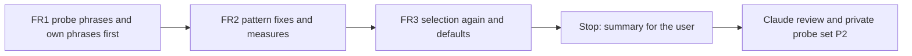

# Handoff: Step 3.3 B1 Fix Round (2026-10-25)

Read this file first. Then read, in this order:

1. `tasks/index.md` (the task system).
2. `tasks/todo.md`.
3. `task.md` and `notes.md` in this folder. In `notes.md`, read these sections:
    - "Decisions (2026-10-25)", decisions 5 to 10;
    - "Stage B selection rule and B1 stop rule";
    - "Review of Stage B part 1", all of it.
4. `handoff-stage-b.md` in this folder: sections B1a, B1b, B2c, "3. Traps", and "Cursor results" (B1b and B2c). You did that work. This handoff changes only the B1 patterns and repeats the B1b and B2c measures.
5. `CLAUDE.md`.
6. These sections of `docs/lessons.md`:
    - "A perfect score on a dev set says nothing about phrasings the set lacks";
    - "Set a stop rule for rule rounds on a long-tail check";
    - "Prove that a mutation was applied with a fixed-string check, not the regex that applied it".

Do not read `tasks/archive/`.

The user will review your work after this round. Part 2 comes after that review: the CI gate (B3), the notebook (B4), and the one held-out run with the README numbers (B5).

## 1. Status

| Item | State |
|------|-------|
| `main` | Ahead of `origin/main` (not pushed). Do not push. |
| Committed set | Frozen at A3b (dataset SHA-256 `c80627b5…24f448`). Do not change a case, a label, or the guide. |
| EMSCAD | The tuning part runs **one time** in this round, after FR2. |
| Held-out part | **Do not run it.** Never use `--part heldout`. Do not create `data/eval/emscad/heldout_used.json`. |
| This round | The one fix round that the B1 stop rule allows (decision 8). **There is no further B1 round.** What stays wrong after the review goes to the known limits. |
| This handoff | FR1, FR2, and FR3. **Stop after FR3.** |

## 2. The task



**What the review found.** B1b removed most false positives on EMSCAD, but it also lost most of the real scam wording that the old patterns caught. On probe set P1 (26 phrases that you had not seen), the old code caught 14 of 16 scam phrases, and B1b catches 5. B1b leaves alone 4 of 10 ordinary phrases. The B1a must-match phrases tested only the exact forms that the new patterns accept, so the tests did not show the loss.

**The rules that matter most:**

- **Phrases first.** Write all FR1 phrases before you change a pattern. Do not change a phrase to fit a pattern.
- **Fit the class, not the 26 phrases.** Claude measures the result on a second probe set (P2) that you have not seen and will not see. A pattern that lists the P1 words will fail on P2.
- **Fixed list and option (a).** Change only the 18 patterns on the B1 list. A word form of a sign on the list is allowed: "hiring" for "hire", "interviews" for "interview", "starting" for "start", "working" for "work", "purchase" for "buy". A new sign is not allowed, for example "urgent", "slots are limited", "send your IC", or a new app name.
- **One regex per listed key.** `_live_pattern` in `test_scam_detector.py` maps each B1a key to one entry by its position in its group. Keep the 18 entries, their order, and their groups. Put alternatives inside one regex with `|`. Do not add or split an entry.
- **Keep every phrase.** Do not change, remove, or weaken a B1a phrase or an FR1 phrase. If you think a phrase is wrong, keep it and write it in the summary.
- **The selection is mechanical.** Rules S1 and S2 pick the threshold and the action again. Do not change the numbers 0.005, 0.50, or 10, and do not pick by judgment.

There are three or four commits: FR1, FR2, FR3 (only if the defaults change), and the results section of this file. Before each commit, run all the checks in section 5.

### The six failure classes

| Class | What fails today | What the fix must do |
|-------|------------------|----------------------|
| 1. Word forms | "IMMEDIATE HIRING", "No interviews needed", "Starting today" | Accept the word forms of the listed signs. Keep the word boundary at the start of each word. |
| 2. App name with a number or a handle | "pls WhatsApp 9123 4567", "WhatsApp: +65 8123 4567", "Telegram: @hr_desk_sg" | The app counts as the contact channel when a phone number or a handle follows the name, with or without a colon, and with no contact verb before it. "WhatsApp Business API" and "Telegram Bot API" must still miss. |
| 3. "to start working" | "You must pay $380 to start working" | The pay-to-work pattern accepts "working" as well as "work". |
| 4. Bullet lists | "buy the equipment" on the fifth line of a list | A line break starts a new phrase, the same as a full stop. The "never ... buy" guard still applies inside the line. |
| 5. Gift-card wording | "Buy Google Play gift cards", "Purchase two $100 Steam gift cards" | Accept a brand, a count, or an amount between the verb and "gift cards". "purchase" counts as "buy". The anti-fraud notice ("never asks ... send gift cards") must still miss. |
| 6. Too broad | "on signal processing", "on signal integrity", "work on Telegram bots", "chat features on WhatsApp", "no interview fee", "We never ask you to pay to start work" | "on", "via", or "through" before an app name is not enough. It needs contact context ("reach our HR on WhatsApp", "add me on Telegram"), or a number or a handle after the name. "chat" before "features" is a noun, not a contact verb. "no interview" followed by "fee" is not a sign. The pay-to-work pattern needs a negation guard, the same as "never ... buy". |

Class 6 has two branches in the `whatsapp` pattern that fire on "Build chat features on WhatsApp": the `on|via|through` branch and the `chat ... whatsapp` branch. Fix both.

### FR1. Probe phrases and your own phrases first

Add these phrases to `MUST_MATCH` and `MUST_NOT` in `apps/backend-py/tests/unit/test_scam_detector.py`:

1. **The 26 P1 phrases**, exactly as written below, each under its key. Append them to the existing lists. The test helpers test each phrase alone and inside the short posting, as before.
2. **Your own phrases: for each of the six classes, at least 2 must-match and 2 must-not phrases**, in your own words. Write them from what scam advertisements and job postings say, before you design a pattern. Cover forms that P1 does not have, for example:
    - other word forms of the same signs;
    - other number and handle layouts (spaces, dashes, a country code, a "+" sign, an "@" handle, an ID label);
    - other list layouts (dashes, bullets, numbers);
    - other apps on the list (`signal`, `kik`) as the contact channel and as the product;
    - other negation wording ("we will never", "at no point", "no candidate is asked to").

Mark each phrase that fails on the current code with `pytest.mark.xfail(strict=True, reason="B1 fix round: class N")`. The must-match phrases that fail today are the detections that FR2 must restore. The must-not phrases that fail today are the false positives that FR2 must remove. Show the list of strict xfails in the summary.

**P1 must-match phrases (16).** "Today" is the result on the current code (HEAD `a8da397`).

| # | Key | Phrase | Today | Class |
|---|-----|--------|-------|-------|
| 1 | `immediate.*hire` | `"IMMEDIATE HIRING for warehouse packers, apply now"` | misses | 1 |
| 2 | `immediate.*hire` | `"Immediate hiring! Start this week"` | misses | 1 |
| 3 | `no.*interview` | `"No interviews needed, just send your IC"` | misses | 1 |
| 4 | `no.*interview` | `"no interview required, start tomorrow"` | hits | - |
| 5 | `start.*today` | `"Starting today, slots are limited"` | misses | 1 |
| 6 | `whatsapp` | `"Interested candidates pls WhatsApp 9123 4567"` | misses | 2 |
| 7 | `whatsapp` | `"WhatsApp: +65 8123 4567 for details"` | misses | 2 |
| 8 | `telegram` | `"Telegram: @hr_desk_sg"` | misses | 2 |
| 9 | `telegram` | `"Add me on Telegram, handle hrfast"` | hits | - |
| 10 | `whatsapp` | `"Kindly reach out to our HR on WhatsApp"` | hits | - |
| 11 | `pay.*to.*work` | `"You must pay $380 to start working"` | misses | 3 |
| 12 | `buy.*equipment` | `"Starter kit\n- You must buy equipment from our vendor before day one"` | hits | - |
| 13 | `buy.*equipment` | `"Responsibilities\n- Answer calls from customers\n- Process orders in our system\n- Log each call in the sheet\n- You must buy the equipment from our approved vendor first"` | misses | 4 |
| 14 | `gift cards` | `"Buy Google Play gift cards and keep the receipt"` | misses | 5 |
| 15 | `gift cards` | `"Purchase two $100 Steam gift cards for the client"` | misses | 5 |
| 16 | `bitcoin` | `"Your first pay comes in bitcoin to a wallet we set up"` | hits | - |

Phrases 12 and 13 contain line breaks (`\n`). Keep them as written. In the posting layout, the short posting puts a full stop and a line break before the phrase, so the alone layout is the harder test for class 4.

**P1 must-not phrases (10).**

| # | Key | Phrase | Today | Class |
|---|-----|--------|-------|-------|
| 17 | `signal` | `"A paper or a thesis on signal processing is useful"` | fires | 6 |
| 18 | `signal` | `"Experience on signal integrity for high-speed boards"` | fires | 6 |
| 19 | `telegram` | `"You will work on Telegram bots for our customers"` | fires | 6 |
| 20 | `whatsapp` | `"Build chat features on WhatsApp and Messenger for retail clients"` | fires | 6 |
| 21 | `no.*interview` | `"There is no interview fee; interviews are free and on site"` | fires | 6 |
| 22 | `no.*interview` | `"We know interviews can be stressful, so we share the questions"` | misses | - |
| 23 | `pay.*to.*work` | `"We never ask you to pay to start work"` | fires | 6 |
| 24 | `payment.*required` | `"Payment terms: net 30. A degree is required."` | misses | - |
| 25 | `bitcoin` | `"Our team builds wallets for bitcoin and ether"` | misses | - |
| 26 | `gift cards` | `"Staff get gift cards at the year-end party"` | misses | - |

The `MUST_NOT` lists hold `(phrase, reason)` tuples. Give each P1 must-not phrase a short reason, for example `"P1 class 6"`.

Commit FR1: `test(scam): add the review probe phrases for the B1 fix round`.

### FR2. Pattern fixes, measured

- Change only the 18 listed patterns. Keep one regex per key (section 2).
- Remove the FR1 `xfail` markers. All B1a and FR1 tests must pass.
- The detector lowercases the text and searches with `re.IGNORECASE`. The quick filter searches the title and the description with `re.IGNORECASE`. A pattern with `^` matches only at the start of the text, because neither uses `re.MULTILINE`.
- After FR2, no hard negative may be flagged at 0.70 or at the default threshold. If one is, say so. Do not change the committed set.
- Measure after FR2, on the same two sets as B1b:
    - the committed set: one `eval scam` run;
    - the EMSCAD tuning part: one `eval emscad --part tuning` run. FR3 uses this same report.

  The "before" values are the B2c reports: `data/eval/scam/20261025T044303583101Z.json` and `data/eval/emscad/20261025T044101635146Z.json`. Record three tables:
    1. Per pattern: hits on legitimate and on scam or fraud rows in each set, before and after. Compute them the same way as in B1b.
    2. The overall metrics of each set, before and after, at 0.70 (from the `pipeline_sweep` row 0.70, so they compare with the B1b table) and at the default threshold.
    3. The detector score of each of the six hard negatives, before and after. B3 pins these scores (decision 10).

Run the scam suite (from `apps/backend-py`):

```bash
.venv/bin/python main.py eval scam
```

Run the EMSCAD tuning part (from `apps/backend-py`):

```bash
.venv/bin/python main.py eval emscad --part tuning
```

Commit FR2: `fix(scam): word forms, contact forms, and guards in the R3 patterns`.

### FR3. Selection again and the defaults

- From the FR2 tuning report, record the full `pipeline_sweep` (all 20 rows) and `details["selection"]` in the results section.
- **If the selection is still `t*` = 1.00 and `flag`:** change no code. FR3 has no commit.
- **If the selection differs:**
    - set `DEFAULT_SCAM_THRESHOLD` to `t*` and `DEFAULT_SCAM_ACTION` to the selected action;
    - set the Pipeline page default and help text to match (`apps/frontend-ts/src/app/pipeline/page.tsx`); the B2a cross-check test must pass;
    - run `eval scam` one more time at the new default, and record its metrics and the hard negatives' scores;
    - run the frontend checks in section 5;
    - commit FR3: `feat(scam): set the defaults from the fix-round selection`.
- If `t*` flags a hard negative, say so. Do not change `t*`.

## 3. Traps

- **Held-out.** Never run it, and never create the real marker. A test that writes the marker uses `tmp_path`.
- **Fixed list.** Do not add a pattern for recall, and do not change a pattern outside the B1 list, even when you see a false positive. Write it in the summary. The off-list items in "Observations for Stage B" stay as they are.
- **No P1 word lists.** Do not add "warehouse", "IC", "hr_desk", "Google Play", "Steam", or another P1 word to a pattern. Brands of gift cards are many. Accept a short run of words between the verb and "gift cards" instead.
- **Negation guards.** Each guard must stay inside one phrase, the same as the "never ... buy" guard. A "never" in another sentence must not turn off a real sign.
- **Committed set.** Do not change a case, a label, or `README.md` in `tests/fixtures/eval/scam/`. Do not judge a new signal on it (decision 6).
- **EMSCAD is local only.** No text from the CSV goes into tests, notes, or commit messages. Write phrases in your own words.
- **No real data and no secrets.** Never open `.env`, `.env.local`, or `apps/backend-py/data/settings/user_settings.json`.
- **Startup time.** `main.py` takes about 100 s to start on `/mnt/d`, and the full backend suite takes 3 to 8 minutes. Run long commands in the background.
- **Line endings and scratch files.**
    - Check `git ls-files --eol` before each commit.
    - Do not commit the files that the IDE rewrites with CRLF.
    - Put scratch files and commit messages outside the repository, and use `git commit -F <file>`.

## 4. Summary to leave for the user

At the end of this file, add "Cursor results (date)" with:

- The commits (hash and subject).
- FR1:
    - the phrase count per key (P1 and your own);
    - the strict xfails on the code before FR2, with their class.
- FR2:
    - each pattern change (before FR2 and after);
    - the three measure tables;
    - each phrase that you think is wrong (kept, not changed);
    - the false positives that you saw outside the list.
- FR3:
    - the full pipeline sweep;
    - the selection with its reason;
    - the defaults (changed or not).
- Every check that you ran and its result. Say clearly what you did not run. The held-out part must be in the "not run" list.

## 5. Checks

Backend (WSL, from `apps/backend-py`):

Check formatting:

```bash
.venv/bin/python -m black --check main.py scripts/mypy_gate.py src/ tests/
```

Run the linter:

```bash
.venv/bin/python -m ruff check main.py scripts/mypy_gate.py src/ tests/
```

Run the mypy baseline gate:

```bash
.venv/bin/python scripts/mypy_gate.py
```

Run the tests:

```bash
.venv/bin/python -m pytest tests/ -q
```

Frontend (from `apps/frontend-ts`, only if FR3 changes the Pipeline page):

Run the linter:

```bash
npm run lint
```

Run the type check:

```bash
npm run type-check
```

Check the formatting of the changed page:

```bash
npx prettier --check src/app/pipeline/page.tsx
```

Run the unit tests:

```bash
npx vitest run
```

## 6. Rules (unchanged)

- Follow `CLAUDE.md`:
    - docstrings with description, arguments, and returns;
    - type hints;
    - ASD-STE100 for documentation;
    - no emojis;
    - a Mermaid diagram in documentation.
- Before each commit, run `git status --short` and stage only the files of that step.
- Never run `scripts/mypy_gate.py --update` to accept a new error.
- Keep dry run as the default. Do not make auto-submit reachable.
- Do not push. Push only from WSL, and only after the user approves.
