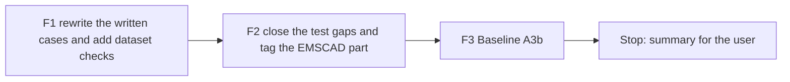

# Handoff: Step 3.3 Stage A Fixes, Scam Set Rework and Test Gaps (2026-10-25)

Read this file first. Then read, in this order:

1. `tasks/index.md` (the task system).
2. `tasks/todo.md`.
3. `task.md` and `notes.md` in this folder. The "Stage A review" and "Decisions (2026-10-25)" sections in `notes.md` give the reasons for this round.
4. `CLAUDE.md`.
5. These sections of `docs/lessons.md`:
    - "Give constructed eval sets a measurable diversity rule, and test it";
    - "Name the author of constructed text, not only the words it must not use";
    - "Prove that a mutation was applied with a fixed-string check, not the regex that applied it".

Do not read `tasks/archive/`.

The user will review your work after this round.

## 1. Status

| Item | State |
|------|-------|
| `main` | Ahead of `origin/main` (not pushed). Do not push. |
| Scam code | `src/scoring/` does not change in this round. The fixes are Stage B. |
| Committed set | Ran one time (A3, 2026-10-24). The detector output on the old texts is known. The rewrite follows the guide only. |
| EMSCAD | The CSV is in `apps/backend-py/data/kaggle/`. The tuning part ran one time (2026-10-25). **Do not run the `emscad` suite in this round, for either part.** |
| Held-out part | Stage B only. Never use `--part heldout`. |
| This handoff | F1, F2, and F3. **Stop after F3.** |

## 2. The task



**The rule that matters most: no detector output on the new texts before the F1 commit.** From the start of F1 until the F1 commit, do not run `JobScamDetector`, `ScamFilter`, `main.py eval`, or the notebook on the cases. While you write, also do not open these:

- `src/scoring/scam_detector.py`;
- the A3 report in `apps/backend-py/data/eval/scam/`;
- the A3 per-case tables.

Write each posting from the guide and from what real postings look like. Do not write to hit a pattern or to miss one.

There are three commits: F1, F2, and F3 (the F3 commit has only this file's results section). Before each commit, run Black, ruff, the mypy gate, and the full pytest suite (section 4).

### F1. Rewrite the written cases

Files:

- `apps/backend-py/tests/fixtures/eval/scam/cases.jsonl`;
- `apps/backend-py/tests/fixtures/eval/scam/README.md` (the guide);
- `apps/backend-py/tests/unit/test_scam_dataset.py`.

**What stays.**

- The 12 `legit_fixture` cases do not change.
- Each of the 34 written cases keeps three things: its `case_id`, its `expected` label, and its form. The form is the scam type or hard-negative form that its group and note name. Rewrite the `note` to match the new text.
- The six hard-negative forms stay, each with the words that name its form:
    1. "signal" in a signal processing role;
    2. "competitive pay and the chance to work on" a named product;
    3. "WhatsApp Business API";
    4. "bitcoin" at an exchange;
    5. an anti-fraud notice with "scam" or "fraud" and payment words;
    6. an annual maximum above 156,000.
- The counts stay: 46 cases, and at least 4 scams for each indicator group.

**What changes** (Stage A review findings 1 to 5):

1. **Author voice.** Each written posting is the text that its author would publish.
    - A legitimate posting is written by the employer.
    - A scam is written by the scammer, who wants the reader to reply. It sells the job (pay, ease, speed), and it gives the next step: a number, a handle, a mailbox, or a fee.
    - Write scams the way real scams are written: amounts with currency signs, short lines, capitals or "!" where a real scam would use them, and vague promises.
    - A scam leaves out what it does not have. It does not name an office. It does not say "there is no office".
    - No sentence judges the posting from outside. These sentences from the current set show the error, and nothing like them may come back:
        - "The listing says ...";
        - "The rate cannot fit the task.";
        - "The vacancy is a shell.";
        - "There is nothing here a recruiter can treat as a vacancy.";
        - "The rush is the whole vacancy.";
        - "The purpose is a hook, not a hire a recruiter can defend."
2. **The anti-scam sentence.** At most 3 written legitimate postings have a sentence about what the employer does not ask for or does not do.
    - `hard_negative__antifraud_notice` keeps its notice.
    - Choose at most 2 others where a real employer would write such a sentence. An exchange that holds client funds is one example.
    - Remove the sentence from every other legitimate posting.
3. **Company names.** Use names that a real business could have, and do not use a real company's name.
    - No word in a name describes the posting's quality, speed, or content. Examples of such words: Generic, Blank, Vague, Hollow, Shadow, Quiet, Instant, SameDay, Flash, Rapid, Quick, Empty, Fake, Shell, Secret, Mystery.
    - A company is in at most 2 cases.
4. **Line structure.**
    - At least 6 of the 12 written legitimate postings and at least 8 of the 22 scams use line breaks: headings (for example "Responsibilities" or "How to apply"), or a list.
    - Of the 6 hard negatives, at least 2 use line breaks and at least 2 stay on one line.
    - The other postings stay on one line, which is the EMSCAD form.
    - In the JSON, a line break is `\n` inside the description string.
5. **Length.** The lengths of the two classes overlap.
    - At least 4 scams have more than 150 words.
    - At least 3 written legitimate postings have fewer than 100 words.
    - At least 2 `scam_listing` postings have fewer than 20 words, like a real empty listing.
6. **Indicator groups.** For each new scam text, list again every group that the text shows, from the guide's definitions. Do this before any run.

**New dataset checks.** Write them first. They must fail on the current set; show that output.

- **S5 (fix).** Count the first 4 words of each posting and also each 4-word sentence opening (company replaced). Each one is in at most 4 cases.
- **S8 (change).** Every written case has 30 to 450 words, except `scam_listing`, which has 8 to 450. At least 6 written postings have more than 200 words, and at least 2 of those 6 are scams.
- **S9: narrator phrases.** Check the title and the description of every written case, case-insensitive. None of these phrases may appear:
    - "the listing", "this listing", "the text says", "the page", "the vacancy is";
    - "does not fit", "cannot fit", "a recruiter can", "public register", "the purpose is";
    - "the real step", "is not named", "names no", "nothing here", "is a shell", "the rush is".
- **S10: anti-scam sentence.** Use a regex list of the forms in the current set, for example:
    - "never ask(s)";
    - "does not (ask|charge|hire|request)";
    - "do(es) not (buy|purchase|pay|move|complete)";
    - "no (applicant|application|placement|training) fee";
    - "no kit";
    - "not a (paid|work-from-home|trading)".

    At most 3 written legitimate postings match, and `hard_negative__antifraud_notice` matches.
- **S11: company words.** No written case's company name has a word from the list in "Company names".
- **S12: line structure.** Check the counts in "Line structure".
- **S13: length overlap.** Check the counts in "Length".

These checks are a floor for the exact failures that the review found. They are not the goal: a writer can meet a limit and fill the next slot (`docs/lessons.md`).

**After the tests pass, read all 34 written cases from start to end.** For each case, ask:

- Who wrote it?
- Would a real person publish it?
- Does a sentence judge the posting from outside?
- Does it repeat a move from another case?

Change what fails. In the summary, list each case that you changed after the read, and why.

**Guide.** Update `README.md`:

- Voice states the author rule (item 1).
- Add S9 to S13 and the S8 change to "Diversity Limits".
- Add a "Changes" entry for 2026-10-25. The entry gives the reason (the Stage A review, findings 1 to 5) and states that no `case_id`, `expected` label, or form changed.

Commit F1: `fix(eval): rewrite the written scam cases in their authors' voice`.

### F2. Close the test gaps and tag the EMSCAD part

The review applied four real mutations. All four survived with 49 tests passing. Add one test for each, with a new name, in `tests/unit/test_scam_suite.py`:

- **T1 (catches M1).** Write a small CSV in `tmp_path`, then run `run_emscad_suite` with `part="tuning"` and with `part="heldout"`. The case IDs in each report's `details["cases"]` must be equal to the IDs of the matching part from `split_emscad`. The two ID sets must not share an ID.
- **T2 (catches M2).** `run_eval_command` passes `--part` to the `emscad` runner and passes no `part` to the `scam` runner. Use fake runners through `get_suite` (monkeypatch), `--no-mlflow`, and `--out tmp_path`.
- **T3 (catches M3).** Use uneven labels, for example 10 legitimate rows and 4 fraudulent rows, with a held-out fraction of 0.5. Each part must have exactly 5 legitimate rows and 2 fraudulent rows.
- **T4 (catches M4).** A case with a detector confidence of exactly 0.70 is counted as flagged in the 0.70 row of the sweep. That row agrees with `JobScamDetector(threshold=0.7).is_scam`.

**The EMSCAD part in MLflow.** An EMSCAD run shows its part in the run name (for example `emscad-tuning-<stamp>`) and as a `part` tag.

- Keep `log_report_to_mlflow` generic. For example, add an optional `tags: Dict[str, str]` to `EvalReport`, set it in `run_emscad_suite`, and add it to the run tags and the run name.
- The `scam` and `grounding` runs keep their current run names.
- Test it the same way as `test_logs_run_to_sqlite_store` in `tests/unit/test_evaluation_harness.py`, with a temporary SQLite store.

**Mutation proofs.** Apply each mutation below with a fixed-string replacement. For each one:

- show the checksum before and after;
- show the count of the new string;
- run the tests and show the result;
- restore the file and compare it with the backup.

| Mutation | File | Old | New | Must fail |
|----------|------|-----|-----|-----------|
| M1 | `src/evaluation/suites/emscad.py` | `chosen = tuning if part == "tuning" else heldout` | `chosen = tuning` | T1 |
| M2 | `main.py` | `runner_kwargs["part"] = args.part` | `pass` | T2 |
| M3 | `src/evaluation/suites/emscad.py` | `buckets[row.fraudulent].append(row)` | `buckets[0].append(row)` | T3 |
| M4 | `src/evaluation/suites/scam.py` | `{"scam"} if confidence >= threshold else set() for confidence in confidences` | the same line with `>` | T4 |
| M5 | the code that adds the report tags to the MLflow run | remove the tags | | the MLflow part test |

If F2 changes a line in this table, apply the same fault to the new line, and say so in the summary.

Commit F2: `test(eval): close the scam suite test gaps and tag the EMSCAD part`.

### F3. Baseline A3b

- After the F1 and F2 commits, run the committed set one time:

    Run the scam suite on the reworked set (from `apps/backend-py`):

    ```bash
    .venv/bin/python main.py eval scam
    ```

- Record these in this file's results section:
    - the dataset SHA-256 and the MLflow run;
    - the metrics, the confusion counts, and the recall per group with its support;
    - every false positive and false negative (case ID, which component fired, and the reasons);
    - the sweep table.
- Add one table with the A3 and A3b metrics side by side. The texts changed, so do not compare the per-case rows.
- Do not change a case or a label after this run.
- Do not run the `emscad` suite.

Commit F3: `docs(tasks): record Baseline A3b for the scam set`.

## 3. Traps

- **Detector output.** None on the new texts before the F1 commit. Do not read `scam_detector.py`, `data/eval/scam/`, or the A3 per-case tables while you write.
- **Writing to a pattern.** A scam uses the words that a real scam uses, whether or not a rule matches them. A legitimate posting does the same.
- **EMSCAD.**
    - Do not run the `emscad` suite, and never use `--part heldout`. T1 and T3 use small CSVs in `tmp_path` only.
    - The CSV is local only: no text from it in fixtures, tests, notes, or commit messages.
- **No fixes in `src/scoring/`.** If you see a detector problem, write it in the summary.
- **Templating.** S9 to S13 are a floor. The review counts sentence openings, anti-scam sentences, company names, lengths, and line breaks again, and reads every written case.
- **No real data and no secrets.** Never open `.env`, `.env.local`, or `apps/backend-py/data/settings/user_settings.json`.
- **Startup time.** `main.py` takes about 100 s to start on `/mnt/d`, and the full backend suite takes 3 to 8 minutes. Run long commands in the background.
- **Line endings and scratch files.**
    - `*.jsonl` is LF. Check `git ls-files --eol` before you commit.
    - Do not commit the 14 files that the IDE rewrites with CRLF.
    - Put scratch files and commit messages outside the repository, and use `git commit -F <file>`.

## 4. Checks (WSL, from `apps/backend-py`)

Check formatting:

```bash
.venv/bin/python -m black --check main.py scripts/mypy_gate.py src/ tests/
```

Run the linter:

```bash
.venv/bin/python -m ruff check main.py scripts/mypy_gate.py src/ tests/
```

Run the mypy baseline gate:

```bash
.venv/bin/python scripts/mypy_gate.py
```

Run the tests:

```bash
.venv/bin/python -m pytest tests/ -q
```

## 5. Rules (unchanged)

- Follow `CLAUDE.md`:
    - docstrings with description, arguments, and returns;
    - type hints;
    - ASD-STE100 for documentation;
    - no emojis;
    - a Mermaid diagram in documentation.
- Before each commit, run `git status --short` and stage only the files of that step.
- Never run `scripts/mypy_gate.py --update` to accept a new error.
- Keep dry run as the default. Do not make auto-submit reachable.
- Do not push. Push only from WSL, and only after the user approves.

## 6. Summary to leave for the user

At the end of this file, add "Cursor results (date)" with:

- The commits (hash and subject): F1, F2, and F3.
- F1:
    - the counts per group, and the support of each indicator group;
    - the output of the new checks on the old set, before the rewrite;
    - the S1 to S13 statistics;
    - the company names that changed;
    - the cases that you changed after the full read, and why;
    - a statement that no detector ran on the new texts before the F1 commit.
- F2: the new tests and their failure output before the code, and the five mutation results.
- F3: the tables from section F3.
- Every check that you ran and its result. Say clearly what you did not run.
