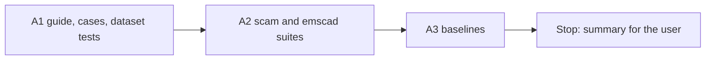

# Handoff: Step 3.3 Stage A, Scam Set, Suites, and Baselines (2026-10-24)

Read this file first. Then read, in this order: `tasks/index.md` (the task system), `tasks/todo.md`, `task.md` and `notes.md` in this folder, `CLAUDE.md` (project rules), and these sections of `docs/lessons.md`: "Give constructed eval sets a measurable diversity rule, and test it", "A perfect score on a dev set says nothing about phrasings the set lacks", and "Set a stop rule for rule rounds on a long-tail check". Use the grounding suite as the model for code and tests: `apps/backend-py/src/evaluation/suites/grounding.py`, `apps/backend-py/tests/unit/test_grounding_dataset.py`, and the guide `apps/backend-py/tests/fixtures/eval/grounding/README.md`. Do not read `tasks/archive/`.

The user will review your work after Stage A.

## 1. Status

| Item | State |
|------|-------|
| `main` | 3 commits ahead of `origin/main` (not pushed). Do not push. |
| Scam code | `src/scoring/` does not change in Stage A. The fixes are Stage B, after the review. |
| EMSCAD | `apps/backend-py/data/kaggle/` has no `fake_job_postings.csv` yet. The user downloads it (decision 3 of 2026-10-22). If it is not there at A3, skip the EMSCAD baseline and say so. |
| Held-out part | The EMSCAD held-out part is the unbiased measure. **Do not run it in Stage A**, not even to look. It runs one time in Stage B, after the threshold is chosen. |
| This handoff | A1, A2, and A3. **Stop after A3.** |

## 2. The task



**The rule that matters most: no detector output before the labels are frozen.** From the start of A1 until the A1 commit, do not run `JobScamDetector`, `ScamFilter`, `main.py eval`, or the notebook on the cases. Decide every label from the guide only. The structure and diversity tests do not run the detector, so you can run them at any time.

Three commits: A1, A2, and A3 (the A3 commit has only this file's results section). Black, ruff, the mypy gate on `main.py scripts/mypy_gate.py src/ tests/`, and the full pytest suite before each commit.

### A1. Labeling guide, cases, and dataset tests

Files: `apps/backend-py/tests/fixtures/eval/scam/README.md` (the guide, with a Mermaid diagram of the labeling steps), `cases.jsonl` in the same folder, and `apps/backend-py/tests/unit/test_scam_dataset.py`.

**Definition for the guide.** A posting is `scam` when its purpose is to take money, personal data, or unpaid work from the applicant, or when it misrepresents the employer. Label by the purpose of the whole posting, not by single words. The guide describes the signs of each indicator group:

- `payment`: the applicant pays a fee, buys equipment or a kit, or receives money to forward;
- `contact`: the hiring moves to a messaging app or a personal email address only;
- `urgency`: a hire with no interview, or a start today with no checks;
- `compensation`: pay that does not fit the work, the hours, or the role;
- `listing_quality`: no real employer, no real duties, or a very short or generic text.

**Case format.** Add `ScamCase` (Pydantic, `extra="forbid"`) in `src/evaluation/suites/scam.py` (A2 uses it too):

- `case_id`: `<group>__<short_name>`. Groups: `legit_fixture`, `legit_written`, `hard_negative`, `scam_payment`, `scam_contact`, `scam_urgency`, `scam_compensation`, `scam_listing`.
- `job`: a dict that `JobListing` accepts (title, company, description, and, when useful, `salary_range`, `recruiter_email`, `source_url`).
- `expected`: `scam` or `legit`.
- `indicator_groups`: for a scam, the groups that the posting shows (one or more); empty for a legitimate posting.
- `source`: `fixture:<path>#<index or id>` or `written`.
- `note`: why the label is right, in one or two sentences.

**Counts.** At least 40 cases:

- At least 20 legitimate: every usable public posting from the source fixtures (`tests/fixtures/careersatgov/`, `jobstreet/`, `mycareersfuture/`, `jd_paste/`; about 12, some are search-page teasers, and that is real input), then written legitimate postings, and at least 6 hard negatives.
- At least 20 scams, with at least 4 cases for each indicator group. A scam can show more than one group.

**Hard negatives.** Legitimate postings, each realistic and each legitimate for a reason a recruiter accepts. Write your own words for each form:

1. a signal processing role;
2. a posting that offers competitive pay and the chance to work on a named product;
3. an integration role for the WhatsApp Business API;
4. an engineering role at a bitcoin exchange;
5. a legitimate posting with an anti-fraud notice that names payment words (for example, that the company never asks candidates to pay a fee or buy equipment);
6. a senior role with an annual maximum above 156,000.

**Rules for written postings.**

- Write each posting for its own company and role. Do not copy text from EMSCAD or another dataset into the committed set (license; decision 3).
- Voice: no sentence names the dataset, a label, or the test. "label", "test case", "indicator", "dataset", and "this posting is" never appear. "scam" and "fraud" may appear only in the anti-fraud notice of a hard negative, and its note says so.
- Use real-looking but fictional company names. A company is in at most 2 cases.

**Dataset tests** (`test_scam_dataset.py`), written before the cases, so they fail first:

- Structure: every case loads as `ScamCase`, and its `job` loads as `JobListing`; IDs are unique; the group prefix is valid; `expected` agrees with the group (`scam_*` is `scam`; `legit_*` and `hard_negative` are `legit`); `indicator_groups` is not empty for a scam and is empty for a legitimate posting; the counts above hold; each `fixture:` source exists and its description is the fixture text.
- Diversity for written cases (long sentence: 8 or more words, digits as `#`):
    - S1: a long sentence is in at most 2 cases;
    - S2: two cases share at most 1 long sentence;
    - S3: distinct long sentences divided by all long sentences is at least 0.90;
    - S4: with the company and the title replaced by slots, a sentence frame is in at most 3 cases;
    - S5: a 4-word sentence opening (company replaced) is in at most 4 cases;
    - S6: at least 25 distinct companies;
    - S7: the Voice rule above;
    - S8: word counts from 30 to 450, with at least 6 written postings over 200 words.
- These limits are a floor, not the goal. A writer can meet a limit by filling a slot (`docs/lessons.md`). After the tests pass, read 10 cases from start to end and check that each one reads like a real posting.

### A2. The `scam` and `emscad` suites

- **`src/evaluation/suites/scam.py`:** `run_scam_suite(dataset_dir) -> EvalReport`. The decision for each case is the pipeline decision: `ScamFilter.is_potential_scam(job)` or `JobScamDetector(threshold=0.7).detect(job).is_scam`. Metrics: `precision`, `recall`, and `f1` for the class `scam`; `false_positive_rate` (legitimate postings flagged, divided by legitimate postings); `recall.<group>` for each indicator group. Details: the confusion counts; one row per case with the expected and predicted label, whether the quick filter fired, the detector confidence, and the detector reasons; and a threshold sweep of the detector alone (0.00 to 1.00 in steps of 0.05: precision, recall, F1, and false-positive rate). The sweep is for review; Stage A does not change the threshold.
- **`src/evaluation/suites/emscad.py`:** move the row mapping of notebook cell 8 into `load_emscad(csv_path)`. Add `split_emscad(rows, seed=20261024, held_out_fraction=0.5)`: deterministic, stratified by the `fraudulent` column. `run_emscad_suite(dataset_dir, part="tuning")` reports the same metrics on that part. The metadata has the SHA-256 of the CSV, the part, the seed, and the row counts. A missing CSV raises `FileNotFoundError` with the path and a pointer to decision 3. The notebook does not change in Stage A.
- **Registry and CLI:** add `scam` (default folder `tests/fixtures/eval/scam`) and `emscad` (default folder `data/kaggle`) to `SUITE_NAMES` and `get_suite` (`src/evaluation/suites/__init__.py`). Add `--part {tuning,heldout}` (default `tuning`) to `python main.py eval`; only `emscad` uses it. MLflow logging works as for `grounding`.
- **Tests** on small datasets that the test writes to `tmp_path`, with new names: a quick-filter hit is a scam even when the detector confidence is low; metric values on a known small set; per-group recall; the false-positive rate; the sweep; the EMSCAD mapping of a small CSV; the split (the same seed gives the same parts, the parts do not share a row, and both labels are in both parts); the missing-CSV message; the registry and `--part`.
- **Mutation proofs:** (1) the decision without the quick filter, and a test must fail; (2) the split without the seed, and the determinism test must fail. Check the checksum and a fixed-string count, and restore and compare with the backup.

### A3. Baselines

- After the A1 commit, run the committed set one time:

    Run the scam suite on the committed set (from `apps/backend-py`):

    ```bash
    .venv/bin/python main.py eval scam
    ```

- If the CSV is in `apps/backend-py/data/kaggle/`, run the tuning part one time:

    Run the EMSCAD tuning part (from `apps/backend-py`):

    ```bash
    .venv/bin/python main.py eval emscad --part tuning
    ```

- Record both in this file's results section: the dataset SHA-256, the MLflow run, the metrics, the confusion counts, recall per group, the false positives (case ID, which component fired, and the reasons), and the sweep table. Do not change a label or a case after this run.

## 3. Traps

- **No detector output while you write or label** (section 2).
- **The held-out part** runs one time, in Stage B. A look at it now uses it up.
- **EMSCAD is local only.** Do not commit the CSV, a sample of it, or text from it. Outputs go to `apps/backend-py/data/`.
- **No real data and no secrets.** Never open `.env`, `.env.local`, or `apps/backend-py/data/settings/user_settings.json`. Do not run the first cells of the notebook: they load `.env` and call the Kaggle API.
- **No fixes in Stage A.** Do not change `src/scoring/`, even when a false positive is obvious. Write it in the summary.
- **Templating.** See A1. The review counts openings and reads cases.
- **Startup time.** `main.py` takes about 100 s to start on `/mnt/d`; the full backend suite takes 3 to 8 minutes. Run long commands in the background.
- **Line endings and scratch files.** `*.jsonl` is LF (`.gitattributes`). Check `git ls-files --eol` before you commit, and do not commit the 14 files that Cursor rewrites with CRLF. Put scratch files and commit messages outside the repository; use `git commit -F <file>`.

## 4. Checks (WSL, from `apps/backend-py`)

Check formatting:

```bash
.venv/bin/python -m black --check main.py scripts/mypy_gate.py src/ tests/
```

Run the linter:

```bash
.venv/bin/python -m ruff check main.py scripts/mypy_gate.py src/ tests/
```

Run the mypy baseline gate:

```bash
.venv/bin/python scripts/mypy_gate.py
```

Run the tests:

```bash
.venv/bin/python -m pytest tests/ -q
```

## 5. Rules (unchanged)

- Follow `CLAUDE.md`: docstrings with description, arguments, and returns; type hints; ASD-STE100 for documentation; no emojis; a Mermaid diagram in documentation.
- Before each commit, run `git status --short` and stage only the files of that step.
- Never run `scripts/mypy_gate.py --update` to accept a new error.
- Keep dry run as the default. Do not make auto-submit reachable.
- Do not push. Push only from WSL, and only after the user approves.

## 6. Summary to leave for the user

At the end of this file, add "Cursor results (date)" with:

- The commits (hash and subject): A1, A2, and A3.
- A1: the counts per group, the dataset test failure output before the cases existed, the S1 to S8 stats, the list of hard negatives (case ID and form), and a statement that no detector ran before the A1 commit.
- A2: the tests and their failure output before the code, and the two mutation results.
- A3: the baseline tables (section A3), or a statement that the CSV was not there.
- False positives or misses that look like R3 items (for Stage B; do not fix them).
- Every check you ran and its result. Say clearly what you did not run.
