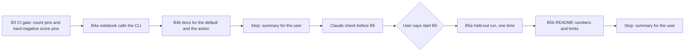
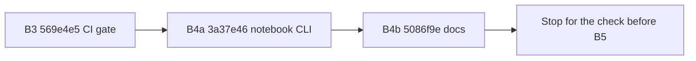

# Handoff: Step 3.3 Stage B Part 2, CI Gate, Notebook, and the Held-Out Run (2026-10-25)

Read this file first. Then read, in this order:

1. `tasks/index.md` (the task system).
2. `tasks/todo.md`.
3. `task.md` and `notes.md` in this folder. In `notes.md`, read these sections:
    - "Decisions (2026-10-25)", decisions 5 to 11;
    - "Stage B selection rule and B1 stop rule" (rule S3 is the held-out report);
    - "Review of the B1 fix round", all of it. Its "Known limits of B1" go into the README in B5.
4. `apps/backend-py/tests/unit/test_grounding_thresholds.py` and `apps/backend-py/tests/fixtures/eval/grounding/thresholds.json`. B3 uses the same form.
5. `CLAUDE.md`.
6. These sections of `docs/lessons.md`:
    - "A perfect score on a dev set says nothing about phrasings the set lacks";
    - "Prove that a mutation was applied with a fixed-string check, not the regex that applied it".

Do not read `tasks/archive/`.

## 1. Status

| Item | State |
|------|-------|
| `main` | Ahead of `origin/main` (not pushed). Do not push. |
| B1 and B2 | Closed (decision 11). `t*` = 1.00 and the action is `flag`. **Do not change a pattern, a default, or the numbers 0.005, 0.50, and 10.** |
| Committed set | Frozen at A3b (dataset SHA-256 `c80627b55a338198802555f5df36eb55f10a591cd8e475460db58b5bb524f448`). Do not change a case, a label, or the guide. |
| EMSCAD tuning part | May run in B4: one notebook test run. |
| EMSCAD held-out part | **B5 only, one time, after the stop.** Never before the user says "start B5". |
| This handoff | Part A: B3 and B4, then **stop**. Part B: B5, only after Claude's check and the user's go. |

## 2. The task



**The rules that matter most:**

- **The held-out part runs one time.** Do not run it again for any reason, also when the numbers look wrong or a later step fails. If the command fails before it writes a report, stop and tell the user. The user decides what happens next.
- **No change after the held-out numbers (rule S4).** Do not change `t*`, the action, a pattern, or a rule number after you see the held-out result. The README states the numbers as they are.
- **No pattern change in part 2 (decision 11).** The dead group in the messaging patterns stays.
- **EMSCAD text stays local.** No text from the CSV goes into tests, notes, commit messages, the README, or a committed notebook output.

Part A has four commits: B3, B4a, B4b, and the part A results in this file. Part B has two commits: B5b and the part B results. B5a writes only local files (`data/` is ignored by git). Before each commit, run all the checks in section 5.

### B3. CI gate on the committed set

Add the gate in the same form as the grounding gate.

- **`apps/backend-py/tests/fixtures/eval/scam/thresholds.json`:**
    - `suite`, `dataset_sha256` (the full value in section 1), `baseline` (`"FR2"`), and `mlflow_run` (the full ID of the FR2 committed-set run, `b4794ddc…`).
    - `threshold` (1.0) and `action` (`"flag"`): the defaults that the pins are for.
    - `counts`: `max_false_positives` 0 and `max_false_negatives` 22, at `t*`.
    - `hard_negative_scores`: the detector confidence of each of the six hard negatives, from the FR2 run, with no margin:

        | Case | Pin |
        |------|-----|
        | `hard_negative__antifraud_notice` | 0.10 |
        | `hard_negative__bitcoin_exchange` | 0.10 |
        | `hard_negative__competitive_hearthline` | 0.10 |
        | `hard_negative__signal_processing` | 0.10 |
        | `hard_negative__summit_ridge_revenue` | 0.40 |
        | `hard_negative__whatsapp_business_api` | 0.10 |

    - `changes`: one entry with the date, the reason, and the MLflow run.

    The suite hashes only `cases.jsonl`, so the new file does not change the dataset SHA-256. Check this after you add the file.
- **`apps/backend-py/tests/unit/test_scam_thresholds.py`.** A `threshold_check(report, thresholds)` function returns `(violations, tightenable)`, the same as the grounding gate. It checks, in this order:
    1. The dataset SHA-256. When it differs, it returns only that violation.
    2. `DEFAULT_SCAM_THRESHOLD` and `DEFAULT_SCAM_ACTION` against `threshold` and `action`. When a default differs, it is a violation: "defaults changed; run a new baseline and pin new counts".
    3. The counts at the default threshold. A count above its pin is a violation that names the cases behind it. A count below its pin goes to `tightenable`.
    4. The hard negatives. Every `hard_negative__` case in the report needs a pin, and every pin needs a case. Each hard negative must be predicted `legit`, with no quick-filter hit. A score above its pin is a violation that names the case and its detector reasons. A score below its pin goes to `tightenable`. Compare scores rounded to 4 decimal places. This is not a margin.
- **Tests in the same file:**
    - the gate on the real committed set (`run_scam_suite()`), which warns for `tightenable` and fails for violations;
    - the `changes` entries each have a date, a reason, and an MLflow run;
    - small synthetic reports: a count above its pin names the case; a count below passes and is listed for tightening; a hard-negative score above its pin names the case and the reasons; a missing hard-negative pin fails; a changed dataset is the only violation; a changed default fails.
- **Cleanup.** Remove the empty `MUST_MATCH_XFAIL` dict from `test_scam_detector.py`, and the code that reads it. No phrase changes.
- **Mutation proofs.** For each mutation below, apply a fixed-string replacement, show the checksum and the count of the new string, show that the gate test fails with the expected message, and restore the file and compare it with the backup:
    1. Insert a bare `\b(?:on|via|through)\s+signal\b|` branch right after the opening `(?:` of the `signal` pattern. The gate must name `hard_negative__signal_processing` (its score goes above 0.10).
    2. Add the plain substring `"bitcoin"` to `ScamFilter.REJECT_PATTERNS`. The gate must name `hard_negative__bitcoin_exchange` (a false positive and a quick-filter hit).
    3. Remove the dataset SHA-256 check from `threshold_check`. A synthetic test must fail.
    4. Set `DEFAULT_SCAM_THRESHOLD` to 0.95. The gate must report the changed default.

Commit B3: `test(scam): CI gate with count pins and hard-negative score pins`.

### B4a. The notebook calls the eval CLI

Rewrite `apps/backend-py/notebooks/scam_detector_evaluation.ipynb`, so that the evaluation logic exists only once, in the `emscad` suite.

- **Remove:**
    - the `.env` load (`load_dotenv`) and the Kaggle API download. Decision 3 of 2026-10-22: the user downloads the CSV by hand after the license check;
    - the notebook's own detector run, row parser, metrics, and threshold sweep;
    - the error analysis that prints posting text (EMSCAD text must not be in an output).
- **Keep or add:**
    1. A short description: what the notebook shows, and that the logic is in `src/evaluation/suites/emscad.py`.
    2. A setup cell: `BACKEND_DIR`, and a check that `data/kaggle/fake_job_postings.csv` exists. If it does not, the cell says where to put it and stops.
    3. One cell that runs the CLI for the tuning part, from `BACKEND_DIR`, with `sys.executable`: `main.py eval emscad --part tuning --out data/eval/notebook`. MLflow logs the run as usual.
    4. A cell that loads the newest report from `data/eval/notebook/emscad/`.
    5. Cells that show only numbers from the report: the metrics with the Wilson intervals, `details["selection"]`, a plot of the pipeline sweep (precision, recall, and the false-positive rate against the threshold, with `t*` marked), the confusion counts at `t*`, and the count of each detector reason by class (counts only).
    6. A summary cell: what the numbers mean, the EMSCAD limits, and that the held-out part runs one time, through the CLI, and never from this notebook.
- **Commit the notebook with no outputs** and with `execution_count` set to `null` in every code cell.
- **`apps/backend-py/tests/unit/test_scam_notebook.py`.** Read the notebook JSON. The test fails when:
    - a code cell has an output or an execution count;
    - a code cell contains `heldout`, `load_dotenv`, `.env`, `kaggle datasets download`, or `JobScamDetector(` (so the notebook does not show the report's `heldout_rows` key either);
    - no code cell contains `main.py`, `eval`, `emscad`, `--part`, and `tuning`.
- **Run it one time** to show that it works, with the output outside the repository. This is the one tuning run of B4:

    Run the notebook (from `apps/backend-py`):

    ```bash
    .venv/bin/python -m jupyter nbconvert --to notebook --execute notebooks/scam_detector_evaluation.ipynb --output-dir /tmp/scam-notebook-run
    ```

    If the run cannot start (for example, no kernel), say so in the summary. Do not install a package without the user.
- **`apps/backend-py/notebooks/README.md`:** add a section for this notebook: the CSV location and the manual download, what the notebook runs, that the held-out part is not in it, and that outputs are not committed. Add a Mermaid diagram of the flow. Put each command in its own labeled snippet.

Commit B4a: `feat(notebook): run the scam evaluation through the eval CLI`.

### B4b. Docs for the shared default and the action

Since B2c, the default threshold is 1.0 and the action is `flag`: the pipeline keeps flagged postings. These docs still say 0.7 or "filters out":

| File | Place | Change |
|------|-------|--------|
| `README.md` | Pipeline Stages, row 3 | "Flag likely scams; flagged postings are kept" (or the same idea in your words) |
| `docs/api.md` | the `scam_threshold` row (line 52) and the example (line 437) | Default `1.0`; add the `scam_action` setting (`drop` or `flag`, default `flag`) |
| `docs/usage.md` | the `--scam-threshold` row (line 178) and "Stage 3: Filter Scams" | Default `1.0`; say what `flag` does |
| `docs/index.md` | line 395 | "Flags potential scams" |
| `README.md` (line 283), `DOCKER.md` (line 125), `apps/backend-py/.env.example` (line 95) | the Kaggle comments | The notebook does not download the dataset. Keep the keys as optional, for a manual download with the Kaggle CLI |

Find the line numbers again before you edit, because B4a can move them. Do not change the "Scam Detection" section of `README.md` in B4b. B5b changes it.

Commit B4b: `docs: state the scam default threshold and the flag action`.

### Stop after B4

Write the part A results (section 4) at the end of this file, commit them (`docs(tasks): record Stage B part 2 results up to B4`), and stop. **Do not start B5.**

Claude then checks four things and records them in `notes.md`:

1. HEAD is the reviewed commit, with no change in `apps/backend-py/src/` or `apps/backend-py/main.py`.
2. `DEFAULT_SCAM_THRESHOLD` and `DEFAULT_SCAM_ACTION` match the FR2 selection (1.0 and `flag`).
3. `apps/backend-py/data/eval/emscad/heldout_used.json` does not exist.
4. The user's decision on the 14 files that the IDE rewrote with CRLF is applied (finding 6 of the fix-round review).

The user then tells you to start B5.

### B5a. The held-out run, one time

Only after the user says "start B5":

- **First, check the tree** (added 2026-10-26 by the check before B5 in `notes.md`). The IDE rewrote files with CRLF before, and a dirty tree marks the held-out report as `git_dirty`. From the repository root, this command must print nothing:

    Check for changes in tracked files:

    ```bash
    git status --porcelain --untracked-files=no
    ```

    If it prints a file, stop and tell the user. Do not run B5a on a dirty tree.
- Run the held-out part one time, with MLflow:

    Run the EMSCAD held-out part (from `apps/backend-py`):

    ```bash
    .venv/bin/python main.py eval emscad --part heldout
    ```

- The guard writes `data/eval/emscad/heldout_used.json` after the run. Do not delete, move, or edit it. Do not commit it (`data/` is ignored by git).
- Record in the part B results:
    - the report path, the MLflow run ID, the git SHA and `git_dirty`, the dataset SHA-256, and the row counts of the part (frauds and legitimate rows);
    - the threshold and the action of the run;
    - TP, FP, FN, and TN;
    - precision, recall, and the false-positive rate, each with its counts (for example "0 of 28") and its Wilson 95% interval. If no posting is flagged, precision is "not defined (0 flagged)".
- Do not run the tuning part again in B5, and do not run the notebook.

### B5b. README numbers and limits

Replace the last line of the "Scam Detection" section of `README.md` ("These are heuristics. Their precision and recall are not measured yet.") with these parts:

1. **What is measured:** the pipeline decision. That is the quick filter, or the detector score at or above the threshold.
2. **The operating point:** threshold 1.00 and action `flag`, chosen on the EMSCAD tuning part by fixed rules (a false-positive rate of at most 0.005; `drop` only with a precision of at least 0.50 and at least 10 flagged frauds). Flagged postings are kept, and the pipeline records the score and the reasons.
3. **The held-out numbers:** a table with precision, recall, and the false-positive rate, each with its counts and its Wilson 95% interval, and the size of the held-out part.
4. **What the numbers mean**, in plain words. For example, if recall is 0: the rule detector does not detect EMSCAD frauds at this operating point, so the pipeline does not remove postings, and the user judges each posting.
5. **The limits:**
    - EMSCAD postings are from 2012 to 2014 and mostly from the US. Emails, links, and phone numbers are masked. There are no company names and no line breaks.
    - The committed set (46 written and fixture postings) guards the six hard negatives in CI. It does not measure recall.
    - A short list of the known limits of B1 (from `notes.md`): the closed contact-verb list, the negation guards, the phrase anchors, and the scam wording outside the listed patterns.
6. **A Mermaid diagram** of the decision: posting, quick filter, detector score, flag at the threshold, posting kept with the flag.

Do not link to `tasks/` (task folders move to the archive). You can link to `apps/backend-py/notebooks/README.md`. Write in ASD-STE100, with no emojis.

Commit B5b: `docs(readme): state the held-out scam numbers and their limits`. Then write the part B results (section 4), commit them (`docs(tasks): record the held-out run`), and stop.

## 3. Traps

- **Held-out.** One run, only in B5a, only after the user says so. Never `--part heldout` anywhere else, also not in a test or the notebook. A test that writes a marker uses `tmp_path`.
- **No tuning after the result (rule S4).** If the held-out numbers look bad, report them. Do not explain them away, and do not change anything to improve them.
- **Fixed code.** Part 2 changes no pattern and no default. If you see a false positive, write it in the summary.
- **Committed set.** Do not change a case, a label, or `README.md` in `tests/fixtures/eval/scam/`. Do not judge a new signal on it (decision 6).
- **EMSCAD is local only.** Clear the notebook outputs before you commit. The nbconvert output goes outside the repository.
- **No real data and no secrets.** Never open `.env`, `.env.local`, or `apps/backend-py/data/settings/user_settings.json`. The notebook must not read `.env`.
- **Startup time.** `main.py` takes about 100 s to start on `/mnt/d`, and the full backend suite takes 3 to 8 minutes. Run long commands in the background. `pytest.ini` has `--maxfail=5`, so a run stops at the fifth failure.
- **Line endings and scratch files.**
    - Check `git ls-files --eol` before each commit.
    - Do not commit the files that the IDE rewrites with CRLF.
    - Put scratch files and commit messages outside the repository, and use `git commit -F <file>`.

## 4. Summary to leave for the user

At the end of this file, add "Cursor results, part A (date)" after B4b, and "Cursor results, part B (date)" after B5b.

Part A:

- The commits (hash and subject).
- B3: the pins, the tests, their failure output before the gate code, the four mutation results, and the dataset SHA-256 after the new file.
- B4a: the notebook cells (a short list), the notebook test, and the result of the one nbconvert run (the selection and the metrics it showed).
- B4b: each doc change.
- Every check that you ran and its result. Say clearly what you did not run. The held-out part must be in the "not run" list.

Part B:

- The commits (hash and subject).
- B5a: all the values in the B5a list, and the content of the marker file.
- B5b: the new README section (a short summary; the diff shows the text).
- Every check that you ran and its result.

## 5. Checks

Backend (WSL, from `apps/backend-py`):

Check formatting:

```bash
.venv/bin/python -m black --check main.py scripts/mypy_gate.py src/ tests/
```

Run the linter:

```bash
.venv/bin/python -m ruff check main.py scripts/mypy_gate.py src/ tests/
```

Run the mypy baseline gate:

```bash
.venv/bin/python scripts/mypy_gate.py
```

Run the tests:

```bash
.venv/bin/python -m pytest tests/ -q
```

No frontend file changes in part 2, so the frontend checks are not needed. If you change a frontend file, run the frontend checks in `handoff-stage-b.md`, section 4.

## 6. Rules (unchanged)

- Follow `CLAUDE.md`:
    - docstrings with description, arguments, and returns;
    - type hints;
    - ASD-STE100 for documentation;
    - no emojis;
    - a Mermaid diagram in documentation.
- Before each commit, run `git status --short` and stage only the files of that step.
- Never run `scripts/mypy_gate.py --update` to accept a new error.
- Keep dry run as the default. Do not make auto-submit reachable.
- Do not push. Push only from WSL, and only after the user approves.

## Cursor results, part A (2026-10-26)



Part B has not started. The held-out part was not run. `heldout_used.json` was not created. This branch was not pushed.

### Commits

| Step | Hash | Subject |
|------|------|---------|
| B3 | `569e4e5` | `test(scam): CI gate with count pins and hard-negative score pins` |
| B4a | `3a37e46` | `feat(notebook): run the scam evaluation through the eval CLI` |
| B4b | `5086f9e` | `docs: state the scam default threshold and the flag action` |
| This section | (this commit) | Results only |

### B3

`apps/backend-py/tests/fixtures/eval/scam/thresholds.json`:

- `suite` `scam`; `dataset_sha256` `c80627b55a338198802555f5df36eb55f10a591cd8e475460db58b5bb524f448`; `baseline` `FR2`; `mlflow_run` `b4794ddcd9a74eb5b7f2813bea9d4d78`.
- `threshold` 1.0; `action` `flag`.
- `counts`: `max_false_positives` 0, `max_false_negatives` 22.
- Hard-negative pins, no margin: `antifraud_notice` 0.10, `bitcoin_exchange` 0.10, `competitive_hearthline` 0.10, `signal_processing` 0.10, `summit_ridge_revenue` 0.40, `whatsapp_business_api` 0.10.
- One `changes` entry (2026-10-25, FR2 pins, that MLflow run).

After the new file, `dataset_sha256(cases.jsonl)` is still `c80627b55a338198802555f5df36eb55f10a591cd8e475460db58b5bb524f448`.

`test_scam_thresholds.py`: `threshold_check` then the real-suite gate, the `changes` test, and the synthetic tests (count above names the cases; count below is tightenable; score above names the case and reasons; missing pin fails; changed dataset is the only violation; changed default fails). The eight tests were added with the function. The first run passed (8 passed). The failing proofs are the four mutations below.

Removed the empty `MUST_MATCH_XFAIL` dict and the code that read it. No phrase changed.

Mutation proofs (fixed-string replace, checksum changed, new-string count 1, test failed, file restored to the backup checksum):

| Mutation | Test | Failure |
|----------|------|---------|
| 1. Bare `\b(?:on\|via\|through)\s+signal\b\|` after the opening `(?:` of the `signal` pattern | `test_scam_suite_meets_the_pinned_counts` | `hard_negative__signal_processing: score 0.5000 (pin 0.1000); reasons: Requires messaging app: ...` |
| 2. Plain `"bitcoin"` added to `REJECT_PATTERNS` | `test_scam_suite_meets_the_pinned_counts` | `false_positives: 1 (pin 0); cases: hard_negative__bitcoin_exchange`; also predicted scam and quick filter hit |
| 3. Dataset SHA-256 check changed to `if False and ...` | `test_a_changed_dataset_fails_before_any_count` | `assert (2 == 1)` (count and score violations, not `dataset changed`) |
| 4. `DEFAULT_SCAM_THRESHOLD = 0.95` | `test_scam_suite_meets_the_pinned_counts` | `defaults changed; run a new baseline and pin new counts` |

### B4a

Notebook cells:

1. Description: the logic is in `emscad.py`; the notebook calls the CLI; the CSV is local; the held-out part is not in the notebook.
2. Setup: `BACKEND_DIR` and a stop if `data/kaggle/fake_job_postings.csv` is missing.
3. CLI: `sys.executable main.py eval emscad --part tuning --out data/eval/notebook`.
4. Load the newest report from `data/eval/notebook/emscad/`.
5. Metrics with Wilson intervals, and `details["selection"]`.
6. Plot of the pipeline sweep, with `t*` marked.
7. Confusion counts at `t*`.
8. Detector reason counts by class (counts only).
9. Summary: what the numbers mean, the EMSCAD limits, and that the held-out part runs one time through the CLI.

`test_scam_notebook.py` passed (3 tests). The committed notebook has `execution_count` null and no outputs.

One nbconvert run, output in `/tmp/scam-notebook-run` (python3 kernel present). Report `data/eval/notebook/emscad/20261025T164604564297Z.json`. MLflow `35002c449fc24bc5b304fc91b553cbf4`. Git SHA `569e4e5` (dirty: the 14 CRLF rewrites). Same selection and metrics as FR2:

- selection: `t*` 1.00, action `flag`, same reason as B2c/FR3.
- precision 0.0 (CI 0.0000 to 0.1206); recall 0.0 (CI 0.0000 to 0.0088); FPR 0.0033 (CI 0.0023 to 0.0048).
- confusion: TP 0, FP 28, FN 433, TN 8479.

### B4b

| File | Change |
|------|--------|
| `README.md` Pipeline Stages row 3 | "Flag likely scams; flagged postings are kept" |
| `docs/api.md` | `scam_threshold` default `1.0`; new `scam_action` (`flag` or `drop`, default `flag`); example `JobScamDetector(threshold=1.0)` |
| `docs/usage.md` | `--scam-threshold` default 1.0; Stage 3 says `flag` keeps postings |
| `docs/index.md` | "Flags potential scams ... flagged postings are kept" |
| `README.md`, `DOCKER.md`, `apps/backend-py/.env.example` Kaggle comments | The notebook does not download the dataset; the keys stay optional for a manual Kaggle CLI download |

The README "Scam Detection" section was not changed.

### Checks that ran

Backend, from `apps/backend-py`, before B3, B4a, and B4b:

- `black --check main.py scripts/mypy_gate.py src/ tests/` passed
- `ruff check main.py scripts/mypy_gate.py src/ tests/` passed
- `scripts/mypy_gate.py` passed (182 known errors, 0 new)
- `pytest tests/ -q` passed: 1592 after B3, 1595 after B4a and B4b

B4a also ran the one nbconvert command above.

### Checks that did not run

- `eval emscad --part heldout` (do not run)
- Frontend lint, type-check, Prettier, and Vitest (no frontend file change)
- Push
- B5a and B5b
