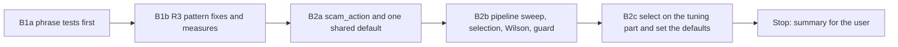
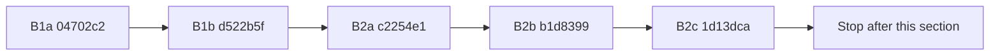

# Handoff: Step 3.3 Stage B Part 1, R3 Fixes, Selection, and Settings (2026-10-25)

Read this file first. Then read, in this order:

1. `tasks/index.md` (the task system).
2. `tasks/todo.md`.
3. `task.md` and `notes.md` in this folder. In `notes.md`, read these sections:
    - "Decisions (2026-10-25)", decisions 4 to 7;
    - "Stage B selection rule and B1 stop rule" (rules S1 to S4 and the B1 stop rule);
    - "Review of the Stage A fixes", for the four limits of the committed set;
    - "Observations for Stage B".
4. `CLAUDE.md`.
5. These sections of `docs/lessons.md`:
    - "A perfect score on a dev set says nothing about phrasings the set lacks";
    - "Set a stop rule for rule rounds on a long-tail check";
    - "Prove that a mutation was applied with a fixed-string check, not the regex that applied it".

Do not read `tasks/archive/`.

The user will review your work after this part. Part 2 comes after that review: the CI gate (B3), the notebook (B4), and the one held-out run with the README numbers (B5).

## 1. Status

| Item | State |
|------|-------|
| `main` | Ahead of `origin/main` (not pushed). Do not push. |
| Committed set | Frozen at A3b (dataset SHA-256 `c80627b5…24f448`). Do not change a case, a label, or the guide. |
| EMSCAD | The CSV is in `apps/backend-py/data/kaggle/`. The tuning part may run in this part: one time after B1b and one time in B2c. |
| Held-out part | **Do not run it.** Never use `--part heldout`. Do not create the held-out marker file (B2b) outside `tmp_path`. |
| This handoff | B1a, B1b, B2a, B2b, and B2c. **Stop after B2c.** |

## 2. The task



**The rules that matter most:**

- **B1 is one round over a fixed list** (section B1). It adds no pattern for recall (option a, decision 4), and it changes no pattern outside the list.
- **The selection is mechanical.** Rules S1 and S2 (decision 5) pick the threshold and the action from the tuning sweep. Do not change the numbers 0.005, 0.50, or 10, and do not pick by judgment.
- **No new detector signal is tuned or judged on the committed set** (decision 6). The committed set guards the hard negatives and shows regressions.

There are six commits: B1a, B1b, B2a, B2b, B2c, and the results section of this file. Before each commit, run all the checks in section 4.

### B1a. Phrase tests first

Add `apps/backend-py/tests/unit/test_scam_detector.py`. No unit tests for `JobScamDetector` or `ScamFilter` exist today.

For **each pattern in the list below**, write at least 3 phrases that must match and at least 3 phrases that must not match:

- A must-match phrase is real scam wording for that sign, in your own words (for example "No interview required, start tomorrow").
- A must-not phrase is ordinary posting wording that has the trigger words. Include each hard-negative form that applies:
    - "signal processing";
    - "competitive pay and the chance to work on";
    - "WhatsApp Business API";
    - "a licensed bitcoin exchange";
    - an anti-fraud notice ("never asks a candidate to pay a fee, buy equipment, or send gift cards");
    - "Interviews are on site".
- Include at least one must-not case for each `.*` pattern where the trigger words are in two different sentences of the same line, for example "Pay is monthly. You get the chance to work on X."
- Test each phrase two ways: alone on one line, and inside a short posting with line breaks.

Test the pattern on its own (the compiled pattern or a small helper), not only the full `detect()` score.

| Group | Patterns on the list |
|-------|----------------------|
| `payment` | `pay.*to.*work`, `payment.*required`, `buy.*equipment`, `wire.*transfer`, `cryptocurrency.*payment`, `bitcoin.*required` |
| `messaging` | `telegram`, `whatsapp`, `signal`, `kik`, `discord.*only`, `text.*only` |
| `immediate` | `immediate.*hire`, `start.*today`, `no.*interview`, `skip.*interview` |
| `ScamFilter.REJECT_PATTERNS` | `bitcoin`, `gift cards` |

Not on the list, so do not change them: the email-domain patterns, `reply.*to.*personal` (it is matched against `recruiter_email` only and cannot match), the `unrealistic` pay patterns, `SUSPICIOUS_COMPANY_PATTERNS`, the title patterns in `_check_title`, the other `REJECT_PATTERNS`, and `_scan_scam_flags` in `api/routes/cover_letter.py`. "Observations for Stage B" in `notes.md` records them as known limits.

**Every must-match phrase must pass on the current code.** These phrases are the detections that B1 must keep. If one fails today, the phrase is wrong; change the phrase, not the pattern.

Mark each must-not phrase that fails on the current code with `pytest.mark.xfail(strict=True, reason="R3 ...")`. Show the list of those strict xfails.

Commit B1a: `test(scam): add must-match and must-not phrases for the R3 patterns`.

### B1b. R3 pattern fixes, measured

- Change only the patterns in the list. Use word boundaries, and replace `.*` with phrase context that stays inside one phrase. For example, a messaging app counts when it is the contact channel ("message us on WhatsApp", "Telegram only", "@handle"), not when it is the product.
- A negation guard is allowed if a must-not phrase needs it, for example "never asks ... to pay".
- Remove the `xfail` markers from B1a. All B1a tests must pass. Do not change, remove, or weaken a B1a phrase in B1b. If you think a phrase is wrong, keep it, and write it in the summary.
- Measure before and after on the same two sets:
    - the committed set: the A3b report, then one `eval scam` run after B1b;
    - the EMSCAD tuning part: the report of 2026-10-25 (`data/eval/emscad/20261024T172032465209Z.json`), then one `eval emscad --part tuning` run after B1b.

  Record two tables:
    1. Per pattern: hits on legitimate and on scam or fraud rows in each set, before and after.
    2. The overall metrics of each set, before and after.
- After B1b, no hard negative may be flagged at 0.70. If one is, say so; do not change the committed set.
- One round. The review can ask for one more fix round. What then stays wrong goes to the known limits.

Commit B1b: `fix(scam): word boundaries and phrase context for the R3 patterns`.

### B2a. `scam_action` and one shared default

- **One shared default.** Add `DEFAULT_SCAM_THRESHOLD = 0.7` and `DEFAULT_SCAM_ACTION = "drop"` in `src/scoring/scam_detector.py`. The values do not change in this step, so behaviour stays the same. Every default reads them:
    - `JobScamDetector.__init__` and `TrustAnalyzer.__init__`;
    - `PipelineConfig` and the fallback in `stages.py:111`;
    - `PipelineRequest` in `api/models/requests.py`;
    - the `scam` and `emscad` suites (no literal 0.7 is left).
- **`scam_action`.** Add `scam_action: Literal["drop", "flag"]` to `PipelineConfig`, to the pipeline context config, and to `PipelineRequest` (default `DEFAULT_SCAM_ACTION`). `stage_filter_scams` reads it, and the quick filter follows the same action.
    - `drop`: the same as today.
    - `flag`: keep every posting. For each posting that the quick filter or the detector flags, set `job.metadata["scam_flag"]` to `{"quick_filter": bool, "confidence": float, "reasons": [...]}`. The stage metadata records the action and the counts.
    - Also fix `original_count`: count the postings before the quick filter. (The Stage A observation found that the count is taken after the quick filter.)
- **Pipeline page** (`apps/frontend-ts/src/app/pipeline/page.tsx`):
    - the default `scamThreshold` equals `DEFAULT_SCAM_THRESHOLD`;
    - the input `step` is `0.05`;
    - the help text matches `DEFAULT_SCAM_ACTION`: "Jobs at or above this score are removed." for `drop`, and "Jobs at or above this score are flagged and kept." for `flag`.

    The page does not send `scam_action`, so the backend default applies.
- **Tests:**
    - `drop` and `flag` in `stage_filter_scams`; in `flag`, a quick-filter hit is also kept and gets `scam_flag`;
    - the `original_count` fix;
    - the request defaults;
    - one backend test that reads `page.tsx` and fails when the page default or the help text does not match `DEFAULT_SCAM_THRESHOLD` and `DEFAULT_SCAM_ACTION`;
    - update `tests/app/pipeline/page.test.tsx` if it needs a change.

Commit B2a: `feat(pipeline): add scam_action and one shared scam default`.

### B2b. Pipeline sweep, selection, Wilson intervals, and the held-out guard

- **Pipeline sweep.** `evaluate_scam_listings` adds `details["pipeline_sweep"]`: the pipeline decision (quick filter or detector at or above `t`) for `t` from 0.05 to 1.00 in steps of 0.05. Each row has TP, FP, FN, TN, precision, recall, and the false-positive rate. Keep the detector-only `threshold_sweep`.
- **Selection.** Add `select_operating_point(pipeline_sweep)`, which returns the threshold, the action, and a one-line reason. It applies rules S1 and S2 exactly. Keep `MAX_FALSE_POSITIVE_RATE = 0.005`, `MIN_DROP_PRECISION = 0.50`, and `MIN_FLAGGED_FRAUDS = 10` in one place, with a comment that points to decision 5. The tuning report of the `emscad` suite has the result in `details["selection"]`. The held-out report does not select.
- **Wilson intervals.** Add `wilson_interval(successes, trials, z=1.96)` to `src/evaluation/metrics.py`. Both suites report `precision.ci95_low`, `precision.ci95_high`, and the same two values for `recall` and `false_positive_rate`.
- **Held-out guard.**
    - The marker is `apps/backend-py/data/eval/emscad/heldout_used.json`. Make it a constant that tests can replace.
    - `run_eval_command` with `emscad --part heldout` stops with exit code 1 and a clear message when the marker exists.
    - After a successful held-out run, it writes the marker: the UTC time, the git SHA, the dataset SHA-256, the threshold, the action, and the report path.
    - The guard applies whatever `--out` is.
- **Tests:**
    - selection: a tie goes to the higher threshold; when no threshold qualifies, `t*` is 1.00; a value exactly at each limit qualifies (FPR 0.005, precision 0.50, 10 frauds); `drop` against `flag`;
    - Wilson: 5 of 10 gives about (0.2366, 0.7634); 0 trials gives None;
    - the pipeline sweep counts on a small set;
    - the guard: it refuses when the marker exists, and it writes the marker after a run. Use `tmp_path` only.
- **Mutation proofs.** For each mutation below:
    - apply a fixed-string replacement;
    - show the checksum and the count of the new string;
    - show that a test fails;
    - restore the file and compare it with the backup.

    The mutations:
    1. The selection without the tie rule.
    2. The guard check removed.
    3. The pipeline sweep without the quick filter.
    4. The Wilson `z` term removed.

Commit B2b: `feat(eval): pipeline sweep, operating-point selection, and the held-out guard`.

### B2c. Select on the tuning part and set the defaults

- Run the tuning part one time:

    Run the EMSCAD tuning part (from `apps/backend-py`):

    ```bash
    .venv/bin/python main.py eval emscad --part tuning
    ```

- Record the full `pipeline_sweep` (all 20 rows) and `details["selection"]` in this file's results section.
- Set `DEFAULT_SCAM_THRESHOLD` to `t*` and `DEFAULT_SCAM_ACTION` to the selected action. Set the Pipeline page default and help text to match; the B2a cross-check test must pass.
- Run the committed set one time at the new default, and record its metrics, its flagged cases, and the hard negatives' scores:

    Run the scam suite (from `apps/backend-py`):

    ```bash
    .venv/bin/python main.py eval scam
    ```

- If `t*` flags a hard negative, say so. Do not change `t*`.

Commit B2c: `feat(scam): set the default threshold and action from the tuning selection`.

## 3. Traps

- **Held-out.** Never run it, and never create the real marker. A test that writes the marker uses `tmp_path`.
- **Fixed list.** Do not add a pattern for recall, and do not change a pattern outside the B1 list, even when you see a false positive. Write it in the summary.
- **Phrases first.** Write the B1a phrases from what scam advertisements and job postings say, before you design a pattern. Do not change a phrase to fit a new pattern.
- **Committed set.** Do not change a case, a label, or `README.md` in `tests/fixtures/eval/scam/`. Do not judge a new signal on it (decision 6).
- **EMSCAD is local only.** No text from the CSV goes into tests, notes, or commit messages. Write phrases in your own words.
- **Frontend.** The Pipeline page change must pass the frontend checks. The E2E suite runs in CI.
- **No real data and no secrets.** Never open `.env`, `.env.local`, or `apps/backend-py/data/settings/user_settings.json`.
- **Startup time.** `main.py` takes about 100 s to start on `/mnt/d`, and the full backend suite takes 3 to 8 minutes. Run long commands in the background.
- **Line endings and scratch files.**
    - Check `git ls-files --eol` before each commit.
    - Do not commit the files that the IDE rewrites with CRLF.
    - Put scratch files and commit messages outside the repository, and use `git commit -F <file>`.

## 4. Checks

Backend (WSL, from `apps/backend-py`):

Check formatting:

```bash
.venv/bin/python -m black --check main.py scripts/mypy_gate.py src/ tests/
```

Run the linter:

```bash
.venv/bin/python -m ruff check main.py scripts/mypy_gate.py src/ tests/
```

Run the mypy baseline gate:

```bash
.venv/bin/python scripts/mypy_gate.py
```

Run the tests:

```bash
.venv/bin/python -m pytest tests/ -q
```

Frontend (from `apps/frontend-ts`, for B2a and B2c):

Run the linter:

```bash
npm run lint
```

Run the type check:

```bash
npm run type-check
```

Check formatting:

```bash
npm run format:check
```

Run the unit tests:

```bash
npx vitest run
```

## 5. Rules (unchanged)

- Follow `CLAUDE.md`:
    - docstrings with description, arguments, and returns;
    - type hints;
    - ASD-STE100 for documentation;
    - no emojis;
    - a Mermaid diagram in documentation.
- Before each commit, run `git status --short` and stage only the files of that step.
- Never run `scripts/mypy_gate.py --update` to accept a new error.
- Keep dry run as the default. Do not make auto-submit reachable.
- Do not push. Push only from WSL, and only after the user approves.

## 6. Summary to leave for the user

At the end of this file, add "Cursor results (date)" with:

- The commits (hash and subject).
- B1a: the phrase count per pattern, and the strict xfails on the old code.
- B1b:
    - each pattern change (old and new);
    - the two measure tables;
    - each B1a phrase that you think is wrong (kept, not changed);
    - the false positives that you saw outside the list.
- B2a: the places that now read the shared default, and the tests.
- B2b: the tests, their failure output before the code, and the four mutation results.
- B2c:
    - the full pipeline sweep;
    - the selection with its reason;
    - the new defaults;
    - the committed-set run at the new default, with the hard negatives' scores.
- Every check that you ran and its result. Say clearly what you did not run. The held-out part must be in the "not run" list.

## Cursor results (2026-10-25)



### Commits

| Hash | Subject |
|------|---------|
| `04702c2` | `test(scam): add must-match and must-not phrases for the R3 patterns` |
| `d522b5f` | `fix(scam): word boundaries and phrase context for the R3 patterns` |
| `c2254e1` | `feat(pipeline): add scam_action and one shared scam default` |
| `b1d8399` | `feat(eval): pipeline sweep, operating-point selection, and the held-out guard` |
| `1d13dca` | `feat(scam): set the default threshold and action from the tuning selection` |
| this commit | results section of this file |

`main` is ahead of `origin/main`. This part did not push.

### B1a

`apps/backend-py/tests/unit/test_scam_detector.py`. 18 patterns. Each pattern has at least 3 must-match phrases and 3 must-not phrases. Each phrase is tested alone and in a 4-line posting. The helper `_pattern_hits` tests the compiled pattern or the reject substring, not `detect()`.

Phrase counts:

| Group | Must-match (x2 layouts) | Must-not (x2 layouts) |
|-------|-------------------------|------------------------|
| 18 patterns | 18 x 3 x 2 = 108 | 18 x 3 x 2 = 108 |
| Structure tests | 3 | |

On the old code: 167 passed, 52 strict xfails (26 must-not phrases x 2 layouts). Every must-match phrase passed. The first `kik` must-not draft used `kicking` and `kiosk`; those strings do not contain `kik`, so B1a replaced them with Kikuyu and kikoi before the B1a commit.

Strict xfails on the old code:

| Pattern | Must-not phrases that failed |
|---------|------------------------------|
| `pay.*to.*work` | competitive pay and the chance to work on; Pay is monthly. You get the chance to work on |
| `payment.*required` | Payment is monthly. Overtime is required |
| `buy.*equipment` | never asks ... buy equipment; You may buy from our store. Equipment is supplied |
| `wire.*transfer` | We send the first week by wire. Transfer of knowledge |
| `cryptocurrency.*payment` | We accept no cryptocurrency. Payment is by bank transfer |
| `bitcoin.*required` | We do not use bitcoin. Experience is required |
| `telegram` | Telegram Bot API; public Telegram channel |
| `whatsapp` | WhatsApp Business API (two phrasings) |
| `signal` | signal processing; signal-to-noise |
| `kik` | Kikuyu; kikoi |
| `discord.*only` | Join our Discord. Only full-time roles |
| `text.*only` | The job text is on the site. Only applicants |
| `immediate.*hire` | immediate need. Hire decisions come after |
| `start.*today` | Applications start on Monday. Today the team |
| `no.*interview` | No travel is needed. Interviews are on site |
| `skip.*interview` | skip the online form. Interviews are required |
| reject `bitcoin` | licensed bitcoin exchange; watches bitcoin prices |
| reject `gift cards` | never asks ... gift cards; year-end gift cards |

### B1b

One round. No B1a phrase was changed. No pattern outside the B1 list was changed.

| Pattern | Old | New |
|---------|-----|-----|
| `pay.*to.*work` | `pay.*to.*work` | `\bpay\b` then optional fee/cost/kit/deposit in the same sentence, then `\bto\s+(?:start\s+)?work\b` |
| `payment.*required` | `payment.*required` | `\bpayment\b[^.!?]{0,30}\brequired\b` |
| `buy.*equipment` | `buy.*equipment` | same-sentence `\bbuy\b` ... `\bequipment\b`, with a never/do-not guard |
| `wire.*transfer` | `wire.*transfer` | `\bwire\b[^.!?]{0,20}\btransfer\b` |
| `cryptocurrency.*payment` | `cryptocurrency.*payment` | `\bcryptocurrency\b[^.!?]{0,20}\bpayment\b` |
| `bitcoin.*required` | `bitcoin.*required` | `\bbitcoin\b[^.!?]{0,20}\brequired\b` |
| `telegram` | `telegram` | contact channel: on/via/through, "only", `@handle`, or message/contact/apply near the word |
| `whatsapp` | `whatsapp` | contact channel; not WhatsApp Business API |
| `signal` | `signal` | contact channel; not "signal processing" as a product, except when hire/message context is present |
| `kik` | `kik` | `\bkik\b` |
| `discord.*only` | `discord.*only` | `\bdiscord\b[^.!?]{0,15}\bonly\b` |
| `text.*only` | `text.*only` | `\btext\s+only\b` |
| `immediate.*hire` | `immediate.*hire` | `\bimmediate\s+hire\b` |
| `start.*today` | `start.*today` | `\bstart\s+today\b` |
| `no.*interview` | `no.*interview` | `\bno\s+interview\b` |
| `skip.*interview` | `skip.*interview` | `\bskip\b[^.!?]{0,15}\binterview\b` |
| reject `bitcoin` | substring `bitcoin` | pay/send/deposit/fee ... bitcoin, or "in bitcoin", with a never/do-not sentence guard |
| reject `gift cards` | substring `gift cards` | `\bbuy\|pay with\|accept\s+gift cards\b` or gift cards plus codes/store/starter fee |

`ScamFilter.reject_pattern_hits` now uses a regex when the pattern has metacharacters. All 219 B1a phrase tests pass.

No B1a phrase is treated as wrong. All must-not phrases were kept.

Overall metrics:

| Set | When | P | R | FPR | TP | FP | FN | TN |
|-----|------|---|---|-----|----|----|----|----|
| Committed | A3b | 0.2500 | 0.0455 | 0.1250 | 1 | 3 | 21 | 21 |
| Committed | after B1b (`20261025T035828897487Z.json`, MLflow `6a9ab3d7`) | 1.0000 | 0.0455 | 0.0000 | 1 | 0 | 21 | 24 |
| EMSCAD tuning | 2026-10-25 | 0.0219 | 0.0069 | 0.0158 | 3 | 134 | 430 | 8373 |
| EMSCAD tuning | after B1b (`20261025T040004954373Z.json`, MLflow `df5229a2`) | 0.0000 | 0.0000 | 0.0033 | 0 | 28 | 433 | 8479 |

Committed-set dataset SHA stayed `c80627b5…24f448`. After B1b, no hard negative was flagged at 0.70. `hard_negative__signal_processing` still scores 0.50 (the live `signal` pattern still hits that posting). It is not flagged at 0.70.

Per-pattern hits, committed set, legit/scam, before to after:

| Pattern | Before | After |
|---------|--------|-------|
| `pay.*to.*work` | 1/1 | 0/0 |
| `payment.*required` | 0/0 | 0/0 |
| `buy.*equipment` | 1/0 | 0/0 |
| `wire.*transfer` | 0/0 | 0/0 |
| `cryptocurrency.*payment` | 0/0 | 0/0 |
| `bitcoin.*required` | 0/0 | 0/0 |
| `telegram` | 0/3 | 0/3 |
| `whatsapp` | 1/2 | 0/2 |
| `signal` | 1/0 | 1/0 |
| `kik` | 0/0 | 0/0 |
| `discord.*only` | 0/0 | 0/0 |
| `text.*only` | 0/0 | 0/0 |
| `immediate.*hire` | 0/0 | 0/0 |
| `start.*today` | 0/3 | 0/1 |
| `no.*interview` | 4/2 | 0/2 |
| `skip.*interview` | 0/0 | 0/0 |
| reject `bitcoin` | 1/0 | 0/0 |
| reject `gift cards` | 1/0 | 0/0 |

Per-pattern hits, EMSCAD tuning, legit/scam, before to after:

| Pattern | Before | After |
|---------|--------|-------|
| `pay.*to.*work` | 360/10 | 0/0 |
| `payment.*required` | 28/1 | 2/0 |
| `buy.*equipment` | 2/0 | 0/0 |
| `wire.*transfer` | 25/0 | 22/0 |
| `cryptocurrency.*payment` | 0/0 | 0/0 |
| `bitcoin.*required` | 0/0 | 0/0 |
| `telegram` | 0/0 | 0/0 |
| `whatsapp` | 29/0 | 0/0 |
| `signal` | 32/3 | 0/0 |
| `kik` | 0/0 | 0/0 |
| `discord.*only` | 0/0 | 0/0 |
| `text.*only` | 20/0 | 0/0 |
| `immediate.*hire` | 23/0 | 15/0 |
| `start.*today` | 89/5 | 18/1 |
| `no.*interview` | 337/7 | 0/0 |
| `skip.*interview` | 1/0 | 0/0 |
| reject `bitcoin` | 12/0 | 5/0 |
| reject `gift cards` | 0/0 | 0/0 |

Remaining on-list legit hits on EMSCAD (known limits after one round): `payment.*required` 2, `wire.*transfer` 22, `immediate.*hire` 15, `start.*today` 18, reject `bitcoin` 5. No pattern outside the list was changed. Off-list limits from Stage A (email-domain patterns, title patterns, `_scan_scam_flags`) stay as recorded in `notes.md`.

### B2a

`DEFAULT_SCAM_THRESHOLD = 0.7` and `DEFAULT_SCAM_ACTION = "drop"` were added in `src/scoring/scam_detector.py`. Values did not change in B2a. Readers:

- `JobScamDetector.__init__`
- `TrustAnalyzer.__init__`
- `PipelineConfig` and the fallback in `stages.py`
- `PipelineStartRequest` (the request model; the handoff name `PipelineRequest` is this class)
- `api/routes/pipeline.py`
- `main.py --scam-threshold`
- `run_scam_suite` and `run_emscad_suite` (no suite literal `0.7` remains)

`scam_action` is on `PipelineConfig`, the pipeline context config, and `PipelineStartRequest`. `stage_filter_scams` counts `original_count` before the quick filter. `drop` removes flagged postings. `flag` keeps every posting and writes `job.metadata["scam_flag"]`. The Pipeline page default is the shared threshold, `step="0.05"`, help text "Jobs at or above this score are removed." The page does not send `scam_action`.

Tests: `TestStageFilterScams` (drop, flag, `original_count`) and `tests/unit/test_scam_defaults.py` (request, config, TrustAnalyzer, page.tsx cross-check). `tests/app/pipeline/page.test.tsx` did not need a change.

### B2b

Tests are in `tests/unit/test_operating_point.py`. Before the code, collection failed:

```
ImportError: cannot import name 'wilson_interval' from 'src.evaluation.metrics'
collected 0 items / 1 error
```

After the code, the new tests passed (18 in that file, plus the existing suite tests that now patch the marker).

Selection (S1, S2): a recall tie goes to the higher threshold; when no row qualifies, `t*` is 1.00; FPR 0.005, precision 0.50, and 10 flagged frauds each qualify; `drop` against `flag`. Constants `MAX_FALSE_POSITIVE_RATE`, `MIN_DROP_PRECISION`, and `MIN_FLAGGED_FRAUDS` sit in `scam.py` with a comment that points to decision 5.

Wilson: 5 of 10 is about (0.2366, 0.7634); 0 trials returns None. Both suites add `precision.ci95_*`, `recall.ci95_*`, and `false_positive_rate.ci95_*`.

Pipeline sweep: 20 rows, 0.05 to 1.00, quick filter or detector at or above `t`, with TP, FP, FN, TN, precision, recall, and FPR. Detector-only `threshold_sweep` stays.

Held-out guard: `HELDOUT_USED_MARKER` in `emscad.py` (tests replace it). `run_eval_command` with `emscad --part heldout` exits 1 when the marker exists, and writes the marker after a successful run, including when `--out` is set. Tests use `tmp_path` only. The real marker file was not created.

The tuning report stores `details["selection"]`. The held-out report does not select.

Mutation proofs (fixed-string replace, checksum changed, `grep -F` count of the new string is 1, test failed, file restored to the backup checksum):

| Mutation | Test | Failure |
|----------|------|---------|
| 1. Selection without the tie rule (`max(...)` to `top[0]`) | `test_tie_goes_to_the_higher_threshold` | `assert 0.5 == 0.8` |
| 2. Guard check removed (`if marker.is_file()` to `if False and ...`) | `test_refuses_when_the_marker_exists` | `assert 0 == 1` |
| 3. Pipeline sweep without the quick filter | `test_counts_include_the_quick_filter` | `assert 0 == 1` (TP at 1.00) |
| 4. Wilson `z` term removed (`z_squared = z * z` to `0.0`) | `test_five_of_ten` | low bound 0.1901, not 0.2366 |

### B2c

Tuning run (one time): `python main.py eval emscad --part tuning`. Report `data/eval/emscad/20261025T044101635146Z.json`. MLflow `6ce4f4b307cf4826be2a502e2a0eeaad`. Git SHA `b1d8399`. EMSCAD dataset SHA-256 `a771a4ea…06f641a4`. 8940 cases.

`details["selection"]`:

```
threshold: 1.0
action: flag
reason: t* is 1.00 (highest recall among FPR at most 0.005; tie broke to the higher threshold); action is flag because precision is below 0.50 and flagged frauds are below 10.
```

From 0.45 to 1.00 every row has FPR at most 0.005 and recall 0. The tie rule picks 1.00. Precision is 0 and flagged frauds are 0, so the action is `flag`.

Full `pipeline_sweep`:

| t | TP | FP | FN | TN | P | R | FPR |
|---|----|----|----|----|---|---|-----|
| 0.05 | 433 | 8507 | 0 | 0 | 0.0484 | 1.0000 | 1.0000 |
| 0.10 | 433 | 8507 | 0 | 0 | 0.0484 | 1.0000 | 1.0000 |
| 0.15 | 67 | 658 | 366 | 7849 | 0.0924 | 0.1547 | 0.0773 |
| 0.20 | 67 | 658 | 366 | 7849 | 0.0924 | 0.1547 | 0.0773 |
| 0.25 | 26 | 294 | 407 | 8213 | 0.0813 | 0.0600 | 0.0346 |
| 0.30 | 23 | 203 | 410 | 8304 | 0.1018 | 0.0531 | 0.0239 |
| 0.35 | 21 | 179 | 412 | 8328 | 0.1050 | 0.0485 | 0.0210 |
| 0.40 | 17 | 154 | 416 | 8353 | 0.0994 | 0.0393 | 0.0181 |
| 0.45 | 0 | 38 | 433 | 8469 | 0.0000 | 0.0000 | 0.0045 |
| 0.50 | 0 | 38 | 433 | 8469 | 0.0000 | 0.0000 | 0.0045 |
| 0.55 | 0 | 30 | 433 | 8477 | 0.0000 | 0.0000 | 0.0035 |
| 0.60 | 0 | 30 | 433 | 8477 | 0.0000 | 0.0000 | 0.0035 |
| 0.65 | 0 | 28 | 433 | 8479 | 0.0000 | 0.0000 | 0.0033 |
| 0.70 | 0 | 28 | 433 | 8479 | 0.0000 | 0.0000 | 0.0033 |
| 0.75 | 0 | 28 | 433 | 8479 | 0.0000 | 0.0000 | 0.0033 |
| 0.80 | 0 | 28 | 433 | 8479 | 0.0000 | 0.0000 | 0.0033 |
| 0.85 | 0 | 28 | 433 | 8479 | 0.0000 | 0.0000 | 0.0033 |
| 0.90 | 0 | 28 | 433 | 8479 | 0.0000 | 0.0000 | 0.0033 |
| 0.95 | 0 | 28 | 433 | 8479 | 0.0000 | 0.0000 | 0.0033 |
| 1.00 | 0 | 28 | 433 | 8479 | 0.0000 | 0.0000 | 0.0033 |

New defaults: `DEFAULT_SCAM_THRESHOLD = 1.0`, `DEFAULT_SCAM_ACTION = "flag"`. The Pipeline page default is `1.0`. The help text is "Jobs at or above this score are flagged and kept." The B2a page cross-check passes. The `TestStageFilterScams` helper pins 0.7 so drop/flag behaviour stays visible at `t* = 1.0`.

Committed-set run at the new default: `python main.py eval scam`. Report `data/eval/scam/20261025T044303583101Z.json`. MLflow `b539298d50694292a22e6a0295be71af`. Dataset SHA-256 `c80627b5…24f448`.

| Metric | Value |
|--------|-------|
| cases | 46 |
| precision | undefined (0 flags) |
| recall | 0.0000 (CI 0.0000 to 0.1487) |
| FPR | 0.0000 (CI 0.0000 to 0.1380) |
| confusion | TP 0, FP 0, FN 22, TN 24 |

No posting was flagged. `t*` does not flag a hard negative.

Hard-negative scores at the new default:

| Case | Predicted | Quick filter | Confidence |
|------|-----------|--------------|------------|
| `hard_negative__signal_processing` | legit | no | 0.50 |
| `hard_negative__competitive_hearthline` | legit | no | 0.10 |
| `hard_negative__whatsapp_business_api` | legit | no | 0.10 |
| `hard_negative__bitcoin_exchange` | legit | no | 0.10 |
| `hard_negative__antifraud_notice` | legit | no | 0.10 |
| `hard_negative__summit_ridge_revenue` | legit | no | 0.40 |

`hard_negative__signal_processing` still matches the live `signal` pattern (score 0.50). It is not flagged at 1.0. `t*` was not changed.

### Checks that ran

Backend, from `apps/backend-py`, before each of B2a, B2b, and B2c:

- `black --check main.py scripts/mypy_gate.py src/ tests/` passed
- `ruff check main.py scripts/mypy_gate.py src/ tests/` passed
- `scripts/mypy_gate.py` passed (182 known errors, 0 new)
- `pytest tests/ -q` passed: 1451 after B2a, 1469 after B2b, 1469 after B2c

Frontend, from `apps/frontend-ts`, for B2a and B2c:

- `npm run lint` passed
- `npm run type-check` passed
- `npx prettier --check src/app/pipeline/page.tsx` passed
- `npx vitest run` passed: 46 files, 252 tests

B1a and B1b used the same backend gates (B1b: 1445 then the later full counts above).

`git ls-files --eol` was checked before each commit. Commits used LF files only. The 14 IDE CRLF rewrites were not committed. Scratch files and commit messages stayed outside the repository.

### Checks that did not run

- EMSCAD `--part heldout` (do not run in this part)
- Creation of the real marker `apps/backend-py/data/eval/emscad/heldout_used.json`
- Frontend `npm run format:check` on the whole tree (it fails on pre-existing CRLF files that this part did not touch)
- Frontend E2E (CI)
- Push
- Part 2: B3 CI gate, B4 notebook, B5 held-out and README numbers

### Follow-up while waiting for review (2026-10-25)

- Wilson intervals are now clamped to `[0, 1]`. The B2c tuning report printed `recall.ci95_low: -0.0` from float error on 0 of 433. The 5-of-10 test still holds. A new test covers 0 of 433.
- The Pipeline page was checked in the browser: default `1`, step `0.05`, help text "Jobs at or above this score are flagged and kept." The field accepts `0.95`.
- Part 2 was not started. Held-out was not run. The real marker was not created.
