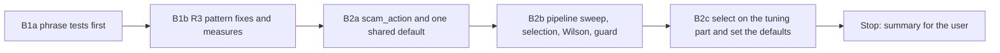

# Handoff: Step 3.3 Stage B Part 1, R3 Fixes, Selection, and Settings (2026-10-25)

Read this file first. Then read, in this order:

1. `tasks/index.md` (the task system).
2. `tasks/todo.md`.
3. `task.md` and `notes.md` in this folder. In `notes.md`, read these sections:
    - "Decisions (2026-10-25)", decisions 4 to 7;
    - "Stage B selection rule and B1 stop rule" (rules S1 to S4 and the B1 stop rule);
    - "Review of the Stage A fixes", for the four limits of the committed set;
    - "Observations for Stage B".
4. `CLAUDE.md`.
5. These sections of `docs/lessons.md`:
    - "A perfect score on a dev set says nothing about phrasings the set lacks";
    - "Set a stop rule for rule rounds on a long-tail check";
    - "Prove that a mutation was applied with a fixed-string check, not the regex that applied it".

Do not read `tasks/archive/`.

The user will review your work after this part. Part 2 comes after that review: the CI gate (B3), the notebook (B4), and the one held-out run with the README numbers (B5).

## 1. Status

| Item | State |
|------|-------|
| `main` | Ahead of `origin/main` (not pushed). Do not push. |
| Committed set | Frozen at A3b (dataset SHA-256 `c80627b5…24f448`). Do not change a case, a label, or the guide. |
| EMSCAD | The CSV is in `apps/backend-py/data/kaggle/`. The tuning part may run in this part: one time after B1b and one time in B2c. |
| Held-out part | **Do not run it.** Never use `--part heldout`. Do not create the held-out marker file (B2b) outside `tmp_path`. |
| This handoff | B1a, B1b, B2a, B2b, and B2c. **Stop after B2c.** |

## 2. The task



**The rules that matter most:**

- **B1 is one round over a fixed list** (section B1). It adds no pattern for recall (option a, decision 4), and it changes no pattern outside the list.
- **The selection is mechanical.** Rules S1 and S2 (decision 5) pick the threshold and the action from the tuning sweep. Do not change the numbers 0.005, 0.50, or 10, and do not pick by judgment.
- **No new detector signal is tuned or judged on the committed set** (decision 6). The committed set guards the hard negatives and shows regressions.

There are six commits: B1a, B1b, B2a, B2b, B2c, and the results section of this file. Before each commit, run all the checks in section 4.

### B1a. Phrase tests first

Add `apps/backend-py/tests/unit/test_scam_detector.py`. No unit tests for `JobScamDetector` or `ScamFilter` exist today.

For **each pattern in the list below**, write at least 3 phrases that must match and at least 3 phrases that must not match:

- A must-match phrase is real scam wording for that sign, in your own words (for example "No interview required, start tomorrow").
- A must-not phrase is ordinary posting wording that has the trigger words. Include each hard-negative form that applies:
    - "signal processing";
    - "competitive pay and the chance to work on";
    - "WhatsApp Business API";
    - "a licensed bitcoin exchange";
    - an anti-fraud notice ("never asks a candidate to pay a fee, buy equipment, or send gift cards");
    - "Interviews are on site".
- Include at least one must-not case for each `.*` pattern where the trigger words are in two different sentences of the same line, for example "Pay is monthly. You get the chance to work on X."
- Test each phrase two ways: alone on one line, and inside a short posting with line breaks.

Test the pattern on its own (the compiled pattern or a small helper), not only the full `detect()` score.

| Group | Patterns on the list |
|-------|----------------------|
| `payment` | `pay.*to.*work`, `payment.*required`, `buy.*equipment`, `wire.*transfer`, `cryptocurrency.*payment`, `bitcoin.*required` |
| `messaging` | `telegram`, `whatsapp`, `signal`, `kik`, `discord.*only`, `text.*only` |
| `immediate` | `immediate.*hire`, `start.*today`, `no.*interview`, `skip.*interview` |
| `ScamFilter.REJECT_PATTERNS` | `bitcoin`, `gift cards` |

Not on the list, so do not change them: the email-domain patterns, `reply.*to.*personal` (it is matched against `recruiter_email` only and cannot match), the `unrealistic` pay patterns, `SUSPICIOUS_COMPANY_PATTERNS`, the title patterns in `_check_title`, the other `REJECT_PATTERNS`, and `_scan_scam_flags` in `api/routes/cover_letter.py`. "Observations for Stage B" in `notes.md` records them as known limits.

**Every must-match phrase must pass on the current code.** These phrases are the detections that B1 must keep. If one fails today, the phrase is wrong; change the phrase, not the pattern.

Mark each must-not phrase that fails on the current code with `pytest.mark.xfail(strict=True, reason="R3 ...")`. Show the list of those strict xfails.

Commit B1a: `test(scam): add must-match and must-not phrases for the R3 patterns`.

### B1b. R3 pattern fixes, measured

- Change only the patterns in the list. Use word boundaries, and replace `.*` with phrase context that stays inside one phrase. For example, a messaging app counts when it is the contact channel ("message us on WhatsApp", "Telegram only", "@handle"), not when it is the product.
- A negation guard is allowed if a must-not phrase needs it, for example "never asks ... to pay".
- Remove the `xfail` markers from B1a. All B1a tests must pass. Do not change, remove, or weaken a B1a phrase in B1b. If you think a phrase is wrong, keep it, and write it in the summary.
- Measure before and after on the same two sets:
    - the committed set: the A3b report, then one `eval scam` run after B1b;
    - the EMSCAD tuning part: the report of 2026-10-25 (`data/eval/emscad/20261024T172032465209Z.json`), then one `eval emscad --part tuning` run after B1b.

  Record two tables:
    1. Per pattern: hits on legitimate and on scam or fraud rows in each set, before and after.
    2. The overall metrics of each set, before and after.
- After B1b, no hard negative may be flagged at 0.70. If one is, say so; do not change the committed set.
- One round. The review can ask for one more fix round. What then stays wrong goes to the known limits.

Commit B1b: `fix(scam): word boundaries and phrase context for the R3 patterns`.

### B2a. `scam_action` and one shared default

- **One shared default.** Add `DEFAULT_SCAM_THRESHOLD = 0.7` and `DEFAULT_SCAM_ACTION = "drop"` in `src/scoring/scam_detector.py`. The values do not change in this step, so behaviour stays the same. Every default reads them:
    - `JobScamDetector.__init__` and `TrustAnalyzer.__init__`;
    - `PipelineConfig` and the fallback in `stages.py:111`;
    - `PipelineRequest` in `api/models/requests.py`;
    - the `scam` and `emscad` suites (no literal 0.7 is left).
- **`scam_action`.** Add `scam_action: Literal["drop", "flag"]` to `PipelineConfig`, to the pipeline context config, and to `PipelineRequest` (default `DEFAULT_SCAM_ACTION`). `stage_filter_scams` reads it, and the quick filter follows the same action.
    - `drop`: the same as today.
    - `flag`: keep every posting. For each posting that the quick filter or the detector flags, set `job.metadata["scam_flag"]` to `{"quick_filter": bool, "confidence": float, "reasons": [...]}`. The stage metadata records the action and the counts.
    - Also fix `original_count`: count the postings before the quick filter. (The Stage A observation found that the count is taken after the quick filter.)
- **Pipeline page** (`apps/frontend-ts/src/app/pipeline/page.tsx`):
    - the default `scamThreshold` equals `DEFAULT_SCAM_THRESHOLD`;
    - the input `step` is `0.05`;
    - the help text matches `DEFAULT_SCAM_ACTION`: "Jobs at or above this score are removed." for `drop`, and "Jobs at or above this score are flagged and kept." for `flag`.

    The page does not send `scam_action`, so the backend default applies.
- **Tests:**
    - `drop` and `flag` in `stage_filter_scams`; in `flag`, a quick-filter hit is also kept and gets `scam_flag`;
    - the `original_count` fix;
    - the request defaults;
    - one backend test that reads `page.tsx` and fails when the page default or the help text does not match `DEFAULT_SCAM_THRESHOLD` and `DEFAULT_SCAM_ACTION`;
    - update `tests/app/pipeline/page.test.tsx` if it needs a change.

Commit B2a: `feat(pipeline): add scam_action and one shared scam default`.

### B2b. Pipeline sweep, selection, Wilson intervals, and the held-out guard

- **Pipeline sweep.** `evaluate_scam_listings` adds `details["pipeline_sweep"]`: the pipeline decision (quick filter or detector at or above `t`) for `t` from 0.05 to 1.00 in steps of 0.05. Each row has TP, FP, FN, TN, precision, recall, and the false-positive rate. Keep the detector-only `threshold_sweep`.
- **Selection.** Add `select_operating_point(pipeline_sweep)`, which returns the threshold, the action, and a one-line reason. It applies rules S1 and S2 exactly. Keep `MAX_FALSE_POSITIVE_RATE = 0.005`, `MIN_DROP_PRECISION = 0.50`, and `MIN_FLAGGED_FRAUDS = 10` in one place, with a comment that points to decision 5. The tuning report of the `emscad` suite has the result in `details["selection"]`. The held-out report does not select.
- **Wilson intervals.** Add `wilson_interval(successes, trials, z=1.96)` to `src/evaluation/metrics.py`. Both suites report `precision.ci95_low`, `precision.ci95_high`, and the same two values for `recall` and `false_positive_rate`.
- **Held-out guard.**
    - The marker is `apps/backend-py/data/eval/emscad/heldout_used.json`. Make it a constant that tests can replace.
    - `run_eval_command` with `emscad --part heldout` stops with exit code 1 and a clear message when the marker exists.
    - After a successful held-out run, it writes the marker: the UTC time, the git SHA, the dataset SHA-256, the threshold, the action, and the report path.
    - The guard applies whatever `--out` is.
- **Tests:**
    - selection: a tie goes to the higher threshold; when no threshold qualifies, `t*` is 1.00; a value exactly at each limit qualifies (FPR 0.005, precision 0.50, 10 frauds); `drop` against `flag`;
    - Wilson: 5 of 10 gives about (0.2366, 0.7634); 0 trials gives None;
    - the pipeline sweep counts on a small set;
    - the guard: it refuses when the marker exists, and it writes the marker after a run. Use `tmp_path` only.
- **Mutation proofs.** For each mutation below:
    - apply a fixed-string replacement;
    - show the checksum and the count of the new string;
    - show that a test fails;
    - restore the file and compare it with the backup.

    The mutations:
    1. The selection without the tie rule.
    2. The guard check removed.
    3. The pipeline sweep without the quick filter.
    4. The Wilson `z` term removed.

Commit B2b: `feat(eval): pipeline sweep, operating-point selection, and the held-out guard`.

### B2c. Select on the tuning part and set the defaults

- Run the tuning part one time:

    Run the EMSCAD tuning part (from `apps/backend-py`):

    ```bash
    .venv/bin/python main.py eval emscad --part tuning
    ```

- Record the full `pipeline_sweep` (all 20 rows) and `details["selection"]` in this file's results section.
- Set `DEFAULT_SCAM_THRESHOLD` to `t*` and `DEFAULT_SCAM_ACTION` to the selected action. Set the Pipeline page default and help text to match; the B2a cross-check test must pass.
- Run the committed set one time at the new default, and record its metrics, its flagged cases, and the hard negatives' scores:

    Run the scam suite (from `apps/backend-py`):

    ```bash
    .venv/bin/python main.py eval scam
    ```

- If `t*` flags a hard negative, say so. Do not change `t*`.

Commit B2c: `feat(scam): set the default threshold and action from the tuning selection`.

## 3. Traps

- **Held-out.** Never run it, and never create the real marker. A test that writes the marker uses `tmp_path`.
- **Fixed list.** Do not add a pattern for recall, and do not change a pattern outside the B1 list, even when you see a false positive. Write it in the summary.
- **Phrases first.** Write the B1a phrases from what scam advertisements and job postings say, before you design a pattern. Do not change a phrase to fit a new pattern.
- **Committed set.** Do not change a case, a label, or `README.md` in `tests/fixtures/eval/scam/`. Do not judge a new signal on it (decision 6).
- **EMSCAD is local only.** No text from the CSV goes into tests, notes, or commit messages. Write phrases in your own words.
- **Frontend.** The Pipeline page change must pass the frontend checks. The E2E suite runs in CI.
- **No real data and no secrets.** Never open `.env`, `.env.local`, or `apps/backend-py/data/settings/user_settings.json`.
- **Startup time.** `main.py` takes about 100 s to start on `/mnt/d`, and the full backend suite takes 3 to 8 minutes. Run long commands in the background.
- **Line endings and scratch files.**
    - Check `git ls-files --eol` before each commit.
    - Do not commit the files that the IDE rewrites with CRLF.
    - Put scratch files and commit messages outside the repository, and use `git commit -F <file>`.

## 4. Checks

Backend (WSL, from `apps/backend-py`):

Check formatting:

```bash
.venv/bin/python -m black --check main.py scripts/mypy_gate.py src/ tests/
```

Run the linter:

```bash
.venv/bin/python -m ruff check main.py scripts/mypy_gate.py src/ tests/
```

Run the mypy baseline gate:

```bash
.venv/bin/python scripts/mypy_gate.py
```

Run the tests:

```bash
.venv/bin/python -m pytest tests/ -q
```

Frontend (from `apps/frontend-ts`, for B2a and B2c):

Run the linter:

```bash
npm run lint
```

Run the type check:

```bash
npm run type-check
```

Check formatting:

```bash
npm run format:check
```

Run the unit tests:

```bash
npx vitest run
```

## 5. Rules (unchanged)

- Follow `CLAUDE.md`:
    - docstrings with description, arguments, and returns;
    - type hints;
    - ASD-STE100 for documentation;
    - no emojis;
    - a Mermaid diagram in documentation.
- Before each commit, run `git status --short` and stage only the files of that step.
- Never run `scripts/mypy_gate.py --update` to accept a new error.
- Keep dry run as the default. Do not make auto-submit reachable.
- Do not push. Push only from WSL, and only after the user approves.

## 6. Summary to leave for the user

At the end of this file, add "Cursor results (date)" with:

- The commits (hash and subject).
- B1a: the phrase count per pattern, and the strict xfails on the old code.
- B1b:
    - each pattern change (old and new);
    - the two measure tables;
    - each B1a phrase that you think is wrong (kept, not changed);
    - the false positives that you saw outside the list.
- B2a: the places that now read the shared default, and the tests.
- B2b: the tests, their failure output before the code, and the four mutation results.
- B2c:
    - the full pipeline sweep;
    - the selection with its reason;
    - the new defaults;
    - the committed-set run at the new default, with the hard negatives' scores.
- Every check that you ran and its result. Say clearly what you did not run. The held-out part must be in the "not run" list.
