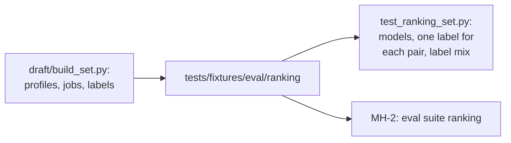

# MH-1: The ranking set and its format test

## Apply with the runner

The handoff runner applies this file: it writes the format test, runs the red command (it must fail), writes the set files, runs the "Done when" checks (they must pass), and commits. See `docs/handoff-runner.md`.

Apply this handoff (WSL, from `apps/backend-py`):

```bash
.venv/bin/python scripts/run_handoff.py ../../tasks/active/step-3-4-ranking-set/mh-1-ranking-set.md
```

## Why

Step 3.4 measures job ranking on a labeled set. This handoff adds the set that the user checked (`notes.md`, "Label check"): 2 synthetic profiles, 70 constructed jobs, and 140 labels (2 apply, 1 maybe, 0 not relevant), with the labeling guide. A format test keeps the set valid. No ranker has run on the set.



The labeling guide, `apps/backend-py/tests/fixtures/eval/ranking/README.md`, is already in the repository (Claude's docs commit): it has a Mermaid fence, and the runner reads only three-backtick blocks, so it cannot carry the guide.

## Files

- `apps/backend-py/tests/fixtures/eval/ranking/profiles.json` (new)
- `apps/backend-py/tests/fixtures/eval/ranking/modes.json` (new)
- `apps/backend-py/tests/fixtures/eval/ranking/jobs.jsonl` (new)
- `apps/backend-py/tests/fixtures/eval/ranking/labels.jsonl` (new)
- `apps/backend-py/tests/unit/test_ranking_set.py` (new)

## Step 1: add the format test, run it, and see it fail

```python new=apps/backend-py/tests/unit/test_ranking_set.py
"""Format tests for the Step 3.4 ranking set (``tests/fixtures/eval/ranking``)."""

import json
import re
from collections import Counter
from pathlib import Path
from typing import Any, Dict, List

from src.models.job_listing import JobListing
from src.models.user_profile import UserProfile

SET_DIR = Path(__file__).resolve().parents[1] / "fixtures" / "eval" / "ranking"


def read_jsonl(name: str) -> List[Dict[str, Any]]:
    """
    Read one JSON Lines file of the set.

    Args:
        name: The file name.

    Returns:
        One dictionary for each non-empty line.
    """
    text = (SET_DIR / name).read_text(encoding="utf-8")
    return [json.loads(line) for line in text.splitlines() if line.strip()]


def read_json(name: str) -> Dict[str, Any]:
    """
    Read one JSON file of the set.

    Args:
        name: The file name.

    Returns:
        The parsed object.
    """
    data: Dict[str, Any] = json.loads((SET_DIR / name).read_text(encoding="utf-8"))
    return data


def test_profiles_are_valid_and_have_modes() -> None:
    """Each profile validates and has the matcher mode of the pipeline."""
    profiles = read_json("profiles.json")
    modes = read_json("modes.json")

    assert set(profiles) == {"fresh_ml", "mid_backend"}
    assert set(modes) == set(profiles)
    for profile_id, data in profiles.items():
        UserProfile.model_validate(data)
        assert isinstance(modes[profile_id]["fresh_grad_mode"], bool)
    assert modes["fresh_ml"]["fresh_grad_mode"] is True
    assert modes["mid_backend"]["fresh_grad_mode"] is False


def test_jobs_are_valid_with_unique_ids() -> None:
    """Each job validates, and the job IDs are unique and numbered."""
    jobs = read_jsonl("jobs.jsonl")
    ids = [job["job_id"] for job in jobs]

    assert len(jobs) == 70
    assert len(set(ids)) == len(ids)
    for job in jobs:
        JobListing.model_validate(job)
        assert re.fullmatch(r"rk-\d{3}", job["job_id"]), job["job_id"]


def test_each_profile_has_one_label_for_each_job() -> None:
    """Each profile and job pair has exactly one label of 0, 1, or 2 with a reason."""
    profiles = read_json("profiles.json")
    job_ids = {job["job_id"] for job in read_jsonl("jobs.jsonl")}
    labels = read_jsonl("labels.jsonl")
    pairs = Counter((row["profile_id"], row["job_id"]) for row in labels)

    assert set(pairs) == {(p, j) for p in profiles for j in job_ids}
    assert set(pairs.values()) == {1}
    for row in labels:
        assert row["label"] in (0, 1, 2), row
        assert row["reason"].strip(), row


def test_each_profile_has_relevant_and_irrelevant_jobs() -> None:
    """Each profile has enough jobs of each label for the ranking metrics."""
    labels = read_jsonl("labels.jsonl")

    for profile_id in ("fresh_ml", "mid_backend"):
        counts = Counter(r["label"] for r in labels if r["profile_id"] == profile_id)
        assert counts[2] >= 5, (profile_id, counts)
        assert counts[1] >= 5, (profile_id, counts)
        assert counts[0] >= 20, (profile_id, counts)


def test_the_guide_states_the_label_rules() -> None:
    """The labeling guide defines each label and the rule to label first."""
    guide = (SET_DIR / "README.md").read_text(encoding="utf-8")

    for heading in ("### `2` (apply)", "### `1` (maybe)", "### `0` (not relevant)"):
        assert heading in guide
    assert "Write Labels Before Any Ranker Runs" in guide
```

Run it. It must fail (the set does not exist yet):

```bash red cwd=apps/backend-py
.venv/bin/python -m pytest tests/unit/test_ranking_set.py -q
```

## Step 2: add the set

The profiles:

```json new=apps/backend-py/tests/fixtures/eval/ranking/profiles.json
{
  "fresh_ml": {
    "name": "Rina Tan",
    "contact": {
      "email": "rina.tan@example.com",
      "location": "Singapore"
    },
    "summary": "Computer science graduate who builds machine learning and retrieval applications in Python, from data preparation to a small API.",
    "skills": [
      {
        "name": "Python",
        "category": "programming_language",
        "proficiency": "Advanced",
        "years_of_experience": 4.0
      },
      {
        "name": "PyTorch",
        "category": "framework",
        "proficiency": "Intermediate",
        "years_of_experience": 2.0
      },
      {
        "name": "scikit-learn",
        "category": "framework",
        "proficiency": "Intermediate",
        "years_of_experience": 2.0
      },
      {
        "name": "Pandas",
        "category": "framework",
        "proficiency": "Advanced",
        "years_of_experience": 3.0
      },
      {
        "name": "SQL",
        "category": "programming_language",
        "proficiency": "Intermediate",
        "years_of_experience": 2.0
      },
      {
        "name": "FastAPI",
        "category": "framework",
        "proficiency": "Intermediate",
        "years_of_experience": 1.0
      },
      {
        "name": "LangChain",
        "category": "framework",
        "proficiency": "Intermediate",
        "years_of_experience": 1.0
      },
      {
        "name": "Hugging Face Transformers",
        "category": "framework",
        "proficiency": "Intermediate",
        "years_of_experience": 1.0
      },
      {
        "name": "Docker",
        "category": "tool",
        "proficiency": "Beginner",
        "years_of_experience": 1.0
      },
      {
        "name": "Git",
        "category": "tool",
        "proficiency": "Intermediate",
        "years_of_experience": 3.0
      },
      {
        "name": "Machine Learning",
        "category": "domain",
        "proficiency": "Intermediate",
        "years_of_experience": 2.0
      },
      {
        "name": "Natural Language Processing",
        "category": "domain",
        "proficiency": "Intermediate",
        "years_of_experience": 1.0
      }
    ],
    "core_skills": [
      "Python",
      "PyTorch",
      "Machine Learning",
      "SQL"
    ],
    "experience": [
      {
        "title": "Data Science Intern",
        "company": "Harbourline Logistics",
        "location": "Singapore",
        "start_date": "2024-05-01T00:00:00",
        "end_date": "2024-11-01T00:00:00",
        "current": false,
        "description": "Built demand forecasts for the warehouse planning team.",
        "highlights": [
          "Built a gradient boosting forecast in scikit-learn for weekly parcel volume.",
          "Cleaned two years of shipment records in Pandas and SQL."
        ],
        "technologies": [
          "Python",
          "scikit-learn",
          "Pandas",
          "SQL"
        ]
      }
    ],
    "projects": [
      {
        "name": "Course Notes Assistant",
        "description": "A retrieval-augmented question answering app over lecture notes.",
        "technologies": [
          "Python",
          "LangChain",
          "FAISS",
          "FastAPI"
        ],
        "start_date": "2025-01-01T00:00:00",
        "end_date": "2025-04-01T00:00:00",
        "highlights": [
          "Indexed 400 pages of notes and answered questions with source links."
        ],
        "role": "Developer"
      },
      {
        "name": "Plant Disease Classifier",
        "description": "An image classifier for leaf diseases, trained in PyTorch.",
        "technologies": [
          "Python",
          "PyTorch"
        ],
        "start_date": "2024-08-01T00:00:00",
        "end_date": "2024-12-01T00:00:00",
        "highlights": [
          "Reached 91% accuracy on a held-out set of 2,000 images."
        ],
        "role": "Developer"
      },
      {
        "name": "Review Sentiment Tagger",
        "description": "A fine-tuned transformer that tags product reviews by sentiment.",
        "technologies": [
          "Python",
          "Hugging Face Transformers"
        ],
        "start_date": "2025-02-01T00:00:00",
        "end_date": "2025-05-01T00:00:00",
        "highlights": [
          "Fine-tuned a small BERT model on 20,000 labeled reviews."
        ],
        "role": "Developer"
      }
    ],
    "education": [
      {
        "degree": "Bachelor of Computing in Computer Science",
        "school": "Fictional Marina University",
        "end_date": "2025-06-01T00:00:00",
        "coursework": [
          "Machine Learning",
          "Databases",
          "Data Structures"
        ]
      }
    ],
    "certifications": [],
    "targets": {
      "keywords": [
        "machine learning engineer",
        "data scientist",
        "AI"
      ],
      "locations": [
        "Singapore"
      ],
      "experience_levels": [
        "Entry Level"
      ],
      "remote_preference": true
    }
  },
  "mid_backend": {
    "name": "Daniel Ong",
    "contact": {
      "email": "daniel.ong@example.com",
      "location": "Singapore"
    },
    "summary": "Backend engineer with four years of experience building Java and Go services, event pipelines, and the platforms that run them.",
    "skills": [
      {
        "name": "Java",
        "category": "programming_language",
        "proficiency": "Advanced",
        "years_of_experience": 4.0
      },
      {
        "name": "Spring Boot",
        "category": "framework",
        "proficiency": "Advanced",
        "years_of_experience": 4.0
      },
      {
        "name": "Go",
        "category": "programming_language",
        "proficiency": "Intermediate",
        "years_of_experience": 2.0
      },
      {
        "name": "PostgreSQL",
        "category": "database",
        "proficiency": "Advanced",
        "years_of_experience": 4.0
      },
      {
        "name": "Redis",
        "category": "database",
        "proficiency": "Intermediate",
        "years_of_experience": 3.0
      },
      {
        "name": "Kafka",
        "category": "tool",
        "proficiency": "Intermediate",
        "years_of_experience": 2.0
      },
      {
        "name": "Docker",
        "category": "tool",
        "proficiency": "Advanced",
        "years_of_experience": 4.0
      },
      {
        "name": "Kubernetes",
        "category": "tool",
        "proficiency": "Intermediate",
        "years_of_experience": 2.0
      },
      {
        "name": "AWS",
        "category": "cloud",
        "proficiency": "Intermediate",
        "years_of_experience": 3.0
      },
      {
        "name": "gRPC",
        "category": "framework",
        "proficiency": "Intermediate",
        "years_of_experience": 2.0
      },
      {
        "name": "REST APIs",
        "category": "domain",
        "proficiency": "Advanced",
        "years_of_experience": 4.0
      }
    ],
    "core_skills": [
      "Java",
      "Spring Boot",
      "Go",
      "PostgreSQL",
      "Kafka"
    ],
    "experience": [
      {
        "title": "Software Engineer",
        "company": "Crestpay",
        "location": "Singapore",
        "start_date": "2020-07-01T00:00:00",
        "end_date": "2022-12-01T00:00:00",
        "current": false,
        "description": "Built payment services for merchant onboarding.",
        "highlights": [
          "Built Spring Boot services for merchant checks on PostgreSQL.",
          "Moved nightly batch jobs to Kafka consumers."
        ],
        "technologies": [
          "Java",
          "Spring Boot",
          "PostgreSQL",
          "Kafka"
        ]
      },
      {
        "title": "Backend Engineer",
        "company": "Tidewater Freight",
        "location": "Singapore",
        "start_date": "2023-01-01T00:00:00",
        "end_date": "2025-01-01T00:00:00",
        "current": false,
        "description": "Built shipment tracking services and their platform.",
        "highlights": [
          "Wrote Go services with gRPC for shipment events.",
          "Ran the services on Kubernetes in AWS with Redis caching."
        ],
        "technologies": [
          "Go",
          "gRPC",
          "Kubernetes",
          "AWS",
          "Redis",
          "Docker"
        ]
      }
    ],
    "projects": [
      {
        "name": "Event Replay Tool",
        "description": "A command-line tool that replays Kafka events into a test cluster.",
        "technologies": [
          "Go",
          "Kafka"
        ],
        "start_date": "2024-03-01T00:00:00",
        "end_date": "2024-06-01T00:00:00",
        "highlights": [
          "Cut the time to reproduce a production bug from days to hours."
        ],
        "role": "Developer"
      }
    ],
    "education": [
      {
        "degree": "Bachelor of Engineering in Computer Engineering",
        "school": "Fictional Kallang Institute of Technology",
        "end_date": "2020-06-01T00:00:00"
      }
    ],
    "certifications": [],
    "targets": {
      "keywords": [
        "backend engineer",
        "platform engineer",
        "Java"
      ],
      "locations": [
        "Singapore"
      ],
      "experience_levels": [
        "Mid Level"
      ],
      "remote_preference": true
    }
  }
}
```

The matcher mode of each profile:

```json new=apps/backend-py/tests/fixtures/eval/ranking/modes.json
{
  "fresh_ml": {
    "fresh_grad_mode": true
  },
  "mid_backend": {
    "fresh_grad_mode": false
  }
}
```

The jobs (one for each line):

```json new=apps/backend-py/tests/fixtures/eval/ranking/jobs.jsonl
{"job_id": "rk-001", "title": "Graduate Machine Learning Engineer", "company": "Lumen Analytics", "source": "other", "location": "Singapore", "work_mode": "On-site", "is_remote": false, "experience_level": "Entry Level", "description": "Join our applied machine learning team as a graduate engineer. You will train and evaluate models in PyTorch, prepare data pipelines in Python, and package models with Docker for our internal serving platform. We look for a degree in computer science or a related field, a solid grasp of machine learning basics, and projects that show you can take a model from a notebook to a working service. Mentoring and a structured first year are part of the programme.", "skills": [{"name": "Python", "is_required": true}, {"name": "PyTorch", "is_required": true}, {"name": "Machine Learning", "is_required": true}, {"name": "Docker", "is_required": true}]}
{"job_id": "rk-002", "title": "Junior Data Scientist", "company": "Kestrel Insurance", "source": "other", "location": "Singapore", "work_mode": "On-site", "is_remote": false, "experience_level": "Entry Level", "description": "Our pricing team needs a junior data scientist to build claim frequency models and explain them to actuaries. Day to day you will query policy data with SQL, explore it in Pandas, and fit and validate models in scikit-learn. You will present findings in short written notes. Up to two years of experience, including internships, is fine.", "skills": [{"name": "Python", "is_required": true}, {"name": "SQL", "is_required": true}, {"name": "Pandas", "is_required": true}, {"name": "scikit-learn", "is_required": true}]}
{"job_id": "rk-003", "title": "AI Engineer, LLM Applications", "company": "Brightloop Software", "source": "other", "location": "Singapore", "work_mode": "On-site", "is_remote": false, "experience_level": "Entry Level", "description": "We build assistants for customer service teams on top of large language models. As an AI engineer you will design retrieval-augmented generation pipelines, write prompt and evaluation code in Python, and expose features through FastAPI services. Experience with LangChain or a similar framework, and with vector search, is a strong plus. This role suits a graduate with zero to two years of experience and real projects.", "skills": []}
{"job_id": "rk-004", "title": "Associate NLP Engineer", "company": "Wordwise Labs", "source": "other", "location": "Singapore", "work_mode": "On-site", "is_remote": false, "experience_level": "Entry Level", "description": "Help us build text classification and entity extraction models for legal documents. You will fine-tune transformer models with Hugging Face Transformers and PyTorch, clean and label training data, and measure model quality. A degree in computing and a natural language processing project are required.", "skills": [{"name": "Python", "is_required": true}, {"name": "Hugging Face Transformers", "is_required": true}, {"name": "PyTorch", "is_required": true}, {"name": "Natural Language Processing", "is_required": true}]}
{"job_id": "rk-005", "title": "Machine Learning Engineer", "company": "Orchid Mobility", "source": "other", "location": "Singapore", "work_mode": "On-site", "is_remote": false, "experience_level": "Mid Level", "description": "We need a machine learning engineer with at least three years of experience to own our demand forecasting and dispatch models in production. You will run training jobs on Kubernetes, build MLOps tooling for model monitoring, and work with backend engineers on low-latency serving. Strong PyTorch and production experience required.", "skills": [{"name": "Python", "is_required": true}, {"name": "PyTorch", "is_required": true}, {"name": "MLOps", "is_required": true}, {"name": "Kubernetes", "is_required": true}]}
{"job_id": "rk-006", "title": "Senior Machine Learning Engineer", "company": "Orchid Mobility", "source": "other", "location": "Singapore", "work_mode": "On-site", "is_remote": false, "experience_level": "Senior", "description": "Lead the design of our next forecasting platform. You bring seven or more years of building machine learning systems, have led a team of engineers, and can set technical direction for model training, evaluation, and serving at scale.", "skills": [{"name": "Python", "is_required": true}, {"name": "PyTorch", "is_required": true}, {"name": "Machine Learning", "is_required": true}, {"name": "Distributed Systems", "is_required": true}]}
{"job_id": "rk-007", "title": "Lead Data Scientist", "company": "Harrowgate Bank", "source": "other", "location": "Singapore", "work_mode": "On-site", "is_remote": false, "experience_level": "Lead", "description": "Head a group of eight data scientists in our credit risk division. You will set the modelling roadmap, review model governance documents, and report to the chief risk officer. Ten or more years of experience and a track record of leading teams are required.", "skills": []}
{"job_id": "rk-008", "title": "Data Analyst", "company": "Seastar Retail Group", "source": "other", "location": "Singapore", "work_mode": "On-site", "is_remote": false, "experience_level": "Entry Level", "description": "Turn sales and inventory data into weekly reports for store managers. You will write SQL queries, build Tableau dashboards, and answer ad hoc questions from the merchandising team. Strong Excel skills and attention to detail are needed; Python is a bonus.", "skills": [{"name": "SQL", "is_required": true}, {"name": "Tableau", "is_required": true}, {"name": "Excel", "is_required": true}, {"name": "Python", "is_required": false}]}
{"job_id": "rk-009", "title": "Junior Data Engineer", "company": "Pinewave Media", "source": "other", "location": "Singapore", "work_mode": "On-site", "is_remote": false, "experience_level": "Entry Level", "description": "Build and maintain the batch pipelines that feed our recommendation models. You will write Spark jobs in Python, schedule them with Airflow, and model tables in SQL. This is a junior role for someone with up to two years of experience who enjoys data quality work.", "skills": [{"name": "Python", "is_required": true}, {"name": "Spark", "is_required": true}, {"name": "Airflow", "is_required": true}, {"name": "SQL", "is_required": true}]}
{"job_id": "rk-010", "title": "Graduate MLOps Engineer", "company": "Lumen Analytics", "source": "other", "location": "Singapore", "work_mode": "On-site", "is_remote": false, "experience_level": "Entry Level", "description": "Our platform team is hiring a graduate to automate model training and deployment. You will write Python tooling, maintain CI/CD pipelines, build Docker images, and run workloads on Kubernetes. Interest in machine learning systems is expected; deep modelling skills are not.", "skills": [{"name": "Python", "is_required": true}, {"name": "Docker", "is_required": true}, {"name": "Kubernetes", "is_required": true}, {"name": "CI/CD", "is_required": true}]}
{"job_id": "rk-011", "title": "Computer Vision Engineer", "company": "Visiontrack Robotics", "source": "other", "location": "Singapore", "work_mode": "On-site", "is_remote": false, "experience_level": "Mid Level", "description": "Develop real-time perception for warehouse robots. You will write C++ and CUDA code for detection models, optimise inference with OpenCV and TensorRT, and test on embedded hardware. Two or more years of computer vision experience required.", "skills": [{"name": "C++", "is_required": true}, {"name": "CUDA", "is_required": true}, {"name": "OpenCV", "is_required": true}, {"name": "Computer Vision", "is_required": true}]}
{"job_id": "rk-012", "title": "Research Engineer, Machine Learning", "company": "Northgate Institute for AI", "source": "other", "location": "Singapore", "work_mode": "On-site", "is_remote": false, "experience_level": "Mid Level", "description": "Work with research scientists to turn new learning methods into reproducible experiments. You will implement papers in PyTorch, run large-scale training, and co-author publications. A master's or PhD with two to four years of research experience is preferred.", "skills": [{"name": "Python", "is_required": true}, {"name": "PyTorch", "is_required": true}, {"name": "Machine Learning Research", "is_required": true}]}
{"job_id": "rk-013", "title": "AI Intern", "company": "Brightloop Software", "source": "other", "location": "Singapore", "work_mode": "On-site", "is_remote": false, "experience_level": "Internship", "description": "A six-month internship on our assistants team. You will help build evaluation sets for language model features, write Python scripts, and join daily stand-ups. Open to students in their final year.", "skills": [{"name": "Python", "is_required": true}]}
{"job_id": "rk-014", "title": "Data Science Graduate Programme", "company": "Harrowgate Bank", "source": "other", "location": "Singapore", "work_mode": "On-site", "is_remote": false, "experience_level": "Entry Level", "description": "A two-year rotation programme for new graduates across fraud, marketing, and credit analytics. Each rotation builds models in Python and SQL with a senior data scientist as your mentor. We look for strong statistics, machine learning coursework, and at least one end-to-end project.", "skills": [{"name": "Python", "is_required": true}, {"name": "SQL", "is_required": true}, {"name": "Machine Learning", "is_required": true}, {"name": "Statistics", "is_required": true}]}
{"job_id": "rk-015", "title": "Business Intelligence Analyst", "company": "Coralpoint Hotels", "source": "other", "location": "Singapore", "work_mode": "On-site", "is_remote": false, "experience_level": "Entry Level", "description": "Build Power BI dashboards for revenue and occupancy, maintain the data model behind them, and train hotel managers to use the reports. You will work mostly in Power BI, DAX, and Excel, with some SQL.", "skills": [{"name": "Power BI", "is_required": true}, {"name": "DAX", "is_required": true}, {"name": "Excel", "is_required": true}, {"name": "SQL", "is_required": false}]}
{"job_id": "rk-016", "title": "Quantitative Researcher", "company": "Meridian Capital", "source": "other", "location": "Singapore", "work_mode": "On-site", "is_remote": false, "experience_level": "Mid Level", "description": "Research and test systematic trading signals. You will write C++ and Python, apply time-series statistics, and work closely with traders. A PhD in a quantitative field and two or more years in trading are required.", "skills": [{"name": "C++", "is_required": true}, {"name": "Python", "is_required": true}, {"name": "Time Series", "is_required": true}, {"name": "Statistics", "is_required": true}]}
{"job_id": "rk-017", "title": "Applied Scientist, Recommendations", "company": "Pinewave Media", "source": "other", "location": "Singapore", "work_mode": "On-site", "is_remote": false, "experience_level": "Mid Level", "description": "Improve the ranking models behind our video feed. You will design experiments, build features, and train deep learning recommenders in PyTorch. We expect three to five years of applied machine learning experience and strong statistics.", "skills": [{"name": "Python", "is_required": true}, {"name": "PyTorch", "is_required": true}, {"name": "Recommender Systems", "is_required": true}, {"name": "Statistics", "is_required": true}]}
{"job_id": "rk-018", "title": "Junior AI Solutions Engineer", "company": "Corvid Cloud", "source": "other", "location": "Singapore", "work_mode": "On-site", "is_remote": false, "experience_level": "Entry Level", "description": "Help customers build their first generative AI features. You will build demos in Python that call large language model APIs, write small retrieval prototypes, and explain them to client teams. Clear speaking and a portfolio of AI projects matter more than years of experience.", "skills": []}
{"job_id": "rk-019", "title": "Data Annotation Specialist", "company": "Northgate Institute for AI", "source": "other", "location": "Singapore", "work_mode": "On-site", "is_remote": false, "experience_level": "Entry Level", "description": "Label images and short texts that train our AI models. You will follow detailed guidelines, maintain labeling quality above our target, and flag unclear cases. No programming is needed; care and consistency are.", "skills": []}
{"job_id": "rk-020", "title": "Email Marketing Executive", "company": "Seastar Retail Group", "source": "other", "location": "Singapore", "work_mode": "On-site", "is_remote": false, "experience_level": "Entry Level", "description": "Plan and send our weekly email campaigns to retail customers. You will maintain the mailing lists, write detailed campaign briefs, test subject lines, and report open and click rates. Experience with an email platform and an eye for detail are required.", "skills": [{"name": "Email Marketing", "is_required": true}, {"name": "Copywriting", "is_required": true}]}
{"job_id": "rk-021", "title": "Digital Marketing Specialist", "company": "Coralpoint Hotels", "source": "other", "location": "Singapore", "work_mode": "On-site", "is_remote": false, "experience_level": "Entry Level", "description": "Run our digital advertising across search and social channels. You will manage budgets, plan campaigns, build audience segments, and report on bookings from each channel.", "skills": []}
{"job_id": "rk-022", "title": "Training Coordinator", "company": "Harbourline Logistics", "source": "other", "location": "Singapore", "work_mode": "On-site", "is_remote": false, "experience_level": "Entry Level", "description": "Organise training for our warehouse and driver teams. You will maintain the training calendar, book rooms and trainers, keep attendance records, and collect feedback after each course.", "skills": []}
{"job_id": "rk-023", "title": "Retail Store Supervisor", "company": "Seastar Retail Group", "source": "other", "location": "Singapore", "work_mode": "On-site", "is_remote": false, "experience_level": "Entry Level", "description": "Supervise a team of six in our flagship store. You will open and close the store, maintain stock displays, coach staff to give good service, and keep things going smoothly on busy weekends.", "skills": []}
{"job_id": "rk-024", "title": "Machine Learning Platform Engineer", "company": "Lumen Analytics", "source": "other", "location": "Singapore", "work_mode": "On-site", "is_remote": false, "experience_level": "Mid Level", "description": "Build the platform that trains and serves our models. You will write Go services for the feature store, run training jobs on Kubernetes in AWS, and design gRPC interfaces that data scientists call. Three or more years of backend or platform engineering experience required; machine learning knowledge is a plus.", "skills": [{"name": "Go", "is_required": true}, {"name": "Kubernetes", "is_required": true}, {"name": "AWS", "is_required": true}, {"name": "gRPC", "is_required": true}, {"name": "Machine Learning", "is_required": false}]}
{"job_id": "rk-025", "title": "Data Scientist, Experimentation", "company": "Brightloop Software", "source": "other", "location": "Singapore", "work_mode": "On-site", "is_remote": false, "experience_level": "Mid Level", "description": "Own A/B testing for our product teams. You will design experiments, analyse results in Python and SQL, and coach product managers on statistics. Two to four years of data science experience are required.", "skills": [{"name": "Python", "is_required": true}, {"name": "SQL", "is_required": true}, {"name": "Statistics", "is_required": true}, {"name": "Experimentation", "is_required": true}]}
{"job_id": "rk-026", "title": "Graduate Software Engineer, Python", "company": "Pinewave Media", "source": "other", "location": "Singapore", "work_mode": "On-site", "is_remote": false, "experience_level": "Entry Level", "description": "Join a product team that builds data tools for editors. You will write Python services, small APIs, and tests, and work with data scientists on the features they need. Any computing graduate with Python projects is welcome.", "skills": [{"name": "Python", "is_required": true}, {"name": "FastAPI", "is_required": false}, {"name": "SQL", "is_required": false}]}
{"job_id": "rk-027", "title": "NLP Data Scientist", "company": "Wordwise Labs", "source": "other", "location": "Singapore", "work_mode": "On-site", "is_remote": false, "experience_level": "Entry Level", "description": "Build models that sort customer messages in English and Chinese. You will clean text data, fine-tune transformer models, and measure accuracy for each language. Zero to two years of experience, Python, and a natural language processing project are required.", "skills": []}
{"job_id": "rk-028", "title": "Senior Data Engineer", "company": "Meridian Capital", "source": "other", "location": "Singapore", "work_mode": "On-site", "is_remote": false, "experience_level": "Senior", "description": "Design our streaming data platform. You will build Kafka and Spark pipelines, set data modelling standards, and mentor junior engineers. Six or more years of data engineering are required.", "skills": [{"name": "Kafka", "is_required": true}, {"name": "Spark", "is_required": true}, {"name": "Scala", "is_required": true}, {"name": "Data Modelling", "is_required": true}]}
{"job_id": "rk-029", "title": "Statistician", "company": "Fictional Statistics Board", "source": "other", "location": "Singapore", "work_mode": "On-site", "is_remote": false, "experience_level": "Mid Level", "description": "Design household surveys and produce official estimates. You will work in R and SAS, write methodology notes, and check the quality of each release. Two or more years in survey statistics are required.", "skills": [{"name": "R", "is_required": true}, {"name": "SAS", "is_required": true}, {"name": "Survey Methodology", "is_required": true}]}
{"job_id": "rk-030", "title": "Junior ML Engineer, Edge Devices", "company": "Visiontrack Robotics", "source": "other", "location": "Singapore", "work_mode": "On-site", "is_remote": false, "experience_level": "Entry Level", "description": "Make our models run on small devices. You will quantise PyTorch models, convert them to TensorFlow Lite, and write C++ code to call them on embedded boards. A graduate with machine learning projects and some C++ is ideal.", "skills": [{"name": "PyTorch", "is_required": true}, {"name": "TensorFlow Lite", "is_required": true}, {"name": "C++", "is_required": true}, {"name": "Python", "is_required": false}]}
{"job_id": "rk-031", "title": "AI Product Manager", "company": "Corvid Cloud", "source": "other", "location": "Singapore", "work_mode": "On-site", "is_remote": false, "experience_level": "Mid Level", "description": "Own the roadmap for our AI assistant products. You will talk to customers, write requirements, and prioritise work for three engineering teams. Three or more years of product management are required.", "skills": []}
{"job_id": "rk-032", "title": "Junior Data Scientist, Healthcare", "company": "Fictional General Hospital", "source": "other", "location": "Singapore", "work_mode": "On-site", "is_remote": false, "experience_level": "Entry Level", "description": "Build models that predict hospital readmission and explain them to clinicians. You will use Python, Pandas, scikit-learn, and SQL on anonymised patient records. A degree and machine learning projects are required; healthcare knowledge is a plus.", "skills": [{"name": "Python", "is_required": true}, {"name": "Pandas", "is_required": true}, {"name": "scikit-learn", "is_required": true}, {"name": "SQL", "is_required": true}]}
{"job_id": "rk-033", "title": "Deep Learning Engineer", "company": "Northgate Institute for AI", "source": "other", "location": "Singapore", "work_mode": "On-site", "is_remote": false, "experience_level": "Mid Level", "description": "Scale training of large vision and language models. You will write distributed PyTorch code, profile GPU jobs, and improve training speed. Two or more years of deep learning engineering are required.", "skills": [{"name": "PyTorch", "is_required": true}, {"name": "Distributed Training", "is_required": true}, {"name": "CUDA", "is_required": true}]}
{"job_id": "rk-034", "title": "Analytics Engineer", "company": "Kestrel Insurance", "source": "other", "location": "Singapore", "work_mode": "On-site", "is_remote": false, "experience_level": "Entry Level", "description": "Model our warehouse tables in dbt and SQL so that analysts get clean, tested data. You will write transformations, document models, and add data tests. Up to two years of experience.", "skills": [{"name": "SQL", "is_required": true}, {"name": "dbt", "is_required": true}]}
{"job_id": "rk-035", "title": "LLM Evaluation Analyst", "company": "Wordwise Labs", "source": "other", "location": "Singapore", "work_mode": "On-site", "is_remote": false, "experience_level": "Entry Level", "description": "Check the quality of our language model outputs. You will write test prompts, score answers against guidelines, and script simple checks in Python. A background in linguistics or computing suits this role.", "skills": [{"name": "Python", "is_required": false}]}
{"job_id": "rk-036", "title": "Backend Engineer", "company": "Crestline Payments", "source": "other", "location": "Singapore", "work_mode": "On-site", "is_remote": false, "experience_level": "Mid Level", "description": "Build the services behind our card issuing product. You will design REST APIs in Java with Spring Boot, model data in PostgreSQL, and own your services in production. Three to five years of backend experience required.", "skills": [{"name": "Java", "is_required": true}, {"name": "Spring Boot", "is_required": true}, {"name": "PostgreSQL", "is_required": true}, {"name": "REST APIs", "is_required": true}]}
{"job_id": "rk-037", "title": "Platform Engineer", "company": "Tidepool Cloud", "source": "other", "location": "Singapore", "work_mode": "On-site", "is_remote": false, "experience_level": "Mid Level", "description": "Run the Kubernetes platform that all our product teams deploy to. You will write Go operators, manage AWS infrastructure, and improve the developer experience of our deploy tooling. Two to five years of platform or infrastructure experience.", "skills": [{"name": "Go", "is_required": true}, {"name": "Kubernetes", "is_required": true}, {"name": "AWS", "is_required": true}, {"name": "Docker", "is_required": true}]}
{"job_id": "rk-038", "title": "Software Engineer II, Payments", "company": "Crestline Payments", "source": "other", "location": "Singapore", "work_mode": "On-site", "is_remote": false, "experience_level": "Mid Level", "description": "Join the payments core team. You will build Java services that process transfers, publish and consume Kafka events, and keep our ledger correct under load. We look for three or more years of building backend systems.", "skills": [{"name": "Java", "is_required": true}, {"name": "Kafka", "is_required": true}, {"name": "PostgreSQL", "is_required": true}, {"name": "Microservices", "is_required": true}]}
{"job_id": "rk-039", "title": "Backend Engineer, Go", "company": "Fleetbridge", "source": "other", "location": "Singapore", "work_mode": "On-site", "is_remote": false, "experience_level": "Mid Level", "description": "Write the Go services that track our vehicle fleet in real time. You will build gRPC APIs, cache hot data in Redis, and store history in PostgreSQL. Two or more years of Go in production required.", "skills": [{"name": "Go", "is_required": true}, {"name": "gRPC", "is_required": true}, {"name": "Redis", "is_required": true}, {"name": "PostgreSQL", "is_required": true}]}
{"job_id": "rk-040", "title": "Senior Backend Engineer", "company": "Crestline Payments", "source": "other", "location": "Singapore", "work_mode": "On-site", "is_remote": false, "experience_level": "Senior", "description": "Lead the design of new payment products. You bring six or more years of Java backend experience, mentor engineers, and own system design reviews for your area.", "skills": [{"name": "Java", "is_required": true}, {"name": "Spring Boot", "is_required": true}, {"name": "System Design", "is_required": true}]}
{"job_id": "rk-041", "title": "Staff Engineer, Platform", "company": "Tidepool Cloud", "source": "other", "location": "Singapore", "work_mode": "On-site", "is_remote": false, "experience_level": "Lead", "description": "Set the technical direction for our infrastructure. Ten or more years of experience, deep Kubernetes and networking knowledge, and a record of leading large migrations are required.", "skills": [{"name": "Kubernetes", "is_required": true}, {"name": "Networking", "is_required": true}, {"name": "Technical Leadership", "is_required": true}]}
{"job_id": "rk-042", "title": "Junior Backend Developer", "company": "Fleetbridge", "source": "other", "location": "Singapore", "work_mode": "On-site", "is_remote": false, "experience_level": "Entry Level", "description": "Start your career on our Java team. You will fix bugs, write tests, and build small features in our Spring Boot services. Zero to two years of experience.", "skills": [{"name": "Java", "is_required": true}, {"name": "Spring Boot", "is_required": true}]}
{"job_id": "rk-043", "title": "Backend Engineer, Python", "company": "Pinewave Media", "source": "other", "location": "Singapore", "work_mode": "On-site", "is_remote": false, "experience_level": "Mid Level", "description": "Build the APIs behind our content management system. You will write Python services in Django, model data in PostgreSQL, and work with the frontend team. Three or more years of Django experience required.", "skills": [{"name": "Python", "is_required": true}, {"name": "Django", "is_required": true}, {"name": "PostgreSQL", "is_required": true}]}
{"job_id": "rk-044", "title": "Frontend Engineer", "company": "Brightloop Software", "source": "other", "location": "Singapore", "work_mode": "On-site", "is_remote": false, "experience_level": "Mid Level", "description": "Build the web app that our customers use every day. You will write JavaScript and TypeScript with React, build accessible components, and work closely with designers. Three or more years of frontend experience required.", "skills": [{"name": "JavaScript", "is_required": true}, {"name": "TypeScript", "is_required": true}, {"name": "React", "is_required": true}, {"name": "CSS", "is_required": true}]}
{"job_id": "rk-045", "title": "Full-stack JavaScript Developer", "company": "Seastar Retail Group", "source": "other", "location": "Singapore", "work_mode": "On-site", "is_remote": false, "experience_level": "Mid Level", "description": "Build our online store end to end. You will write React on the front and Node.js with Express on the back, and connect both to MongoDB. Two or more years of full-stack JavaScript experience.", "skills": [{"name": "JavaScript", "is_required": true}, {"name": "React", "is_required": true}, {"name": "Node.js", "is_required": true}, {"name": "MongoDB", "is_required": true}]}
{"job_id": "rk-046", "title": "Site Reliability Engineer", "company": "Tidepool Cloud", "source": "other", "location": "Singapore", "work_mode": "On-site", "is_remote": false, "experience_level": "Mid Level", "description": "Keep our services fast and available. You will run Kubernetes clusters, build Prometheus alerts, write Go tools for incident response, and lead post-incident reviews. Two or more years of SRE or operations experience.", "skills": [{"name": "Kubernetes", "is_required": true}, {"name": "Prometheus", "is_required": true}, {"name": "Go", "is_required": true}, {"name": "Linux", "is_required": true}]}
{"job_id": "rk-047", "title": "DevOps Engineer", "company": "Harbourline Logistics", "source": "other", "location": "Singapore", "work_mode": "On-site", "is_remote": false, "experience_level": "Mid Level", "description": "Automate our build and release process. You will write Terraform for AWS, maintain CI/CD pipelines, and support teams with Docker. Two to four years of DevOps experience.", "skills": [{"name": "Terraform", "is_required": true}, {"name": "AWS", "is_required": true}, {"name": "CI/CD", "is_required": true}, {"name": "Docker", "is_required": true}]}
{"job_id": "rk-048", "title": "Data Engineer", "company": "Meridian Capital", "source": "other", "location": "Singapore", "work_mode": "On-site", "is_remote": false, "experience_level": "Mid Level", "description": "Build the pipelines that move market data into our research platform. You will write Kafka consumers in Java, run Spark jobs, and model tables for analysts. Two to five years of data engineering.", "skills": [{"name": "Java", "is_required": true}, {"name": "Kafka", "is_required": true}, {"name": "Spark", "is_required": true}, {"name": "SQL", "is_required": true}]}
{"job_id": "rk-049", "title": "Full-stack Engineer", "company": "Kestrel Insurance", "source": "other", "location": "Singapore", "work_mode": "On-site", "is_remote": false, "experience_level": "Mid Level", "description": "Build the tools that our claims staff use. You will write Java services with Spring Boot and React screens, and own features from database to browser. Three or more years of experience.", "skills": [{"name": "Java", "is_required": true}, {"name": "Spring Boot", "is_required": true}, {"name": "React", "is_required": true}]}
{"job_id": "rk-050", "title": "iOS Developer", "company": "Orchid Mobility", "source": "other", "location": "Singapore", "work_mode": "On-site", "is_remote": false, "experience_level": "Mid Level", "description": "Build our rider app for iPhone. You will write Swift and SwiftUI, work with our API team, and ship weekly releases. Three or more years of iOS development.", "skills": [{"name": "Swift", "is_required": true}, {"name": "SwiftUI", "is_required": true}, {"name": "iOS", "is_required": true}]}
{"job_id": "rk-051", "title": "Customer Support Specialist", "company": "Corvid Cloud", "source": "other", "location": "Singapore", "work_mode": "On-site", "is_remote": false, "experience_level": "Entry Level", "description": "Help our customers by chat and email. You need good written English, a calm manner, and a habit of going the extra mile. Experience with Google Workspace and a ticketing tool is a plus.", "skills": []}
{"job_id": "rk-052", "title": "Sales Development Representative", "company": "Tidepool Cloud", "source": "other", "location": "Singapore", "work_mode": "On-site", "is_remote": false, "experience_level": "Entry Level", "description": "Open new conversations with companies that could use our platform. You are goal-oriented, good on the phone, and keep your pipeline up to date. Weekly targets and a clear bonus plan.", "skills": []}
{"job_id": "rk-053", "title": "Backend Engineering Intern", "company": "Crestline Payments", "source": "other", "location": "Singapore", "work_mode": "On-site", "is_remote": false, "experience_level": "Internship", "description": "A three-month internship on our Java services. You will write tests, fix small bugs, and present a project at the end. Open to students.", "skills": [{"name": "Java", "is_required": true}]}
{"job_id": "rk-054", "title": "Principal Software Architect", "company": "Harrowgate Bank", "source": "other", "location": "Singapore", "work_mode": "On-site", "is_remote": false, "experience_level": "Principal", "description": "Shape the architecture of our core banking platform. Fifteen or more years of experience, enterprise architecture certification, and a record of leading bank-wide programmes are required.", "skills": [{"name": "Enterprise Architecture", "is_required": true}, {"name": "Java", "is_required": true}, {"name": "System Design", "is_required": true}]}
{"job_id": "rk-055", "title": "Backend Engineer, Kotlin", "company": "Fleetbridge", "source": "other", "location": "Singapore", "work_mode": "On-site", "is_remote": false, "experience_level": "Mid Level", "description": "Build the booking services of our logistics marketplace. You will write Kotlin with Spring Boot, store data in PostgreSQL, and publish Kafka events. Java developers who want to move to Kotlin are welcome.", "skills": [{"name": "Kotlin", "is_required": true}, {"name": "Spring Boot", "is_required": true}, {"name": "PostgreSQL", "is_required": true}, {"name": "Kafka", "is_required": true}]}
{"job_id": "rk-056", "title": "Golang Developer", "company": "Pinewave Media", "source": "other", "location": "Singapore", "work_mode": "On-site", "is_remote": false, "experience_level": "Mid Level", "description": "Write the Go microservices that power our streaming apps. You will build REST and gRPC APIs, work with MongoDB and Redis, and run services on Kubernetes. Two or more years of Go.", "skills": [{"name": "Go", "is_required": true}, {"name": "gRPC", "is_required": true}, {"name": "MongoDB", "is_required": true}, {"name": "Redis", "is_required": true}]}
{"job_id": "rk-057", "title": "Cloud Engineer", "company": "Coralpoint Hotels", "source": "other", "location": "Singapore", "work_mode": "On-site", "is_remote": false, "experience_level": "Mid Level", "description": "Run our move to AWS. You will set up networking, accounts, and security controls, and help teams deploy their apps. Two or more years of AWS and Linux administration.", "skills": [{"name": "AWS", "is_required": true}, {"name": "Networking", "is_required": true}, {"name": "Linux", "is_required": true}]}
{"job_id": "rk-058", "title": "QA Automation Engineer", "company": "Kestrel Insurance", "source": "other", "location": "Singapore", "work_mode": "On-site", "is_remote": false, "experience_level": "Mid Level", "description": "Build automated tests for our web and API products. You will write Selenium and REST tests in Java, run them in CI, and report on test coverage. Two or more years of test automation.", "skills": [{"name": "Selenium", "is_required": true}, {"name": "Java", "is_required": true}, {"name": "Test Automation", "is_required": true}]}
{"job_id": "rk-059", "title": "Integration Engineer", "company": "Harbourline Logistics", "source": "other", "location": "Singapore", "work_mode": "On-site", "is_remote": false, "experience_level": "Mid Level", "description": "Connect our warehouse system to partner carriers. You will build REST integrations in Java, map data formats, and monitor message flows. Two or more years of integration or backend work.", "skills": [{"name": "Java", "is_required": true}, {"name": "REST APIs", "is_required": true}, {"name": "Message Queues", "is_required": true}]}
{"job_id": "rk-060", "title": "Software Engineer, Search Backend", "company": "Seastar Retail Group", "source": "other", "location": "Singapore", "work_mode": "On-site", "is_remote": false, "experience_level": "Mid Level", "description": "Make product search fast and relevant. You will build Java services around Elasticsearch, tune queries, and add caching with Redis. Three or more years of backend experience.", "skills": [{"name": "Java", "is_required": true}, {"name": "Elasticsearch", "is_required": true}, {"name": "Redis", "is_required": true}]}
{"job_id": "rk-061", "title": "Backend Engineer, .NET", "company": "Harrowgate Bank", "source": "other", "location": "Singapore", "work_mode": "On-site", "is_remote": false, "experience_level": "Mid Level", "description": "Build internal banking services in C# and .NET, with SQL Server and REST APIs. Three or more years of .NET backend experience.", "skills": [{"name": "C#", "is_required": true}, {"name": ".NET", "is_required": true}, {"name": "SQL Server", "is_required": true}]}
{"job_id": "rk-062", "title": "Graduate Software Engineer", "company": "Fictional Government Technology Office", "source": "other", "location": "Singapore", "work_mode": "On-site", "is_remote": false, "experience_level": "Entry Level", "description": "Our graduate programme takes engineers in any language. You will rotate through two product teams, mostly writing Java services, and learn our engineering practices. A computing degree and coding projects are needed.", "skills": [{"name": "Java", "is_required": false}]}
{"job_id": "rk-063", "title": "Senior Platform Engineer", "company": "Tidepool Cloud", "source": "other", "location": "Singapore", "work_mode": "On-site", "is_remote": false, "experience_level": "Senior", "description": "Lead our Kubernetes platform roadmap. Seven or more years of platform experience, deep Go skills, and experience running multi-region clusters are required.", "skills": [{"name": "Kubernetes", "is_required": true}, {"name": "Go", "is_required": true}, {"name": "Multi-region Operations", "is_required": true}]}
{"job_id": "rk-064", "title": "Lead Backend Engineer", "company": "Crestline Payments", "source": "other", "location": "Singapore", "work_mode": "On-site", "is_remote": false, "experience_level": "Lead", "description": "Lead a team of six backend engineers. Eight or more years of Java experience and two or more years of people management are required.", "skills": [{"name": "Java", "is_required": true}, {"name": "People Management", "is_required": true}]}
{"job_id": "rk-065", "title": "Database Administrator", "company": "Harrowgate Bank", "source": "other", "location": "Singapore", "work_mode": "On-site", "is_remote": false, "experience_level": "Mid Level", "description": "Look after our PostgreSQL and Oracle databases. You will plan backups, tune performance, and manage upgrades. Three or more years of DBA work.", "skills": [{"name": "PostgreSQL", "is_required": true}, {"name": "Oracle", "is_required": true}, {"name": "Database Administration", "is_required": true}]}
{"job_id": "rk-066", "title": "Backend Engineer, Remote", "company": "Corvid Cloud", "source": "other", "location": "Remote", "work_mode": "Remote", "is_remote": true, "experience_level": "Mid Level", "description": "A fully remote role on our API team. You will build Java services on AWS, design REST APIs, and write clear technical documents. Three or more years of backend experience; any time zone within four hours of Singapore.", "skills": [{"name": "Java", "is_required": true}, {"name": "AWS", "is_required": true}, {"name": "REST APIs", "is_required": true}]}
{"job_id": "rk-067", "title": "Embedded Software Engineer", "company": "Visiontrack Robotics", "source": "other", "location": "Singapore", "work_mode": "On-site", "is_remote": false, "experience_level": "Mid Level", "description": "Write firmware for our robot controllers in C on an RTOS. You will debug hardware, write drivers, and test on the bench. Two or more years of embedded development.", "skills": [{"name": "C", "is_required": true}, {"name": "RTOS", "is_required": true}, {"name": "Embedded Systems", "is_required": true}]}
{"job_id": "rk-068", "title": "API Engineer", "company": "Fleetbridge", "source": "other", "location": "Singapore", "work_mode": "On-site", "is_remote": false, "experience_level": "Mid Level", "description": "Own our public API. You will write Go services, keep the OpenAPI specification current, and store data in PostgreSQL. Two or more years of backend experience.", "skills": [{"name": "Go", "is_required": true}, {"name": "OpenAPI", "is_required": true}, {"name": "PostgreSQL", "is_required": true}]}
{"job_id": "rk-069", "title": "Technical Support Engineer", "company": "Corvid Cloud", "source": "other", "location": "Singapore", "work_mode": "On-site", "is_remote": false, "experience_level": "Entry Level", "description": "Solve technical problems for our enterprise customers. You will read logs on Linux servers, run SQL queries, and write clear answers in our ticketing system.", "skills": [{"name": "Linux", "is_required": true}, {"name": "SQL", "is_required": true}]}
{"job_id": "rk-070", "title": "Event Streaming Engineer", "company": "Meridian Capital", "source": "other", "location": "Singapore", "work_mode": "On-site", "is_remote": false, "experience_level": "Mid Level", "description": "Build the event streaming backbone of our trading systems. You will write Java services with Kafka and Flink, design event schemas, and tune throughput. Three or more years of backend or streaming experience.", "skills": [{"name": "Java", "is_required": true}, {"name": "Kafka", "is_required": true}, {"name": "Flink", "is_required": true}]}
```

The labels (one for each profile and job):

```json new=apps/backend-py/tests/fixtures/eval/ranking/labels.jsonl
{"profile_id": "fresh_ml", "job_id": "rk-001", "label": 2, "reason": "Fits: entry ML engineer role; has Python, PyTorch, ML, Docker"}
{"profile_id": "mid_backend", "job_id": "rk-001", "label": 0, "reason": "Machine learning role; not a backend or platform target"}
{"profile_id": "fresh_ml", "job_id": "rk-002", "label": 2, "reason": "Fits: entry data scientist; has SQL, Pandas, scikit-learn"}
{"profile_id": "mid_backend", "job_id": "rk-002", "label": 0, "reason": "Data science role; not a backend or platform target"}
{"profile_id": "fresh_ml", "job_id": "rk-003", "label": 2, "reason": "Fits: entry AI role; has Python, LangChain, retrieval project, FastAPI"}
{"profile_id": "mid_backend", "job_id": "rk-003", "label": 1, "reason": "Backend services in an AI product (FastAPI); entry is one step below"}
{"profile_id": "fresh_ml", "job_id": "rk-004", "label": 2, "reason": "Fits: entry NLP role; has Transformers, PyTorch, NLP project"}
{"profile_id": "mid_backend", "job_id": "rk-004", "label": 0, "reason": "Machine learning role; not a backend or platform target"}
{"profile_id": "fresh_ml", "job_id": "rk-005", "label": 1, "reason": "ML role, but mid level (3+ years); profile is entry"}
{"profile_id": "mid_backend", "job_id": "rk-005", "label": 0, "reason": "Machine learning role; not a backend or platform target"}
{"profile_id": "fresh_ml", "job_id": "rk-006", "label": 0, "reason": "Senior role, 7+ years; profile is entry level"}
{"profile_id": "mid_backend", "job_id": "rk-006", "label": 0, "reason": "Machine learning role; not a backend or platform target"}
{"profile_id": "fresh_ml", "job_id": "rk-007", "label": 0, "reason": "Lead role, 10+ years; profile is entry level"}
{"profile_id": "mid_backend", "job_id": "rk-007", "label": 0, "reason": "Data science lead; not a backend target, and two levels off"}
{"profile_id": "fresh_ml", "job_id": "rk-008", "label": 1, "reason": "Data analyst: next to the data scientist target; has SQL"}
{"profile_id": "mid_backend", "job_id": "rk-008", "label": 0, "reason": "Analytics role; not a backend target"}
{"profile_id": "fresh_ml", "job_id": "rk-009", "label": 1, "reason": "Data engineer: next to the ML target; has Python and SQL, not Spark"}
{"profile_id": "mid_backend", "job_id": "rk-009", "label": 1, "reason": "Data engineering is next to backend; entry level is one step below"}
{"profile_id": "fresh_ml", "job_id": "rk-010", "label": 1, "reason": "MLOps: next to the ML target; has Python, Docker, not Kubernetes or CI/CD"}
{"profile_id": "mid_backend", "job_id": "rk-010", "label": 1, "reason": "Platform work next to the targets; entry level is one step below"}
{"profile_id": "fresh_ml", "job_id": "rk-011", "label": 1, "reason": "Computer vision is an ML role, but mid level and C++ heavy"}
{"profile_id": "mid_backend", "job_id": "rk-011", "label": 0, "reason": "Machine learning role; not a backend or platform target"}
{"profile_id": "fresh_ml", "job_id": "rk-012", "label": 1, "reason": "ML research role; asks 2-4 years and a graduate degree"}
{"profile_id": "mid_backend", "job_id": "rk-012", "label": 0, "reason": "Machine learning role; not a backend or platform target"}
{"profile_id": "fresh_ml", "job_id": "rk-013", "label": 1, "reason": "AI role, but an internship (one step below a graduate)"}
{"profile_id": "mid_backend", "job_id": "rk-013", "label": 0, "reason": "Internship; two levels below a mid-level profile"}
{"profile_id": "fresh_ml", "job_id": "rk-014", "label": 2, "reason": "Fits: graduate data science programme; has Python, SQL, ML projects"}
{"profile_id": "mid_backend", "job_id": "rk-014", "label": 0, "reason": "Graduate data science programme; not a backend target"}
{"profile_id": "fresh_ml", "job_id": "rk-015", "label": 1, "reason": "BI analytics is next to data science; has some SQL, not Power BI"}
{"profile_id": "mid_backend", "job_id": "rk-015", "label": 0, "reason": "BI reporting role; not a backend target"}
{"profile_id": "fresh_ml", "job_id": "rk-016", "label": 0, "reason": "Quant trading research; not an ML engineering or data science target"}
{"profile_id": "mid_backend", "job_id": "rk-016", "label": 0, "reason": "Quant research; not a backend target"}
{"profile_id": "fresh_ml", "job_id": "rk-017", "label": 1, "reason": "Applied ML role; asks 3-5 years (one step above entry)"}
{"profile_id": "mid_backend", "job_id": "rk-017", "label": 0, "reason": "Machine learning role; not a backend or platform target"}
{"profile_id": "fresh_ml", "job_id": "rk-018", "label": 2, "reason": "Fits: entry AI role; has Python and an LLM retrieval project"}
{"profile_id": "mid_backend", "job_id": "rk-018", "label": 0, "reason": "Customer-facing AI role; not a backend target"}
{"profile_id": "fresh_ml", "job_id": "rk-019", "label": 0, "reason": "Manual labeling work; not an ML engineering or data science role"}
{"profile_id": "mid_backend", "job_id": "rk-019", "label": 0, "reason": "Labeling work; not a backend target"}
{"profile_id": "fresh_ml", "job_id": "rk-020", "label": 0, "reason": "Marketing role; not a data or ML target"}
{"profile_id": "mid_backend", "job_id": "rk-020", "label": 0, "reason": "Marketing role; not a backend target"}
{"profile_id": "fresh_ml", "job_id": "rk-021", "label": 0, "reason": "Marketing role; not a data or ML target"}
{"profile_id": "mid_backend", "job_id": "rk-021", "label": 0, "reason": "Marketing role; not a backend target"}
{"profile_id": "fresh_ml", "job_id": "rk-022", "label": 0, "reason": "Training administration; not a data or ML target"}
{"profile_id": "mid_backend", "job_id": "rk-022", "label": 0, "reason": "Training administration; not a backend target"}
{"profile_id": "fresh_ml", "job_id": "rk-023", "label": 0, "reason": "Retail role; not a data or ML target"}
{"profile_id": "mid_backend", "job_id": "rk-023", "label": 0, "reason": "Retail role; not a backend target"}
{"profile_id": "fresh_ml", "job_id": "rk-024", "label": 1, "reason": "ML platform: next to the ML target, but mid level with Go and Kubernetes"}
{"profile_id": "mid_backend", "job_id": "rk-024", "label": 2, "reason": "Fits: mid platform engineer; has Go, Kubernetes, AWS, gRPC"}
{"profile_id": "fresh_ml", "job_id": "rk-025", "label": 1, "reason": "Data scientist role; asks 2-4 years (one step above entry)"}
{"profile_id": "mid_backend", "job_id": "rk-025", "label": 0, "reason": "Data science role; not a backend target"}
{"profile_id": "fresh_ml", "job_id": "rk-026", "label": 1, "reason": "Graduate Python software role; next to the ML target"}
{"profile_id": "mid_backend", "job_id": "rk-026", "label": 1, "reason": "Software role near backend; entry level is one step below"}
{"profile_id": "fresh_ml", "job_id": "rk-027", "label": 2, "reason": "Fits: entry NLP data scientist; has Python, Transformers, NLP project"}
{"profile_id": "mid_backend", "job_id": "rk-027", "label": 0, "reason": "Machine learning role; not a backend or platform target"}
{"profile_id": "fresh_ml", "job_id": "rk-028", "label": 0, "reason": "Senior data engineer, 6+ years; profile is entry level"}
{"profile_id": "mid_backend", "job_id": "rk-028", "label": 1, "reason": "Data engineering next to backend; has Kafka; senior is one step above"}
{"profile_id": "fresh_ml", "job_id": "rk-029", "label": 0, "reason": "Survey statistics; not an ML engineering or data science target"}
{"profile_id": "mid_backend", "job_id": "rk-029", "label": 0, "reason": "Statistics role; not a backend target"}
{"profile_id": "fresh_ml", "job_id": "rk-030", "label": 1, "reason": "Entry ML role, but asks C++ and TensorFlow Lite (has PyTorch only)"}
{"profile_id": "mid_backend", "job_id": "rk-030", "label": 0, "reason": "Machine learning role; not a backend or platform target"}
{"profile_id": "fresh_ml", "job_id": "rk-031", "label": 0, "reason": "Product management role; not an engineering or data science target"}
{"profile_id": "mid_backend", "job_id": "rk-031", "label": 0, "reason": "Product management role; not a backend target"}
{"profile_id": "fresh_ml", "job_id": "rk-032", "label": 2, "reason": "Fits: entry data scientist; has Python, Pandas, scikit-learn, SQL"}
{"profile_id": "mid_backend", "job_id": "rk-032", "label": 0, "reason": "Data science role; not a backend target"}
{"profile_id": "fresh_ml", "job_id": "rk-033", "label": 1, "reason": "Deep learning role; mid level (2+ years), one step above entry"}
{"profile_id": "mid_backend", "job_id": "rk-033", "label": 0, "reason": "Machine learning role; not a backend or platform target"}
{"profile_id": "fresh_ml", "job_id": "rk-034", "label": 1, "reason": "Analytics engineering is next to data science; has SQL, not dbt"}
{"profile_id": "mid_backend", "job_id": "rk-034", "label": 0, "reason": "Analytics role; not a backend target"}
{"profile_id": "fresh_ml", "job_id": "rk-035", "label": 1, "reason": "AI evaluation role next to the ML target; little modelling"}
{"profile_id": "mid_backend", "job_id": "rk-035", "label": 0, "reason": "Evaluation role; not a backend target"}
{"profile_id": "fresh_ml", "job_id": "rk-036", "label": 0, "reason": "Backend role; not an ML or data target, and not in Python"}
{"profile_id": "mid_backend", "job_id": "rk-036", "label": 2, "reason": "Fits: mid backend; has Java, Spring Boot, PostgreSQL"}
{"profile_id": "fresh_ml", "job_id": "rk-037", "label": 0, "reason": "Platform role; not an ML or data target"}
{"profile_id": "mid_backend", "job_id": "rk-037", "label": 2, "reason": "Fits: mid platform engineer; has Go, Kubernetes, AWS"}
{"profile_id": "fresh_ml", "job_id": "rk-038", "label": 0, "reason": "Backend role; not an ML or data target, and not in Python"}
{"profile_id": "mid_backend", "job_id": "rk-038", "label": 2, "reason": "Fits: mid backend; has Java, Kafka, PostgreSQL"}
{"profile_id": "fresh_ml", "job_id": "rk-039", "label": 0, "reason": "Backend role; not an ML or data target, and not in Python"}
{"profile_id": "mid_backend", "job_id": "rk-039", "label": 2, "reason": "Fits: mid backend; has Go, gRPC, Redis, PostgreSQL"}
{"profile_id": "fresh_ml", "job_id": "rk-040", "label": 0, "reason": "Senior backend role; not an ML target, and two levels off"}
{"profile_id": "mid_backend", "job_id": "rk-040", "label": 1, "reason": "Backend target, but senior (6+ years); one step above mid"}
{"profile_id": "fresh_ml", "job_id": "rk-041", "label": 0, "reason": "Staff platform role, 10+ years; not an ML target"}
{"profile_id": "mid_backend", "job_id": "rk-041", "label": 0, "reason": "Staff level (10+ years); two levels above mid"}
{"profile_id": "fresh_ml", "job_id": "rk-042", "label": 0, "reason": "Java backend role; not an ML or data target"}
{"profile_id": "mid_backend", "job_id": "rk-042", "label": 1, "reason": "Backend target, but junior (entry); one step below mid"}
{"profile_id": "fresh_ml", "job_id": "rk-043", "label": 1, "reason": "Python software role next to the ML target; mid level, one step above"}
{"profile_id": "mid_backend", "job_id": "rk-043", "label": 1, "reason": "Backend target, but in Python and Django (has PostgreSQL only)"}
{"profile_id": "fresh_ml", "job_id": "rk-044", "label": 0, "reason": "Frontend role; not an ML or data target"}
{"profile_id": "mid_backend", "job_id": "rk-044", "label": 0, "reason": "Frontend JavaScript role; not a backend target (Java is not JavaScript)"}
{"profile_id": "fresh_ml", "job_id": "rk-045", "label": 0, "reason": "Full-stack JavaScript role; not an ML or data target"}
{"profile_id": "mid_backend", "job_id": "rk-045", "label": 1, "reason": "Full-stack is next to backend; skills are JavaScript, not Java"}
{"profile_id": "fresh_ml", "job_id": "rk-046", "label": 0, "reason": "Site reliability role; not an ML or data target"}
{"profile_id": "mid_backend", "job_id": "rk-046", "label": 1, "reason": "SRE is next to backend; has Kubernetes and Go"}
{"profile_id": "fresh_ml", "job_id": "rk-047", "label": 0, "reason": "DevOps role; not an ML or data target"}
{"profile_id": "mid_backend", "job_id": "rk-047", "label": 1, "reason": "DevOps is next to backend; has AWS and Docker, not Terraform"}
{"profile_id": "fresh_ml", "job_id": "rk-048", "label": 1, "reason": "Data engineer next to the ML target; mid level, one step above"}
{"profile_id": "mid_backend", "job_id": "rk-048", "label": 1, "reason": "Data engineering next to backend; has Java and Kafka"}
{"profile_id": "fresh_ml", "job_id": "rk-049", "label": 0, "reason": "Full-stack Java role; not an ML or data target"}
{"profile_id": "mid_backend", "job_id": "rk-049", "label": 1, "reason": "Full-stack is next to backend; has Java and Spring Boot"}
{"profile_id": "fresh_ml", "job_id": "rk-050", "label": 0, "reason": "Mobile role; not an ML or data target"}
{"profile_id": "mid_backend", "job_id": "rk-050", "label": 0, "reason": "Mobile role; not a backend target"}
{"profile_id": "fresh_ml", "job_id": "rk-051", "label": 0, "reason": "Support role; not a data or ML target"}
{"profile_id": "mid_backend", "job_id": "rk-051", "label": 0, "reason": "Support role; not a backend target"}
{"profile_id": "fresh_ml", "job_id": "rk-052", "label": 0, "reason": "Sales role; not a data or ML target"}
{"profile_id": "mid_backend", "job_id": "rk-052", "label": 0, "reason": "Sales role; not a backend target"}
{"profile_id": "fresh_ml", "job_id": "rk-053", "label": 0, "reason": "Java backend internship; not an ML or data target"}
{"profile_id": "mid_backend", "job_id": "rk-053", "label": 0, "reason": "Internship; two levels below a mid-level profile"}
{"profile_id": "fresh_ml", "job_id": "rk-054", "label": 0, "reason": "Principal architect, 15+ years; not an ML target"}
{"profile_id": "mid_backend", "job_id": "rk-054", "label": 0, "reason": "Principal level; three levels above mid"}
{"profile_id": "fresh_ml", "job_id": "rk-055", "label": 0, "reason": "Backend role; not an ML or data target, and not in Python"}
{"profile_id": "mid_backend", "job_id": "rk-055", "label": 2, "reason": "Fits: mid backend; has Spring Boot, PostgreSQL, Kafka; Java to Kotlin welcome"}
{"profile_id": "fresh_ml", "job_id": "rk-056", "label": 0, "reason": "Backend role; not an ML or data target, and not in Python"}
{"profile_id": "mid_backend", "job_id": "rk-056", "label": 2, "reason": "Fits: mid backend; has Go, gRPC, Redis, Kubernetes"}
{"profile_id": "fresh_ml", "job_id": "rk-057", "label": 0, "reason": "Cloud operations role; not an ML or data target"}
{"profile_id": "mid_backend", "job_id": "rk-057", "label": 1, "reason": "Cloud engineering is next to platform; has AWS"}
{"profile_id": "fresh_ml", "job_id": "rk-058", "label": 0, "reason": "Test automation role; not an ML or data target"}
{"profile_id": "mid_backend", "job_id": "rk-058", "label": 0, "reason": "Test automation role; not a backend target or next to one"}
{"profile_id": "fresh_ml", "job_id": "rk-059", "label": 0, "reason": "Integration role; not an ML or data target"}
{"profile_id": "mid_backend", "job_id": "rk-059", "label": 1, "reason": "Integration work is next to backend; has Java and REST APIs"}
{"profile_id": "fresh_ml", "job_id": "rk-060", "label": 0, "reason": "Search backend role in Java; not an ML or data target"}
{"profile_id": "mid_backend", "job_id": "rk-060", "label": 2, "reason": "Fits: mid backend; has Java and Redis"}
{"profile_id": "fresh_ml", "job_id": "rk-061", "label": 0, "reason": ".NET backend role; not an ML or data target"}
{"profile_id": "mid_backend", "job_id": "rk-061", "label": 1, "reason": "Backend target, but in C# and .NET"}
{"profile_id": "fresh_ml", "job_id": "rk-062", "label": 1, "reason": "Graduate software role open to any language; next to the ML target"}
{"profile_id": "mid_backend", "job_id": "rk-062", "label": 1, "reason": "Software role near backend; entry level is one step below"}
{"profile_id": "fresh_ml", "job_id": "rk-063", "label": 0, "reason": "Senior platform role; not an ML target, and two levels off"}
{"profile_id": "mid_backend", "job_id": "rk-063", "label": 1, "reason": "Platform target, but senior (7+ years); one step above mid"}
{"profile_id": "fresh_ml", "job_id": "rk-064", "label": 0, "reason": "Lead role; not an ML target"}
{"profile_id": "mid_backend", "job_id": "rk-064", "label": 0, "reason": "Lead level (8+ years, management); two levels above mid"}
{"profile_id": "fresh_ml", "job_id": "rk-065", "label": 0, "reason": "Database administration; not an ML or data science target"}
{"profile_id": "mid_backend", "job_id": "rk-065", "label": 0, "reason": "Database administration; not a backend target or next to one"}
{"profile_id": "fresh_ml", "job_id": "rk-066", "label": 0, "reason": "Backend role; not an ML or data target, and not in Python"}
{"profile_id": "mid_backend", "job_id": "rk-066", "label": 2, "reason": "Fits: mid backend, remote; has Java, AWS, REST APIs"}
{"profile_id": "fresh_ml", "job_id": "rk-067", "label": 0, "reason": "Embedded role; not an ML or data target"}
{"profile_id": "mid_backend", "job_id": "rk-067", "label": 0, "reason": "Embedded role; not a backend target"}
{"profile_id": "fresh_ml", "job_id": "rk-068", "label": 0, "reason": "Backend role; not an ML or data target, and not in Python"}
{"profile_id": "mid_backend", "job_id": "rk-068", "label": 2, "reason": "Fits: mid backend; has Go and PostgreSQL"}
{"profile_id": "fresh_ml", "job_id": "rk-069", "label": 0, "reason": "Technical support role; not a data or ML target"}
{"profile_id": "mid_backend", "job_id": "rk-069", "label": 0, "reason": "Support role; not a backend target"}
{"profile_id": "fresh_ml", "job_id": "rk-070", "label": 0, "reason": "Backend role; not an ML or data target, and not in Python"}
{"profile_id": "mid_backend", "job_id": "rk-070", "label": 2, "reason": "Fits: mid backend; has Java and Kafka"}
```

## Done when

Run the format test:

```bash check cwd=apps/backend-py
.venv/bin/python -m pytest tests/unit/test_ranking_set.py -q
```

Format and lint the test:

```bash check cwd=apps/backend-py
.venv/bin/python -m black tests/unit/test_ranking_set.py
```

```bash check cwd=apps/backend-py
.venv/bin/python -m ruff check tests/unit/test_ranking_set.py
```

Run the mypy gate (no new errors):

```bash check cwd=apps/backend-py
.venv/bin/python scripts/mypy_gate.py
```

Commit message:

```text commit
test(eval): add the Step 3.4 ranking set and its format test

tests/fixtures/eval/ranking holds 2 synthetic profiles (a fresh
graduate for ML and data roles, a mid-level backend engineer), 70
constructed jobs with seniority mismatches and substring traps, and
140 labels (2 apply, 1 maybe, 0 not relevant) that the user checked.
test_ranking_set.py checks the models, one label for each profile and
job, the label mix, and the labeling guide (Step 3.4, MH-1).
```
