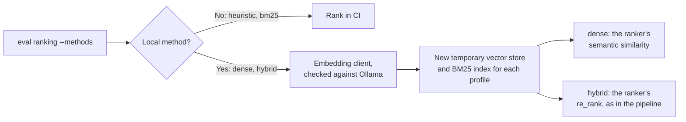

# MH-3: Dense and hybrid methods in the ranking suite

## Apply with the runner

The handoff runner applies this file: it writes the test file, runs the red command (it must fail), makes the edits, runs the "Done when" checks (they must pass), and commits. See `docs/handoff-runner.md`.

Apply this handoff (WSL, from `apps/backend-py`):

```bash
.venv/bin/python scripts/run_handoff.py ../../tasks/active/step-3-4-ranking-set/mh-3-dense-and-hybrid.md
```

## Why

MH-2 scores the heuristic matcher and BM25. This handoff adds the two methods that need the embedding model, so the baseline covers all four:



- `dense`: index the profile and the jobs with `RAGRanker`, then score each job with `RAGRanker._compute_semantic_similarity`.
- `hybrid`: score the jobs with the heuristic matcher (the profile's mode) and call `RAGRanker.re_rank`, as the pipeline's RAG stage does. Jobs that `re_rank` leaves out (below its final limit of 20) get the score -1.
- Each profile gets a new temporary vector store and BM25 index, so one profile's chunks never reach another profile's search. The ranker is built as in `pipeline/stages.py` (job chunker, BM25 when enabled, no cross-encoder).
- `eval ranking --methods heuristic,bm25,dense,hybrid` chooses the methods; the default stays `heuristic,bm25`, which never makes an embedding client (CI).
- The tests use a fake embedding client (hashed word counts) and a real ChromaDB in a temporary folder, as `test_rag_ranker.py` does.

## Files

- `apps/backend-py/src/evaluation/suites/ranking.py` (change)
- `apps/backend-py/main.py` (change: `--methods`)
- `apps/backend-py/tests/unit/test_ranking_local.py` (new)

## Step 1: add the test file, run it, and see it fail

```python new=apps/backend-py/tests/unit/test_ranking_local.py
"""Tests for the dense and hybrid ranking methods (Step 3.4, MH-3)."""

import hashlib
import math
import re
from pathlib import Path
from types import SimpleNamespace
from typing import Any, Dict, List

import pytest

import main as cli
import src.evaluation.suites.ranking as ranking
from src.evaluation.report import EvalReport
from src.evaluation.run_metadata import build_run_metadata
from src.rag.bm25_retriever import BM25Retriever
from src.rag.config import RAGConfig
from tests.unit.test_cli import parse
from tests.unit.test_ranking_suite import job_with, profile_with


class BowEmbedder:
    """A fake embedding client: word counts hashed into 256 buckets."""

    model = "fake-bow"

    def __init__(self, available: bool = True) -> None:
        """
        Keep the availability answer.

        Args:
            available: The answer of ``is_model_available``.
        """
        self.available = available

    def is_model_available(self) -> bool:
        """
        Say whether the model is available.

        Returns:
            The availability given to the constructor.
        """
        return self.available

    def embed(self, text: str) -> List[float]:
        """
        Embed one text.

        Args:
            text: The text.

        Returns:
            A unit vector of hashed word counts.
        """
        vector = [0.0] * 256
        for word in re.findall(r"\w+", text.lower()):
            vector[int(hashlib.md5(word.encode()).hexdigest(), 16) % 256] += 1.0
        norm = math.sqrt(sum(value * value for value in vector)) or 1.0
        return [value / norm for value in vector]

    def embed_batch(self, texts: List[str]) -> List[List[float]]:
        """
        Embed several texts.

        Args:
            texts: The texts.

        Returns:
            One vector for each text.
        """
        return [self.embed(text) for text in texts]


def config() -> RAGConfig:
    """
    The RAG configuration of the pipeline.

    Returns:
        The configuration from ``config/rag_config.yaml``.
    """
    return RAGConfig.from_yaml(str(ranking.RAG_CONFIG_PATH))


def jobs_with_kafka() -> List[Any]:
    """
    One Kafka job and six unrelated jobs.

    Returns:
        The jobs.
    """
    return [
        job_with("j1", "Kafka Engineer", "Build Kafka streams and Kafka connectors.")
    ] + [
        job_with(f"f{n}", "Clerk", "File records and answer the phone.")
        for n in range(6)
    ]


def test_dense_ranks_the_closest_job_first() -> None:
    """The job whose chunks are closest to the profile ranks first."""
    result = ranking.dense_ranking(
        profile_with(["Kafka", "Streams"]),
        {},
        jobs_with_kafka(),
        config=config(),
        embedding_client=BowEmbedder(),
    )

    assert result[0][0] == "j1"


def test_dense_uses_the_ranker_similarity(monkeypatch: pytest.MonkeyPatch) -> None:
    """Dense scores come from the RAG ranker's similarity, once for each job."""
    calls: List[int] = []

    def similarity(self: Any, profile: Any, job: Any) -> float:
        """Record the call and return a fixed score."""
        calls.append(len(job))
        return 0.5

    monkeypatch.setattr(ranking.RAGRanker, "_compute_semantic_similarity", similarity)
    jobs = jobs_with_kafka()

    ranking.dense_ranking(
        profile_with(["Kafka"]),
        {},
        jobs,
        config=config(),
        embedding_client=BowEmbedder(),
    )

    assert len(calls) == len(jobs)
    assert all(count > 0 for count in calls)


def test_hybrid_follows_re_rank_and_the_profile_mode(
    monkeypatch: pytest.MonkeyPatch,
) -> None:
    """Hybrid orders jobs by re_rank's combined score and scores with the profile mode."""
    modes: List[bool] = []
    real = ranking.JobMatcher

    def make(fresh_grad_mode: bool = False, **kwargs: Any) -> Any:
        """Record the mode and make a real matcher."""
        modes.append(fresh_grad_mode)
        return real(fresh_grad_mode=fresh_grad_mode, **kwargs)

    def re_rank(self: Any, scored: Any, profile: Any) -> List[Any]:
        """Return two jobs in a fixed order that is not the job-ID order."""
        by_id = {job.job_id: job for job, _ in scored}
        return [
            SimpleNamespace(job=by_id["j1"], combined_score=0.9),
            SimpleNamespace(job=by_id["f3"], combined_score=0.5),
        ]

    monkeypatch.setattr(ranking, "JobMatcher", make)
    monkeypatch.setattr(ranking.RAGRanker, "re_rank", re_rank)

    result = ranking.hybrid_ranking(
        profile_with(["Kafka"]),
        {"fresh_grad_mode": True},
        jobs_with_kafka(),
        config=config(),
        embedding_client=BowEmbedder(),
    )

    assert [job_id for job_id, _ in result[:3]] == ["j1", "f3", "f0"]
    assert result[2][1] == -1.0
    assert modes == [True]


def test_each_call_gets_a_new_store(monkeypatch: pytest.MonkeyPatch) -> None:
    """Each ranking builds its own vector store folder."""
    folders: List[str] = []
    real = ranking.ChromaStore

    def make(store_config: Any) -> Any:
        """Record the folder and make a real store."""
        folders.append(store_config.persist_directory)
        return real(store_config)

    monkeypatch.setattr(ranking, "ChromaStore", make)
    for _ in range(2):
        ranking.dense_ranking(
            profile_with(["Kafka"]),
            {},
            jobs_with_kafka(),
            config=config(),
            embedding_client=BowEmbedder(),
        )

    assert len(folders) == 2
    assert folders[0] != folders[1]


def test_rag_ranker_is_built_like_the_pipeline(tmp_path: Path) -> None:
    """The ranker has a new BM25 index, the job chunker, and no cross-encoder."""
    ranker = ranking.rag_ranker(config(), BowEmbedder(), tmp_path)

    assert isinstance(ranker.bm25_retriever, BM25Retriever)
    assert ranker.bm25_retriever.doc_count == 0
    assert ranker.cross_encoder is None
    assert ranker.chunker.config == config().chunking.get("job_description")


def test_local_methods_need_the_embedding_model(
    monkeypatch: pytest.MonkeyPatch,
) -> None:
    """Without the embedding model, a local method stops with a clear error."""
    monkeypatch.setattr(ranking, "EmbeddingClient", lambda **kwargs: BowEmbedder(False))

    with pytest.raises(ValueError, match="not available"):
        ranking.run_ranking_suite(methods=["dense"])


def test_ci_methods_never_make_an_embedding_client(
    monkeypatch: pytest.MonkeyPatch,
) -> None:
    """The CI methods run without the embedding model."""

    def refuse(**kwargs: Any) -> Any:
        """Fail if called."""
        raise AssertionError("embedding client made for a CI method")

    monkeypatch.setattr(ranking, "EmbeddingClient", refuse)

    report = ranking.run_ranking_suite(methods=["heuristic", "bm25"])

    assert report.metrics["bm25_ndcg_at_10"] is not None


def test_suite_runs_all_methods_with_a_given_client() -> None:
    """With an embedding client, the suite reports the dense and hybrid methods."""
    report = ranking.run_ranking_suite(
        methods=list(ranking.ALL_METHODS), embedding_client=BowEmbedder()
    )

    for method in ("dense", "hybrid"):
        for pid in ("fresh_ml", "mid_backend"):
            value = report.metrics[f"{method}_{pid}_ndcg_at_10"]
            assert value is not None and 0.0 <= value <= 1.0
    assert report.details["methods"] == ["heuristic", "bm25", "dense", "hybrid"]


def fake_report(tmp_path: Path) -> EvalReport:
    """
    A small ranking report for the command tests.

    Args:
        tmp_path: The test folder.

    Returns:
        The report.
    """
    path = tmp_path / "labels.jsonl"
    path.write_text("{}\n", encoding="utf-8")
    return EvalReport(
        suite="ranking",
        metadata=build_run_metadata("ranking", [path], 1, repo_dir=tmp_path),
        metrics={"bm25_ndcg_at_10": 1.0},
        details={},
    )


@pytest.mark.parametrize(
    ("extra", "expected"),
    [
        (["--methods", "heuristic, dense"], {"methods": ["heuristic", "dense"]}),
        ([], {}),
    ],
)
def test_eval_ranking_passes_the_methods(
    tmp_path: Path,
    monkeypatch: pytest.MonkeyPatch,
    extra: List[str],
    expected: Dict[str, Any],
) -> None:
    """``eval ranking --methods`` gives the methods to the suite; no option gives none."""
    seen: Dict[str, Any] = {}

    def fake_suite(dataset: Path, **kwargs: Any) -> EvalReport:
        """Record the arguments and return a report."""
        seen["kwargs"] = kwargs
        return fake_report(tmp_path)

    monkeypatch.setattr(
        "src.evaluation.suites.get_suite", lambda name: (fake_suite, tmp_path)
    )
    args = parse(
        ["eval", "ranking", *extra, "--out", str(tmp_path / "out"), "--no-mlflow"]
    )

    assert cli.run_eval_command(args) == 0
    assert seen["kwargs"] == expected
```

Run it. It must fail (the dense and hybrid methods do not exist yet):

```bash red cwd=apps/backend-py
.venv/bin/python -m pytest tests/unit/test_ranking_local.py -q --maxfail=30
```

## Step 2: add the dense and hybrid methods to the ranking suite

```python edit=apps/backend-py/src/evaluation/suites/ranking.py
<<<<<<< OLD
  ranker's profile query. A job's score is its best chunk score.
=======
  ranker's profile query. A job's score is its best chunk score.
- ``dense``: the RAG ranker's semantic similarity between the profile chunks
  and each job's chunks (embeddings of the configured embedding model).
- ``hybrid``: the RAG ranker's ``re_rank`` as the pipeline runs it (BM25 and
  dense retrieval fused by RRF, combined with the heuristic score).
>>>>>>> NEW
```

```python edit=apps/backend-py/src/evaluation/suites/ranking.py
<<<<<<< OLD

Both methods are deterministic and run in CI. Ties are broken by job ID, so
a ranking is the same on every run.
=======

``heuristic`` and ``bm25`` are deterministic and run in CI (``CI_METHODS``).
``dense`` and ``hybrid`` need the embedding model in Ollama, so they run
locally. Each profile gets a new temporary vector store and BM25 index, so
one profile's chunks never reach another profile's search. Ties are broken
by job ID.
>>>>>>> NEW
```

```python edit=apps/backend-py/src/evaluation/suites/ranking.py
<<<<<<< OLD
import statistics
from dataclasses import dataclass
=======
import statistics
import tempfile
from dataclasses import dataclass, replace
from functools import partial
>>>>>>> NEW
```

```python edit=apps/backend-py/src/evaluation/suites/ranking.py
<<<<<<< OLD
from pathlib import Path
from typing import Callable, Dict, List, Optional, Sequence, Tuple
=======
from pathlib import Path
from typing import Any, Callable, Dict, List, Optional, Sequence, Tuple
>>>>>>> NEW
```

```python edit=apps/backend-py/src/evaluation/suites/ranking.py
<<<<<<< OLD
from pydantic import BaseModel, Field

=======
from pydantic import BaseModel, Field

from ...llm.embedding_client import EmbeddingClient
>>>>>>> NEW
```

```python edit=apps/backend-py/src/evaluation/suites/ranking.py
<<<<<<< OLD
from ...rag.ranker import RAGRanker
=======
from ...rag.ranker import RAGRanker
from ...rag.vector_store import ChromaStore
>>>>>>> NEW
```

```python edit=apps/backend-py/src/evaluation/suites/ranking.py
<<<<<<< OLD
CI_METHODS: Tuple[str, ...] = ("heuristic", "bm25")
=======
CI_METHODS: Tuple[str, ...] = ("heuristic", "bm25")
LOCAL_METHODS: Tuple[str, ...] = ("dense", "hybrid")
ALL_METHODS: Tuple[str, ...] = CI_METHODS + LOCAL_METHODS
>>>>>>> NEW
```

```python edit=apps/backend-py/src/evaluation/suites/ranking.py
<<<<<<< OLD
RANKERS: Dict[str, Ranker] = {"heuristic": heuristic_ranking, "bm25": bm25_ranking}


=======
RANKERS: Dict[str, Ranker] = {"heuristic": heuristic_ranking, "bm25": bm25_ranking}


def default_embedding_client(config: RAGConfig) -> EmbeddingClient:
    """
    The configured embedding client, checked against Ollama.

    Args:
        config: The RAG configuration.

    Returns:
        The embedding client of the pipeline's RAG stage.

    Raises:
        ValueError: When the embedding model is not available in Ollama.
    """
    client = EmbeddingClient(
        model=config.embedding.model,
        batch_size=config.embedding.batch_size,
        cache_enabled=config.embedding.cache_enabled,
        cache_ttl=config.embedding.cache_ttl,
    )
    if not client.is_model_available():
        raise ValueError(
            f"embedding model {config.embedding.model!r} is not available in Ollama; "
            "the dense and hybrid methods need it"
        )
    return client


def rag_ranker(config: RAGConfig, embedding_client: Any, store_dir: Path) -> RAGRanker:
    """
    A RAG ranker as the pipeline builds it, on a new vector store.

    Args:
        config: The RAG configuration.
        embedding_client: The embedding client.
        store_dir: An empty folder for the vector store.

    Returns:
        The ranker, with a new BM25 index and no cross-encoder.
    """
    store = ChromaStore(replace(config.vector_store, persist_directory=str(store_dir)))
    store.initialize()
    return RAGRanker(
        config=config,
        embedding_client=embedding_client,
        vector_store=store,
        chunker=TextChunker(config.chunking.get("job_description")),
        bm25_retriever=BM25Retriever() if config.bm25.enabled else None,
        cross_encoder=None,
    )


def dense_ranking(
    profile: UserProfile,
    mode: Dict[str, bool],
    jobs: List[JobListing],
    *,
    config: RAGConfig,
    embedding_client: Any,
) -> Ranking:
    """
    Rank jobs by the RAG ranker's semantic similarity to the profile.

    Args:
        profile: The profile.
        mode: The profile's matcher settings (not used).
        jobs: The jobs.
        config: The RAG configuration.
        embedding_client: The embedding client.

    Returns:
        The ranking by semantic similarity.
    """
    with tempfile.TemporaryDirectory(ignore_cleanup_errors=True) as folder:
        ranker = rag_ranker(config, embedding_client, Path(folder))
        ranker.index_profile(profile)
        ranker.index_jobs(jobs)
        profile_embeddings = ranker.vector_store.get_profile_embeddings("default")
        scores = {
            job.job_id: ranker._compute_semantic_similarity(
                profile_embeddings or [],
                ranker.vector_store.get_job_embeddings(job.job_id) or [],
            )
            for job in jobs
        }
    return sort_scores(scores)


def hybrid_ranking(
    profile: UserProfile,
    mode: Dict[str, bool],
    jobs: List[JobListing],
    *,
    config: RAGConfig,
    embedding_client: Any,
) -> Ranking:
    """
    Rank jobs with the RAG ranker's ``re_rank``, as the pipeline does.

    Args:
        profile: The profile.
        mode: The profile's matcher settings (for the heuristic part).
        jobs: The jobs.
        config: The RAG configuration.
        embedding_client: The embedding client.

    Returns:
        The ranking by combined score. Jobs that ``re_rank`` leaves out
        (below its final limit) follow with the score -1.
    """
    matcher = JobMatcher(fresh_grad_mode=bool(mode.get("fresh_grad_mode", False)))
    scored = [(job, matcher.score_job(job, profile)) for job in jobs]
    with tempfile.TemporaryDirectory(ignore_cleanup_errors=True) as folder:
        ranker = rag_ranker(config, embedding_client, Path(folder))
        results = ranker.re_rank(scored, profile)
    scores = {job.job_id: -1.0 for job in jobs}
    for result in results:
        scores[result.job.job_id] = result.combined_score
    return sort_scores(scores)


>>>>>>> NEW
```

```python edit=apps/backend-py/src/evaluation/suites/ranking.py
<<<<<<< OLD
    k: int = TOP_K,
=======
    k: int = TOP_K,
    config: Optional[RAGConfig] = None,
    embedding_client: Optional[Any] = None,
>>>>>>> NEW
```

```python edit=apps/backend-py/src/evaluation/suites/ranking.py
<<<<<<< OLD
        dataset_dir: The ranking set folder.
        methods: The methods to run (names in ``RANKERS``).
=======
        dataset_dir: The ranking set folder.
        methods: The methods to run (names in ``ALL_METHODS``).
>>>>>>> NEW
```

```python edit=apps/backend-py/src/evaluation/suites/ranking.py
<<<<<<< OLD
        k: The cut-off of NDCG and recall.
=======
        k: The cut-off of NDCG and recall.
        config: The RAG configuration (default: ``config/rag_config.yaml``).
        embedding_client: The embedding client of the dense and hybrid
            methods; the default is the configured client, checked against
            Ollama. It is made only when a local method runs.
>>>>>>> NEW
```

```python edit=apps/backend-py/src/evaluation/suites/ranking.py
<<<<<<< OLD
    Raises:
        ValueError: When a method is unknown or the set is not complete.
=======
    Raises:
        ValueError: When a method is unknown, the set is not complete, or a
            local method runs without the embedding model.
>>>>>>> NEW
```

```python edit=apps/backend-py/src/evaluation/suites/ranking.py
<<<<<<< OLD
    """
    unknown = [method for method in methods if method not in RANKERS]
=======
    """
    unknown = [method for method in methods if method not in ALL_METHODS]
>>>>>>> NEW
```

```python edit=apps/backend-py/src/evaluation/suites/ranking.py
<<<<<<< OLD
        raise ValueError(
            f"unknown ranking methods: {unknown}; known: {sorted(RANKERS)}"
=======
        raise ValueError(
            f"unknown ranking methods: {unknown}; known: {list(ALL_METHODS)}"
        )
    rankers: Dict[str, Ranker] = dict(RANKERS)
    if any(method in LOCAL_METHODS for method in methods):
        config = config or RAGConfig.from_yaml(str(RAG_CONFIG_PATH))
        client = embedding_client or default_embedding_client(config)
        rankers["dense"] = partial(
            dense_ranking, config=config, embedding_client=client
        )
        rankers["hybrid"] = partial(
            hybrid_ranking, config=config, embedding_client=client
>>>>>>> NEW
```

```python edit=apps/backend-py/src/evaluation/suites/ranking.py
<<<<<<< OLD
        for pid, profile in data.profiles.items():
            ranking = RANKERS[method](profile, data.modes[pid], data.jobs)
=======
        for pid, profile in data.profiles.items():
            ranking = rankers[method](profile, data.modes[pid], data.jobs)
>>>>>>> NEW
```

## Step 3: add `--methods` to `main.py`

```python edit=apps/backend-py/main.py
<<<<<<< OLD
            ``no_mlflow``, ``part``, ``model``, and ``samples``.
=======
            ``no_mlflow``, ``part``, ``model``, ``samples``, and ``methods``.
>>>>>>> NEW
```

```python edit=apps/backend-py/main.py
<<<<<<< OLD
        runner_kwargs["samples"] = args.samples
=======
        runner_kwargs["samples"] = args.samples
    if args.suite == "ranking" and args.methods:
        runner_kwargs["methods"] = [
            method.strip() for method in args.methods.split(",") if method.strip()
        ]
>>>>>>> NEW
```

```python edit=apps/backend-py/main.py
<<<<<<< OLD
  python main.py eval ranking
=======
  python main.py eval ranking

  # Add the dense and hybrid methods (local; needs the embedding model)
  python main.py eval ranking --methods heuristic,bm25,dense,hybrid
>>>>>>> NEW
```

```python edit=apps/backend-py/main.py
<<<<<<< OLD
        help="Letters for each profile-job pair (writer only; default: 3)",
    )
=======
        help="Letters for each profile-job pair (writer only; default: 3)",
    )
    eval_parser.add_argument(
        "--methods",
        type=str,
        default=None,
        help="Comma-separated ranking methods (ranking only; default: heuristic,bm25)",
    )
>>>>>>> NEW
```

## Done when

Run the new tests and the other ranking, command, and RAG tests:

```bash check cwd=apps/backend-py
.venv/bin/python -m pytest tests/unit/test_ranking_local.py tests/unit/test_ranking_suite.py tests/unit/test_ranking_set.py tests/unit/test_cli.py tests/unit/test_writer_command.py tests/unit/test_rag_ranker.py -q
```

Format the changed files:

```bash check cwd=apps/backend-py
.venv/bin/python -m black src/evaluation/suites/ranking.py tests/unit/test_ranking_local.py main.py
```

Check the lint:

```bash check cwd=apps/backend-py
.venv/bin/python -m ruff check src/evaluation/suites/ranking.py tests/unit/test_ranking_local.py main.py
```

Run the mypy gate (no new errors):

```bash check cwd=apps/backend-py
.venv/bin/python scripts/mypy_gate.py
```

Commit message:

```text commit
feat(eval): add the dense and hybrid methods to the ranking suite

The ranking suite can now score the RAG ranker's dense similarity and
its re_rank path (BM25 and dense fused by RRF, combined with the
heuristic score), as the pipeline runs them. Each profile gets a new
temporary vector store and BM25 index. The methods need the embedding
model, so they run only when chosen: main.py eval ranking --methods
heuristic,bm25,dense,hybrid (Step 3.4, MH-3).
```
