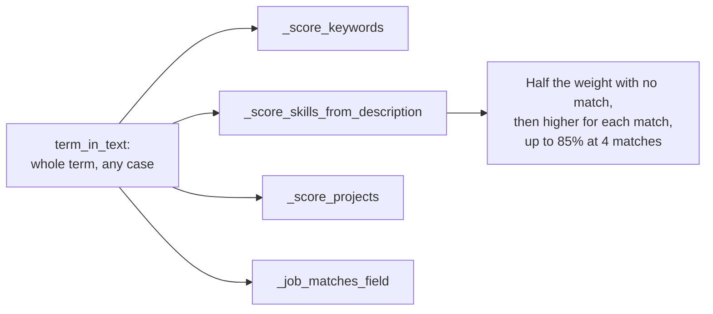

# MH-4: R4, whole-term matching and a rising description skill score

## Apply with the runner

The handoff runner applies this file: it writes the test file, runs the red command (it must fail), makes the matcher edits, runs the "Done when" checks (they must pass), and commits. See `docs/handoff-runner.md`.

Apply this handoff (WSL, from `apps/backend-py`):

```bash
.venv/bin/python scripts/run_handoff.py ../../tasks/active/step-3-4-ranking-set/mh-4-r4-whole-terms.md
```

## Why

Review item R4: the heuristic matcher (`src/scoring/matcher.py`) matches terms as plain substrings, so "ai" matches "email" and "maintain", "java" matches "javascript", "go" matches "good" and "django", and "git" matches "digital". And when a job has no skill list, its skill score falls when the description names a few of the candidate's skills (0 matches score 20 of 40; 1 match of 12 skills scores 10).



- One helper, `term_in_text`: no letter or digit may come just before or just after the term; spaces in the term match any whitespace; "C++", "C#", ".NET", and "Node.js" match as written. The four places that matched substrings use it.
- The description skill score keeps half the weight for no match (the neutral score that `tests/unit/test_paste_job.py` pins) and adds to it for each match: `half + (cap - half) * min(1, matches / 4)`, with the cap at 85% of the weight as before. With the weight 40: 0, 1, 2, 3, 4 matches give 20, 23, 27, 30, 34. The constant 4 was set before the measurement.
- Known limits: a one-letter term still matches a lone letter ("C" in "C-suite"); "SQL" no longer matches "PostgreSQL"; plurals do not match.
- The plan is in `notes.md` ("R4 plan"). The ranking set is measured after the apply with the baseline command.

## Files

- `apps/backend-py/src/scoring/matcher.py` (change)
- `apps/backend-py/tests/unit/test_matcher_terms.py` (new)

## Step 1: add the test file, run it, and see it fail

```python new=apps/backend-py/tests/unit/test_matcher_terms.py
"""Tests for whole-term matching and the description skill score (Step 3.4, R4)."""

import json
from pathlib import Path
from typing import List

import pytest

from src.models.job_listing import JobListing
from src.models.user_profile import UserProfile
from src.scoring.matcher import JobMatcher, ScoreCategory, term_in_text
from tests.unit.test_ranking_suite import job_with, profile_with

RANKING_SET = Path(__file__).resolve().parents[1] / "fixtures" / "eval" / "ranking"


@pytest.mark.parametrize(
    ("term", "text", "expected"),
    [
        ("ai", "Plan email campaigns and maintain retail training", False),
        ("ai", "Cook Thai food", False),
        ("ai", "Build AI features", True),
        ("ai", "Build AI-driven tools", True),
        ("java", "JavaScript and TypeScript with React", False),
        ("java", "Java, Kotlin, and Spring Boot", True),
        ("go", "good service, going further, Google, Django, MongoDB", False),
        ("go", "Write Go services", True),
        ("git", "Run digital campaigns", False),
        ("c++", "We use C++ and CUDA", True),
        ("c#", "Services in C# and .NET", True),
        (".net", "Services in C# and .NET", True),
        ("node.js", "Node.js with Express", True),
        ("machine learning", "Machine\n learning models", True),
        ("sql", "PostgreSQL databases", False),
        ("", "anything", False),
        ("", "", False),
        ("   ", "a  -  b", False),
    ],
)
def test_term_in_text_matches_whole_terms(term: str, text: str, expected: bool) -> None:
    """A term matches only as a whole term, in any case."""
    assert term_in_text(term, text) is expected


def keyword_profile(keywords: List[str]) -> UserProfile:
    """
    A profile with target keywords.

    Args:
        keywords: The target keywords.

    Returns:
        The profile.
    """
    profile = profile_with(["Python"])
    profile.targets.keywords = keywords
    return profile


def test_keywords_do_not_match_inside_words() -> None:
    """The keyword "AI" does not match email, maintain, retail, or training."""
    matcher = JobMatcher()
    trap = job_with(
        "j1", "Email Executive", "Maintain retail email lists and training."
    )
    real = job_with("j2", "AI Engineer", "Build AI features.")

    trap_score, trap_matched = matcher._score_keywords(trap, keyword_profile(["AI"]))
    real_score, real_matched = matcher._score_keywords(real, keyword_profile(["AI"]))

    assert trap_matched == [] and trap_score == 0
    assert real_matched == ["ai"] and real_score > 0


def test_keywords_in_requirements_match_whole_terms() -> None:
    """A requirement line counts only when the keyword is a whole term in it."""
    matcher = JobMatcher()
    job = JobListing.model_validate(
        {
            "job_id": "j1",
            "title": "Coordinator",
            "company": "Test Co",
            "source": "other",
            "requirements": [
                {"text": "Maintain the email lists"},
                {"text": "Some AI work"},
            ],
        }
    )

    _score, matched = matcher._score_keywords(job, keyword_profile(["AI", "Java"]))

    assert matched == ["ai"]
    job.requirements = job.requirements[:1]
    _score, matched = matcher._score_keywords(job, keyword_profile(["AI", "Java"]))
    assert matched == []


def test_description_skills_do_not_match_inside_words() -> None:
    """The skills "Go" and "Git" do not match good, going, Django, or digital."""
    matcher = JobMatcher()
    weight = matcher.weights[ScoreCategory.SKILLS]
    job = job_with(
        "j1", "Clerk", "Good service, going further, Django and digital work."
    )

    score, _missing = matcher._score_skills(job, profile_with(["Go", "Git", "Rust"]))

    assert score == weight // 2


@pytest.mark.parametrize(
    ("mentions", "expected"),
    [(0, 20), (1, 23), (2, 27), (3, 30), (4, 34), (5, 34)],
)
def test_description_skill_score_rises_with_each_match(
    mentions: int, expected: int
) -> None:
    """With the weight 40: half for no match, then higher for each match, up to 34."""
    skills = ["Python", "Docker", "Kafka", "Redis", "Terraform", "Rust"]
    text = " ".join(skills[:mentions]) or "No tools are named."
    matcher = JobMatcher()

    score, missing = matcher._score_skills(
        job_with("j1", "Engineer", text), profile_with(skills)
    )

    assert matcher.weights[ScoreCategory.SKILLS] == 40
    assert score == expected
    assert missing == []


def project_profile(technologies: List[str]) -> UserProfile:
    """
    A profile with one project.

    Args:
        technologies: The project's technologies.

    Returns:
        The profile.
    """
    return UserProfile.model_validate(
        {
            "name": "Test Person",
            "contact": {"email": "test@example.com", "location": "Singapore"},
            "projects": [
                {
                    "name": "Shop Front",
                    "description": "An online shop.",
                    "technologies": technologies,
                }
            ],
        }
    )


def skilled_job(skills: List[str]) -> JobListing:
    """
    A job with a required skill list.

    Args:
        skills: The required skills.

    Returns:
        The job.
    """
    return JobListing.model_validate(
        {
            "job_id": "j1",
            "title": "Engineer",
            "company": "Test Co",
            "source": "other",
            "description": "Build things.",
            "skills": [{"name": name} for name in skills],
        }
    )


def test_project_skills_match_whole_terms() -> None:
    """A JavaScript project earns no bonus for a Java job, but does for a JavaScript job."""
    matcher = JobMatcher(fresh_grad_mode=True)
    profile = project_profile(["JavaScript", "React"])

    java = matcher._score_projects(skilled_job(["Java"]), profile)
    javascript = matcher._score_projects(skilled_job(["JavaScript"]), profile)

    assert javascript > java


def test_field_match_uses_whole_terms() -> None:
    """The field "AI/ML" does not match a maintenance job, but matches an ML job."""
    maintenance = job_with("j1", "Maintenance Technician", "Maintain the machines.")
    ml_job = job_with("j2", "ML Engineer", "Train models.")

    assert JobMatcher._job_matches_field(maintenance, "AI/ML") is False
    assert JobMatcher._job_matches_field(ml_job, "AI/ML") is True


def test_ranking_set_traps_no_longer_match() -> None:
    """In the ranking set, the Java profile keyword does not match the JavaScript job."""
    profiles = json.loads((RANKING_SET / "profiles.json").read_text(encoding="utf-8"))
    lines = (RANKING_SET / "jobs.jsonl").read_text(encoding="utf-8").splitlines()
    jobs = {
        row["job_id"]: JobListing.model_validate(row)
        for row in (json.loads(line) for line in lines if line.strip())
    }
    backend = UserProfile.model_validate(profiles["mid_backend"])

    frontend = JobMatcher().score_job(jobs["rk-044"], backend)
    backend_job = JobMatcher().score_job(jobs["rk-036"], backend)

    assert "java" not in frontend.matched_keywords
    assert "java" in backend_job.matched_keywords
```

Run it. It must fail (`term_in_text` does not exist yet):

```bash red cwd=apps/backend-py
.venv/bin/python -m pytest tests/unit/test_matcher_terms.py -q
```

## Step 2: change the matcher

Import `re`:

```python edit=apps/backend-py/src/scoring/matcher.py
<<<<<<< OLD
from dataclasses import dataclass
from enum import Enum
=======
import re
from dataclasses import dataclass
from enum import Enum
>>>>>>> NEW
```

Add the constant and the helper after the imports:

```python edit=apps/backend-py/src/scoring/matcher.py
<<<<<<< OLD
from .filter import JobFilter
=======
from .filter import JobFilter

# Matches of profile skills in a description that count as a full match
# when the job has no skill list (Step 3.4, R4).
DESCRIPTION_SKILL_TARGET = 4


def term_in_text(term: str, text: str) -> bool:
    """
    Check whether a term occurs in a text as a whole term.

    The match ignores case. No letter or digit may come just before or just
    after the term, so "ai" does not match "email" and "java" does not match
    "javascript". A space in the term matches any whitespace; every other
    character matches as written, so "c++", "c#", ".net", and "node.js" work.

    Args:
        term: The term, for example a keyword or a skill name.
        text: The text to search.

    Returns:
        True when the term occurs as a whole term.
    """
    words = term.strip().split()
    if not words:
        return False
    pattern = r"\s+".join(re.escape(word) for word in words)
    found = re.search(rf"(?<![a-z0-9]){pattern}(?![a-z0-9])", text, re.IGNORECASE)
    return found is not None
>>>>>>> NEW
```

Match keywords as whole terms:

```python edit=apps/backend-py/src/scoring/matcher.py
<<<<<<< OLD
        # Check title
        for keyword in target_keywords:
            if keyword in job.title.lower():
                matched.add(keyword)

        # Check description
        if job.description:
            for keyword in target_keywords:
                if keyword in job.description.lower():
                    matched.add(keyword)

        # Check requirements
        for req in job.requirements:
            for keyword in target_keywords:
                if keyword in req.text.lower():
                    matched.add(keyword)
=======
        # Check title
        for keyword in target_keywords:
            if term_in_text(keyword, job.title):
                matched.add(keyword)

        # Check description
        if job.description:
            for keyword in target_keywords:
                if term_in_text(keyword, job.description):
                    matched.add(keyword)

        # Check requirements
        for req in job.requirements:
            for keyword in target_keywords:
                if term_in_text(keyword, req.text):
                    matched.add(keyword)
>>>>>>> NEW
```

Describe the new description score:

```python edit=apps/backend-py/src/scoring/matcher.py
<<<<<<< OLD
        Used for pasted JDs that only provide a description blob. Mentions of
        the candidate's skills in the description raise the score; absence of
        structure never awards the full skills weight.
=======
        Used for pasted JDs that only provide a description blob. With no
        mention of the candidate's skills, the score is half the weight (no
        evidence either way). Each mention raises it, up to 85% of the weight
        at ``DESCRIPTION_SKILL_TARGET`` mentions; absence of structure never
        awards the full skills weight. Skills match as whole terms.
>>>>>>> NEW
```

Match description skills as whole terms, and make the score rise with each match:

```python edit=apps/backend-py/src/scoring/matcher.py
<<<<<<< OLD
        matched = {
            skill for skill in user_skills if len(skill) >= 2 and skill in description
        }
        if not matched:
            return weight // 2, []

        # Cap below full weight: structured required skills are more reliable.
        match_ratio = len(matched) / max(len(user_skills), 1)
        score = int(weight * min(match_ratio, 0.85))
        return max(score, weight // 4), []
=======
        matched = {
            skill
            for skill in user_skills
            if len(skill) >= 2 and term_in_text(skill, description)
        }
        half = weight // 2
        # Cap below full weight: structured required skills are more reliable.
        cap = int(weight * 0.85)
        progress = min(len(matched) / DESCRIPTION_SKILL_TARGET, 1.0)
        return half + int((cap - half) * progress), []
>>>>>>> NEW
```

Match project skills as whole terms:

```python edit=apps/backend-py/src/scoring/matcher.py
<<<<<<< OLD
            for job_skill in job_skills_lower:
                if job_skill in proj_text:
                    matching_skills += 1
=======
            for job_skill in job_skills_lower:
                if term_in_text(job_skill, proj_text):
                    matching_skills += 1
>>>>>>> NEW
```

Match the apprenticeship field as whole terms:

```python edit=apps/backend-py/src/scoring/matcher.py
<<<<<<< OLD
        return any(term in searchable for term in field_terms)
=======
        return any(term_in_text(term, searchable) for term in field_terms)
>>>>>>> NEW
```

## Done when

Run the new tests and the other matcher, scoring, and ranking tests:

```bash check cwd=apps/backend-py
.venv/bin/python -m pytest tests/unit/test_matcher_terms.py tests/unit/test_scorer.py tests/unit/test_paste_job.py tests/unit/test_pipeline_stages.py tests/unit/test_cover_letter_assess.py tests/unit/test_ranking_suite.py tests/unit/test_ranking_local.py -q
```

Format and lint the changed files:

```bash check cwd=apps/backend-py
.venv/bin/python -m black src/scoring/matcher.py tests/unit/test_matcher_terms.py
```

```bash check cwd=apps/backend-py
.venv/bin/python -m ruff check src/scoring/matcher.py tests/unit/test_matcher_terms.py
```

Run the mypy gate (no new errors):

```bash check cwd=apps/backend-py
.venv/bin/python scripts/mypy_gate.py
```

Commit message:

```text commit
fix(scoring): match keywords and skills as whole terms (R4)

The heuristic matcher matched terms as plain substrings, so "ai"
matched "email", "java" matched "javascript", and "go" matched "good".
One helper, term_in_text, now matches whole terms in the keyword, the
description skill, the project, and the apprenticeship field checks.
The description skill score no longer falls when a few skills match:
half the weight for no match, then higher for each match, up to 85% at
four matches (Step 3.4, R4).
```
