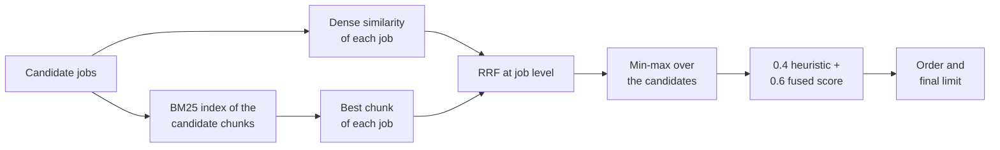

# MH-5: R5, job-level hybrid fusion on one score scale

## Apply with the runner

The handoff runner applies this file: it writes the test file, runs the red command (it must fail), makes the edits, runs the "Done when" checks (they must pass), and commits. See `docs/handoff-runner.md`.

Apply this handoff (WSL, from `apps/backend-py`):

```bash
.venv/bin/python scripts/run_handoff.py ../../tasks/active/step-3-4-ranking-set/mh-5-r5-job-fusion.md
```

## Why

Review item R5: the hybrid ranker, which the pipeline uses, ranks below each of its parts (NDCG@10 0.707; BM25 0.882, dense 0.806, heuristic 0.818). The main cause is two score scales: jobs inside the hybrid result have a min-max RRF score (median 0.138), and jobs outside have a cosine similarity (median 0.570). So a job that retrieval finds can get a lower score than a job that retrieval does not find. The full list of causes is in `notes.md` ("R5 plan").



- `re_rank` computes the dense similarity of every candidate job. The query on the whole vector store goes away, so jobs from earlier runs have no effect.
- The hybrid step builds the BM25 index again on each call, from the chunks of the candidates only. So jobs that are already in the vector store get a BM25 rank, and profile chunks stay out of the index.
- Each job is at most once in each list, with its best chunk. A job with no term match has no BM25 rank.
- Each candidate gets one score: min-max over the fused jobs. A job in no list gets 0.0.
- The BM25 query reads `summary`, the skill names, and `targets.keywords`.
- The cross-encoder (off by default) gets one document for each job. Jobs past its `top_k` get 0.0.
- `bm25.n_results` has no use after this change, so it goes out of the configuration.
- The configured values do not change: `k` 60, RRF weights 0.5 and 0.5, combined weights 0.4 and 0.6, and the `apply` and `maybe` limits.
- Known limits: the fused score comes from ranks, so the best job of a weak group gets 1.0. The cross-encoder path has unit tests only. Hybrid stays below BM25 alone on the ranking set.

The ranking set is measured after the apply with the baseline command.

## Files

- `apps/backend-py/src/rag/ranker.py` (change)
- `apps/backend-py/src/rag/config.py` (change)
- `apps/backend-py/config/rag_config.yaml` (change)
- `apps/backend-py/tests/unit/test_rag_hybrid.py` (new)

## Step 1: add the test file, run it, and see it fail

```python new=apps/backend-py/tests/unit/test_rag_hybrid.py
"""Tests for job-level hybrid fusion in the RAG ranker (Step 3.4, R5)."""

from pathlib import Path
from typing import Any, Dict, Iterator, List, Optional, Tuple
from unittest.mock import patch

import pytest

from src.models.job_listing import JobListing
from src.models.user_profile import UserProfile
from src.rag import ranker as ranker_module
from src.rag.bm25_retriever import BM25Retriever
from src.rag.chunker import TextChunker
from src.rag.config import BM25Config, RAGConfig, RRFFusionConfig, VectorStoreConfig
from src.rag.ranker import RAGRanker
from src.rag.rrf_fusion import reciprocal_rank_fusion
from src.rag.vector_store import ChromaStore
from src.scoring.matcher import MatchScore
from tests.unit.test_ranking_suite import job_with, profile_with

MATCH = "kafka streaming engineer"
NO_MATCH = "pastry chef for a small bakery"


class FakeStore:
    """A vector store with a fixed similarity for each job."""

    def __init__(self, similarities: Dict[str, float]) -> None:
        """
        Set the similarities.

        Args:
            similarities: Job ID to the cosine similarity with the profile.
                A job that is not here has no embeddings.
        """
        self.similarities = similarities

    def job_exists(self, job_id: str) -> bool:
        """
        Report a job as stored when it has a similarity, as after an earlier run.

        Args:
            job_id: The job ID.

        Returns:
            True when the job has a similarity.
        """
        return job_id in self.similarities

    def add_jobs_batch(self, **kwargs: Any) -> None:
        """
        Accept new jobs.

        Args:
            kwargs: The store arguments.
        """

    def add_profile(self, **kwargs: Any) -> None:
        """
        Accept the profile.

        Args:
            kwargs: The store arguments.
        """

    def get_profile_embeddings(self, profile_id: str = "default") -> List[List[float]]:
        """
        One profile vector.

        Args:
            profile_id: The profile ID.

        Returns:
            The unit vector on the first axis.
        """
        return [[1.0, 0.0]]

    def get_job_embeddings(self, job_id: str) -> Optional[List[List[float]]]:
        """
        One vector with the job's similarity to the profile vector.

        Args:
            job_id: The job ID.

        Returns:
            The vector, or None when the job has no embeddings.
        """
        similarity = self.similarities.get(job_id)
        if similarity is None:
            return None
        return [[similarity, (1.0 - similarity**2) ** 0.5]]


class FakeCrossEncoder:
    """A cross-encoder that scores jobs in the given order and keeps the top_k."""

    is_available = True

    def __init__(self, order: List[str]) -> None:
        """
        Set the order.

        Args:
            order: Job IDs, best first.
        """
        self.order = order
        self.calls: List[Dict[str, Any]] = []

    def rerank(
        self, query: str, results: List[Dict[str, Any]], top_k: Optional[int] = None
    ) -> List[Dict[str, Any]]:
        """
        Record the call and score the results by the fixed order.

        Args:
            query: The query text.
            results: The results to rerank.
            top_k: The number of results to keep.

        Returns:
            The best results with a cross-encoder score.
        """
        self.calls.append({"query": query, "results": results, "top_k": top_k})
        scored = [
            {
                **result,
                "cross_encoder_score": -float(self.order.index(result["doc_id"])),
            }
            for result in results
        ]
        scored.sort(key=lambda item: -item["cross_encoder_score"])
        return scored[:top_k]


def make_ranker(
    store: Any,
    client: Any,
    retriever: Optional[BM25Retriever] = None,
    config: Optional[RAGConfig] = None,
    cross_encoder: Any = None,
) -> RAGRanker:
    """
    A RAG ranker with a BM25 retriever.

    Args:
        store: The vector store.
        client: The embedding client.
        retriever: The BM25 retriever (default: a new one).
        config: The RAG configuration (default: the dataclass defaults).
        cross_encoder: The optional cross-encoder.

    Returns:
        The ranker.
    """
    config = config or RAGConfig()
    return RAGRanker(
        config=config,
        embedding_client=client,
        vector_store=store,
        chunker=TextChunker(config.chunking.get("job_description")),
        bm25_retriever=retriever or BM25Retriever(),
        cross_encoder=cross_encoder,
    )


def scored(jobs: List[JobListing], total: int = 50) -> List[Tuple[JobListing, Any]]:
    """
    Give each job one heuristic score.

    Args:
        jobs: The jobs.
        total: The heuristic score.

    Returns:
        The input of ``re_rank``.
    """
    return [
        (
            job,
            MatchScore(
                job=job,
                total_score=total,
                passed_threshold=True,
                breakdown={},
                matched_keywords=[],
                missing_skills=[],
                recommendation="maybe",
                reasoning="",
            ),
        )
        for job in jobs
    ]


def jobs_by_id(results: List[Any]) -> Dict[str, Any]:
    """
    Index ``re_rank`` results by job ID.

    Args:
        results: The results.

    Returns:
        Job ID to result.
    """
    return {result.job.job_id: result for result in results}


@pytest.fixture
def fusion_calls() -> Iterator[List[Dict[str, Any]]]:
    """
    Record each call of the RRF fusion.

    Yields:
        The keyword arguments of the calls.
    """
    calls: List[Dict[str, Any]] = []

    def spy(**kwargs: Any) -> Any:
        """
        Record the call and run the real fusion.

        Args:
            kwargs: The fusion arguments.

        Returns:
            The fused results.
        """
        calls.append(kwargs)
        return reciprocal_rank_fusion(**kwargs)

    with patch.object(ranker_module, "reciprocal_rank_fusion", spy):
        yield calls


def ids_of(results: List[Dict[str, Any]]) -> List[str]:
    """
    The document IDs of a result list.

    Args:
        results: The results.

    Returns:
        The IDs in order.
    """
    return [result["doc_id"] for result in results]


# Query


def test_query_has_the_summary_the_skills_and_the_target_keywords() -> None:
    """The BM25 query reads the real profile fields."""
    profile = UserProfile.model_validate(
        {
            "name": "Test Person",
            "contact": {"email": "test@example.com", "location": "Singapore"},
            "summary": "Backend engineer",
            "skills": [{"name": "Kafka"}, {"name": "Go"}],
            "targets": {"keywords": ["platform engineer"]},
        }
    )
    query = make_ranker(None, None)._build_profile_query_text(profile)
    assert query == "Backend engineer Kafka Go platform engineer"


def test_query_without_a_summary() -> None:
    """A profile without a summary gives the other fields only."""
    query = make_ranker(None, None)._build_profile_query_text(profile_with(["Kafka"]))
    assert query == "Kafka"


# BM25 index


def test_profile_chunks_stay_out_of_the_bm25_index(mock_embedding_client: Any) -> None:
    """Only job chunks reach the BM25 index."""
    profile = profile_with(["Kafka"])
    job = job_with("a", "Engineer", MATCH)
    ranker = make_ranker(FakeStore({"a": 0.5}), mock_embedding_client)

    ranker.index_profile(profile)
    assert ranker.bm25_retriever is not None
    assert ranker.bm25_retriever.doc_count == 0

    ranker.re_rank(scored([job]), profile)
    expected = len(ranker.chunker.chunk_job(job))
    assert ranker.bm25_retriever.doc_count == expected


def test_index_jobs_leaves_the_bm25_index_alone(mock_embedding_client: Any) -> None:
    """The hybrid step owns the BM25 index, so indexing does not fill it."""
    ranker = make_ranker(FakeStore({}), mock_embedding_client)
    ranker.index_jobs([job_with("a", "Engineer", MATCH)])
    assert ranker.bm25_retriever is not None
    assert ranker.bm25_retriever.doc_count == 0


def test_jobs_already_in_the_store_get_a_bm25_rank(mock_embedding_client: Any) -> None:
    """Jobs from an earlier run skip index_jobs but still reach BM25."""
    store = FakeStore({"a": 0.5, "b": 0.5})
    jobs = [job_with("a", "Baker", NO_MATCH), job_with("b", "Engineer", MATCH)]
    ranker = make_ranker(store, mock_embedding_client)

    results = jobs_by_id(ranker.re_rank(scored(jobs), profile_with(["Kafka"])))

    assert results["b"].semantic_score > results["a"].semantic_score


def test_each_call_indexes_only_its_candidates(mock_embedding_client: Any) -> None:
    """A later call does not keep the jobs of an earlier call in the BM25 index."""
    store = FakeStore({"a": 0.5, "b": 0.5})
    ranker = make_ranker(store, mock_embedding_client)
    first = job_with("a", "Engineer", MATCH)
    second = job_with("b", "Engineer", MATCH)
    profile = profile_with(["Kafka"])

    ranker.re_rank(scored([first]), profile)
    ranker.re_rank(scored([second]), profile)

    assert ranker.bm25_retriever is not None
    assert ranker.bm25_retriever.doc_count == len(ranker.chunker.chunk_job(second))


def test_jobs_of_earlier_runs_do_not_reach_the_fusion(
    temp_chroma_dir: str,
    mock_embedding_client: Any,
    fusion_calls: List[Dict[str, Any]],
) -> None:
    """A stored job that is not a candidate gets no rank and no score."""
    store = ChromaStore(VectorStoreConfig(persist_directory=temp_chroma_dir))
    store.initialize()
    ranker = make_ranker(store, mock_embedding_client)
    ranker.index_jobs([job_with("old", "Engineer", MATCH)])
    candidates = [job_with("a", "Engineer", MATCH), job_with("b", "Baker", NO_MATCH)]

    results = ranker.re_rank(scored(candidates), profile_with(["Kafka"]))

    assert sorted(result.job.job_id for result in results) == ["a", "b"]
    assert sorted(ids_of(fusion_calls[0]["dense_results"])) == ["a", "b"]
    assert ids_of(fusion_calls[0]["sparse_results"]) == ["a"]


# Job-level fusion


def test_a_job_is_once_in_each_list(
    mock_embedding_client: Any, fusion_calls: List[Dict[str, Any]]
) -> None:
    """A job with several matching chunks has one entry in each list."""
    job = JobListing.model_validate(
        {
            "job_id": "a",
            "title": "Kafka Engineer",
            "company": "Test Co",
            "source": "other",
            "description": MATCH,
            "skills": [{"name": "Kafka"}],
            "requirements": [{"text": "Kafka experience"}],
        }
    )
    other = job_with("b", "Baker", NO_MATCH)
    ranker = make_ranker(None, mock_embedding_client)

    ranker._hybrid_retrieve(profile_with(["Kafka"]), [job, other], {"a": 0.9, "b": 0.8})

    assert ids_of(fusion_calls[0]["dense_results"]) == ["a", "b"]
    assert ids_of(fusion_calls[0]["sparse_results"]) == ["a"]


def test_a_job_gets_its_score_from_both_lists(mock_embedding_client: Any) -> None:
    """A job second in dense and first in BM25 beats the first job in dense."""
    jobs = [
        job_with("a", "Baker", NO_MATCH),
        job_with("b", "Engineer", MATCH),
        job_with("c", "Baker", NO_MATCH),
    ]
    ranker = make_ranker(None, mock_embedding_client)

    scores = ranker._hybrid_retrieve(
        profile_with(["Kafka"]), jobs, {"a": 0.9, "b": 0.8, "c": 0.7}
    )

    assert scores["b"] == 1.0
    assert scores["c"] == 0.0
    assert 0.0 < scores["a"] < 0.1


def test_the_best_chunk_gives_the_bm25_score(mock_embedding_client: Any) -> None:
    """A job keeps the score of its best chunk, not of a later chunk."""
    job = JobListing.model_validate(
        {
            "job_id": "a",
            "title": "Engineer",
            "company": "Test Co",
            "source": "other",
            "description": "kafka kafka kafka",
            "requirements": [{"text": "Long text with one kafka word in it"}],
        }
    )
    other = job_with("b", "Engineer", "one kafka word")
    filler = [job_with(f"z{i}", "Baker", NO_MATCH) for i in range(3)]
    ranker = make_ranker(None, mock_embedding_client)

    scores = ranker._bm25_job_scores("kafka", [job, other, *filler])

    assert scores["a"] == 1.0
    assert scores["b"] < 1.0


def test_a_job_with_no_term_match_has_no_bm25_score(mock_embedding_client: Any) -> None:
    """No term match gives no BM25 entry, so no rank from BM25."""
    jobs = [job_with("a", "Engineer", MATCH), job_with("b", "Baker", NO_MATCH)]
    ranker = make_ranker(None, mock_embedding_client)
    assert set(ranker._bm25_job_scores("kafka", jobs)) == {"a"}


def test_ties_follow_the_job_id() -> None:
    """The order of equal scores does not depend on the input order."""
    documents = {"a": "", "b": "", "c": ""}
    results = RAGRanker._ranked_results({"c": 0.5, "a": 0.5, "b": 0.9}, documents)
    assert ids_of(results) == ["b", "a", "c"]


def test_the_fusion_uses_the_configured_values(
    mock_embedding_client: Any, fusion_calls: List[Dict[str, Any]]
) -> None:
    """The RRF constant and weights come from the configuration."""
    config = RAGConfig(rrf=RRFFusionConfig(k=7, dense_weight=0.3, sparse_weight=0.2))
    ranker = make_ranker(None, mock_embedding_client, config=config)

    ranker._hybrid_retrieve(
        profile_with(["Kafka"]), [job_with("a", "Engineer", MATCH)], {"a": 0.5}
    )

    call = fusion_calls[0]
    assert (call["k"], call["dense_weight"], call["sparse_weight"]) == (7, 0.3, 0.2)


# One scale


def test_every_candidate_is_on_one_scale(mock_embedding_client: Any) -> None:
    """All candidates get a fused score, also past the old limit of 20 results."""
    matches = [job_with(f"m{i:02d}", "Engineer", MATCH) for i in range(30)]
    others = [job_with(f"o{i:02d}", "Baker", NO_MATCH) for i in range(40)]
    jobs = matches + others
    dense = {job.job_id: 0.9 - i / 100 for i, job in enumerate(jobs)}
    ranker = make_ranker(None, mock_embedding_client)

    scores = ranker._hybrid_retrieve(profile_with(["Kafka"]), jobs, dense)

    assert set(scores) == set(dense)
    assert max(scores.values()) == 1.0
    assert min(scores.values()) == 0.0
    assert len(ranker._bm25_job_scores("kafka", jobs)) == len(matches)


def test_a_found_job_is_not_below_the_jobs_that_retrieval_misses(
    mock_embedding_client: Any,
) -> None:
    """The job first in BM25 leads, however low its dense rank."""
    similarities = {f"j{i:02d}": 0.7 - i / 100 for i in range(24)}
    similarities["hit"] = 0.1
    jobs = [job_with(job_id, "Baker", NO_MATCH) for job_id in similarities]
    jobs[-1] = job_with("hit", "Engineer", MATCH)
    ranker = make_ranker(FakeStore(similarities), mock_embedding_client)

    results = ranker.re_rank(scored(jobs), profile_with(["Kafka"]))

    assert results[0].job.job_id == "hit"
    assert results[0].semantic_score == 1.0
    assert all(result.semantic_score < 1.0 for result in results[1:])


def test_a_job_without_embeddings_keeps_its_bm25_rank(
    mock_embedding_client: Any,
) -> None:
    """A job needs one list to get a score; a job in no list gets 0.0."""
    store = FakeStore({"a": 0.9, "b": 0.8})
    jobs = [
        job_with("a", "Baker", NO_MATCH),
        job_with("b", "Baker", NO_MATCH),
        job_with("found", "Engineer", MATCH),
        job_with("lost", "Baker", NO_MATCH),
    ]
    ranker = make_ranker(store, mock_embedding_client)

    results = jobs_by_id(ranker.re_rank(scored(jobs), profile_with(["Kafka"])))

    assert results["found"].semantic_score > 0.0
    assert results["lost"].semantic_score == 0.0
    embeddings = store.get_profile_embeddings()
    assert set(ranker._dense_scores(embeddings, jobs)) == {"a", "b"}


def test_one_candidate_gets_the_top_score(mock_embedding_client: Any) -> None:
    """With no spread, a job with a positive score gets 1.0."""
    ranker = make_ranker(None, mock_embedding_client)
    scores = ranker._hybrid_retrieve(
        profile_with(["Kafka"]), [job_with("a", "Engineer", MATCH)], {"a": 0.5}
    )
    assert scores == {"a": 1.0}


def test_no_list_gives_no_scores(mock_embedding_client: Any) -> None:
    """A job in no list gives an empty result."""
    ranker = make_ranker(None, mock_embedding_client)
    scores = ranker._hybrid_retrieve(
        profile_with(["Kafka"]), [job_with("a", "Baker", NO_MATCH)], {}
    )
    assert scores == {}


def test_the_combined_score_uses_the_fused_score(mock_embedding_client: Any) -> None:
    """The combined score is 0.4 heuristic + 0.6 fused score."""
    store = FakeStore({"a": 0.2})
    ranker = make_ranker(store, mock_embedding_client)

    result = ranker.re_rank(
        scored([job_with("a", "Engineer", MATCH)], total=50), profile_with(["Kafka"])
    )[0]

    assert result.semantic_score == 1.0
    assert result.combined_score == pytest.approx(0.8)
    assert result.recommendation == "apply"


# Failure and dense-only paths


def test_a_bm25_failure_leaves_the_dense_ranking(mock_embedding_client: Any) -> None:
    """When BM25 fails, the dense ranks alone give the scores."""

    class BrokenRetriever(BM25Retriever):
        """A retriever whose query fails."""

        def query(self, query_text: str, n_results: int = 20) -> Any:
            """
            Fail.

            Args:
                query_text: The query.
                n_results: The result limit.

            Raises:
                RuntimeError: Always.
            """
            raise RuntimeError("broken index")

    jobs = [job_with("a", "Engineer", MATCH), job_with("b", "Baker", NO_MATCH)]
    ranker = make_ranker(None, mock_embedding_client, BrokenRetriever())

    scores = ranker._hybrid_retrieve(
        profile_with(["Kafka"]), jobs, {"a": 0.2, "b": 0.8}
    )

    assert scores == {"b": 1.0, "a": 0.0}


def test_no_retriever_gives_no_bm25_scores(mock_embedding_client: Any) -> None:
    """Without a retriever there is nothing to score."""
    ranker = make_ranker(None, mock_embedding_client)
    ranker.bm25_retriever = None
    assert ranker._bm25_job_scores("kafka", [job_with("a", "Eng", MATCH)]) == {}


@pytest.mark.parametrize(
    "config",
    [
        RAGConfig(bm25=BM25Config(enabled=False)),
        RAGConfig(rrf=RRFFusionConfig(enabled=False)),
    ],
)
def test_without_hybrid_the_score_is_the_similarity(
    config: RAGConfig, mock_embedding_client: Any
) -> None:
    """With BM25 or RRF off, the score stays the cosine similarity."""
    store = FakeStore({"a": 0.8})
    jobs = [job_with("a", "Baker", NO_MATCH), job_with("none", "Baker", NO_MATCH)]
    ranker = make_ranker(store, mock_embedding_client, config=config)

    results = jobs_by_id(ranker.re_rank(scored(jobs), profile_with(["Kafka"])))

    assert results["a"].semantic_score == pytest.approx(0.8)
    assert results["none"].semantic_score == 0.0


# Cross-encoder


def test_the_cross_encoder_ranks_jobs(mock_embedding_client: Any) -> None:
    """It gets one document for each job and the jobs past its top_k get 0.0."""
    config = RAGConfig()
    config.cross_encoder.top_k = 2
    encoder = FakeCrossEncoder(["c", "a", "b"])
    store = FakeStore({"a": 0.9, "b": 0.8, "c": 0.7})
    jobs = [
        job_with("a", "Engineer", MATCH),
        job_with("b", "Engineer", "second " + MATCH),
        JobListing.model_validate(
            {"job_id": "c", "title": "Kafka Lead", "company": "Co", "source": "other"}
        ),
    ]
    ranker = make_ranker(
        store, mock_embedding_client, config=config, cross_encoder=encoder
    )

    results = jobs_by_id(ranker.re_rank(scored(jobs), profile_with(["Kafka"])))

    call = encoder.calls[0]
    assert call["query"] == "Kafka"
    assert call["top_k"] == 2
    documents = {item["doc_id"]: item["document"] for item in call["results"]}
    assert documents == {"a": MATCH, "b": "second " + MATCH, "c": "Kafka Lead"}
    assert results["c"].semantic_score == 1.0
    assert results["a"].semantic_score == 0.0
    assert results["b"].semantic_score == 0.0


def test_the_real_configuration_loads() -> None:
    """The configuration file loads without the old result limit."""
    path = Path(__file__).resolve().parents[2] / "config" / "rag_config.yaml"
    config = RAGConfig.from_yaml(str(path))
    assert config.bm25.enabled is True
    assert not hasattr(config.bm25, "n_results")
```

Run it. It must fail (`_hybrid_retrieve` has the old signature, and `_bm25_job_scores` does not exist yet):

```bash red cwd=apps/backend-py
.venv/bin/python -m pytest tests/unit/test_rag_hybrid.py -q
```

## Step 2: change the ranker

Update the description of the semantic score:

```python edit=apps/backend-py/src/rag/ranker.py
<<<<<<< OLD
        semantic_score: Cosine similarity from vector embeddings (0.0-1.0).
=======
        semantic_score: Score in 0.0-1.0: the fused dense and BM25 score, or the
            cosine similarity when BM25 is off.
>>>>>>> NEW
```

Remove the BM25 step from `index_jobs`:

```python edit=apps/backend-py/src/rag/ranker.py
<<<<<<< OLD
        # Also index chunks into BM25 for hybrid retrieval
        if self.bm25_retriever and self.config.bm25.enabled:
            bm25_ids = []
            bm25_docs = []
            bm25_metas = []
            for job, chunks in zip(valid_jobs, valid_chunks):
                for chunk in chunks:
                    bm25_ids.append(f"{job.job_id}_chunk_{chunk.chunk_index}")
                    bm25_docs.append(chunk.content)
                    bm25_metas.append(
                        {"job_id": job.job_id, "section": chunk.section or ""}
                    )
            if bm25_ids:
                self.bm25_retriever.add_documents(bm25_ids, bm25_docs, bm25_metas)
                logger.debug("Indexed %d chunks into BM25", len(bm25_ids))

=======
>>>>>>> NEW
```

Remove the BM25 step from `index_profile`:

```python edit=apps/backend-py/src/rag/ranker.py
<<<<<<< OLD
        # Also index profile chunks into BM25
        if self.bm25_retriever and self.config.bm25.enabled:
            bm25_ids = [
                f"profile_{profile_id}_chunk_{c.chunk_index}" for c in valid_chunks
            ]
            bm25_docs = [c.content for c in valid_chunks]
            bm25_metas = [
                {"profile_id": profile_id, "section": c.section or ""}
                for c in valid_chunks
            ]
            self.bm25_retriever.add_documents(bm25_ids, bm25_docs, bm25_metas)

=======
>>>>>>> NEW
```

Give every candidate one score in `re_rank`:

```python edit=apps/backend-py/src/rag/ranker.py
<<<<<<< OLD
        # Compute semantic similarity for each job
        # Use hybrid retrieval when BM25 is available, otherwise dense-only
        use_hybrid = (
            self.bm25_retriever is not None
            and self.config.bm25.enabled
            and self.config.rrf.enabled
        )

        if use_hybrid:
            hybrid_scores = self._hybrid_retrieve(profile, jobs)
        else:
            hybrid_scores = None

        rag_scores: List[RAGMatchScore] = []

        for job, match_score in scored_listings:
            # Use hybrid score if available, otherwise compute dense-only
            if use_hybrid and hybrid_scores and job.job_id in hybrid_scores:
                semantic_sim = hybrid_scores[job.job_id]
            else:
                # Dense-only fallback for this specific job
                job_embeddings = self.vector_store.get_job_embeddings(job.job_id)
                if not job_embeddings:
                    semantic_sim = 0.0
                else:
                    semantic_sim = self._compute_semantic_similarity(
                        profile_embeddings, job_embeddings
                    )

            combined = self._compute_combined_score(
=======
        # Every candidate gets one score: the fused score when BM25 is on,
        # otherwise the dense similarity. A job with no score gets 0.0.
        semantic_scores = self._dense_scores(profile_embeddings, jobs)
        use_hybrid = (
            self.bm25_retriever is not None
            and self.config.bm25.enabled
            and self.config.rrf.enabled
        )
        if use_hybrid:
            semantic_scores = self._hybrid_retrieve(profile, jobs, semantic_scores)

        rag_scores: List[RAGMatchScore] = []

        for job, match_score in scored_listings:
            semantic_sim = semantic_scores.get(job.job_id, 0.0)

            combined = self._compute_combined_score(
>>>>>>> NEW
```

Add the dense and BM25 job scores, and fuse them at job level:

```python edit=apps/backend-py/src/rag/ranker.py
<<<<<<< OLD
    def _hybrid_retrieve(
        self,
        profile: UserProfile,
        jobs: List[JobListing],
    ) -> Dict[str, float]:
        """Perform hybrid retrieval: dense + sparse via RRF, with optional reranking.

        Builds a profile query from the user profile, runs both dense (ChromaDB)
        and sparse (BM25) retrieval, fuses via RRF, and optionally reranks with
        a cross-encoder. Returns normalized scores mapped to job IDs.

        Args:
            profile: User profile to match against.
            jobs: Job listings to score.

        Returns:
            Dict mapping job_id to normalized semantic score (0-1).
        """
        profile_query_text = self._build_profile_query_text(profile)
        n_results = self.config.bm25.n_results

        # Dense retrieval via ChromaDB
        dense_results: List[Dict[str, Any]] = []
        try:
            profile_embedding = self._get_profile_query_embedding()
            if profile_embedding:
                raw_results = self.vector_store.query_similar(
                    query_embedding=profile_embedding,
                    collection="jobs",
                    n_results=n_results,
                )
                dense_results = [
                    {
                        "doc_id": r["metadata"].get("job_id", ""),
                        "document": r["document"],
                        "metadata": r["metadata"],
                    }
                    for r in raw_results
                ]
        except Exception as e:
            logger.warning("Dense retrieval failed in hybrid mode: %s", e)

        # Sparse retrieval via BM25
        sparse_results: List[Dict[str, Any]] = []
        if self.bm25_retriever and self.bm25_retriever.doc_count > 0:
            try:
                bm25_results = self.bm25_retriever.query(
                    profile_query_text, n_results=n_results
                )
                sparse_results = [
                    {
                        "doc_id": r.doc_id,
                        "document": r.document,
                        "metadata": r.metadata,
                    }
                    for r in bm25_results
                ]
            except Exception as e:
                logger.warning("BM25 retrieval failed: %s", e)

        # RRF fusion
        rrf_config = self.config.rrf
        fused = reciprocal_rank_fusion(
            dense_results=dense_results,
            sparse_results=sparse_results,
            k=rrf_config.k,
=======
    def _dense_scores(
        self,
        profile_embeddings: List[List[float]],
        jobs: List[JobListing],
    ) -> Dict[str, float]:
        """Compute the dense similarity of each candidate job.

        Args:
            profile_embeddings: List of profile chunk embeddings.
            jobs: Candidate job listings.

        Returns:
            Dict mapping job_id to similarity. A job without embeddings is
            not in the dict.
        """
        scores: Dict[str, float] = {}
        for job in jobs:
            job_embeddings = self.vector_store.get_job_embeddings(job.job_id)
            if job_embeddings:
                scores[job.job_id] = self._compute_semantic_similarity(
                    profile_embeddings, job_embeddings
                )
        return scores

    def _bm25_job_scores(self, query: str, jobs: List[JobListing]) -> Dict[str, float]:
        """Score the candidate jobs with BM25, by the best chunk of each job.

        Builds the in-memory index again from the chunks of the candidates, so
        the index holds these jobs only: also the jobs that ``index_jobs``
        skips because they are in the vector store from an earlier run.

        Args:
            query: The BM25 query text.
            jobs: Candidate job listings.

        Returns:
            Dict mapping job_id to its best chunk score. A job with no query
            term is not in the dict.
        """
        retriever = self.bm25_retriever
        if retriever is None:
            return {}

        chunk_ids: List[str] = []
        chunk_texts: List[str] = []
        chunk_metadata: List[Dict[str, Any]] = []
        for job in jobs:
            for chunk in self.chunker.chunk_job(job):
                chunk_ids.append(f"{job.job_id}_chunk_{chunk.chunk_index}")
                chunk_texts.append(chunk.content)
                chunk_metadata.append({"job_id": job.job_id})
        retriever.index_documents(chunk_ids, chunk_texts, chunk_metadata)

        scores: Dict[str, float] = {}
        for result in retriever.query(query, n_results=retriever.doc_count):
            job_id = result.metadata["job_id"]
            if result.score > scores.get(job_id, 0.0):
                scores[job_id] = result.score
        return scores

    @staticmethod
    def _ranked_results(
        scores: Dict[str, float],
        documents: Dict[str, str],
    ) -> List[Dict[str, Any]]:
        """Order job scores best first as a result list for RRF.

        Args:
            scores: Job ID to score.
            documents: Job ID to the job's text.

        Returns:
            One result for each job, with ties in job ID order.
        """
        ordered = sorted(scores, key=lambda job_id: (-scores[job_id], job_id))
        return [{"doc_id": job_id, "document": documents[job_id]} for job_id in ordered]

    def _hybrid_retrieve(
        self,
        profile: UserProfile,
        jobs: List[JobListing],
        dense_scores: Dict[str, float],
    ) -> Dict[str, float]:
        """Fuse the dense and BM25 rankings of the candidate jobs.

        Each job is at most once in each ranking, so RRF gives a job one score
        from both rankings. An optional cross-encoder then reranks the fused
        jobs. The final scores are scaled to 0-1 over the fused jobs, so they
        are all on one scale.

        Args:
            profile: User profile to match against.
            jobs: Candidate job listings.
            dense_scores: Job ID to dense similarity, for the jobs that have
                embeddings.

        Returns:
            Dict mapping job_id to normalized score (0-1). A job without
            embeddings and without a BM25 term match is not in the dict.
        """
        profile_query_text = self._build_profile_query_text(profile)
        documents = {job.job_id: job.description or job.title for job in jobs}

        sparse_scores: Dict[str, float] = {}
        try:
            sparse_scores = self._bm25_job_scores(profile_query_text, jobs)
        except Exception as e:
            logger.warning("BM25 retrieval failed: %s", e)

        # RRF fusion
        rrf_config = self.config.rrf
        fused = reciprocal_rank_fusion(
            dense_results=self._ranked_results(dense_scores, documents),
            sparse_results=self._ranked_results(sparse_scores, documents),
            k=rrf_config.k,
>>>>>>> NEW
```

Scale the job scores, and remove the profile centroid:

```python edit=apps/backend-py/src/rag/ranker.py
<<<<<<< OLD
        # Normalize RRF scores to 0-1 and map to job IDs
        if not fused:
            return {}

        max_score = max(r.rrf_score for r in fused)
        min_score = min(r.rrf_score for r in fused)
        score_range = max_score - min_score

        job_scores: Dict[str, float] = {}
        for r in fused:
            job_id = r.metadata.get("job_id") or r.doc_id.split("_chunk_")[0]
            normalized = (
                (r.rrf_score - min_score) / score_range
                if score_range > 0
                else (1.0 if r.rrf_score > 0 else 0.0)
            )
            # Keep the highest score per job (a job may have multiple chunks)
            if job_id not in job_scores or normalized > job_scores[job_id]:
                job_scores[job_id] = normalized

        logger.info(
            "Hybrid retrieval: %d dense + %d sparse -> %d fused -> %d jobs scored",
            len(dense_results),
            len(sparse_results),
            len(fused),
            len(job_scores),
        )
        return job_scores

    def _get_profile_query_embedding(self) -> Optional[List[float]]:
        """Get a single query embedding representing the profile.

        Averages all profile chunk embeddings into a centroid vector.

        Returns:
            List of floats representing the profile query embedding,
            or None if no embeddings are available.
        """
        profile_embeddings = self.vector_store.get_profile_embeddings("default")
        if not profile_embeddings:
            return None

        profile_array = np.array(profile_embeddings)
        centroid = np.mean(profile_array, axis=0)
        return centroid.tolist()

=======
        # Normalize the scores to 0-1 over the fused jobs
        if not fused:
            return {}

        max_score = max(r.rrf_score for r in fused)
        min_score = min(r.rrf_score for r in fused)
        score_range = max_score - min_score

        job_scores = {
            r.doc_id: (
                (r.rrf_score - min_score) / score_range
                if score_range > 0
                else (1.0 if r.rrf_score > 0 else 0.0)
            )
            for r in fused
        }

        logger.info(
            "Hybrid retrieval: %d dense + %d sparse -> %d jobs scored",
            len(dense_scores),
            len(sparse_scores),
            len(job_scores),
        )
        return job_scores

>>>>>>> NEW
```

Read the real profile fields in the query:

```python edit=apps/backend-py/src/rag/ranker.py
<<<<<<< OLD
        """Build a text query from the user profile for BM25 retrieval.

        Concatenates the most relevant profile fields into a single
        query string optimized for lexical matching.

        Args:
            profile: User profile to extract query terms from.

        Returns:
            Space-separated query string.
        """
        parts: List[str] = []

        if hasattr(profile, "professional_summary") and profile.professional_summary:
            parts.append(profile.professional_summary)

        if hasattr(profile, "skills") and profile.skills:
            if isinstance(profile.skills, list):
                skill_names = [
                    s.name if hasattr(s, "name") else str(s) for s in profile.skills
                ]
                parts.extend(skill_names)
            elif isinstance(profile.skills, dict):
                for category, skills in profile.skills.items():
                    if isinstance(skills, list):
                        parts.extend(
                            [s.name if hasattr(s, "name") else str(s) for s in skills]
                        )

        if hasattr(profile, "target_job") and profile.target_job:
            target = profile.target_job
            if hasattr(target, "keywords") and target.keywords:
                parts.extend(target.keywords)
            if hasattr(target, "title") and target.title:
                parts.append(target.title)

        return " ".join(parts) if parts else ""
=======
        """Build a text query from the user profile for BM25 retrieval.

        Joins the summary, the skill names, and the target keywords.

        Args:
            profile: User profile to extract query terms from.

        Returns:
            Space-separated query string.
        """
        parts: List[str] = [profile.summary] if profile.summary else []
        parts.extend(skill.name for skill in profile.skills)
        parts.extend(profile.targets.keywords)
        return " ".join(parts)
>>>>>>> NEW
```

## Step 3: remove the result limit from the configuration

```python edit=apps/backend-py/src/rag/config.py
<<<<<<< OLD
        algorithm: BM25 variant to use ("okapi" or "plus").
        n_results: Maximum BM25 results per query.
=======
        algorithm: BM25 variant to use ("okapi" or "plus").
>>>>>>> NEW
```

```python edit=apps/backend-py/src/rag/config.py
<<<<<<< OLD
    algorithm: str = "okapi"
    n_results: int = 20
=======
    algorithm: str = "okapi"
>>>>>>> NEW
```

```python edit=apps/backend-py/src/rag/config.py
<<<<<<< OLD
                algorithm=bm25_raw.get("algorithm", "okapi"),
                n_results=bm25_raw.get("n_results", 20),
=======
                algorithm=bm25_raw.get("algorithm", "okapi"),
>>>>>>> NEW
```

```python edit=apps/backend-py/config/rag_config.yaml
<<<<<<< OLD
  algorithm: "okapi"
  n_results: 20
=======
  algorithm: "okapi"
>>>>>>> NEW
```

## Done when

Run the new tests and the other RAG and ranking tests:

```bash check cwd=apps/backend-py
.venv/bin/python -m pytest tests/unit/test_rag_hybrid.py tests/unit/test_rag_ranker.py tests/unit/test_bm25_retriever.py tests/integration/test_rag_pipeline.py tests/unit/test_ranking_suite.py tests/unit/test_ranking_local.py -q
```

Format and lint the changed files:

```bash check cwd=apps/backend-py
.venv/bin/python -m black src/rag/ranker.py src/rag/config.py tests/unit/test_rag_hybrid.py
```

```bash check cwd=apps/backend-py
.venv/bin/python -m ruff check src/rag/ranker.py src/rag/config.py tests/unit/test_rag_hybrid.py
```

Run the mypy gate (no new errors):

```bash check cwd=apps/backend-py
.venv/bin/python scripts/mypy_gate.py
```

Commit message:

```text commit
fix(rag): fuse dense and BM25 at job level on one score scale (R5)

Jobs inside the hybrid result had a min-max RRF score and jobs outside
had a cosine similarity, so a job that retrieval found could score
below a job that it did not find. Dense results used job IDs and BM25
results used chunk IDs, so no job had a score from both lists.

Every candidate job now gets a dense rank and a BM25 rank, with its
best chunk, and one fused score. The BM25 index is built on each call
from the candidates only, so jobs already in the vector store get a
rank, and profile chunks stay out. Jobs of earlier runs no longer reach
the fusion. The BM25 query reads summary and targets.keywords. The
configured weights do not change (Step 3.4, R5).

Co-Authored-By: Claude Opus 5.5 <noreply@anthropic.com>
```
