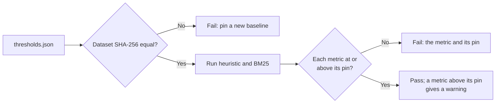

# MH-6: CI gate for the ranking suite

## Apply with the runner

The handoff runner applies this file: it writes the test file, runs the red command (it must fail), writes the pins, runs the "Done when" checks (they must pass), and commits. See `docs/handoff-runner.md`.

Apply this handoff (WSL, from `apps/backend-py`):

```bash
.venv/bin/python scripts/run_handoff.py ../../tasks/active/step-3-4-ranking-set/mh-6-ranking-gate.md
```

## Why

Step 3.4 measured the ranking methods after the R4 and R5 fixes. This gate keeps the two deterministic methods at those numbers. The CI backend job runs it as part of `pytest tests/`, like the grounding, scam, and dedupe gates.



- The pins are NDCG@10 and recall@10 of `heuristic` and `bm25`, for each profile, with no margin. The values come from MLflow run `d0cc16f055ba4dd1a9fa5982cde70743`.
- A metric must stay at or above its pin. The metrics are rounded to 4 places, so a pin with no margin is stable.
- Dense and hybrid need the embedding model, so they are not in this gate. `tests/unit/test_rag_hybrid.py` covers the hybrid logic with fixed scores.
- The docs are already in the repository (Claude's docs commit): `docs/usage.md` has a Mermaid fence, and the runner reads only three-backtick blocks, so it cannot carry them.

## Files

- `apps/backend-py/tests/unit/test_ranking_thresholds.py` (new)
- `apps/backend-py/tests/fixtures/eval/ranking/thresholds.json` (new)

## Step 1: add the test file, run it, and see it fail

```python new=apps/backend-py/tests/unit/test_ranking_thresholds.py
"""
CI gate for the ranking suite on the committed set (Step 3.4).

The heuristic and BM25 methods are deterministic, so the gate pins their
NDCG@10 and recall@10 for each profile with no margin: a metric must stay at
or above its pin. It also pins the dataset SHA-256, so a changed set fails
before any metric is compared. Dense and hybrid need the embedding model, so
they run locally and are not part of this gate.
"""

from __future__ import annotations

import json
import warnings
from datetime import datetime, timezone
from typing import Any, Dict, List, Optional, Tuple

import pytest

from src.evaluation.report import EvalReport
from src.evaluation.run_metadata import RunMetadata
from src.evaluation.suites.ranking import (
    CI_METHODS,
    DEFAULT_DATASET_DIR,
    TOP_K,
    load_ranking_set,
    run_ranking_suite,
)

THRESHOLDS_PATH = DEFAULT_DATASET_DIR / "thresholds.json"


def threshold_check(
    report: EvalReport, thresholds: Dict[str, Any]
) -> Tuple[List[str], List[str]]:
    """
    Compare a ranking report with the pinned minimums.

    The dataset SHA-256 is checked first. When it differs, no metric is
    compared.

    Args:
        report: Report from ``run_ranking_suite``.
        thresholds: Parsed ``thresholds.json``.

    Returns:
        ``(violations, tightenable)``: values below their pins or not in the
        report, and values above their pins.
    """
    pinned_sha = thresholds["dataset_sha256"]
    if report.metadata.dataset_sha256 != pinned_sha:
        return [
            f"dataset changed: {report.metadata.dataset_sha256} is not the pinned "
            f"{pinned_sha}; run a new baseline and pin new metrics"
        ], []

    violations: List[str] = []
    tightenable: List[str] = []
    for metric, pin in sorted(thresholds["minimums"].items()):
        value = report.metrics.get(metric)
        if value is None:
            violations.append(f"{metric}: no value (pin {pin})")
        elif value < pin:
            violations.append(f"{metric}: {value} (pin {pin})")
        elif value > pin:
            tightenable.append(f"{metric}: {value} (pin {pin})")
    return violations, tightenable


def assert_pins_met(report: EvalReport, thresholds: Dict[str, Any]) -> None:
    """
    Fail on a pin violation, and warn about pins that can go up.

    Args:
        report: Report from ``run_ranking_suite``.
        thresholds: Parsed ``thresholds.json``.

    Raises:
        AssertionError: When a metric is below its pin or the dataset changed.
    """
    violations, tightenable = threshold_check(report, thresholds)
    if tightenable:
        warnings.warn(
            "ranking metrics above their pins, tighten thresholds.json: "
            + "; ".join(tightenable),
            stacklevel=1,
        )
    assert not violations, "\n".join(violations)


def test_ranking_suite_meets_the_pinned_metrics() -> None:
    """The committed set stays at or above every pin (the CI gate)."""
    thresholds = json.loads(THRESHOLDS_PATH.read_text(encoding="utf-8"))
    assert_pins_met(run_ranking_suite(), thresholds)


def test_thresholds_file_records_each_change() -> None:
    """Every pin change has a dated entry with a reason and an MLflow run."""
    thresholds = json.loads(THRESHOLDS_PATH.read_text(encoding="utf-8"))
    assert thresholds["suite"] == "ranking"
    assert thresholds["baseline"] == "after-r5"
    assert thresholds["changes"]
    for entry in thresholds["changes"]:
        assert entry["date"] and entry["reason"] and entry["mlflow_run"], entry


def test_the_pins_cover_each_ci_method_and_profile() -> None:
    """Each CI method has both metrics for each profile, and nothing else."""
    thresholds = json.loads(THRESHOLDS_PATH.read_text(encoding="utf-8"))
    expected = {
        f"{method}_{profile}_{metric}_at_{TOP_K}"
        for method in CI_METHODS
        for profile in load_ranking_set().profiles
        for metric in ("ndcg", "recall")
    }
    assert set(thresholds["minimums"]) == expected


def _report(
    *,
    sha: str = "abc",
    metrics: Optional[Dict[str, Optional[float]]] = None,
) -> EvalReport:
    """
    Build a small synthetic ranking report.

    Args:
        sha: Dataset SHA-256 to report.
        metrics: The metrics.

    Returns:
        A report shaped like ``run_ranking_suite`` output.
    """
    return EvalReport(
        suite="ranking",
        metadata=RunMetadata(
            suite="ranking",
            git_sha="0000000",
            git_dirty=False,
            dataset_sha256=sha,
            case_count=140,
            started_at=datetime(2026, 11, 4, tzinfo=timezone.utc),
        ),
        metrics=metrics or {},
        details={},
    )


_PINS: Dict[str, Any] = {
    "dataset_sha256": "abc",
    "minimums": {"bm25_fresh_ml_ndcg_at_10": 0.8638, "heuristic_ndcg": 0.5},
}


def test_a_metric_at_its_pin_passes() -> None:
    """A metric equal to its pin is neither a violation nor tightenable."""
    report = _report(
        metrics={"bm25_fresh_ml_ndcg_at_10": 0.8638, "heuristic_ndcg": 0.5}
    )
    assert threshold_check(report, _PINS) == ([], [])


def test_a_metric_below_its_pin_is_a_violation() -> None:
    """The smallest reported drop fails, with the metric named."""
    report = _report(
        metrics={"bm25_fresh_ml_ndcg_at_10": 0.8637, "heuristic_ndcg": 0.5}
    )
    violations, tightenable = threshold_check(report, _PINS)
    assert violations == ["bm25_fresh_ml_ndcg_at_10: 0.8637 (pin 0.8638)"]
    assert tightenable == []


def test_a_metric_above_its_pin_can_be_tightened() -> None:
    """A better metric is not a violation; it is listed for tightening."""
    report = _report(metrics={"bm25_fresh_ml_ndcg_at_10": 0.9, "heuristic_ndcg": 0.5})
    violations, tightenable = threshold_check(report, _PINS)
    assert violations == []
    assert tightenable == ["bm25_fresh_ml_ndcg_at_10: 0.9 (pin 0.8638)"]


def test_a_metric_without_a_value_is_a_violation() -> None:
    """A pinned metric that is missing or None fails."""
    report = _report(metrics={"bm25_fresh_ml_ndcg_at_10": None})
    violations, _ = threshold_check(report, _PINS)
    assert violations == [
        "bm25_fresh_ml_ndcg_at_10: no value (pin 0.8638)",
        "heuristic_ndcg: no value (pin 0.5)",
    ]


def test_a_violation_fails_the_gate() -> None:
    """The gate assertion fails and names the metric."""
    report = _report(
        metrics={"bm25_fresh_ml_ndcg_at_10": 0.8637, "heuristic_ndcg": 0.5}
    )
    with pytest.raises(AssertionError, match="bm25_fresh_ml_ndcg_at_10: 0.8637"):
        assert_pins_met(report, _PINS)


def test_a_better_metric_warns_and_passes_the_gate() -> None:
    """The gate passes and names the pin that can go up."""
    report = _report(metrics={"bm25_fresh_ml_ndcg_at_10": 0.9, "heuristic_ndcg": 0.5})
    with pytest.warns(UserWarning, match="bm25_fresh_ml_ndcg_at_10: 0.9"):
        assert_pins_met(report, _PINS)


def test_a_changed_dataset_fails_before_any_metric() -> None:
    """A different dataset SHA-256 is the only violation reported."""
    report = _report(sha="def", metrics={"heuristic_ndcg": 0.1})
    violations, tightenable = threshold_check(report, _PINS)
    assert len(violations) == 1 and violations[0].startswith("dataset changed")
    assert tightenable == []
```

Run it. It must fail (`thresholds.json` does not exist yet):

```bash red cwd=apps/backend-py
.venv/bin/python -m pytest tests/unit/test_ranking_thresholds.py -q
```

## Step 2: add the pins

```json new=apps/backend-py/tests/fixtures/eval/ranking/thresholds.json
{
  "suite": "ranking",
  "dataset_sha256": "6f5dbeaa2e70d780b393d310a4ba2a82267bfc74e112692d96bc13d121eb50c1",
  "baseline": "after-r5",
  "mlflow_run": "d0cc16f055ba4dd1a9fa5982cde70743",
  "minimums": {
    "bm25_fresh_ml_ndcg_at_10": 0.8638,
    "bm25_fresh_ml_recall_at_10": 0.75,
    "bm25_mid_backend_ndcg_at_10": 0.9669,
    "bm25_mid_backend_recall_at_10": 0.8182,
    "heuristic_fresh_ml_ndcg_at_10": 0.7667,
    "heuristic_fresh_ml_recall_at_10": 0.5,
    "heuristic_mid_backend_ndcg_at_10": 0.8685,
    "heuristic_mid_backend_recall_at_10": 0.6364
  },
  "changes": [
    {
      "date": "2026-11-04",
      "reason": "First pins, from the run after the R5 fix. The heuristic and BM25 metrics of each profile are pinned with no margin. Dense and hybrid need the embedding model, so they are not in this gate.",
      "mlflow_run": "d0cc16f055ba4dd1a9fa5982cde70743"
    }
  ]
}
```

## Done when

Run the gate and the other ranking tests:

```bash check cwd=apps/backend-py
.venv/bin/python -m pytest tests/unit/test_ranking_thresholds.py tests/unit/test_ranking_set.py tests/unit/test_ranking_suite.py -q
```

Format and lint the test:

```bash check cwd=apps/backend-py
.venv/bin/python -m black tests/unit/test_ranking_thresholds.py
```

```bash check cwd=apps/backend-py
.venv/bin/python -m ruff check tests/unit/test_ranking_thresholds.py
```

Run the mypy gate (no new errors):

```bash check cwd=apps/backend-py
.venv/bin/python scripts/mypy_gate.py
```

Commit message:

```text commit
test(eval): gate the ranking suite on the committed set

CI now fails when the heuristic or BM25 ranking gets worse. The gate
pins NDCG@10 and recall@10 for each profile with no margin, and the
dataset SHA-256, so a changed set fails before any metric is compared.
Dense and hybrid need the embedding model, so they are not in the gate
(Step 3.4).

Co-Authored-By: Claude Opus 5.5 <noreply@anthropic.com>
```
