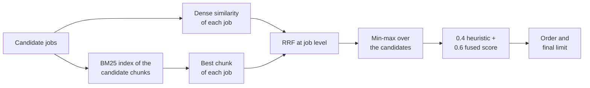

# Scratchpad & Notes

## Plan (2026-11-03, Claude)

### What exists today

- Heuristic matcher, `src/scoring/matcher.py`:
  - `_score_keywords` (line 212) and `_score_skills_from_description` (line 290) match with plain substrings (`keyword in text`), so "ai" matches "email" and the skill "Java" matches every "JavaScript" job. The grounding profile `grad` has both Java and JavaScript, so this trap is real.
  - `_score_skills_from_description`: no match gives half the weight (20 of 40); one match out of many profile skills gives `max(score, weight // 4)` = 10 of 40. More matches can give a lower score.
- RAG ranker, `src/rag/ranker.py`:
  - Dense results use `job_id` as the document ID (line 408); BM25 results use chunk IDs `<job_id>_chunk_<n>` (line 160). `reciprocal_rank_fusion` fuses by document ID, so a job never gets a fused score from both lists.
  - Jobs that the hybrid step returns get a min-max-normalized RRF score; the other jobs get a dense cosine similarity (lines 292 to 302). The two are on different scales.
  - Found while planning: `_build_profile_query_text` reads `profile.professional_summary` and `profile.target_job`, but `UserProfile` has `summary` and `targets`. The `hasattr` checks fail without an error, so the BM25 query is the skill names only.
  - Found while planning: `index_profile` adds the profile's own chunks to the same BM25 index that the job search uses, so a BM25 query can return profile chunks.
- Data: the source fixtures (`careersatgov`, `jobstreet`, `mycareersfuture`) hold 3 listings each. The grounding set has 65 constructed jobs (about 41 words each, no structured skills) for 3 small profiles (3 or 4 skills). The dedupe set is constructed (31 pairs).

### Proposed set

- 2 synthetic profiles in the shape of real users: a fresh graduate (backend and machine learning projects, close to the user's own search) and a mid-level backend engineer. Richer than the grounding profiles: summary, 8 to 12 skills, projects, targets.
- About 35 constructed jobs for each profile (about 70 jobs), written in the shape of real postings (120 to 250 words): some with structured skills, some description only (pasted). A mix of clear fits, partial fits, seniority mismatches (the backlog finding that senior roles rank high for a fresh graduate), and traps for R4: "Java" against JavaScript-only jobs, "AI" against "email" and "maintain", "SQL" against PostgreSQL, "React" against "reactive", "Go" against "good".
- Each profile is ranked against all jobs of the set (both profiles' jobs), so each profile has about 70 candidates and the other profile's jobs give natural "not relevant" and "maybe" cases.
- Labels 0, 1, 2 for each of about 140 pairs, with a one-line reason. Labeling guide in `tests/fixtures/eval/ranking/README.md` (rules first, labels before any ranker runs).

### Metrics

- NDCG@10 with gains 2 and 1; recall@10 of the jobs labeled 2; for each profile and the mean over the profiles.
- Methods: heuristic (`JobMatcher.rank_jobs`), BM25 only, dense only, hybrid (the `RAGRanker` path). BM25 and dense use the ranker's own profile query and job chunks.

### Micro-handoffs (outline)

1. The set and its guide (Claude writes the profiles and jobs; labels drafted by Claude, checked by the user), with a format test.
2. The suite with heuristic and BM25 (CI), and its tests.
3. Dense and hybrid in the suite (local; temporary vector store), and its tests.
4. Baseline run (local; embedding model only).
5. R4 fix, with tests; measure.
6. R5 fix (fusion, score scale, query fields, profile chunks), with tests; measure.
7. CI thresholds, docs, decision log.

Runner handoffs for the data and the suite; spec handoffs for the fixes where they fit an agent.

### Choices for the check-in

1. Job pool: a new constructed set (2 richer profiles, about 70 realistic jobs with traps), or the 65 thin grounding jobs plus about 10 traps (quicker to make, weaker test).
2. Labels: Claude drafts all of about 140 labels with reasons and the user checks them all, or the user checks a sample of about 40.

## Decisions (user, 2026-11-03)

1. Job pool: the new constructed set (2 synthetic profiles, about 70 constructed jobs with seniority mismatches and the R4 traps).
2. Labels: Claude drafts every label with a one-line reason before any ranker runs; the user checks all of them. This changes decision 1 of 2026-10-22 (the user labels the pairs) in the same way as the real-letter decision of 2026-10-30.

## Draft set written (2026-11-03, Claude)

`draft/` holds the labeling guide (`README.md`), the two synthetic profiles (`profiles.py`, with `MODES`: `fresh_ml` uses `fresh_grad_mode`), 70 constructed jobs with a draft label for each profile (`jobs_ml.py`: rk-001 to rk-035; `jobs_backend.py`: rk-036 to rk-070), and `build_set.py`, which validates every profile and job against the app models and writes `draft/out/` (`profiles.json`, `modes.json`, `jobs.jsonl`, `labels.jsonl`) and `label-review.md`.

- Profiles: `fresh_ml` (0.5 years from one internship; targets machine learning engineer, data scientist, AI; entry level; 12 skills; 3 projects) and `mid_backend` (4.4 years from two jobs; targets backend engineer, platform engineer, Java; mid level; 11 skills).
- Jobs: 57 with required skills and 13 without (the matcher's description path, as for a pasted job description). Fewer description-only jobs than planned; the description-path jobs are rk-003, rk-007, rk-018, rk-019, rk-021, rk-022, rk-023, rk-027, rk-031, rk-035, rk-051, rk-052, and rk-062, so the skill traps "Git" in digital (rk-021) and "Go" in good, going, Google, and goal (rk-023, rk-051, rk-052) reach that path. The keyword traps ("AI" and "Java" in the profile targets) reach every job, because keywords are matched in the title and description. Traps for R4: "AI" against email, maintain, detail, retail, and training (rk-019 to rk-023); "Git" against digital (rk-021); "Java" against JavaScript (rk-044, rk-045); "Go" against good, going, Google, goal, Django, and MongoDB (rk-023, rk-043, rk-051, rk-052, rk-056).
- Draft labels: `fresh_ml` 8 apply, 19 maybe, 43 not relevant; `mid_backend` 11, 17, 42.
- The guide changed once while drafting, before any ranker ran: the label rules now give every pair one label (a target role or a role next to it, at most one level step off, is at least `1`; `2` needs a target role, the right level, and most required skills), and "role next to a target role" names software roles in the profile's main language for a machine learning profile.
- No ranker has run on the set. The user checks every label in `label-review.md`.

## Label check (user, 2026-11-03)

The user chose yes-or-no questions over the review sheet (the set is synthetic, so the questions ask whether a job fits a made-up profile). Claude asked about the label rules and the borderline cases, so each answer covers a group of labels.

| Round | Question | Answer |
|-------|----------|--------|
| 1 | Fresh graduate: mid-level ML and data jobs (rk-005, 011, 012, 017, 025, 033) are 1 | Yes |
| 1 | Fresh graduate: the AI internship (rk-013) is 1 | Yes |
| 1 | Fresh graduate: nearby data roles (rk-008, 009, 010, 015, 034, 035, 048) are 1 | Yes |
| 1 | Fresh graduate: Python or any-language software jobs (rk-026, 043, 062) are 1; Java-only or Go-only backend jobs are 0 | Yes |
| 2 | Backend engineer: senior one step up (rk-028, 040, 063) is 1; lead, staff, principal (rk-041, 054, 064) are 0 | Yes |
| 2 | Backend engineer: junior and graduate one step down (rk-009, 010, 026, 042, 062) are 1; internships (rk-013, 053) are 0 | Yes |
| 2 | Backend engineer: roles next to backend (rk-045 to 049, 057, 059) are 1 | Yes |
| 2 | Backend engineer: backend in another stack (rk-043, 061) is 1 | Yes |
| 3 | Backend engineer: QA automation (rk-058) and DBA (rk-065) are 0 | Yes |
| 3 | Backend engineer: the AI engineer job with FastAPI services (rk-003) is 0 | No: make it 1 |
| 3 | Backend engineer: Kotlin backend (rk-055) is 2 | Yes |
| 3 | Backend engineer: search backend (rk-060) and ML platform (rk-024) are 2 | Yes |
| 4 | rk-030 is 1; rk-019 and rk-031 are 0; the clear fits are 2; the clear non-fits are 0 | Not answered: the user said "I'll just let you decide what is considered sensible"; Claude kept the drafts, which follow the rules that rounds 1 to 3 confirmed |

Result: rk-003 for `mid_backend` changed from 0 to 1, with a new line in the guide's terms and its Changes section. Final counts: `fresh_ml` 8 apply, 19 maybe, 43 not relevant; `mid_backend` 11, 18, 41. The labels are final; no ranker has run on the set.

## MH-1 written and checked (2026-11-03, Claude)

`mh-1-ranking-set.md` (runner): `profiles.json`, `modes.json`, `jobs.jsonl`, and `labels.jsonl` in `tests/fixtures/eval/ranking/` (from `draft/build_set.py`), and `tests/unit/test_ranking_set.py` (5 tests: the models, the matcher modes, unique job IDs, one label of 0 to 2 with a reason for each pair, the label mix for each profile, and the guide's label rules).

- The guide (`tests/fixtures/eval/ranking/README.md`) is in Claude's docs commit, not in the handoff: it has a Mermaid fence, and the runner's fence pattern (`FENCE_RE` in `scripts/run_handoff.py`) reads only three-backtick blocks, so a four-backtick block that holds the guide would be skipped.
- Scratch clone (guide in place): red 4 failed and 1 passed (the guide test); black leaves the test unchanged; ruff clean; 5 passed; the mypy gate has 0 new errors.
- Data mutants 8 of 8 caught (duplicate job, label 3, missing label, profile without a name, wrong matcher mode, no apply labels for a profile, empty reason, guide without the label-first rule).
- The guide is committed (`c0865af`). Runner test on a fresh clone at that commit: the red step failed, the 4 checks passed, commit `32d24ce` on the clone, and the five files are the same bytes as the checked copies.
- MH-1 applied on the repo (2026-11-03, Claude ran the runner on the user's word "Yes, apply it"): commit `de901a4`. The red step failed, and the 4 checks passed. The apply script compared the files with the runner-test clone in WSL `/tmp`, which was gone, so it printed "DIFFERENT" for each file; a second comparison with the sources (the checked test copy and `draft/out/`) shows the five committed files are the same bytes.

The ranking set is in the repository and final. Next: MH-2, the `ranking` eval suite with the heuristic matcher and BM25.

## MH-2 written and checked (2026-11-03, Claude)

`mh-2-ranking-suite.md` (runner): `src/evaluation/suites/ranking.py` (`load_ranking_set`, `sort_scores`, `heuristic_ranking`, `profile_query`, `bm25_ranking`, `ndcg_at_k`, `recall_at_k`, `run_ranking_suite`), `tests/unit/test_ranking_suite.py` (14 tests), the registry, one `eval` help example, and the pinned suite names in `test_scam_suite.py`.

- `heuristic` uses the profile's `fresh_grad_mode`; `bm25` indexes the job chunks of the RAG chunker (`config/rag_config.yaml`), queries with `RAGRanker._build_profile_query_text` (so the query bug is measured), and takes each job's best chunk score. The current code has no BM25-only ranking; this method measures the BM25 half of the hybrid ranker.
- NDCG@10 with the label as the gain; recall@10 of the jobs labeled 2. Ties broken by job ID.
- Scratch clone (exit codes printed): red is a collection error (exit 2); black reformatted the two new files; ruff clean; 96 tests pass (the new file, the set, scam, CLI, dedupe, and writer command tests); the mypy gate has 0 new errors.
- Mutants 12 of 12 caught (NDCG discount off by one, ideal order not sorted, recall counts label 1, ties not broken by job ID, heuristic ignores the mode, BM25 keeps the last chunk, BM25 builds its own query, mean is the first profile, missing labels accepted, suite not in the registry, NDCG and recall ignore the cut-off).
- First numbers on the scratch clone (not the baseline run; the labels were final before it ran):

| Method | NDCG@10 `fresh_ml` | NDCG@10 `mid_backend` | NDCG@10 mean | Recall@10 mean |
|--------|--------------------|-----------------------|--------------|----------------|
| heuristic | 0.720 | 0.857 | 0.788 | 0.506 |
| bm25 | 0.864 | 0.900 | 0.882 | 0.693 |

The heuristic matcher puts 3 of the 8 `apply` jobs of the fresh graduate in its top 10 (recall 0.375).

- Runner test on a fresh clone: the red step failed (exit 2), the 4 checks passed, commit `670c18a` on the clone, and the five files are the same bytes as the checked copies.
- MH-2 applied on the repo (2026-11-03, Claude ran the runner on the user's word "Yes, apply it"): commit `e450d91`. The red step failed, and the 4 checks passed. The two new files are the same bytes as the checked copies, and the three edited files are the same as in the runner test.

Next: MH-3, the dense and hybrid methods (local; the embedding model `nomic-embed-text`). The official baseline runs after MH-3, so all four methods share one code state; MH-3 does not change the heuristic and BM25 methods.

## MH-3 written and checked (2026-11-03, Claude)

`mh-3-dense-and-hybrid.md` (runner): `default_embedding_client`, `rag_ranker`, `dense_ranking`, and `hybrid_ranking` in the ranking suite (15 edit blocks, made with `difflib` from the MH-2 file and checked to rebuild the new file), `--methods` in `main.py`, and `tests/unit/test_ranking_local.py` (10 tests, with a fake embedding client of hashed word counts and a real ChromaDB in a temporary folder).

- `dense`: `RAGRanker.index_profile`, `index_jobs`, and `_compute_semantic_similarity`. `hybrid`: the heuristic scores with the profile's mode, then `RAGRanker.re_rank` (the pipeline's path, with its BM25 index, RRF, and score mix); jobs below its final limit get -1. Each profile gets a new temporary vector store and BM25 index. The CI methods never make an embedding client.
- Scratch clone (exit codes printed): red 9 failed and 1 passed (the test that a run without `--methods` gives no arguments); black reformats only the test; ruff clean; 96 tests pass (the new file, MH-2, the set, CLI, writer command, and RAG ranker tests); the mypy gate has 0 new errors.
- Mutants: the first run caught 9 of 10. L3 (hybrid ignores the `re_rank` score) survived, because the fake `re_rank` returned its two jobs in job-ID order, so the tie-break gave the same order; the test now returns them against job-ID order. Re-check: 10 of 10 caught (dense does not index the jobs or the profile, hybrid ignores the score or the mode, one shared store folder, no BM25 in the ranker, no embedding model check, embedding client for CI methods, command drops the methods, local methods refused).
- Runner test on a fresh clone: the red step failed, the 4 checks passed, commit `c8f26e0` on the clone, and the three files are the same bytes as the checked copies.
- MH-3 applied on the repo (2026-11-03, Claude ran the runner on the user's word "Yes, apply it"): commit `8d71cda`. The red step failed, and the 4 checks passed. The three files are the same bytes as the checked copies.

## Baseline run (2026-11-03, Claude, with the user's approval for the GPU time)

Command (WSL, from `apps/backend-py`), with a VRAM watchdog and no model loaded before the run:

```bash
.venv/bin/python main.py eval ranking --methods heuristic,bm25,dense,hybrid
```

Git SHA `559f4ccc3ef44593db8907f3e698805884e70af1` (`git_dirty`: true; the CRLF-only files). Dataset SHA-256 `6f5dbeaa2e70d780b393d310a4ba2a82267bfc74e112692d96bc13d121eb50c1`. 140 labels. MLflow run `3ed51947bcfb4cbe81e4b3d926c54956`. Report `data/eval/ranking/20261103T065210168717Z.json`. 14:49 to 14:52; peak VRAM 2,362 MiB (`nomic-embed-text` only); no model loaded after the run.

| Method | NDCG@10 `fresh_ml` | NDCG@10 `mid_backend` | NDCG@10 mean | Recall@10 `fresh_ml` | Recall@10 `mid_backend` | Recall@10 mean |
|--------|------|------|------|------|------|------|
| heuristic | 0.720 | 0.857 | 0.788 | 0.375 | 0.636 | 0.506 |
| bm25 | 0.864 | 0.900 | 0.882 | 0.750 | 0.636 | 0.693 |
| dense | 0.681 | 0.932 | 0.806 | 0.500 | 0.727 | 0.614 |
| hybrid (the pipeline's RAG path) | 0.594 | 0.821 | 0.707 | 0.125 | 0.545 | 0.335 |

What the baseline shows:

- The hybrid ranker, which the pipeline uses, is below each of its parts. For the fresh graduate it puts 1 of 8 `apply` jobs in its top 10 (rk-001); 9 of its top 10 are `maybe` jobs. This fits the R5 findings: no job gets a fused BM25 and dense score, the scores of jobs inside and outside the hybrid result are on different scales, the BM25 query is the skill names only, and the profile's own chunks are in the BM25 index.
- The heuristic matcher ranks the senior ML role (rk-006, label 0) sixth for the fresh graduate, and leaves out three `apply` jobs that have no skill list (rk-003, rk-018, rk-027): the description path of the skill score gives fewer points when a few skills match than when none match (R4).
- BM25 alone is the best method on this set (NDCG@10 0.882). The jobs are constructed and clean, so lexical matching may be easier here than on real postings; this is a limit of the set.

Next: the R4 fix (heuristic matcher), then the R5 fix (RAG ranker), each measured with the same command.

## R4 plan (2026-11-03, Claude)

Every place where `src/scoring/matcher.py` matches a term with a plain substring (`term in text`):

| Place | Line | Effect today |
|-------|------|--------------|
| `_score_keywords` (title, description, requirements) | 232, 238, 244 | "ai" matches email, maintain, retail, training; "java" matches javascript |
| `_score_skills_from_description` | 318 | "git" matches digital; "go" matches good, going, google, django, mongodb |
| `_score_projects` (job skill in project text) | 461 | a job skill "C" or "R" matches almost any project text; "java" matches a JavaScript project |
| `_job_matches_field` (apprenticeship field check) | 633 to 640 | the field "AI/ML" matches "maintain" |

Fix:

1. One helper, `term_in_text(term, text)`: a case-insensitive whole-term match. The term must not have a letter or digit just before or just after it; the spaces in a term match any whitespace; other characters match as written, so "C++", "C#", ".NET", and "Node.js" work. All four places use it.
2. `_score_skills_from_description` becomes monotonic and keeps its current meaning for "no evidence": no profile skill in the description stays at half the weight (the neutral score that `test_paste_job.py` pins), and each match adds to it: `half + (cap - half) * min(1, matches / 4)` with `cap = 0.85 * weight` as today. With the weight 40: 0 matches 20, 1 match 23, 2 matches 27, 3 matches 30, 4 or more 34. The "4 skills is a full match" constant is set now, before the measurement, and is not tuned to the set.

Known limits: a one-letter term still matches a lone letter in text ("C" in "C-suite"); "SQL" no longer matches "PostgreSQL"; plurals do not match ("API" does not match "APIs").

Not in R4: the fresh-graduate weights rank a senior role sixth for the fresh graduate (rk-006); that is the seniority finding of the backlog (2026-10-31), not a matching bug.

Measure: the same command as the baseline. The heuristic and hybrid numbers can change (hybrid mixes in the heuristic score); BM25 and dense do not. The fix is a correctness fix, so it stays even if a number goes down; the notes record either result.

Handoff: one runner handoff (the helper, the four call sites, the score formula, and tests for each trap of the set and for the monotonic score).

Plan approved by the user ("Yes, write R4").

## R4 written and checked (2026-11-03, Claude)

`mh-4-r4-whole-terms.md` (runner): 7 edits of `src/scoring/matcher.py` (the `re` import, `DESCRIPTION_SKILL_TARGET` and `term_in_text`, the keyword, description skill, project, and field checks, and the new score) and `tests/unit/test_matcher_terms.py` (30 tests: the trap terms, keywords in titles, descriptions, and requirements, description skills, the rising score, project skills, the field check, and the Java/JavaScript trap of the ranking set).

- Scratch clone (exit codes printed): red is a collection error (exit 2); black leaves the matcher edits unchanged and formats the test; ruff clean; 102 tests pass (the new file, scorer, paste job, pipeline stages, cover-letter assess, and the ranking suite tests); the mypy gate has 0 new errors.
- Mutants: the first run caught 12 of 13. Q13 (no empty-term guard) survived: an empty pattern with the two boundaries matches only where no letter or digit is on either side, and the test text was all letters. The test now also checks an empty text and a text with spaces and a dash. Re-check: 13 of 13 caught (title, description, requirement, description-skill, project, and field checks as substrings; no score progress; a target of 5; no boundary after or before the term; case-sensitive; exact spaces; empty term matches).
- First look on the scratch clone (not the measured run): heuristic NDCG@10 mean 0.788 to 0.818 (`fresh_ml` 0.720 to 0.767, `mid_backend` 0.857 to 0.869); recall@10 mean 0.506 to 0.568 (`fresh_ml` 0.375 to 0.500).
- Runner test on a fresh clone: the red step failed (exit 2), the 4 checks passed, commit `22d5ceb` on the clone, and both files are the same bytes as the checked copies.
- R4 applied on the repo (2026-11-04, Claude ran the runner on the user's word "Yes, apply it"): commit `e079e48`. The red step failed, and the 4 checks passed. Both files are the same bytes as the checked copies.

## After R4 (2026-11-04, Claude, the measurement of the approved R4 plan)

Same command and dataset SHA-256 as the baseline. Git SHA `e079e483062307ab186a060f83f8b81c5a5ee2ba` (`git_dirty`: true; the CRLF-only files). MLflow run `2d49f5e547b148bcb5ffb2c3922ec967`. Report `data/eval/ranking/20261104T132510121254Z.json`. 21:23 to 21:25; peak VRAM 2,454 MiB; no model loaded after the run.

| Method | NDCG@10 mean: baseline | after R4 | Recall@10 mean: baseline | after R4 |
|--------|------|------|------|------|
| heuristic | 0.788 | 0.818 | 0.506 | 0.568 |
| bm25 | 0.882 | 0.882 | 0.693 | 0.693 |
| dense | 0.806 | 0.806 | 0.614 | 0.614 |
| hybrid | 0.707 | 0.707 | 0.335 | 0.335 |

- Heuristic: `fresh_ml` NDCG@10 0.720 to 0.767 and recall@10 0.375 to 0.500 (3 to 4 of the 8 `apply` jobs: rk-003, which has no skill list, moves into the top 10 at rank 6); `mid_backend` NDCG@10 0.857 to 0.869 with the same recall@10, and the internship rk-053 (label 0) moves from rank 6 to rank 10.
- BM25 and dense are the same, as the plan said: they do not use the matcher.
- Hybrid has the same metrics to four places, so Claude checked the reports: the scores of both profiles and the order of `fresh_ml` changed, but only lower in the top 10, with the same label at each rank. The new heuristic scores do reach `re_rank`. The weakness of hybrid is not in the matcher, which fits the R5 findings.

Next: the R5 fix (RAG ranker).

## R5 plan (2026-11-04, Claude)

### What the code does today

Claude read `src/rag/ranker.py`, `rrf_fusion.py`, `bm25_retriever.py`, and `vector_store.py`, then ran a diagnostic on the current code (`nomic-embed-text` only; peak VRAM 2,355 MiB; no model loaded after). The diagnostic gives the same hybrid numbers as the measured run (`fresh_ml` 0.5936 and 0.1250, `mid_backend` 0.8209 and 0.5455), and the same BM25 NDCG@10 (0.8639 and 0.9003). It is not a measured run, so it has no MLflow entry.

| # | Cause | Where | Evidence |
|---|-------|-------|----------|
| 1 | Dense results use the job ID and BM25 results use chunk IDs, so RRF never gives a job a score from both lists. | `ranker.py:408`, `:160` | Review item R5 |
| 2 | The dense query returns chunks, so one job can be in the dense list more than once, and RRF adds each entry. A job with many chunks takes the top of the scale, and min-max pushes the other jobs down. New finding. | `ranker.py:406`, `rrf_fusion.py:74` | Median score inside the result: 0.138 for both profiles |
| 3 | Jobs inside the hybrid result have a min-max RRF score. Jobs outside have a cosine similarity. This is the main cause: a job that retrieval finds can get a lower score than a job that retrieval does not find. | `ranker.py:292` to `:302` | `fresh_ml`: all 8 `apply` jobs are inside, with a median of 0.138. The 52 jobs outside have a median of 0.570. |
| 4 | The query reads `professional_summary` and `target_job`, which do not exist, so the BM25 query is the skill names only. | `ranker.py:527`, `:543` | Plan of 2026-11-03 |
| 5 | The profile's own chunks are in the job BM25 index. | `ranker.py:212` | 4 and 3 of the BM25 top 20 chunks are profile chunks |
| 6 | The BM25 index is in memory, but `index_jobs` skips jobs that are already in the persistent vector store before it reaches the BM25 step. After the first pipeline run, jobs seen before have no BM25 score. New finding. | `ranker.py:112`, `:154` | Second process on the same store: 70 jobs skipped, 0 BM25 documents |
| 7 | The dense query has no filter, so jobs from earlier runs in the persistent store take places in the top 20. New finding. | `ranker.py:401` | Read from the code; not measured |

The ranking suite cannot see causes 6 and 7, because each run uses a new store. Unit tests must cover them.

### Fix



1. `re_rank` computes the dense similarity of every candidate job (the score of the `dense` method). The hybrid step ranks the candidates by this score. The query on the whole store and `_get_profile_query_embedding` go away (causes 2 and 7).
2. The hybrid step builds the BM25 index again on each call, from the chunks of the candidates only, with `index_documents`. The BM25 code goes out of `index_jobs` and `index_profile` (causes 5 and 6).
3. Each job is in each list at most once, with its best chunk. A job with no term match has no BM25 rank (cause 1).
4. Each candidate gets one fused score: min-max over the candidates. A job that is not in the fused result gets 0.0 (cause 3).
5. The query is the summary, the skill names, and `targets.keywords` (cause 4). `TargetJob` has no title field.
6. The cross-encoder (off by default) gets one document for each job. Jobs outside its `top_k` get 0.0.
7. `bm25.n_results` has no use after this change, so it goes out of the configuration.

The configured values stay: `k` 60, RRF weights 0.5 and 0.5, combined weights 0.4 and 0.6, and the `apply` and `maybe` limits 0.7 and 0.5. The ranking set gives the reported number, so Claude does not tune a value on it.

### Trial of this design

Claude fixed the design above before the trial and tried this one design only. The trial used a scratch script and did not change the repository.

| Method | `fresh_ml` NDCG@10 | `mid_backend` NDCG@10 | Mean NDCG@10 | Mean recall@10 |
|--------|------|------|------|------|
| Hybrid today | 0.594 | 0.821 | 0.707 | 0.335 |
| Hybrid, this design | 0.766 | 0.935 | 0.851 | 0.739 |
| BM25 today | 0.864 | 0.900 | 0.882 | 0.693 |
| BM25, this query | 0.864 | 0.967 | 0.915 | 0.784 |

- Most of the hybrid gain comes from the fusion. With the fusion fix and the old query, hybrid has 0.765 and 0.932.
- `fresh_ml` recall@10 goes from 0.125 to 0.750.

### Known limits

- Hybrid stays below BM25 alone on this set (0.851 against 0.915). The README must state this. The set has 2 profiles and 70 clean constructed jobs, so a weight tuned on it would fit this set and tell nothing about real postings.
- The fused score comes from ranks. The best job of a weak group gets 1.0. This was already true for jobs inside the hybrid result.
- The suite ranks all 70 jobs. The pipeline ranks only the jobs that pass the heuristic gate (60), so its min-max group is smaller.
- The cross-encoder path has unit tests only. It is off by default and the suite does not measure it.
- Users see a change: `relevance_score` is the combined score, so it changes, and so does `recommendation`. For all 70 jobs, the `apply`, `maybe`, and `skip` counts go from 4, 19, 47 to 9, 16, 45 (`fresh_ml`), and from 6, 22, 42 to 11, 12, 47 (`mid_backend`).

### Measure and tests

Measure: the same command as the baseline. Expected: heuristic and dense do not change; BM25 and hybrid have the trial numbers. A difference needs an explanation. The fix is a correctness fix, so it stays even if a number goes down; the notes record either result.

Handoff: one runner handoff, `mh-5-r5-job-fusion.md` (`src/rag/ranker.py`, `src/rag/config.py`, `config/rag_config.yaml`, new `tests/unit/test_rag_hybrid.py`). Tests for each cause: one job in each list; a job found by retrieval never below a job that is last in both lists; every candidate on one scale; no profile chunks in the BM25 index; jobs already in the store still get a BM25 rank; jobs from earlier runs do not change the result; the three query fields; no BM25 rank without a term match; a job without embeddings; a BM25 failure; the cross-encoder `top_k`; the dense-only path stays the same. Mutants for each of these.

## Blockers / Questions
- None.
