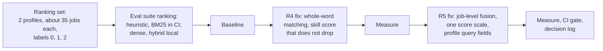

# Task: Step 3.4 Ranking Set, then the R4 and R5 Fixes

## Goal
Measure how well Job Raider ranks jobs for a profile, on a labeled set that anyone can run again, before and after the ranking fixes R4 (keyword and skill matching in the heuristic matcher) and R5 (hybrid fusion in the RAG ranker). Report NDCG@10 and recall@10 for the heuristic matcher, BM25 only, dense only, and hybrid (review items R4 and R5; plan in `tasks/active/step-3-measurable-claims/notes.md`).

## Constraints & Context
- Measure first: the baseline runs on the current code with the same set and suite as the runs after each fix.
- Committed data is synthetic only: synthetic profiles and constructed jobs, no personal data and no copied job postings. The source fixtures hold only 3 listings each, and the dedupe set is also constructed, so the plan's "public jobs from the source fixtures" cannot fill 30 to 50 jobs for each profile.
- Labels: 2 (apply), 1 (maybe), 0 (not relevant) for each profile and job, written before any ranker runs (as in the grounding and dedupe guides). Decision of 2026-10-22: the user labels the pairs; the plan proposes Claude drafts and the user corrects, as for the real letters of Step 3.2.
- The heuristic matcher and BM25 are deterministic and run in CI with a thresholds file. Dense and hybrid need the embedding model (`nomic-embed-text`, small) and Ollama, so they run locally and log to MLflow.
- GPU: the embedding model only (no chat model); one run at a time.
- Each fix is one handoff with its own tests, and each is measured on the same set.

## Acceptance Criteria
- [x] Plan and decisions approved by the user (job pool, labeling). (2026-11-03: new constructed set; Claude drafts all labels, the user checks all)
- [x] Ranking set in `tests/fixtures/eval/ranking/` with a labeling guide; labels checked by the user. (2026-11-03: guide `c0865af`, set and format test `de901a4`; 70 jobs, 140 labels; user answered 12 rule questions, changed rk-003, and left the rest to Claude)
- [ ] Eval suite `ranking`: NDCG@10 and recall@10 for each method, for each profile and in total; heuristic and BM25 deterministic (CI), dense and hybrid local.
- [ ] Baseline run recorded (command, dataset SHA-256, MLflow run ID).
- [ ] R4 fix (whole-word matching for keywords and skills; a skill score that does not drop when matches rise), measured.
- [ ] R5 fix (fuse dense and BM25 at job level; one score scale for jobs inside and outside the hybrid result; the BM25 profile query uses `summary` and `targets`; profile chunks out of the job index), measured.
- [ ] CI gate on the heuristic and BM25 numbers; docs and the decision-log entry.
- [ ] Done when: the README can state NDCG@10 for heuristic, BM25, dense, and hybrid on the labeled set, measured after the R5 fix, with the command.

## Status
`in-progress` (2026-11-03: the ranking set is in the repository; MH-2, the suite with heuristic and BM25, ready for the runner)
