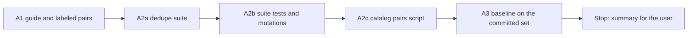

# Handoff: Step 3.5 Stage A, Dedupe Set, Suite, and Baseline (2026-10-26)

Read this file first. Then read, in this order:

1. `tasks/index.md` (the task system).
2. `tasks/todo.md`.
3. `task.md` and `notes.md` in this folder, all of them. The decisions of 2026-10-26 and the classes table are the rules for this stage.
4. `CLAUDE.md`.
5. The code to follow: `apps/backend-py/src/evaluation/suites/scam.py` (case model, loader, metrics, report), `apps/backend-py/tests/fixtures/eval/scam/README.md` (guide form), and `apps/backend-py/tests/unit/test_scam_suite.py`.
6. These sections of `docs/lessons.md`:
    - "Name the author of constructed text, not only the words it must not use";
    - "Give constructed eval sets a measurable diversity rule, and test it";
    - "A perfect score on a dev set says nothing about phrasings the set lacks";
    - "Prove that a mutation was applied with a fixed-string check, not the regex that applied it".

Do not read `tasks/archive/`.

The user will review your work after this stage. Stage B (the R2 fix, the CI gate, and the docs) comes after that review.

## 1. Status

| Item | State |
|------|-------|
| `main` | At `4689a31`, pushed. Do not push. |
| `deduplicate` | **Do not change it in Stage A** (`apps/backend-py/src/models/job_listing.py:397-416`). The baseline measures it as it is. Do not change the normalizers in `src/metrics/outcome_tracker.py` or `AppliedGuard` either. |
| Local catalog | `apps/backend-py/data/listings/catalog.json` (ignored by git). Only the A2c script reads it. No row, name, or text from it goes into the repository, the tests, this file, or a commit message. Report counts only. |
| Probe set | Claude keeps a private probe set of pairs for the reviews. Fit the classes in `notes.md`, not a guess of the probes. |
| This handoff | A1, A2, and A3. **Stop after A3.** |

## 2. The task



**The rules that matter most:**

- **Labels before runs.** Write the guide and every pair before you run the suite on them.
- **No fix in Stage A.** The baseline is the code as it is. If you see how to fix R2, write it in the summary.
- **Constructed text has an author.** Each listing reads as the employer's or the job board's posting. Nothing in a listing's title, company, or description states its label or its class. The `note` field explains the case.
- **No personal data.** No real person's name, email, or phone number in a fixture. Use invented, neutral company names, or the public fixture listings.

There are four commits: A1, A2 (the suite and its tests), A2c (the script), and the results section of this file. Before each commit, run all the checks in section 5.

### A1. Guide and labeled pairs

Add `apps/backend-py/tests/fixtures/eval/dedupe/README.md` and `cases.jsonl`.

**The guide** states:

- the labeling rule of decision 1 in `notes.md` ("same" means one application covers both listings);
- the classes table in `notes.md`, plus class C0 below;
- the case format;
- how the pairs were made (fixture-based or constructed);
- the limits of the set.

**The case format** (one JSON object per line):

```json
{"case_id": "c1__harbourline_data_analyst", "class": "C1", "expected": "same", "a": {"job_id": "mcf-...", "source": "mycareersfuture", "title": "...", "company": "...", "location": "...", "source_url": "https://...", "description": "..."}, "b": {"job_id": "...", "source": "jsearch", "...": "..."}, "source": "constructed", "note": "..."}
```

- `case_id` is `<class in lower case>__<short_name>`, unique.
- `class` is one of C0 to C4 and H1 to H5. `expected` is `same` or `different`, and it must agree with the class.
- `a` and `b` are `JobListing` fields. `JobListing.model_validate` must accept each one. Use the `job_id` prefixes that the scrapers use (read `src/scrapers/*_scraper.py`).
- `source` is `constructed` or `fixture:<path>#<index>`.

**The classes and counts:**

- C0 exact duplicate (the same `job_id` twice), label `same`: exactly 2 pairs. This is a check that the baseline merges something.
- C1 to C4 and H1 to H5 from `notes.md`: at least 3 pairs each.
- At least 30 pairs in total. `same` and `different` are each 40% to 60% of the pairs.
- Apart from C0, `a` and `b` have different `job_id` values.

**Realism:**

- C1 pairs cover at least four of these differences across the class: company suffix or punctuation, title case or punctuation, location format, HTML in one description, a shortened description, and a different URL domain for each source.
- C3 pairs cover a trailing slash, a letter-case change, a `utm_` tracking parameter, and a fragment.
- In H2, the other role is visible in the text (another level, team, or contract type). The title, company, and location are the same.
- In H3, two different jobs have one URL (a careers home page or an aggregator link).
- Descriptions have at least one full sentence. Lengths overlap between `same` and `different` pairs.

**Tests (`apps/backend-py/tests/unit/test_dedupe_dataset.py`):**

- the schema; unique `case_id`; the prefix matches `class`; `expected` agrees with `class`; both listings validate;
- the class counts and the label balance above;
- different `job_id` values outside C0;
- no listing text contains "duplicate", "repost", "same job", "same role", "copy of", or "different job" (case-insensitive);
- diversity: at least 10 distinct companies; no company in more than 4 cases; no title in more than 3 cases.

Commit A1: `test(eval): add the labeled dedupe pairs and their guide`.

### A2. The dedupe suite

**A2a. `apps/backend-py/src/evaluation/suites/dedupe.py`:**

- A `DedupeCase` model (`extra="forbid"`) and `run_dedupe_suite(dataset_dir=DEFAULT_DATASET_DIR)`, in the same form as `run_scam_suite`. The dataset SHA-256 covers `cases.jsonl` only.
- **Decision per pair:** merged when `JobListingCollection(listings=[a, b]).deduplicate()` returns one listing. Also run the order `[b, a]`. A pair that merges in one order only is "order-dependent". The decision uses the order `[a, b]`.
- Give `run_dedupe_suite` a `dedupe_fn` parameter. Its default calls the real `deduplicate`, and tests can pass a fake.
- **Metrics:** precision, recall, F1, and the false-merge rate (merged `different` pairs, of all `different` pairs), each with its counts and Wilson 95% intervals (`wilson_interval` in `src/evaluation/metrics.py`). Also the confusion counts and the number of order-dependent pairs.
- **Details:** per-class counts (merged and total for each class), and one row per pair (`case_id`, `class`, `expected`, `merged`, `merged_reversed`).
- **Labels:** a case with `expected` = `TODO` stops the run with a `ValueError` that says to label the pairs first (see A2c).
- Register the suite in `SUITE_NAMES` and `get_suite` (`src/evaluation/suites/__init__.py`), so that `python main.py eval dedupe` works and logs to MLflow like the other suites. `--part` stays for `emscad` only.

**A2b. `apps/backend-py/tests/unit/test_dedupe_suite.py`:** metrics and per-class counts on a small synthetic set; Wilson bounds; the order-dependent count, with a fake `dedupe_fn` that merges in one order only; the `TODO` refusal; the CLI routes `eval dedupe` to the suite.

**Mutation proofs.** Choose four mutations of the suite code that a correct test must catch: for example, the reversed order is not run; the false-merge rate uses all pairs as its denominator; the `TODO` check is removed; one class is left out of the per-class counts. For each mutation:

- apply a fixed-string replacement;
- show the checksum and the count of the new string;
- show that a test fails;
- restore the file and compare it with the backup.

Commit A2: `feat(eval): add the dedupe suite`.

### A2c. The local catalog pairs script

Add `apps/backend-py/scripts/prepare_dedupe_catalog_pairs.py` (decision 3):

- It reads `data/listings/catalog.json`. The file is `{"updated_at": ..., "listings": {job_id: listing}}`.
- It groups the listings by `normalize_match_label(company)` and `normalize_match_label(title)`.
- For each group with more than one listing, it writes every pair to `data/dedupe_catalog/cases.jsonl`, in the A1 format, with `class` = `catalog`, `source` = `catalog`, and `expected` = `TODO`. (`DedupeCase` accepts `catalog` and `TODO` only for this use.)
- Each listing keeps only `job_id`, `source`, `source_url`, `title`, `company`, `location`, `description`, and `posted_date`. The recruiter fields, `raw_html`, and `metadata` are left out.
- It never overwrites a file in which any label is not `TODO`, so the user's labels are safe. It prints counts only (groups and pairs).
- Tests with a synthetic catalog in `tmp_path`: the pair count, no recruiter field in the output, and no overwrite of a labeled file.

Run it one time on the real catalog, and record only the counts. The expected counts are 13 groups and 20 pairs. Do not open or print the output file.

Run the catalog pairs script (from `apps/backend-py`):

```bash
.venv/bin/python scripts/prepare_dedupe_catalog_pairs.py
```

Commit A2c: `feat(eval): add the local catalog pairs script for the dedupe check`.

### A3. Baseline on the committed set

Run the dedupe suite (from `apps/backend-py`):

```bash
.venv/bin/python main.py eval dedupe
```

Record in the results section: the metrics with counts and intervals, the per-class table, the order-dependent count, the report path, and the MLflow run ID.

With `job_id` matching only, the expected result is that only C0 merges. If any other pair merges, or a C0 pair does not, say so. Do not change a case to fit the result.

Do not run the suite on `data/dedupe_catalog/`. The user labels it first, and Claude runs it in the review.

## 3. Traps

- **Fixed code.** Do not change `deduplicate`, the normalizers, `AppliedGuard`, or the pipeline stages in Stage A.
- **Catalog privacy.** The catalog has recruiter names, emails, and phone numbers. Report counts only.
- **Constructed text.** Write each listing in its author's voice. Do not use one change for every C1 pair. Do not let lengths, names, or a repeated sentence give away the label.
- **No real data and no secrets.** Never open `.env`, `.env.local`, or `apps/backend-py/data/settings/user_settings.json`.
- **Startup time.** `main.py` takes about 100 s to start on `/mnt/d`, and the full backend suite takes 3 to 8 minutes. Run long commands in the background. `pytest.ini` has `--maxfail=5`.
- **Line endings and scratch files.**
    - The IDE keeps rewriting 14 cover-letter, profile, and frontend files with CRLF (no content change). Do not commit them, and do not restore them in this stage.
    - Check `git ls-files --eol` before each commit, and stage only the files of that step.
    - Put scratch files and commit messages outside the repository, and use `git commit -F <file>`.

## 4. Summary to leave for the user

At the end of this file, add "Cursor results (date)" with:

- The commits (hash and subject).
- A1: the pair count per class and per label, and the diversity numbers.
- A2: the tests, their failure output before the code, and the four mutation results.
- A2c: the counts from the one real run (groups and pairs).
- A3: the metrics, the per-class table, the order-dependent count, the report path, and the MLflow run ID.
- Anything that you think is wrong in this plan, and any R2 fix idea (not applied).
- Every check that you ran and its result. Say clearly what you did not run.

## 5. Checks

Backend (WSL, from `apps/backend-py`):

Check formatting (the CI paths plus the new script):

```bash
.venv/bin/python -m black --check main.py scripts/mypy_gate.py scripts/prepare_dedupe_catalog_pairs.py src/ tests/
```

Run the linter (the CI paths plus the new script):

```bash
.venv/bin/python -m ruff check main.py scripts/mypy_gate.py scripts/prepare_dedupe_catalog_pairs.py src/ tests/
```

Run the mypy baseline gate:

```bash
.venv/bin/python scripts/mypy_gate.py
```

Run the tests:

```bash
.venv/bin/python -m pytest tests/ -q
```

Stage A changes no frontend file, so the frontend checks are not needed.

## 6. Rules (unchanged)

- Follow `CLAUDE.md`:
    - docstrings with description, arguments, and returns;
    - type hints;
    - ASD-STE100 for documentation;
    - no emojis;
    - a Mermaid diagram in documentation.
- Before each commit, run `git status --short` and stage only the files of that step.
- Never run `scripts/mypy_gate.py --update` to accept a new error.
- Keep dry run as the default. Do not make auto-submit reachable.
- Do not push. Push only from WSL, and only after the user approves.

## Cursor results (2026-10-26)

Stage A is complete on the committed set. Stop here. Do not start Stage B.
Do not push. The user labels the 20 catalog pairs before anyone runs
`eval dedupe` on `data/dedupe_catalog/`.

### Commits

| Hash | Subject |
|------|---------|
| `4c39c7a` | test(eval): add the labeled dedupe pairs and their guide |
| `08b216c` | feat(eval): add the dedupe suite |
| `6bf5f21` | feat(eval): add the local catalog pairs script for the dedupe check |
| (this commit) | docs(tasks): record Stage A results |

`deduplicate`, the normalizers, and `AppliedGuard` were not changed.

### A1

31 pairs. `same` 16 (51.6%). `different` 15 (48.4%).

| Class | Label | Pairs |
|-------|-------|-------|
| C0 | same | 2 |
| C1 | same | 4 |
| C2 | same | 3 |
| C3 | same | 4 |
| C4 | same | 3 |
| H1 | different | 3 |
| H2 | different | 3 |
| H3 | different | 3 |
| H4 | different | 3 |
| H5 | different | 3 |

Diversity: 26 company names; one company is in at most 2 cases. 30 titles;
one title is in at most 2 cases. C1 covers company suffix, title case,
location format, HTML, a shortened description, and URL domain. C3 covers
slash, letter case, `utm_`, and fragment.

### A2

New tests in `tests/unit/test_dedupe_suite.py`: metrics and per-class
counts on a four-pair synthetic set; Wilson bounds; order-dependent count
with a fake that merges in one order only; the `TODO` refusal; CLI route
`eval dedupe`. `SUITE_NAMES` now includes `dedupe`.

The suite tests were written with the suite. The failure proof is the
four mutations on `src/evaluation/suites/dedupe.py`. Each mutation was a
fixed-string replace. The file checksum changed. `grep` of the new string
was 1 (the TODO mutation deleted the check, so the new-string count is
not used). One named test failed. The file was restored and matched the
backup checksum `d65312f44df9e73c6a52a3ac95fe5f51e43b0e92d27b6c8d0d6b844641f240ba`.

| Mutation | New SHA-256 | Test | Failure |
|----------|-------------|------|---------|
| Reversed order not run (`merged_reversed = merged`) | `7af020fc…61bc3c1` | `test_order_dependent_count_uses_both_orders` | `assert 0 == 1` |
| False-merge trials = `len(cases)` | `2b0f5393…b578660` | `test_metrics_and_per_class_on_a_known_small_set` | `assert 0.25 == 0.5` |
| TODO check removed | `4de671fb…903ff95` | `test_todo_label_refuses_the_run` | `DID NOT RAISE ValueError` |
| C0 left out of per-class counts | `19c71271…9cada79` | `test_metrics_and_per_class_on_a_known_small_set` | per-class map missing C0 |

### A2c

One real run of `scripts/prepare_dedupe_catalog_pairs.py`:

```text
groups=13
pairs=20
```

The output file was not opened or printed. Recruiter fields stay out of
the written rows. A labeled file is not overwritten.

### A3

Command: `python main.py eval dedupe` from `apps/backend-py`.

| Item | Value |
|------|-------|
| Cases | 31 |
| Git SHA | `6bf5f21361ad387930dfe8defbe4f19f293a8cf8` |
| Git dirty | true (the 14 IDE CRLF files; not staged) |
| Dataset SHA-256 | `8389742fb4b51ea175feb0a24a5bd97a2efe8a13c8adbb8349a86ef8692365d7` |
| Report | `apps/backend-py/data/eval/dedupe/20261026T031746532576Z.json` |
| MLflow run | `3a3741b8034647b0885464aa5a4857fa` |
| Order-dependent | 0 |

| Metric | Value | Counts | Wilson 95% |
|--------|-------|--------|------------|
| Precision | 1.0000 | 2 / 2 | 0.3424 to 1.0000 |
| Recall | 0.1250 | 2 / 16 | 0.0350 to 0.3602 |
| F1 | 0.2222 | — | 0.0350 to 0.3602 (same trials as recall) |
| False-merge rate | 0.0000 | 0 / 15 | 0.0000 to 0.2039 |

Confusion: TP 2, FP 0, FN 14, TN 15.

| Class | Merged | Total |
|-------|--------|-------|
| C0 | 2 | 2 |
| C1 | 0 | 4 |
| C2 | 0 | 3 |
| C3 | 0 | 4 |
| C4 | 0 | 3 |
| H1 | 0 | 3 |
| H2 | 0 | 3 |
| H3 | 0 | 3 |
| H4 | 0 | 3 |
| H5 | 0 | 3 |

Only C0 merged. No other pair merged. No C0 pair failed to merge. No case
was changed to fit this result.

### Plan notes and an R2 idea (not applied)

- The F1 Wilson interval uses the recall trial count. F1 is not a
  binomial proportion. Precision, recall, and the false-merge rate are
  the intervals that matter.
- `normalize_match_url` lowercases and strips a trailing slash only. It
  does not drop `utm_` parameters or fragments. A URL-only rule would
  still miss C3 `utm_` and fragment pairs.
- R2 idea for Stage B, not applied: keep `job_id`; then normalized URL;
  then normalized company, title, and location together, and never on
  placeholder labels. Precision first: no H1 to H5 pair in the committed
  set may merge. C2 should merge on URL. C3 slash and case should merge
  on normalized URL. C1, C4, and the remaining C3 pairs should merge only
  when company, title, and location all match.

### Checks

Each of A1, A2, and A2c ran the section 5 backend checks before the
commit. After this results section, the same checks run again.

| Check | Result |
|-------|--------|
| black --check (CI paths plus the new script) | pass |
| ruff check (CI paths plus the new script) | pass |
| mypy_gate.py | pass (182 known, 0 new) |
| pytest tests/ -q | pass (1599 after A1; 1604 after A2; 1606 after A2c) |

Not run:

- Frontend checks (no frontend file in Stage A).
- `eval dedupe` on `data/dedupe_catalog/` (the user labels first).
- Stage B. No change to `deduplicate`.
- Push.
