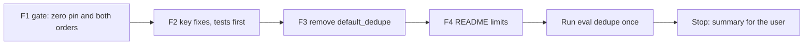

# Handoff: Step 3.5 Stage B Fix Round (2026-10-26)

Read this file first. Then read, in this order:

1. `tasks/index.md` (the task system).
2. `tasks/todo.md`.
3. `task.md` and `notes.md` in this folder. In `notes.md`, read these sections:
    - "Decisions (2026-10-26)", decisions 5, 6, and 7.
    - "Review of Stage B", all of it (findings 1 to 8 and the mutation table).
4. `handoff-stage-b.md` in this folder: "3. Traps" and "Cursor results". You did that work.
5. `CLAUDE.md`.
6. These sections of `docs/lessons.md`:
    - "A closed word list moves a false positive to a new form";
    - "Prove that a mutation was applied with a fixed-string check, not the regex that applied it".

Do not read `tasks/archive/`.

This is the last round (decision 5). After it, Claude checks the fixes and closes Step 3.5.

## 1. Status

| Item | State |
|------|-------|
| `main` | Ahead of `origin/main` (not pushed). Do not push. |
| Committed set | Frozen (31 pairs, SHA-256 `8389742f…365d7`). Do not change a case, a label, or the guide. |
| Local catalog | Do not open, change, or run `data/dedupe_catalog/`. Claude runs it in the check. |
| Probe set | Claude has a private probe set. Fit the findings, not a guess of the probes. |
| Flag rules | The two rules of decision 6 stay. Findings 3 and 4 change only the key normalization. |
| This handoff | F1 to F4, then the results section. **Stop after F4.** There is no further round. |

## 2. The task



**The rules that matter most:**

- **Keep every listing.** `deduplicate` still removes a listing only when its `job_id` is the same as an earlier listing's.
- **No new rule.** Do not add a flag rule, a title word list, a similarity score, or a new legal suffix. The suffix list stays as it is.
- **Tests first** for each behavior change in F2. Show that each new test fails before the code change.
- **Do not tune on the committed set.** If a fix changes a count on it, re-pin (section F2, last item).

There are four commits (F1 to F4), then the results section of this file. Before each commit, run all the checks in section 5. Each finding below has its number from the Stage B review.

### F1. The gate (findings 1 and 2)

- **Finding 1, the zero pin.** In `apps/backend-py/tests/unit/test_dedupe_thresholds.py`, add a test that `thresholds["counts"]["max_merged_different"]` is 0. Its failure message says that this is a safety rule and not a measured pin, so it must not be raised.
- **Finding 2, both orders.** A pair is merged when either order merges.
    - In `apps/backend-py/src/evaluation/suites/dedupe.py`, count `merged_same`, `merged_different`, and the per-class `merged` count from `merged or merged_reversed`. Keep `merged` and `merged_reversed` in each per-pair row.
    - In `threshold_check`, a `different` row is a merged `different` pair when `merged` or `merged_reversed` is true.
    - Tests: a synthetic `dedupe_fn` that merges in one order only gives `merged_different` = 1 for a `different` pair; a synthetic report row with `merged` false and `merged_reversed` true is a `merged_different` violation.
- **Mutation proofs:** (1) the pin is set to 1 in `thresholds.json` (the new pin test fails); (2) the suite counts `merged` only (the one-order suite test fails); (3) `threshold_check` reads `merged` only (the one-order gate test fails).

Commit F1: `test(dedupe): keep the merged-different pin at 0 and read both orders`.

### F2. Key fixes in `src/models/duplicates.py` (findings 3, 4, 5, and 6)

Write the tests in `apps/backend-py/tests/unit/test_possible_duplicates.py` first, and show that they fail. Then change the code.

- **Finding 3, `+` and `#`.** Keep `+` and `#` in the keys (`_PUNCT`, line 41). Tests:
    - "C++ Developer", "C# Developer", and "C Developer" at one company and one location: no flags.
    - "Sr. C++ Developer" and "Sr C++ Developer" at one company and one location: flagged (`same_company_title_location`).
- **Finding 4a, a placeholder location.** The `same_company_title_location` rule also needs a usable location: use `_usable_match_label` on the location, as for the company and the title. Do not change the `same_url` rule. Test: two listings with one company and one title, and the locations "N/A" and "n/a": no flags.
- **Finding 4b, a placeholder after the suffix.** Check the company again after the suffix removal (`_usable_match_label` on the result of `normalize_company_name`). Test: "Confidential Pte Ltd" and "Confidential Pte. Ltd." with one title and one location: no flags.
- **Finding 5, old flags.** In `flag_possible_duplicates`, a listing that this call does not flag but that has a `possible_duplicates` key comes back as a copy without that key. Other metadata keys stay. Tests: the old key is not in the result; the input listing still has its old key (no mutation).
- **Finding 6, test gaps.**
    - The whole-word suffix rule: "Disco" and "Dis Co" with one title and one location give no flags, and `normalize_company_name("Disco")` is `"disco"`.
    - The stage metadata: a `stage_deduplicate` test (see `tests/unit/test_pipeline_stages.py` for the setup) with one `same_url` pair and one `same_company_title_location` pair. It reads `flagged_listings` (4), `flagged_pairs_same_url` (1), and `flagged_pairs_same_company_title_location` (1), and `removed_count` for a same-`job_id` copy.
- **Mutation proofs:** one for each fix (the old `_PUNCT`; no location check; no second company check; old flags kept), plus the two Stage B mutations that were not caught: M3 (`ending = f" {suffix}"` becomes `ending = suffix`) and M11 (`"flagged_listings": flag_stats["flagged_listings"],` becomes `"flagged_listings": 0,`).
- **Then run the suite once** on the committed set (from `apps/backend-py`):

```bash
.venv/bin/python main.py eval dedupe
```

- **If a count changes,** do not change a case. Set the new pins in `thresholds.json` from this run, add a dated `changes` entry (reason and MLflow run ID), update `mlflow_run`, and change the README numbers in F4. If no count changes, leave the pins as they are and record the run ID in the summary.

Commit F2: `fix(dedupe): keep + and #, skip placeholder locations and companies, and clear old flags`.

### F3. Remove `default_dedupe` (finding 7)

- `default_dedupe` in `src/evaluation/suites/dedupe.py` (line 144) is no longer called. Remove it. Change the `run_dedupe_suite` docstring (line 391) so that it does not name it.
- Search `src/`, `tests/`, `main.py`, and `scripts/` first. If something still uses it, keep it and say why in the summary.

Commit F3: `refactor(eval): remove the unused default_dedupe`.

### F4. README limits (finding 8)

In `README.md`, "Duplicate Detection", add two items to "Limits":

- A shared careers page that shows one title at one location for two jobs is flagged.
- The URL rule does not join `http` and `https` URLs.

If F2 changed a count, change the table numbers and intervals to the new run. Write in ASD-STE100, with no emojis. Do not link to `tasks/`.

Commit F4: `docs: add two duplicate-flag limits`.

## 3. Traps

- **Removal.** Only the same `job_id` removes a listing. Finding 2 changes how the suite counts merges, not what `deduplicate` does.
- **`_PUNCT` is shared.** It normalizes the company, the title, and the location. Keeping `+` and `#` changes all three. That is correct. Check that the committed set counts stay the same.
- **Closed lists.** Do not add "pvt", "n.a.", or another word to a list to fix a case that is not in a finding.
- **Committed set and catalog.** Do not change a case or a label. Do not open or run `data/dedupe_catalog/`.
- **No real data and no secrets.** Never open `.env`, `.env.local`, or `apps/backend-py/data/settings/user_settings.json`.
- **Startup time.** `main.py` takes about 100 s to start on `/mnt/d`, and the full backend suite takes 3 to 8 minutes. Run long commands in the background. `pytest.ini` has `--maxfail=5`.
- **Line endings and scratch files.**
    - The IDE keeps rewriting 14 cover-letter, profile, and frontend files with CRLF (no content change). Do not commit them.
    - Check `git ls-files --eol` before each commit, and stage only the files of that step.
    - Put scratch files and commit messages outside the repository, and use `git commit -F <file>`.

## 4. Summary to leave for the user

At the end of this file, add "Cursor results (date)" with:

- The commits (hash and subject).
- For each finding (1 to 8): what changed, the test names, and the failure output of the new tests before the code.
- The mutation results: for each one, the fixed string, the checksum before and after, the failing test, and the restore check.
- The `eval dedupe` run: the metrics with counts and intervals, the per-class table, the report path, the MLflow run ID, and whether a pin changed.
- Anything that you think is wrong in this plan.
- Every check that you ran and its result. Say clearly what you did not run. The catalog run must be in the "not run" list.

## 5. Checks

Backend (WSL, from `apps/backend-py`):

Check formatting (the CI paths plus the catalog script):

```bash
.venv/bin/python -m black --check main.py scripts/mypy_gate.py scripts/prepare_dedupe_catalog_pairs.py src/ tests/
```

Run the linter (the CI paths plus the catalog script):

```bash
.venv/bin/python -m ruff check main.py scripts/mypy_gate.py scripts/prepare_dedupe_catalog_pairs.py src/ tests/
```

Run the mypy baseline gate:

```bash
.venv/bin/python scripts/mypy_gate.py
```

Run the tests:

```bash
.venv/bin/python -m pytest tests/ -q
```

This round changes no frontend file, so the frontend checks are not needed.

## 6. Rules (unchanged)

- Follow `CLAUDE.md`:
    - docstrings with description, arguments, and returns;
    - type hints;
    - ASD-STE100 for documentation;
    - no emojis;
    - a Mermaid diagram in documentation.
- Before each commit, run `git status --short` and stage only the files of that step.
- Never run `scripts/mypy_gate.py --update` to accept a new error.
- Keep dry run as the default. Do not make auto-submit reachable.
- Do not push. Push only from WSL, and only after the user approves.

## Cursor results (2026-10-26)

The last Stage B fix round is complete. Stop here. Do not push. Do not
open or run `data/dedupe_catalog/`.

### Commits

| Step | Hash | Subject |
|------|------|---------|
| F1 | `9f23505` | `test(dedupe): keep the merged-different pin at 0 and read both orders` |
| F2 | `f907f7b` | `fix(dedupe): keep + and #, skip placeholder locations and companies, and clear old flags` |
| F3 | `59a1f66` | `refactor(eval): remove the unused default_dedupe` |
| F4 | (this commit) | `docs: add two duplicate-flag limits` |

### Finding 1 (zero pin)

`test_merged_different_pin_is_a_safety_rule_and_stays_at_zero` asserts
that `max_merged_different` is 0. The message says it is a safety rule
and not a measured pin. The test passed before the mutation (the pin
was already 0). Raising the pin to 1 fails it.

### Finding 2 (both orders)

`evaluate_dedupe_pairs` now counts `merged_same`, `merged_different`,
and per-class `merged` from `merged or merged_reversed`.
`threshold_check` treats a `different` row as merged when `merged` or
`merged_reversed` is true. Per-pair rows still store both orders.

New tests, red before the code:

| Test | Failure before the code |
|------|-------------------------|
| `test_one_order_merge_on_a_different_pair_counts_as_merged_different` | `assert 0.0 == 1` |
| `test_merged_reversed_on_a_different_pair_is_a_merged_different_violation` | `assert [] == ['merged_different: 1 (pin 0); cases: h3__reversed']` |

### Finding 3 (`+` and `#`)

`_PUNCT` is now `[^\w\s+#]+`. Tests:

| Test | Before the code |
|------|-----------------|
| `test_plus_and_hash_keep_c_family_titles_apart` | failed: C++, C#, and C flagged as `same_company_title_location` |
| `test_sr_c_plus_plus_titles_still_flag` | passed (already flagged) |

### Finding 4 (placeholders)

`same_company_title_location` now requires `_usable_match_label` on the
location, and again on the company after suffix removal. `same_url` is
unchanged.

| Test | Failure before the code |
|------|-------------------------|
| `test_placeholder_locations_do_not_flag` | N/A and n/a flagged |
| `test_placeholder_company_after_suffix_does_not_flag` | Confidential Pte Ltd flagged |

### Finding 5 (old flags)

`flag_possible_duplicates` returns a copy without `possible_duplicates`
when this call does not flag the listing. Other metadata keys stay. The
input listing is not changed.

| Test | Failure before the code |
|------|-------------------------|
| `test_old_flags_are_cleared_on_unflagged_listings` | old key stayed on the result |

### Finding 6 (test gaps)

| Test | Before the code |
|------|-----------------|
| `test_suffix_is_a_whole_word` | passed; `normalize_company_name("Disco")` is `"disco"` |
| `test_reports_flag_counts_and_same_job_id_removals` | passed: flagged_listings 4, same_url 1, CTL 1, removed_count 1 |

### Finding 7 (`default_dedupe`)

Searched `src/`, `tests/`, `main.py`, and `scripts/`. Nothing called
`default_dedupe`. Removed the function and the name from the
`run_dedupe_suite` docstring.

### Finding 8 (README limits)

Added two limits under Duplicate Detection. The metric table is
unchanged (F2 did not change a count).

### Mutations

Each mutation was a fixed-string replace. The file checksum changed.
The new-string count was 1. One named test failed. Restore matched the
backup checksum.

F1, backup SHA-256:

- `thresholds.json`: `fcb8acef…4250fa`
- `dedupe.py` (suite): `2483df32…b60232`
- `test_dedupe_thresholds.py`: `fc95a2eb…0cf785`

| Mutation | Fixed string | New SHA-256 | Test | Failure |
|----------|--------------|-------------|------|---------|
| Pin raised to 1 | `"max_merged_different": 0` to `1` | `bab5ea97…69b3f1` | zero-pin test | `assert 1 == 0` (safety-rule message) |
| Suite counts `merged` only | `either_merged = merged or merged_reversed` to `merged` | `0f2702d3…b336dc` | one-order suite test | `assert 0.0 == 1` |
| Gate reads `merged` only | drop `merged_reversed` | `c4767902…d79feb` | one-order gate test | `assert [] == [...]` |

F2, backup SHA-256:

- `duplicates.py`: `1fccb1c4…51dda8`
- `stages.py`: `c4d3ce67…475737`

| Mutation | Fixed string | New SHA-256 | Test | Failure |
|----------|--------------|-------------|------|---------|
| Old `_PUNCT` | `[^\w\s+#]+` to `[^\w\s]+` | `d26d7ec5…549943` | plus-and-hash | C family flagged |
| No location check | drop location `_usable_match_label` | `299f744b…c44e95` | placeholder location | N/A flagged |
| No second company check | drop `_usable_match_label(company)` | `29ed8103…c65db9` | confidential suffix | flagged |
| Old flags kept | skip the clear copy | `ba0f3f25…79ca4a` | old-flags test | key stayed |
| M3 suffix inside a word | `ending = f" {suffix}"` to `ending = suffix` | `b8b20126…af9099` | Disco test | Disco flagged with Dis Co |
| M11 flagged listings | `flag_stats["flagged_listings"]` to `0` | `cf0b6b79…b5cc6e` | stage metadata | `assert 0 == 4` |

### Eval run (after F2, before F3)

Command: `python main.py eval dedupe` from `apps/backend-py`.

| Item | Value |
|------|-------|
| Cases | 31 |
| Git SHA | `9f23505` (dirty true: the 14 IDE CRLF files) |
| Dataset SHA-256 | `8389742fb4b51ea175feb0a24a5bd97a2efe8a13c8adbb8349a86ef8692365d7` |
| Report | `apps/backend-py/data/eval/dedupe/20261026T141827386112Z.json` |
| MLflow run | `26bc47eafe5b4e27a322f692c3853c07` |
| Pins | unchanged |

| Metric | Value | Counts | Wilson 95% |
|--------|-------|--------|------------|
| Precision | 0.8333 | 15 / 18 | 0.6078 to 0.9416 |
| Recall | 0.9375 | 15 / 16 | 0.7167 to 0.9889 |
| F1 | 0.8824 | — | none |
| False-identify rate | 0.2000 | 3 / 15 | 0.0705 to 0.4519 |
| Merged same | 2 | 2 | — |
| Merged different | 0 | 0 | — |
| Order-dependent | 0 | 0 | — |

| Class | Merged | Flagged | Total |
|-------|--------|---------|-------|
| C0 | 2 | 0 | 2 |
| C1 | 0 | 3 | 4 |
| C2 | 0 | 3 | 3 |
| C3 | 0 | 4 | 4 |
| C4 | 0 | 3 | 3 |
| H1 | 0 | 0 | 3 |
| H2 | 0 | 3 | 3 |
| H3 | 0 | 0 | 3 |
| H4 | 0 | 0 | 3 |
| H5 | 0 | 0 | 3 |

### Plan notes

- Nothing in this plan looked wrong after the run.
- Keeping `+` and `#` in `_PUNCT` did not change the committed-set
  counts.

### Checks

Each of F1, F2, and F3 ran the section 5 backend checks before the
commit. After this results section, the same checks run again.

| Check | Result |
|-------|--------|
| black --check | pass |
| ruff check | pass |
| mypy_gate.py | pass (182 known, 0 new) |
| pytest tests/ -q | pass (1628 after F1; 1635 after F2 and F3) |

Not run:

- Frontend checks (no frontend file in this round).
- `eval dedupe` on `data/dedupe_catalog/` (Claude runs it in the check).
- Catalog file was not opened or changed.
- Claude check of the fix round.
- Push.

