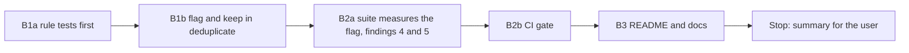

# Handoff: Step 3.5 Stage B, Flag and Keep, CI Gate, and Docs (2026-10-26)

Read this file first. Then read, in this order:

1. `tasks/index.md` (the task system).
2. `tasks/todo.md`.
3. `task.md` and `notes.md` in this folder. In `notes.md`, read these sections:
    - "Decisions (2026-10-26)", all of them. **Decision 6 replaces decision 2 and the merge plan.**
    - "Review of Stage A", all of it (findings 1 to 7).
4. `handoff-stage-a.md` in this folder: "3. Traps" and "Cursor results". You did that work.
5. `CLAUDE.md`.
6. The code to follow for the gate: `apps/backend-py/tests/unit/test_scam_thresholds.py` and `apps/backend-py/tests/fixtures/eval/scam/thresholds.json`.
7. These sections of `docs/lessons.md`:
    - "A closed word list moves a false positive to a new form";
    - "At a high threshold, pin scores in the CI gate, not only decisions";
    - "Prove that a mutation was applied with a fixed-string check, not the regex that applied it".

Do not read `tasks/archive/`.

The user will review your work after this stage. Claude reviews it with a new private probe set and the local catalog check.

## 1. Status

| Item | State |
|------|-------|
| `main` | Ahead of `origin/main` (not pushed). Do not push. |
| Committed set | Frozen at A1 (31 pairs). Do not change a case, a label, or the guide's rules. You may add one sentence to the guide's limits (B3). |
| Local catalog | `data/dedupe_catalog/cases.jsonl` is labeled by the user (all 20 pairs `different`). Do not open, change, or run it. Claude runs it in the review. |
| Probe set | Claude writes a new private probe set for the review. Fit the rules in decision 6, not a guess of the probes. |
| This handoff | B1, B2, and B3. **Stop after B3.** One round; the review can ask for one fix round (decision 5). |

## 2. The task



**The rules that matter most:**

- **Keep every listing.** `deduplicate` removes a listing only when its `job_id` is the same as an earlier listing's. Nothing else is removed.
- **Two flag rules only (decision 6), and no description signal.** The committed set separates its labels on the description (finding 1), so a description rule would look perfect here and fail on real postings. Do not add a third rule, a word list for titles, or a similarity score.
- **Do not mutate the input.** Flagged listings in the result are copies (`model_copy`) with the new metadata. The listings that the caller passed in do not change.
- **Do not tune on the committed set.** Write the rule tests from the rule text in decision 6, before the code.

There are five commits: B1a, B1b, B2a, B2b, and B3, then the results section of this file. Before each commit, run all the checks in section 5.

### B1a. Rule tests first

Add `apps/backend-py/tests/unit/test_possible_duplicates.py`. Write the tests from decision 6, then run them, and show that they fail before the code (collection error or failures).

- **Removal:** two listings with one `job_id` give one listing; listings with different `job_id` values all stay, also when every other field is the same.
- **`same_url`:**
    - flagged: the same URL after the fragment, a trailing slash, letter case, and the tracking parameters (`utm_*`, `trk`, `trkInfo`, `refId`, `ref`) are removed, with the same normalized title and location;
    - not flagged: the same URL with another title (a careers page with two jobs); the same URL with another location; URLs that differ in a query parameter that is not a tracking parameter (for example `?req=4410` and `?req=4417`).
- **`same_company_title_location`:**
    - flagged: company names that differ only in a legal suffix or punctuation ("Pine Kiln Pte. Ltd." and "Pine Kiln Pte Ltd"), titles that differ only in case, whitespace, or punctuation;
    - not flagged: another location; another company; a placeholder company or title ("Confidential", "Unknown", "N/A", empty).
- **The flag:** both listings get `{"job_id": <the other>, "reason": <rule>}` in `metadata["possible_duplicates"]`; a listing never names itself; the list is sorted by `job_id`; when both rules match, the reason is `same_url`; three listings in one group each name the other two; other metadata keys stay.
- **No mutation:** the input listings have no `possible_duplicates` key after the call.

Commit B1a: `test(dedupe): add the flag-and-keep rule tests`.

### B1b. Flag and keep

- Put the rules in one small module, for example `apps/backend-py/src/models/duplicates.py`, with a pure function that takes the listings and returns, for each `job_id`, its possible duplicates and their reasons. Group the listings by the rule keys (a dictionary per rule), not by comparing every pair.
- **Normalizers:**
    - Reuse `normalize_match_url` and `normalize_match_label` from `src/metrics/outcome_tracker.py`. Add the cleaned-URL step (remove the fragment and the tracking parameters) in the new module.
    - Company: `normalize_match_label`, then remove punctuation, then remove legal suffixes that are whole words at the end of the name (so "Disco" keeps its "co"). Keep the suffix list short and in one constant: "pte ltd", "pte", "ltd", "private limited", "limited", "inc", "llc", "llp", "corp", "co", "sdn bhd", "bhd".
    - Title and location: `normalize_match_label`, then remove punctuation. Do not expand abbreviations ("Sr." stays "sr").
    - Placeholders: add "confidential" to `_PLACEHOLDER_LABELS` (`outcome_tracker.py:171`). `AppliedGuard` reads the same set, so a "Confidential" company no longer matches an application on company and title. Add a test for that `AppliedGuard` case too.
- **`JobListingCollection.deduplicate`:** remove the same-`job_id` copies as today (keep the first), then add the flags. Update its docstring.
- **Stage metadata** (`stage_deduplicate`, `src/pipeline/stages.py`): add the number of flagged listings and the number of flagged pairs for each reason. Keep the existing keys. `removed_count` still counts what the stage removes (same `job_id` and the applied filter).
- `ScraperManager` (`src/scrapers/manager.py:142`) calls the same method, so its results get the flags too. Check that its tests still pass.

Commit B1b: `feat(dedupe): keep possible duplicates and flag them with a reason`.

### B2a. The suite measures the flag

Change `apps/backend-py/src/evaluation/suites/dedupe.py`:

- **The decision:** a pair is "identified" when `deduplicate` on `[a, b]` returns one listing (merged), or when the result has a flag between the two listings (flagged). Precision, recall, F1, and the false-identify rate use "identified". Keep the reversed-order run and the order-dependent count.
- **Report merged pairs on their own:** `merged_same` and `merged_different` counts, and `merged`, `flagged`, and `reason` in each per-pair row, and merged and flagged counts in the per-class table. A merged `different` pair is a safety failure.
- **Finding 4:** remove `f1.ci95_low` and `f1.ci95_high` (F1 has no binomial interval).
- **Finding 5:** unit tests that send bad cases to `DedupeCase`: a wrong `case_id` prefix, an H class with `expected` = `same`, a C class with `expected` = `different`, and `TODO` outside the `catalog` class. Each must raise.
- **Mutation proofs.** Four mutations, each a fixed-string replacement with the checksum, the count of the new string, the failing test, and a restore that matches the backup. Include: the flag check is removed from the decision (merged only); `merged_different` counts merged `same` pairs; one of the four `DedupeCase` checks is removed.

Run the suite on the committed set one time (from `apps/backend-py`):

```bash
.venv/bin/python main.py eval dedupe
```

Record the metrics with counts and intervals, the per-class table (merged and flagged), the reasons, the report path, and the MLflow run ID. Compare with the A3 baseline.

Commit B2a: `feat(eval): measure the duplicate flag in the dedupe suite`.

### B2b. CI gate

Add the gate in the same form as the scam gate:

- **`apps/backend-py/tests/fixtures/eval/dedupe/thresholds.json`:** `suite`, `dataset_sha256` (full value), `baseline` (`"B2a"`), `mlflow_run` (full ID of the B2a run), `counts` (`max_false_identified` and `max_missed_same` from the B2a run, and `max_merged_different` = 0), and `changes` (date, reason, MLflow run).
- **`apps/backend-py/tests/unit/test_dedupe_thresholds.py`:** a `threshold_check(report, thresholds)` that checks the dataset SHA-256 first, then each count. A count above its pin is a violation that names the cases. A count below its pin goes to `tightenable` (a warning). The real-set gate, the `changes` check, and synthetic tests for each path.
- **Mutation proofs:** (1) the `same_url` rule ignores the title (an H3 pair becomes identified, so the false-identify pin fails); (2) `deduplicate` merges on the cleaned URL (`merged_different` > 0, so the gate fails); (3) the SHA-256 check is removed (a synthetic test fails).

Commit B2b: `test(dedupe): CI gate with count pins and no merged different pair`.

### B3. README and docs

- `README.md`, the Pipeline Stages table, row 2: say that the stage removes only exact copies (the same job ID), and flags possible duplicates and keeps them.
- `README.md`, a short "Duplicate detection" paragraph near the pipeline table: what is measured, the B2a numbers (identified precision and recall, false-identify rate, each with counts and Wilson intervals, on 31 labeled pairs), the command, and the limits:
    - the set separates on the description, so no description signal is used;
    - location formats ("Singapore" and "Central, Singapore") and title abbreviations are not matched;
    - two openings with the same company, title, and location are flagged;
    - the flag is not shown in the UI yet.
- `docs/index.md` (stage 2 line, about line 394; it says "Removes duplicates across sources", which is not true) and `docs/usage.md` ("Stage 2: Deduplicate", about line 285): the same rule in a sentence or two.
- `tests/fixtures/eval/dedupe/README.md`, "Limits of the Set": one sentence on the description separation (finding 1).
- Write in ASD-STE100, with no emojis. Do not link to `tasks/`.

Commit B3: `docs: state the duplicate flag and its measured numbers`.

## 3. Traps

- **Removal.** Only the same `job_id` removes a listing. If a test or a stage seems to need more, stop and write it in the summary.
- **No description signal, no title word list, no similarity score.** The rule set is the two rules in decision 6.
- **Placeholders.** The change to `_PLACEHOLDER_LABELS` also changes `AppliedGuard` and `find_matching_application`. Run their tests, and say in the summary what changed.
- **Committed set.** Do not change a case or a label.
- **Catalog.** Do not open or run `data/dedupe_catalog/`. The catalog has personal data in the source file; report counts only if you see any.
- **No real data and no secrets.** Never open `.env`, `.env.local`, or `apps/backend-py/data/settings/user_settings.json`.
- **Startup time.** `main.py` takes about 100 s to start on `/mnt/d`, and the full backend suite takes 3 to 8 minutes. Run long commands in the background. `pytest.ini` has `--maxfail=5`.
- **Line endings and scratch files.**
    - The IDE keeps rewriting 14 cover-letter, profile, and frontend files with CRLF (no content change). Do not commit them.
    - Check `git ls-files --eol` before each commit, and stage only the files of that step.
    - Put scratch files and commit messages outside the repository, and use `git commit -F <file>`.

## 4. Summary to leave for the user

At the end of this file, add "Cursor results (date)" with:

- The commits (hash and subject).
- B1a: the tests and their failure output before the code.
- B1b: the module and its normalizers, the suffix list, the placeholder change and its effect on `AppliedGuard`, and the new stage metadata.
- B2a: the metrics against the A3 baseline (identified and merged), the per-class table, the reasons, the report path, the MLflow run ID, and the four mutation results.
- B2b: the pins and the three mutation results.
- B3: each doc change.
- Anything that you think is wrong in this plan.
- Every check that you ran and its result. Say clearly what you did not run. The catalog run must be in the "not run" list.

## 5. Checks

Backend (WSL, from `apps/backend-py`):

Check formatting (the CI paths plus the catalog script):

```bash
.venv/bin/python -m black --check main.py scripts/mypy_gate.py scripts/prepare_dedupe_catalog_pairs.py src/ tests/
```

Run the linter (the CI paths plus the catalog script):

```bash
.venv/bin/python -m ruff check main.py scripts/mypy_gate.py scripts/prepare_dedupe_catalog_pairs.py src/ tests/
```

Run the mypy baseline gate:

```bash
.venv/bin/python scripts/mypy_gate.py
```

Run the tests:

```bash
.venv/bin/python -m pytest tests/ -q
```

Stage B changes no frontend file, so the frontend checks are not needed.

## 6. Rules (unchanged)

- Follow `CLAUDE.md`:
    - docstrings with description, arguments, and returns;
    - type hints;
    - ASD-STE100 for documentation;
    - no emojis;
    - a Mermaid diagram in documentation.
- Before each commit, run `git status --short` and stage only the files of that step.
- Never run `scripts/mypy_gate.py --update` to accept a new error.
- Keep dry run as the default. Do not make auto-submit reachable.
- Do not push. Push only from WSL, and only after the user approves.

## Cursor results (2026-10-26)

Stage B is complete on the committed set. Stop here. Do not push. Do not
open or run `data/dedupe_catalog/`.

### Commits

| Step | Hash | Subject |
|------|------|---------|
| B1a | `0b95cec` | `test(dedupe): add the flag-and-keep rule tests` |
| B1b | `2a39bca` | `feat(dedupe): keep possible duplicates and flag them with a reason` |
| B2a | `ea3ac55` | `feat(eval): measure the duplicate flag in the dedupe suite` |
| B2b | `d5c226a` | `test(dedupe): CI gate with count pins and no merged different pair` |
| B3 | `8eae830` | `docs: state the duplicate flag and its measured numbers` |

### B1a

`tests/unit/test_possible_duplicates.py` has 10 tests written from
decision 6, before the flag code. Before B1b, the four flag-positive
tests failed and the six removal and not-flagged tests passed.

Full suite at B1a: 4 failed, 1612 passed.

| Failed test | Why |
|-------------|-----|
| `test_same_url_flags_fragment_slash_case_and_tracking` | No flag yet |
| `test_company_title_location_flags_suffix_and_punctuation` | No flag yet |
| `test_flag_payload_is_sorted_and_does_not_name_self` | No flag yet |
| `test_same_url_reason_wins_when_both_rules_match` | No flag yet |

### B1b

New module `src/models/duplicates.py`. Grouping is by key, not every
pair. Normalizers:

- URL: `normalize_match_url`, then drop the fragment and tracking
  parameters (`utm_*`, `trk`, `trkInfo`, `refId`, `ref`).
- Company: `normalize_match_label`, strip punctuation, then drop legal
  suffixes that are whole words at the end. `LEGAL_SUFFIXES` (longest
  first): `private limited`, `sdn bhd`, `pte ltd`, `limited`, `pte`,
  `ltd`, `inc`, `llc`, `llp`, `corp`, `co`, `bhd`. `Disco` keeps `co`.
- Title and location: `normalize_match_label`, then strip punctuation.
  Abbreviations are not expanded.

`JobListingCollection.deduplicate` still removes only a repeated
`job_id`, then flags copies with `model_copy`. Input listings do not
change.

`_PLACEHOLDER_LABELS` now includes `confidential`.
`AppliedGuard` and `find_matching_application` read that set, so a
company named Confidential no longer matches on company and title.
New test: `test_confidential_company_does_not_match_on_company_title`.

Stage metadata (added, existing keys kept): `flagged_listings`,
`flagged_pairs_same_url`,
`flagged_pairs_same_company_title_location`. `removed_count` still
counts same-`job_id` removals and the applied filter.

### B2a

Command: `python main.py eval dedupe` from `apps/backend-py`.

| Item | Value |
|------|-------|
| Cases | 31 |
| Git SHA | `2a39bca` (dirty true: the 14 IDE CRLF files) |
| Dataset SHA-256 | `8389742fb4b51ea175feb0a24a5bd97a2efe8a13c8adbb8349a86ef8692365d7` |
| Report | `apps/backend-py/data/eval/dedupe/20261026T055112326321Z.json` |
| MLflow run | `ee58fc58f04e48808d9a345e2b965818` |
| Order-dependent | 0 |
| Merged same | 2 |
| Merged different | 0 |

| Metric | Value | Counts | Wilson 95% |
|--------|-------|--------|------------|
| Precision | 0.8333 | 15 / 18 | 0.6078 to 0.9416 |
| Recall | 0.9375 | 15 / 16 | 0.7167 to 0.9889 |
| F1 | 0.8824 | — | none (finding 4) |
| False-identify rate | 0.2000 | 3 / 15 | 0.0705 to 0.4519 |

Against A3: merge is unchanged (only the two C0 pairs). Identify recall
moved from 2 of 16 to 15 of 16. The miss is `c1__riverton_support`
(location format: "Singapore" and "Central, Singapore").

| Class | Merged | Flagged | Total | Reason |
|-------|--------|---------|-------|--------|
| C0 | 2 | 0 | 2 | same `job_id` |
| C1 | 0 | 3 | 4 | `same_company_title_location` (one miss) |
| C2 | 0 | 3 | 3 | `same_url` |
| C3 | 0 | 4 | 4 | `same_url` |
| C4 | 0 | 3 | 3 | `same_company_title_location` |
| H1 | 0 | 0 | 3 | — |
| H2 | 0 | 3 | 3 | `same_company_title_location` (known limit) |
| H3 | 0 | 0 | 3 | — |
| H4 | 0 | 0 | 3 | — |
| H5 | 0 | 0 | 3 | — |

Finding 4: F1 has no Wilson interval. Finding 5: `DedupeCase` checks
are unit-tested (wrong prefix, H class labeled `same`, C class labeled
`different`, `TODO` outside `catalog`).

Backup SHA-256 of `src/evaluation/suites/dedupe.py`: `fc8b4486…852f1d93`.
Each mutation was a fixed-string replace. The file checksum changed.
The new string count was 1. One named test failed. Restore matched the
backup.

| Mutation | New SHA-256 | Test | Failure |
|----------|-------------|------|---------|
| Flag check removed from identified | `5db4adc3…4aa679` | `test_flag_without_merge` | `assert None == 1.0` |
| `merged_different` counts merged same | `8ffeac9e…114230ae` | suite metrics test | `assert 2.0 == 1` |
| `case_id` prefix check removed | `e1650554…414480` | prefix `DedupeCase` test | DID NOT RAISE |
| H-class label check removed | `110237a5…283b2aa3` | H-class `DedupeCase` test | DID NOT RAISE |

### B2b

Pins in `tests/fixtures/eval/dedupe/thresholds.json`:

| Pin | Value |
|-----|------:|
| `dataset_sha256` | `8389742fb4b51ea175feb0a24a5bd97a2efe8a13c8adbb8349a86ef8692365d7` |
| `max_false_identified` | 3 |
| `max_missed_same` | 1 |
| `max_merged_different` | 0 |
| Baseline / MLflow | B2a / `ee58fc58f04e48808d9a345e2b965818` |

`threshold_check` compares the SHA-256 first, then each count. A count
above its pin names the cases. A count below its pin is a warning.

| Mutation | New SHA-256 | Test | Failure |
|----------|-------------|------|---------|
| `same_url` ignores title | `d4b5b4f7…713200f5` | `test_dedupe_suite_meets_the_pinned_counts` | `false_identified: 6 (pin 3)` (H3 added) |
| `deduplicate` merges on cleaned URL | `b7437b44…ba22dd3f` | `test_dedupe_suite_meets_the_pinned_counts` | `merged_different: 3 (pin 0)` (the three H3 pairs) |
| SHA-256 check removed | `fd2c8aa8…6e191ed8` | `test_a_changed_dataset_fails_before_any_count` | violation is `merged_different`, not `dataset changed` |

Each mutation was a fixed-string replace. The checksum changed. The new
string count was 1 (the SHA mutation deleted the check). Restore
matched the backup.

### B3

- `README.md` pipeline table, row 2: the stage removes only exact
  copies and flags possible duplicates.
- `README.md` "Duplicate Detection": identified precision, recall, and
  false-identify rate from B2a, the command, the four limits, and a
  flow diagram.
- `docs/index.md` stage 2: no longer says the stage removes duplicates
  across sources.
- `docs/usage.md` Stage 2: same rule in two sentences.
- Guide "Limits of the Set": one sentence on the description
  separation (finding 1). No labeling rule changed.

### Plan notes

- The C1 miss and the H2 false identifies are the known limits. They
  are pinned, not tuned.
- The `confidential` placeholder change also affects `AppliedGuard`.
  The new unit test covers that case.
- Nothing in this plan looked wrong after the run.

### Checks

Each of B1a, B1b, B2a, and B2b ran the section 5 backend checks before
the commit. After this results section, the same checks run again.

| Check | Result |
|-------|--------|
| black --check (CI paths plus the catalog script) | pass |
| ruff check (CI paths plus the catalog script) | pass |
| mypy_gate.py | pass (182 known, 0 new) |
| pytest tests/ -q | pass (1612 at B1a red; 1619 after B2a; 1625 after B2b) |

Not run:

- Frontend checks (no frontend file in Stage B).
- `eval dedupe` on `data/dedupe_catalog/` (Claude runs it in the review).
- Catalog file was not opened or changed.
- Stage B review / private probe set.
- Push.

