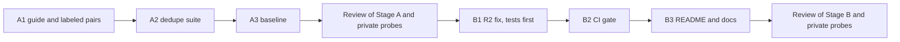

# Scratchpad & Notes

## Plan (2026-10-26, Claude)

Source: Step 3.5 in `tasks/active/step-3-measurable-claims/notes.md`.

### What a case is

One case is a pair of listings, A and B, with a label `same` or `different`. The suite decides "merged" when `JobListingCollection(listings=[A, B]).deduplicate()` returns one listing. Then:

- precision: merged pairs that are `same`, of all merged pairs;
- recall: merged pairs, of all `same` pairs;
- false-merge rate: merged pairs, of all `different` pairs.

A false merge hides a real job from the user, so it costs more than a missed duplicate, which the user sees twice. Decision 2 below makes this the rule for the fix.

### Classes in the set (at least 30 pairs)

| Class | Label | Example of what differs between A and B |
|-------|-------|------------------------------------------|
| C1 cross-source copy | same | Source and `job_id` prefix; URL; company suffix ("Pte. Ltd." and "Pte Ltd"); title case; location format ("Singapore" and "Central, Singapore"); description shortened or with HTML |
| C2 repost, same URL | same | `job_id` only |
| C3 URL variant | same | Trailing slash, letter case, tracking parameters (`utm_*`), or a fragment |
| C4 repost, new URL | same | `job_id` and URL; the text stays the same |
| H1 same title and company, other location | different | Location |
| H2 same title, company, and location, other role | different | The description shows another level, team, or contract |
| H3 shared generic URL | different | Two jobs with one careers-page or aggregator URL |
| H4 same title, other company | different | Company (for example an agency and its client) |
| H5 placeholder labels | different | Company or title is "Confidential", "Unknown", or empty |

Each class gets at least 3 pairs, and the `same` and `different` labels are about half each. The source fixtures have only about 8 public listings (`tests/fixtures/careersatgov/`, `jobstreet/`, `mycareersfuture/`), so most pairs are constructed. The constructed text follows the lesson "Name the author of constructed text": each listing reads as the employer's or the board's posting, and nothing in a listing states its label.

## Observations (2026-10-26, Claude, code at `4689a31`)

- **`deduplicate` (`src/models/job_listing.py:397-416`)** keeps the first listing for each `job_id`. Scrapers prefix the ID with the source (`js-` in `jobstreet_scraper.py:267`, `mcf-` in `mycareersfuture_scraper.py:366`), so a job from two sources is never merged.
- **Shared normalizers exist.** `normalize_match_url` (`src/metrics/outcome_tracker.py:215`) lowercases an http(s) URL and removes a trailing slash; it keeps the query string and the fragment. `normalize_match_label` (`:241`) lowercases and collapses whitespace. `_PLACEHOLDER_LABELS` (`:171`) lists the labels that must not match.
- **`AppliedGuard` and `find_matching_application` (`outcome_tracker.py:1100`)** match on the ID, then the URL, then company and title, but the company-and-title rule applies only when one side has no URL: "two different listing URLs at the same company stay separate". A cross-source copy (C1) has two different URLs, so this rule alone does not merge it. The baseline set decides what B1 does here (decision 2).
- **The local catalog (`data/listings/catalog.json`, gitignored)** has 183 listings: 103 from MyCareersFuture, 60 from LinkedIn, and 20 from JSearch. 13 groups share company and title:
    - 1 group is cross-source (JSearch and LinkedIn), with different URLs and different location strings;
    - 12 groups are from one source, all with the same location; 7 of them also share the URL with a different `job_id`, and 5 have different URLs.

    So in real runs, a repost or a changed ID with the same URL is more common than a cross-source copy. The catalog rows have recruiter fields, so only counts from it go into this file.

## Decisions (2026-10-26)

The user accepted the plan and decisions 1 to 5 as written, including the optional real check (decision 3).

1. **What "same" means (the labeling rule).** Two listings are `same` when one application covers both: the same employer, the same role, and the same place of work. A repost with a new ID or a new URL is `same`. Two listings with the same title, company, and location are `different` only when the text shows another role (level, team, or contract type).
2. **Precision first (the rule for B1).** After B1, no hard negative (H1 to H5) in the committed set may merge. Recall is what the rules give under that limit. B1 may merge two listings with different URLs only on normalized company, title, and location together, and never on placeholder labels.
3. **Real check (local only).** The user labels the pairs of the 13 catalog groups `same` or `different`. The groups give 20 pairs (11 groups of 2, one of 3, and one of 4), about 5 to 10 minutes of labeling.
    - A script writes the pairs to `apps/backend-py/data/dedupe_catalog/cases.jsonl` (ignored by git through `data/`), in the format of the committed set, with the label `TODO` and without the recruiter fields and `raw_html`.
    - The suite runs on it with `--dataset data/dedupe_catalog`; it refuses a `TODO` label.
    - Claude runs the local baseline in the Stage A review, after the user labels. Stage B reports the same measure after the fix.
    - Nothing from the catalog is committed.
4. **Scope.** `deduplicate` keeps the first listing, as today. It does not merge fields from the other listing. The catalog file, which is keyed by `job_id`, is not changed. Stage metadata reports how many listings each rule merged.
5. **Stop rule.** One Stage B round, plus at most one fix round after its review. What then stays wrong goes to the known limits in the README.

## Blockers / Questions

- None. Stage A is with Cursor (`handoff-stage-a.md`). The user labels the 20 catalog pairs after Cursor writes the file (A2c), before the Stage A review.
