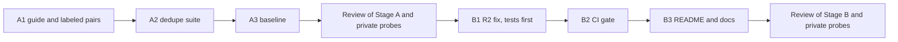

# Scratchpad & Notes

## Plan (2026-10-26, Claude)

Source: Step 3.5 in `tasks/active/step-3-measurable-claims/notes.md`.

### What a case is

One case is a pair of listings, A and B, with a label `same` or `different`. The suite decides "merged" when `JobListingCollection(listings=[A, B]).deduplicate()` returns one listing. Then:

- precision: merged pairs that are `same`, of all merged pairs;
- recall: merged pairs, of all `same` pairs;
- false-merge rate: merged pairs, of all `different` pairs.

A false merge hides a real job from the user, so it costs more than a missed duplicate, which the user sees twice. Decision 2 below makes this the rule for the fix.

### Classes in the set (at least 30 pairs)

| Class | Label | Example of what differs between A and B |
|-------|-------|------------------------------------------|
| C1 cross-source copy | same | Source and `job_id` prefix; URL; company suffix ("Pte. Ltd." and "Pte Ltd"); title case; location format ("Singapore" and "Central, Singapore"); description shortened or with HTML |
| C2 repost, same URL | same | `job_id` only |
| C3 URL variant | same | Trailing slash, letter case, tracking parameters (`utm_*`), or a fragment |
| C4 repost, new URL | same | `job_id` and URL; the text stays the same |
| H1 same title and company, other location | different | Location |
| H2 same title, company, and location, other role | different | The description shows another level, team, or contract |
| H3 shared generic URL | different | Two jobs with one careers-page or aggregator URL |
| H4 same title, other company | different | Company (for example an agency and its client) |
| H5 placeholder labels | different | Company or title is "Confidential", "Unknown", or empty |

Each class gets at least 3 pairs, and the `same` and `different` labels are about half each. The source fixtures have only about 8 public listings (`tests/fixtures/careersatgov/`, `jobstreet/`, `mycareersfuture/`), so most pairs are constructed. The constructed text follows the lesson "Name the author of constructed text": each listing reads as the employer's or the board's posting, and nothing in a listing states its label.

## Observations (2026-10-26, Claude, code at `4689a31`)

- **`deduplicate` (`src/models/job_listing.py:397-416`)** keeps the first listing for each `job_id`. Scrapers prefix the ID with the source (`js-` in `jobstreet_scraper.py:267`, `mcf-` in `mycareersfuture_scraper.py:366`), so a job from two sources is never merged.
- **Shared normalizers exist.** `normalize_match_url` (`src/metrics/outcome_tracker.py:215`) lowercases an http(s) URL and removes a trailing slash; it keeps the query string and the fragment. `normalize_match_label` (`:241`) lowercases and collapses whitespace. `_PLACEHOLDER_LABELS` (`:171`) lists the labels that must not match.
- **`AppliedGuard` and `find_matching_application` (`outcome_tracker.py:1100`)** match on the ID, then the URL, then company and title, but the company-and-title rule applies only when one side has no URL: "two different listing URLs at the same company stay separate". A cross-source copy (C1) has two different URLs, so this rule alone does not merge it. The baseline set decides what B1 does here (decision 2).
- **The local catalog (`data/listings/catalog.json`, gitignored)** has 183 listings: 103 from MyCareersFuture, 60 from LinkedIn, and 20 from JSearch. 13 groups share company and title:
    - 1 group is cross-source (JSearch and LinkedIn), with different URLs and different location strings;
    - 12 groups are from one source, all with the same location; 7 of them also share the URL with a different `job_id`, and 5 have different URLs.

    So in real runs, a repost or a changed ID with the same URL is more common than a cross-source copy. The catalog rows have recruiter fields, so only counts from it go into this file.

## Decisions (2026-10-26)

The user accepted the plan and decisions 1 to 5 as written, including the optional real check (decision 3).

1. **What "same" means (the labeling rule).** Two listings are `same` when one application covers both: the same employer, the same role, and the same place of work. A repost with a new ID or a new URL is `same`. Two listings with the same title, company, and location are `different` only when the text shows another role (level, team, or contract type).
2. **Precision first (the rule for B1).** After B1, no hard negative (H1 to H5) in the committed set may merge. Recall is what the rules give under that limit. B1 may merge two listings with different URLs only on normalized company, title, and location together, and never on placeholder labels.
3. **Real check (local only).** The user labels the pairs of the 13 catalog groups `same` or `different`. The groups give 20 pairs (11 groups of 2, one of 3, and one of 4), about 5 to 10 minutes of labeling.
    - A script writes the pairs to `apps/backend-py/data/dedupe_catalog/cases.jsonl` (ignored by git through `data/`), in the format of the committed set, with the label `TODO` and without the recruiter fields and `raw_html`.
    - The suite runs on it with `--dataset data/dedupe_catalog`; it refuses a `TODO` label.
    - Claude runs the local baseline in the Stage A review, after the user labels. Stage B reports the same measure after the fix.
    - Nothing from the catalog is committed.
4. **Scope.** `deduplicate` keeps the first listing, as today. It does not merge fields from the other listing. The catalog file, which is keyed by `job_id`, is not changed. Stage metadata reports how many listings each rule merged.
5. **Stop rule.** One Stage B round, plus at most one fix round after its review. What then stays wrong goes to the known limits in the README.
6. **Flag and keep (accepted after the Stage A review, 2026-10-26).** This replaces decision 2 and the merge plan of B1. The user accepted recommendation 1 of the Stage A review and asked for findings 4 and 5 to be fixed.
    - `deduplicate` removes only a listing with the same `job_id` as an earlier one. Every other listing stays.
    - Possible duplicates get `metadata["possible_duplicates"]`: a list of `{"job_id": <the other listing>, "reason": <rule>}`, on both listings. Two flag rules, with no description signal (finding 1):
        - `same_url`: the same cleaned URL, the same normalized title, and the same normalized location. The cleaned URL drops the fragment and the tracking parameters (`utm_*`, `trk`, `trkInfo`, `refId`, `ref`) and keeps the other query parameters. The title and location are part of this rule because a shared careers page or aggregator page has different jobs on one URL (finding 3).
        - `same_company_title_location`: the same normalized company (legal suffixes such as "Pte Ltd" removed), title, and location, with no placeholder label ("confidential" is added to the placeholders, finding 7).
    - The suite measures the flag: a pair is "identified" when it is merged or flagged. The suite also reports merged pairs on their own. A merged `different` pair is a safety failure; the CI gate allows 0.
    - On the catalog, the check is that no pair is merged (the user's labels say to keep both). Flags are allowed there.
    - Findings 4 (the F1 interval) and 5 (tests for the `DedupeCase` checks) are fixed in Stage B.
    - Showing the flag in the UI goes to the backlog entry "Show the scam flag to the user".
    - Claude saw how candidate rules scored on probe set P-dedupe before these rules were chosen. So the Stage B review uses a new private probe set, written before Claude reads the Stage B code.

## Review of Stage A (2026-10-26, Claude)

Commits: A1 `4c39c7a`, A2 `08b216c`, A2c `6bf5f21`, results `2bf2418`. Cursor's results are at the end of `handoff-stage-a.md`.

**Verdict.** Accept the Stage A code: the suite, the script, and the baseline are correct. But do not start Stage B as planned. Two results change it:

- The committed set separates its labels on the description (finding 1).
- The user labeled all 20 catalog pairs `different`, so every merge rule beyond `job_id` contradicts the user's labels (finding 2).

Recommendation 1 below proposes "flag and keep" for Stage B. This needs the user's decision.

### What I checked and found correct

- **Commits.** Four commits, each with only the files of its step, all LF. `deduplicate`, the normalizers in `outcome_tracker.py`, `AppliedGuard`, the pipeline stages, and the scrapers did not change. `test_scam_suite.py` changed one line, for the new suite name.
- **The set.** 31 pairs: 16 `same` (C0 2, C1 4, C2 3, C3 4, C4 3) and 15 `different` (3 for each H class). The labels follow decision 1. C1 covers a company suffix, title case, a location format, and a shortened description. C3 covers a trailing slash, letter case, a `utm_` parameter, and a fragment. H2 and H3 are as specified. 26 companies, none in more than 2 cases.
- **The script.** It keeps an allowlist of 8 fields, so no recruiter field and no `raw_html` reach the output. It refuses to overwrite a labeled file. The real run wrote 13 groups and 20 pairs.
- **The suite.** It runs both orders, refuses `TODO`, and reports the Wilson bounds. My reproduction of the baseline gives the same per-pair rows, metrics, per-class counts, and dataset SHA-256 as Cursor's report.
- **Mutations (mine).** Each file was restored and its checksum matched.

    | Mutation | Result |
    |----------|--------|
    | The reversed order runs `[a, b]` again | Caught (`test_order_dependent_count_uses_both_orders`) |
    | The H-class label check in `DedupeCase` is removed | **Not caught** |
    | The `case_id` prefix check in `DedupeCase` is removed | **Not caught** |
    | The script keeps `recruiter_email` | Caught (`test_pair_count_and_no_recruiter_fields`) |
    | The script overwrite guard is off | Caught (`test_does_not_overwrite_a_labeled_file`) |

### Measures

| Set | Pairs | Merged by the baseline (`job_id` only) |
|-----|------:|----------------------------------------|
| Committed (A3, report `20261026T031746532576Z`) | 31 | 2 (the two C0 pairs): precision 2 of 2, recall 2 of 16, false merges 0 of 15 |
| Catalog, the user's labels (local, report `20261026T043641282321Z`, MLflow `7d20d361…`) | 20 | 0: false merges 0 of 20 (all labels are `different`) |
| Private probe set P-dedupe (7 `same`, 7 `different`; outside the repository) | 14 | 0 |

The catalog report records `git_dirty` true, because of the 14 CRLF rewrites; it is a local measure only.

**Candidate rules for Stage B, scored on the three sets** (counted with a scratch script; `url_clean` removes `utm_*`, `trk`, `ref`, `refId`, and the fragment, and keeps the other query parameters):

| Rule | Committed: same merged / false merges | Catalog: false merges (of 20) | Probes: same merged / false merges |
|------|--------------------------------------|-------------------------------|------------------------------------|
| `job_id` (today) | 2 of 16 / 0 of 15 | 0 | 0 of 7 / 0 of 7 |
| `job_id` or URL | 7 / 3 | 8 | 0 / 1 |
| `job_id` or cleaned URL | 9 / 3 | 8 | 2 / 1 |
| `job_id` or company, title, and location | 14 / 3 | 18 | 2 / 2 |
| `job_id` or the same description | 15 / 0 | 12 | 3 / 3 |
| `job_id`, cleaned URL, or company-title-location with the same description | 13 / 3 | 12 | 2 / 1 |

### Findings

1. **The committed set separates its labels on the description (major).** Every `same` pair has the same (or a contained) description, and every `different` pair has a different one. "Merge on the same description" scores 15 of 16 with 0 false merges on the committed set, but 3 of 7 with 3 false merges on the probes, where one employer uses one text for two sites, two titles, or two companies. This is the same kind of limit as the "!" in the Step 3.3 written scams. **Rule:** do not tune or judge a description signal on this set.
2. **The user's catalog labels contradict every merge rule (decision needed).** The user labeled all 20 pairs `different`, also when two listings are at the same company. The reason the user gave: they apply to each listing, so that no application goes missing. This is a product choice: keep both listings. It is not the question of decision 1 (is it one opening?): 8 of the 20 pairs share one URL. Every rule beyond `job_id` merges 8 to 18 of these pairs.
3. **Every URL rule merges the shared-URL hard negatives.** The H3 pairs (a careers home page, an aggregator page, a government portal) and one probe pair (one careers page for two countries) share a URL but are different jobs.
4. **The F1 interval is wrong (minor).** `f1.ci95_low` and `f1.ci95_high` are the recall interval (`dedupe.py:283`). F1 has no binomial interval; report none.
5. **The `DedupeCase` checks are not tested (minor).** No unit test sends a bad case to the model (mutations 2 and 3). The dataset tests check the committed file themselves, but the catalog and probe files rely on the model.
6. **Class C4 (minor).** Two of the three C4 pairs are cross-source copies with no change in the text (C1 without a format change). Only `c4__shoreline_cook` is a same-source repost with a new URL.
7. **"Confidential" is not a placeholder (note for Stage B).** `_PLACEHOLDER_LABELS` (`outcome_tracker.py:171`) has no "confidential", so a company-title rule would match two agency postings under "Confidential".

### Recommendations

1. **Stage B: flag and keep, not merge (needs the user's decision).** It is the same result as Step 3.3, and it follows the user's labels:
    - `deduplicate` keeps the `job_id` merge (the same record twice, for example from two search queries).
    - A flag step marks possible duplicates on each listing (the other `job_id` and the reason, such as "same cleaned URL" or "same company, title, and location") and keeps every listing.
    - The suite measures the flag instead of the merge, on the committed set and on the probes. On the catalog, the check becomes "no listing is removed" (all 20 pairs stay).
    - Showing the flag in the UI goes to the backlog, next to the scam flag display.
    - The flag rule uses no description signal (finding 1).
2. **Fix findings 4 and 5 in Stage B**, and add "confidential" to the placeholders only if the flag rule uses company and title (finding 7).
3. **Keep the set** with its limits: the description leak (finding 1) and the C4 assignment (finding 6). Do not rewrite it.

## Review of Stage B (2026-10-26, Claude, code at `e458cb4`)

Result: accept Stage B. The pipeline removes only a listing with a repeated `job_id`, and no `different` pair is merged on the committed set, the new probes, or the catalog. One fix round (the last one the stop rule permits) is recommended for the small findings below.

### Order of the review

1. I wrote a new private probe set (P-dedupe-B, 30 pairs: 14 `same`, 16 `different`) and a file of the result that decision 6 predicts for each pair. I did this before I read the Stage B code. SHA-256 at 12:03Z: `49098b0a…cac4e`.
2. The first run refused two pairs: `source_url` is `HttpUrl`, so it cannot be empty or have no scheme. I changed those two pairs to a missing URL and to `http` against `https`. The cause is the schema, not the rule. New SHA-256: `7dc1b44c…478a3f1a`. The set stays outside the repository.
3. Then I read the diffs, ran the gate, ran my mutations, and ran the probes and the catalog.

### What I checked and found correct

- `JobListingCollection.deduplicate` removes a listing only when its `job_id` matches an earlier one. Then it calls `flag_possible_duplicates`. `stage_deduplicate` and `ScraperManager` both call `deduplicate`, so both get the flags. The applied filter in stage 2 is not changed.
- `src/models/duplicates.py` follows the handoff: the cleaned URL (`normalize_match_url`, then no fragment and no `utm_*`, `trk`, `trkInfo`, `refId`, `ref`), the company with whole-word legal suffixes removed, and titles and locations without punctuation. Grouping is by key. `same_url` wins over the other reason. There is no self entry. The rows are sorted. Flagged listings are `model_copy` results, and the input listings do not change.
- A group of three (two with the same cleaned URL and one with only the same company, title, and location) gets the correct reason on each side.
- The suite: "identified" is merged or flagged; `merged_same` and `merged_different` are separate; `f1.ci95_*` is removed (finding 4); the `DedupeCase` checks have bad-case tests (finding 5).
- `"confidential"` is in `_PLACEHOLDER_LABELS`. `AppliedGuard` no longer matches a "Confidential" company on company and title, and a test covers this. This keeps more listings, which agrees with the user's policy.
- Docs: the README stage 2 row and the "Duplicate Detection" section (numbers, command in its own labeled block, limits, Mermaid), `docs/index.md`, `docs/usage.md`, and the guide's limit sentence. I calculated the Wilson interval for 15 of 18 again (0.6078 to 0.9416), and it agrees.

### Measures

| Run | Pairs | Merged `different` | Identified precision | Identified recall | False identify | Order-dependent |
|-----|------:|-------------------:|---------------------:|------------------:|---------------:|----------------:|
| Committed set (MLflow `9c20f6b8…`, report `20261026T121502543508Z`) | 31 | 0 | 15 of 18 | 15 of 16 | 3 of 15 | 0 |
| P-dedupe-B (private, in memory) | 30 | 0 | 11 of 14 | 11 of 14 | 3 of 16 | 0 |
| Catalog, local only (MLflow `43273842…`) | 20 | 0 | not applicable | not applicable | 18 of 20 | 0 |

- The committed-set run gives the same numbers as Cursor's B2a run. The gate: black, ruff, mypy gate (182 known, 0 new), and pytest (1625 passed).
- P-dedupe-B: 29 of 30 pairs give the result that decision 6 predicts. The other pair is finding 4a. The three misses are a suffix that is not in the list ("Pvt"), a location format, and `http` against `https`. The three false identifies are two levels under one title, a shared careers page with one title for two clients, and a placeholder location.
- Catalog: 0 of 20 pairs merged, so the check passes. 18 pairs are flagged (8 `same_url`, 10 `same_company_title_location`) and 2 are not. The user's labels are a policy (apply to each listing), not a statement that the jobs differ. Every listing stays, so the flag only adds a note.

### Mutation proofs (Claude)

Each mutation was a fixed-string replace with a count of 1. The file checksum changed, and the restore matched the original checksum.

| Mutation | Result | Test that failed |
|----------|--------|------------------|
| M1 "confidential" not a placeholder | caught | placeholder flag test, `AppliedGuard` test, the gate |
| M2 `ref` kept as a query parameter | caught | `test_same_url_flags_fragment_slash_case_and_tracking` |
| M3 suffix matched inside a word ("Disco" becomes "dis") | **not caught** | none |
| M4 flag written into the input metadata | caught | `test_deduplicate_does_not_mutate_input_listings` |
| M5 `same_url` ignores the location | caught | `test_same_url_does_not_flag_other_title_or_location` |
| M6 placeholder title permitted | caught | placeholder flag test, the gate |
| M7 self entry permitted | caught | four flag tests |
| M8 later reason overwrites `same_url` (both guards removed) | caught | `test_same_url_reason_wins_when_both_rules_match` |
| M9 fragment kept | caught | the URL flag test |
| M10 only `utm_source` removed | caught | the URL flag test |
| M11 stage stops counting flagged listings | **not caught** | none |
| G1 `max_merged_different` raised to 1 | **not caught** | none |

My first M8 removed only one of the two guards. That result was the same code behavior, so I ran it again with both guards removed.

### Findings

1. **The zero pin can be raised (G1, medium).** `max_merged_different` is a number in `thresholds.json`. If it changes to 1, every test passes, so "CI fails when a `different` pair is merged" depends on nobody changing the pin. Fix: a test asserts that the pin is 0, with a message that it is a safety rule and not a measured pin.
2. **`merged_different` reads one order only (low to medium).** The suite runs both orders, but `merged_different` and `threshold_check` read only `merged`. A future rule that removes a listing in one order only (for example "the description of b is in a") would pass the gate. Fix: a pair is merged when either order merges, in the suite and in `threshold_check`.
3. **Title punctuation joins "C++", "C#", and "C" (low).** The title key removes punctuation, so "C++ Developer" and "C# Developer" at one company and location are flagged. This comes from my handoff text (title: remove punctuation), not from a Cursor change. The user looks for software jobs, so this case is likely. Fix: keep `+` and `#` in the keys.
4. **Placeholder edges (low).** (a) A location of "N/A" becomes "n a" and matches. The handoff named placeholders for the company and title only, so this is my gap. (b) "Confidential Pte Ltd" passes the placeholder check, and then the suffix removal leaves "confidential", so two such listings are flagged. Fix: check the location, and the company after suffix removal, against `_PLACEHOLDER_LABELS`.
5. **Old flags stay (low).** `flag_possible_duplicates` does not change a listing that it does not flag. If that listing already has `possible_duplicates` from an earlier run, the old rows stay and can name a listing that is not in this run. Fix: remove the key on a copy of an unflagged listing that has it.
6. **Test gaps (low).** M3: there is no test that a suffix inside a word stays ("Disco"). M11: no test reads the three new stage metadata keys.
7. **Unused function (information).** `default_dedupe` in `src/evaluation/suites/dedupe.py` is no longer called, and the `run_dedupe_suite` docstring still names it. Remove it, or say why it stays.
8. **README limits (documentation).** Add two limits that the probes show: a shared careers page with the same title and location is flagged, and `http` and `https` URLs are not joined.

### Recommendations

1. **One fix round, the last one (needs the user's decision).** Findings 1 to 8 in one handoff. All are small. The committed set stays frozen. If a fix changes a count on the committed set, re-pin with a dated entry in `thresholds.json`. Then I check the fixes against these findings and close Step 3.5, whatever the result.
2. **Cursor does the fix round.** Then the person who wrote the code is not the person who reviews it.

## Blockers / Questions

- The user decides on the Stage B fix round (recommendation 1).
