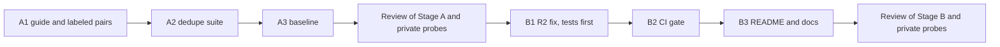

# Scratchpad & Notes

## Plan (2026-10-26, Claude)

Source: Step 3.5 in `tasks/active/step-3-measurable-claims/notes.md`.

### What a case is

One case is a pair of listings, A and B, with a label `same` or `different`. The suite decides "merged" when `JobListingCollection(listings=[A, B]).deduplicate()` returns one listing. Then:

- precision: merged pairs that are `same`, of all merged pairs;
- recall: merged pairs, of all `same` pairs;
- false-merge rate: merged pairs, of all `different` pairs.

A false merge hides a real job from the user, so it costs more than a missed duplicate, which the user sees twice. Decision 2 below makes this the rule for the fix.

### Classes in the set (at least 30 pairs)

| Class | Label | Example of what differs between A and B |
|-------|-------|------------------------------------------|
| C1 cross-source copy | same | Source and `job_id` prefix; URL; company suffix ("Pte. Ltd." and "Pte Ltd"); title case; location format ("Singapore" and "Central, Singapore"); description shortened or with HTML |
| C2 repost, same URL | same | `job_id` only |
| C3 URL variant | same | Trailing slash, letter case, tracking parameters (`utm_*`), or a fragment |
| C4 repost, new URL | same | `job_id` and URL; the text stays the same |
| H1 same title and company, other location | different | Location |
| H2 same title, company, and location, other role | different | The description shows another level, team, or contract |
| H3 shared generic URL | different | Two jobs with one careers-page or aggregator URL |
| H4 same title, other company | different | Company (for example an agency and its client) |
| H5 placeholder labels | different | Company or title is "Confidential", "Unknown", or empty |

Each class gets at least 3 pairs, and the `same` and `different` labels are about half each. The source fixtures have only about 8 public listings (`tests/fixtures/careersatgov/`, `jobstreet/`, `mycareersfuture/`), so most pairs are constructed. The constructed text follows the lesson "Name the author of constructed text": each listing reads as the employer's or the board's posting, and nothing in a listing states its label.

## Observations (2026-10-26, Claude, code at `4689a31`)

- **`deduplicate` (`src/models/job_listing.py:397-416`)** keeps the first listing for each `job_id`. Scrapers prefix the ID with the source (`js-` in `jobstreet_scraper.py:267`, `mcf-` in `mycareersfuture_scraper.py:366`), so a job from two sources is never merged.
- **Shared normalizers exist.** `normalize_match_url` (`src/metrics/outcome_tracker.py:215`) lowercases an http(s) URL and removes a trailing slash; it keeps the query string and the fragment. `normalize_match_label` (`:241`) lowercases and collapses whitespace. `_PLACEHOLDER_LABELS` (`:171`) lists the labels that must not match.
- **`AppliedGuard` and `find_matching_application` (`outcome_tracker.py:1100`)** match on the ID, then the URL, then company and title, but the company-and-title rule applies only when one side has no URL: "two different listing URLs at the same company stay separate". A cross-source copy (C1) has two different URLs, so this rule alone does not merge it. The baseline set decides what B1 does here (decision 2).
- **The local catalog (`data/listings/catalog.json`, gitignored)** has 183 listings: 103 from MyCareersFuture, 60 from LinkedIn, and 20 from JSearch. 13 groups share company and title:
    - 1 group is cross-source (JSearch and LinkedIn), with different URLs and different location strings;
    - 12 groups are from one source, all with the same location; 7 of them also share the URL with a different `job_id`, and 5 have different URLs.

    So in real runs, a repost or a changed ID with the same URL is more common than a cross-source copy. The catalog rows have recruiter fields, so only counts from it go into this file.

## Decisions (2026-10-26)

The user accepted the plan and decisions 1 to 5 as written, including the optional real check (decision 3).

1. **What "same" means (the labeling rule).** Two listings are `same` when one application covers both: the same employer, the same role, and the same place of work. A repost with a new ID or a new URL is `same`. Two listings with the same title, company, and location are `different` only when the text shows another role (level, team, or contract type).
2. **Precision first (the rule for B1).** After B1, no hard negative (H1 to H5) in the committed set may merge. Recall is what the rules give under that limit. B1 may merge two listings with different URLs only on normalized company, title, and location together, and never on placeholder labels.
3. **Real check (local only).** The user labels the pairs of the 13 catalog groups `same` or `different`. The groups give 20 pairs (11 groups of 2, one of 3, and one of 4), about 5 to 10 minutes of labeling.
    - A script writes the pairs to `apps/backend-py/data/dedupe_catalog/cases.jsonl` (ignored by git through `data/`), in the format of the committed set, with the label `TODO` and without the recruiter fields and `raw_html`.
    - The suite runs on it with `--dataset data/dedupe_catalog`; it refuses a `TODO` label.
    - Claude runs the local baseline in the Stage A review, after the user labels. Stage B reports the same measure after the fix.
    - Nothing from the catalog is committed.
4. **Scope.** `deduplicate` keeps the first listing, as today. It does not merge fields from the other listing. The catalog file, which is keyed by `job_id`, is not changed. Stage metadata reports how many listings each rule merged.
5. **Stop rule.** One Stage B round, plus at most one fix round after its review. What then stays wrong goes to the known limits in the README.

## Review of Stage A (2026-10-26, Claude)

Commits: A1 `4c39c7a`, A2 `08b216c`, A2c `6bf5f21`, results `2bf2418`. Cursor's results are at the end of `handoff-stage-a.md`.

**Verdict.** Accept the Stage A code: the suite, the script, and the baseline are correct. But do not start Stage B as planned. Two results change it:

- The committed set separates its labels on the description (finding 1).
- The user labeled all 20 catalog pairs `different`, so every merge rule beyond `job_id` contradicts the user's labels (finding 2).

Recommendation 1 below proposes "flag and keep" for Stage B. This needs the user's decision.

### What I checked and found correct

- **Commits.** Four commits, each with only the files of its step, all LF. `deduplicate`, the normalizers in `outcome_tracker.py`, `AppliedGuard`, the pipeline stages, and the scrapers did not change. `test_scam_suite.py` changed one line, for the new suite name.
- **The set.** 31 pairs: 16 `same` (C0 2, C1 4, C2 3, C3 4, C4 3) and 15 `different` (3 for each H class). The labels follow decision 1. C1 covers a company suffix, title case, a location format, and a shortened description. C3 covers a trailing slash, letter case, a `utm_` parameter, and a fragment. H2 and H3 are as specified. 26 companies, none in more than 2 cases.
- **The script.** It keeps an allowlist of 8 fields, so no recruiter field and no `raw_html` reach the output. It refuses to overwrite a labeled file. The real run wrote 13 groups and 20 pairs.
- **The suite.** It runs both orders, refuses `TODO`, and reports the Wilson bounds. My reproduction of the baseline gives the same per-pair rows, metrics, per-class counts, and dataset SHA-256 as Cursor's report.
- **Mutations (mine).** Each file was restored and its checksum matched.

    | Mutation | Result |
    |----------|--------|
    | The reversed order runs `[a, b]` again | Caught (`test_order_dependent_count_uses_both_orders`) |
    | The H-class label check in `DedupeCase` is removed | **Not caught** |
    | The `case_id` prefix check in `DedupeCase` is removed | **Not caught** |
    | The script keeps `recruiter_email` | Caught (`test_pair_count_and_no_recruiter_fields`) |
    | The script overwrite guard is off | Caught (`test_does_not_overwrite_a_labeled_file`) |

### Measures

| Set | Pairs | Merged by the baseline (`job_id` only) |
|-----|------:|----------------------------------------|
| Committed (A3, report `20261026T031746532576Z`) | 31 | 2 (the two C0 pairs): precision 2 of 2, recall 2 of 16, false merges 0 of 15 |
| Catalog, the user's labels (local, report `20261026T043641282321Z`, MLflow `7d20d361…`) | 20 | 0: false merges 0 of 20 (all labels are `different`) |
| Private probe set P-dedupe (7 `same`, 7 `different`; outside the repository) | 14 | 0 |

The catalog report records `git_dirty` true, because of the 14 CRLF rewrites; it is a local measure only.

**Candidate rules for Stage B, scored on the three sets** (counted with a scratch script; `url_clean` removes `utm_*`, `trk`, `ref`, `refId`, and the fragment, and keeps the other query parameters):

| Rule | Committed: same merged / false merges | Catalog: false merges (of 20) | Probes: same merged / false merges |
|------|--------------------------------------|-------------------------------|------------------------------------|
| `job_id` (today) | 2 of 16 / 0 of 15 | 0 | 0 of 7 / 0 of 7 |
| `job_id` or URL | 7 / 3 | 8 | 0 / 1 |
| `job_id` or cleaned URL | 9 / 3 | 8 | 2 / 1 |
| `job_id` or company, title, and location | 14 / 3 | 18 | 2 / 2 |
| `job_id` or the same description | 15 / 0 | 12 | 3 / 3 |
| `job_id`, cleaned URL, or company-title-location with the same description | 13 / 3 | 12 | 2 / 1 |

### Findings

1. **The committed set separates its labels on the description (major).** Every `same` pair has the same (or a contained) description, and every `different` pair has a different one. "Merge on the same description" scores 15 of 16 with 0 false merges on the committed set, but 3 of 7 with 3 false merges on the probes, where one employer uses one text for two sites, two titles, or two companies. This is the same kind of limit as the "!" in the Step 3.3 written scams. **Rule:** do not tune or judge a description signal on this set.
2. **The user's catalog labels contradict every merge rule (decision needed).** The user labeled all 20 pairs `different`, also when two listings are at the same company. The reason the user gave: they apply to each listing, so that no application goes missing. This is a product choice: keep both listings. It is not the question of decision 1 (is it one opening?): 8 of the 20 pairs share one URL. Every rule beyond `job_id` merges 8 to 18 of these pairs.
3. **Every URL rule merges the shared-URL hard negatives.** The H3 pairs (a careers home page, an aggregator page, a government portal) and one probe pair (one careers page for two countries) share a URL but are different jobs.
4. **The F1 interval is wrong (minor).** `f1.ci95_low` and `f1.ci95_high` are the recall interval (`dedupe.py:283`). F1 has no binomial interval; report none.
5. **The `DedupeCase` checks are not tested (minor).** No unit test sends a bad case to the model (mutations 2 and 3). The dataset tests check the committed file themselves, but the catalog and probe files rely on the model.
6. **Class C4 (minor).** Two of the three C4 pairs are cross-source copies with no change in the text (C1 without a format change). Only `c4__shoreline_cook` is a same-source repost with a new URL.
7. **"Confidential" is not a placeholder (note for Stage B).** `_PLACEHOLDER_LABELS` (`outcome_tracker.py:171`) has no "confidential", so a company-title rule would match two agency postings under "Confidential".

### Recommendations

1. **Stage B: flag and keep, not merge (needs the user's decision).** It is the same result as Step 3.3, and it follows the user's labels:
    - `deduplicate` keeps the `job_id` merge (the same record twice, for example from two search queries).
    - A flag step marks possible duplicates on each listing (the other `job_id` and the reason, such as "same cleaned URL" or "same company, title, and location") and keeps every listing.
    - The suite measures the flag instead of the merge, on the committed set and on the probes. On the catalog, the check becomes "no listing is removed" (all 20 pairs stay).
    - Showing the flag in the UI goes to the backlog, next to the scam flag display.
    - The flag rule uses no description signal (finding 1).
2. **Fix findings 4 and 5 in Stage B**, and add "confidential" to the placeholders only if the flag rule uses company and title (finding 7).
3. **Keep the set** with its limits: the description leak (finding 1) and the C4 assignment (finding 6). Do not rewrite it.

## Blockers / Questions

- The user's decision on recommendation 1 (flag and keep, or merge as planned) before the Stage B handoff.
