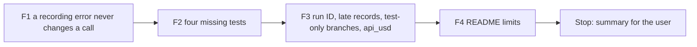

# Handoff: Step 3.6 Fix Round (2026-10-27)

Read this file first. Then read, in this order:

1. `tasks/index.md` (the task system).
2. `tasks/todo.md`.
3. `task.md` and `notes.md` in this folder. In `notes.md`, read these sections:
    - "Decisions (2026-10-27)", decisions 8 and 9;
    - "Review of the Step 3.6 Round", all of it (findings 1 to 7 and the mutation table).
4. `handoff.md` in this folder: "3. Traps" and "Cursor results". You did that work.
5. `CLAUDE.md`.
6. These sections of `docs/lessons.md`:
    - "Prove that a mutation was applied with a fixed-string check, not the regex that applied it";
    - "Before you call a mutation "not caught", prove that it changes behaviour".

Do not read `tasks/archive/`.

This is the last round (decision 8). After it, Claude checks the fixes. Then the user does one full-mode dry run, and Claude closes Step 3.6.

## 1. Status

| Item | State |
|------|-------|
| `main` | Ahead of `origin/main` (not pushed). Do not push. |
| Scope | Findings 1 to 7 of the review. Do not change routing, the response cache, the prices, or the page layout. |
| Ollama | Not needed for any test. Do not run the pipeline; the user does the real run after this round. |
| This handoff | F1 to F4, then the results section. **Stop after F4.** There is no further round. |

## 2. The task



**The rules that matter most:**

- **Finding 1 first, with its test before the code.** Show that the new test fails before the fix.
- **Recording never changes a call.** After F1, no error in recording, pricing, or cost calculation can mark a good call as failed, start the fallback, or raise from `generate` or `generate_async`.
- **No test writes to `data/` or to `data/mlflow.db`.** This stays true after F3 removes the test-only branches.

There are four commits (F1 to F4), then the results section of this file. Before each commit, run all the checks in section 5 that apply to the files of that part.

### F1. A recording error never changes a call (finding 1)

Today `_record_attempt` (`src/llm/router.py:668`) calls `get_model_price` (`:720`) and `calculate_usage_cost` outside `_safe_record`. The primary call records inside its `try` block (`:801` and `:929`), so an error there goes to `except Exception` (`:820` and `:948`): the router records an error, calls the fallback, and returns the fallback answer.

- **Tests first** in `tests/unit/test_cost_recording.py`, with fake clients (the review used a route with an Anthropic primary and an Ollama fallback):
    - a price lookup that raises does not change the result of `generate`: the answer comes from the primary, the fallback client is not called, and no error record is written for the primary;
    - the same for `generate_async`;
    - with no fallback set, a price lookup that raises does not make `generate` raise;
    - a catalog model with no `cost_per_input` or `cost_per_output` gives a record with `cost_usd` `None`, and the call result is the primary answer.
- **The fix:**
    - `_record_attempt` must never raise. Put all of its work (the price lookup, the cost calculation, and the record) inside one `try` and `except` that logs a warning. One wrapper is enough; do not add a second one around each call site.
    - `get_model_price` returns `None` for a catalog row without `cost_per_input` or `cost_per_output`, and logs a warning (`src/metrics/cost_tracker.py:108-109`). Test it in `tests/unit/test_model_pricing.py`.
- **Mutation proofs:** (1) the `try` in `_record_attempt` is removed; (2) `get_model_price` reads `model_cfg["cost_per_input"]` again without a check. Each must make a new test fail.

Commit F1: `fix(llm): keep a recording error from changing a router call`.

### F2. Four missing tests (finding 2)

Add one test for each mutation that the review did not catch. Each test must fail under its mutation. The fixed strings of the review:

| Mutation | File | Old string | New string |
|----------|------|------------|------------|
| K7 | `src/pipeline/orchestrator.py` | `get_cost_tracker().close_run(run_id)` | `pass` |
| K9 | `src/metrics/cost_tracker.py` | `self._totals["cost_unknown"] += 1` | `pass` |
| K10 | `src/api/routes/metrics.py` | `pipeline_runs=len(list_cost_run_files()),` | `pipeline_runs=process["calls"],` |
| K11 | `src/metrics/cost_tracker.py` | `key=lambda p: p.stat().st_mtime, reverse=True` | `reverse=True` |

The tests:

- **K7:** after `PipelineOrchestrator.run`, the tracker holds no records for that run ID (`close_run` frees them).
- **K9:** when one call has no price, the process totals report the cost as `None`, and `/metrics/summary` reports it as `null`.
- **K10:** `pipeline_runs` on `/metrics/costs` and `/metrics/summary` is the number of run files, not the call count. Use a temporary folder with 2 run files and 3 recorded calls.
- **K11:** the last run is the newest file by time. Write two run files whose names sort the other way (for example `cost_run_b...` written first and `cost_run_a...` written second), and check that the last run is the second file. Set the two modification times with `os.utime`, because two quick writes can get the same time.

Put each test next to the code that it guards (`test_cost_run_scope.py`, `test_cost_recording.py`, and `test_metrics_api.py`).

- **Mutation proofs:** run K7, K9, K10, and K11 from the review table again. Each must now fail a named test.

Commit F2: `test(metrics): cover run cleanup, unknown totals, run count, and the last run`.

### F3. Run ID, late records, test-only branches, and `api_usd` (findings 3 to 6)

- **Finding 3, the run ID.** When no run ID is given, `run` and `run_with_agents` (`src/pipeline/orchestrator.py:306` and `:518`) use `str(uuid.uuid4())`. Test: two runs without a run ID get two different IDs and two run files, also in the same second.
- **Finding 4, late records.** `record_call` (`src/metrics/cost_tracker.py:414`) adds a record to a run bucket only while that run is open (between `open_run` and `close_run`). A late record still goes to the recent calls and the process totals. Test: a record with the run ID after `close_run` does not make a new bucket.
- **Finding 5, test-only branches.** Remove both `PYTEST_CURRENT_TEST` checks from `write_cost_run_summary` (`src/metrics/cost_tracker.py:681` and `:718`).
    - Add an autouse fixture in `tests/conftest.py` that points the default metrics folder (`_default_metrics_dir`) to a temporary folder and replaces the default MLflow logging with a fake. Many tests call `orchestrator.run` with no cost arguments, and the fixture must keep all of them out of `data/` and MLflow.
    - The tests that pass a fake tracker factory on purpose (`test_cost_run_scope.py`) must still reach `log_cost_run_to_mlflow` with that factory.
    - Add a test for the default path: `write_cost_run_summary` with no folder and no factory writes the file to the default folder (the temporary folder from the fixture) and calls the default MLflow logging one time.
    - Proof: after the full test run, `data/metrics/` and `data/mlflow.db` are unchanged (compare the file list and the modification times before and after, and record both in the summary).
- **Finding 6, `api_usd`.** `api_costs_usd` (`src/api/routes/metrics.py:137`, `src/api/models/responses.py:162`) and `api_usd` (`metrics.py:205`) are always `None`, and the frontend does not read them. Compute them as the cost of the calls that are not Ollama calls (`None` when one of those calls has no price), with a test. Do not remove them; an API client can read them.

Commit F3: `fix(metrics): UUID run IDs, open-run buckets only, no test-only branches`.

### F4. README limits (finding 7)

In `README.md`, "Cost and usage tracking", add two items to "Limits":

- In a pipeline run, only resume generation (full mode) calls the LLM, so a discover-mode run records 0 calls. Cover letters and the profile pages also call the LLM, outside a pipeline run.
- The totals since the backend started go back to 0 when the backend starts again. The last run comes from its file in `data/metrics/`.

Write in ASD-STE100, with no emojis. Do not link to `tasks/`.

Commit F4: `docs: add two cost-tracking limits`.

## 3. Traps

- **Do not change routing or the response cache.** F1 changes only what happens when recording fails.
- **One wrapper.** Do not hide errors from the client call itself. A failed client call must still give an error record and the fallback, as today.
- **Module state in tests.** Each test starts from an empty tracker and an empty price cache (`reset_cost_tracker`, `reset_price_config_cache`).
- **The autouse fixture is global.** Check that it does not break a test that reads `_default_metrics_dir` on purpose, and that the full suite still passes.
- **No real data and no secrets.** Never open `.env`, `.env.local`, or `apps/backend-py/data/settings/user_settings.json`. Do not run the pipeline.
- **Startup time.** The full backend suite takes 3 to 8 minutes. Run long commands in the background. `pytest.ini` has `--maxfail=5`.
- **Line endings and scratch files.**
    - The IDE keeps rewriting 14 cover-letter, profile, and frontend files with CRLF (no content change). Do not commit them.
    - Check `git ls-files --eol` before each commit, and stage only the files of that part.
    - Put scratch files and commit messages outside the repository, and use `git commit -F <file>`.

## 4. Summary to leave for the user

At the end of this file, add "Cursor results (date)" with:

- The commits (hash and subject).
- For each finding (1 to 7): what changed, the test names, and, for F1, the failure output of the new tests before the code.
- The mutation results: for each one, the fixed string, the checksum before and after, the failing test, and the restore check. At least the two F1 mutations and K7, K9, K10, and K11.
- The F3 proof that `data/metrics/` and `data/mlflow.db` did not change during the full test run.
- Anything that you think is wrong in this plan.
- Every check that you ran and its result. Say clearly what you did not run. The real pipeline run must be in the "not run" list (the user does it after this round).

## 5. Checks

Backend (WSL, from `apps/backend-py`):

Check formatting (the CI paths plus the catalog script):

```bash
.venv/bin/python -m black --check main.py scripts/mypy_gate.py scripts/prepare_dedupe_catalog_pairs.py src/ tests/
```

Run the linter (the CI paths plus the catalog script):

```bash
.venv/bin/python -m ruff check main.py scripts/mypy_gate.py scripts/prepare_dedupe_catalog_pairs.py src/ tests/
```

Run the mypy baseline gate:

```bash
.venv/bin/python scripts/mypy_gate.py
```

Run the tests:

```bash
.venv/bin/python -m pytest tests/ -q
```

This round changes no frontend file, so the frontend checks are not needed. If F3 changes a response field that the frontend reads, stop and say so in the summary.

## 6. Rules (unchanged)

- Follow `CLAUDE.md`:
    - docstrings with description, arguments, and returns;
    - type hints;
    - ASD-STE100 for documentation;
    - no emojis;
    - a Mermaid diagram in documentation.
- Before each commit, run `git status --short` and stage only the files of that part.
- Never run `scripts/mypy_gate.py --update` to accept a new error.
- Keep dry run as the default. Do not make auto-submit reachable.
- Do not push. Push only from WSL, and only after the user approves.
