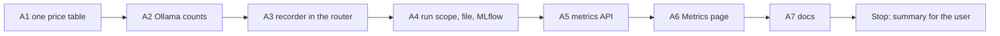

# Handoff: Step 3.6, Real Cost and Usage Tracking (2026-10-27)

Read this file first. Then read, in this order:

1. `tasks/index.md` (the task system).
2. `tasks/todo.md`.
3. `task.md` and `notes.md` in this folder: all of `notes.md` (the plan, the call record, observations 1 to 11, decisions 1 to 8, and the price check).
4. `CLAUDE.md`.
5. These sections of `docs/lessons.md`:
    - "Prove that a mutation was applied with a fixed-string check, not the regex that applied it";
    - "A safety limit needs a test that checks the limit itself";
    - "Before you call a mutation "not caught", prove that it changes behaviour".
6. The code to follow for MLflow: `log_report_to_mlflow` in `apps/backend-py/src/evaluation/report.py:114` (reachability check, fail open, SQLite default store).

Do not read `tasks/archive/`.

Claude reviews this round with mutation proofs, the local gate, and one real pipeline run with Ollama.

## 1. Status

| Item | State |
|------|-------|
| `main` | Ahead of `origin/main` (not pushed). Do not push. |
| Decisions | 1 to 8 in `notes.md` are accepted. The prices in "Price check" are checked on the official pages (2026-10-27). Use them as written. |
| Ollama | Not needed for any test. Every test uses a fake client or a fake HTTP response. |
| This handoff | A1 to A7. **Stop after A7.** One round; the review can ask for one fix round. |

## 2. The task



**The rules that matter most:**

- **Recording never breaks a call.** Wrap each record in `try` and `except`, log a warning, and return the call result. A test proves this: a tracker that raises does not change the router result.
- **No text in a record.** A call record has counts, names, flags, and times only. No prompt, no response, no profile data.
- **One tracker for the process.** Every `LLMRouter` instance writes to the same tracker (observation 3). Do not give each router its own tracker.
- **Runs do not mix.** Two pipeline runs at the same time keep their calls apart (observation 8). Do not clear a shared list at the start of a run.
- **Tests first** for A3 and A4. Show that the new tests fail before the code.

There are seven commits (A1 to A7), then the results section of this file. Before each commit, run all the checks in section 5 that apply to the files of that part.

### A1. One price table (decision 1, the price check)

- `config/model_config.yaml` is the only price table. For each cloud provider, add `price_source` (the URL) and `price_checked` (`2026-10-27`). Set the prices from the table in `notes.md` "Price check":
    - `claude-opus-4-7`: 5.0 and 25.0. `claude-haiku-4-5-20251001`: 1.0 and 5.0. `claude-sonnet-4-6` stays 3.0 and 15.0.
    - `gemini-2.5-flash`: 0.30 and 2.50. `gemini-2.5-pro`: 1.25 and 10.0, and add the tier for a prompt of more than 200,000 tokens: 2.50 and 15.0.
    - Under `anthropic`, add the prompt cache multipliers from the same page: a cache write is 1.25 times the input price, and a cache read is 0.1 times the input price.
- Remove `gemini-2.0-flash` from the YAML catalog, from the Gemini client model list (`gemini_client.py:46` and `:65`), and from `tests/unit/test_gemini_client.py`. It is past its shutdown date. Do not add another model.
- One price function, for example `get_model_price(provider, model)` in `src/metrics/cost_tracker.py`, reads the YAML through the existing config loader. `ollama` always has cost 0. A cloud model that is not in the table returns `None`.
- Remove the Python tables `MODEL_PRICING` in `cost_tracker.py:81`, `claude_client.py:32`, and `gemini_client.py:35`. The clients' `estimate_cost` uses the price function. Keep the client context sizes where they are used (move them, do not lose them).
- `ModelProvider` gets `GEMINI`. A call is recorded with the provider that served it, never with a guessed provider.
- **Missing usage counts:**
    - The Claude client also reads `cache_creation_input_tokens` and `cache_read_input_tokens` when they are present, and the cost uses the multipliers.
    - The Gemini client counts `thoughts_token_count` in the completion tokens when it is present (Google bills it as output).
    - Add the fields that the clients need to `LLMResponse` (`src/llm/base.py:39`), for example `cache_read_tokens`, `cache_write_tokens`, and `tokens_estimated` (default `False`).
- Tests: each price from the YAML; the 200k tier; the cache multipliers; an unknown cloud model gives `None`; an Ollama model gives 0; the thinking tokens count as output.

Commit A1: `fix(llm): one dated price table and complete cloud usage counts`.

### A2. Ollama token counts (observation 6)

- In `ollama_client.py:242-244`, use `prompt_eval_count` and `eval_count` from the `/api/chat` response. When a value is missing, use the length estimate (characters / 4) for that value and set `tokens_estimated` to `True`.
- Remove the `/api/tokenize` request from the generation path. `count_tokens` can keep it for other callers, but no generation call may make an extra HTTP request for each message.
- Tests with a fake HTTP response: the counts from the response; the estimate and the flag when the counts are missing; the number of HTTP requests for one generation call is 1.

Commit A2: `fix(llm): read Ollama token counts from the chat response`.

### A3. The recorder in the router (decisions 2, 3, 5, and 7)

Write the tests first in `tests/unit/test_cost_recording.py`, with fake clients. Show that they fail.

- **The tracker:** a process-wide, thread-safe tracker in `src/metrics/cost_tracker.py`, for example `get_cost_tracker()`. It keeps:
    - the last 1000 call records (decision 5);
    - totals since the process started (calls, prompt, completion, and total tokens, estimated counts, cache hits, fallbacks, errors, and cost);
    - the records of each open run, until that run's summary is written (A4). A run summary counts every call of the run, also when the run has more than 1000 calls.
- **The call record** has the fields in `notes.md` "What a call record holds". `task_type` is the router task type value as a string (decision 7). `cost_usd` comes from the A1 price function, and it is `None` when the price is unknown.
- **The router** (`router.py:647` and `:746`) records:
    - a cache hit: `cache_hit` true, 0 tokens, cost 0 (decision 2);
    - a primary success;
    - a primary failure: `error` true, 0 tokens (decision 3), then the fallback call, if one is set;
    - a fallback success: `fallback` true, with the provider and the model that served it;
    - a fallback failure: `error` true.
- The router measures `latency_ms` around the client call, so that it is the same for every provider.
- `CostTracker.start_run` must not clear the shared records. Change it or remove it.
- The 6-value `TaskType` in `cost_tracker.py` stays only if `get_cost_estimate` keeps a caller (decision 7). Search first, and say in the summary what you did.
- Tests:
    - one primary call is recorded one time, with its tokens, provider, model, and cost;
    - a cache hit is recorded as a cache hit with 0 tokens;
    - a primary failure and a fallback success give two records (one error, one fallback);
    - two router instances write to the same tracker;
    - `generate_async` records the same as `generate`;
    - a tracker that raises does not change the router result;
    - a record has no prompt or response text;
    - the recent-call limit is 1000, and the totals still count every call.

Commit A3: `feat(metrics): record every router call in one process-wide tracker`.

### A4. Run scope, run file, and MLflow (decisions 5 and 6)

Write the tests first. Show that they fail.

- **Run scope:** a context manager, for example `cost_run_scope(run_id)`, that sets the run ID in a `contextvars.ContextVar`. The tracker reads it for each record. `asyncio.to_thread` copies context variables, so the calls in the API worker thread get the run ID (observation 8).
- **The orchestrator:** `PipelineOrchestrator.run` and `run_with_agents` get an optional `run_id` argument. The API passes its pipeline run ID (`src/api/routes/pipeline.py:165`). The CLI (`main.py:303` and `:398`) gets a generated ID. The stage loop runs inside the run scope. A cancelled run and a failed run also write their summary.
- **At the end of each run:**
    - write `data/metrics/cost_run_<run_id>.json` (the existing `_save_run_summary` format, with the new fields: tokens by type, estimated counts, cache hits, fallbacks, errors, and the calls of the run);
    - put a short cost summary in `PipelineResult.metadata["cost"]`;
    - log the summary to MLflow: one MLflow run in the experiment `pipeline-runs`, in the same way as `log_report_to_mlflow` (reachability check, the SQLite default store). Metrics: calls, prompt, completion, and total tokens, estimated share, cache hit rate, fallback count, error count, and cost (skip a metric whose value is `None`). Tags: the run ID, the mode, and the git SHA.
    - **Fail open:** an MLflow error or a file error is logged. The pipeline result does not change.
- Tests:
    - the calls inside a scope carry its run ID, and a call outside every scope has none;
    - two scopes in two threads at the same time keep their calls apart;
    - a run file is written with the run's calls only;
    - a cancelled run writes its file;
    - MLflow is called one time with the expected metrics (use a fake tracker factory), and an MLflow error does not change the pipeline result.

Commit A4: `feat(pipeline): write a cost summary for each run to a file and MLflow`.

### A5. Metrics API (observation 2)

- `src/api/routes/metrics.py` uses the shared tracker (remove the local `CostTracker()` at line 24) and the last saved run file (observation 9: a CLI run is another process).
- `/metrics/costs` and `/metrics/summary` report, for the process since it started and for the last run:
    - calls, prompt tokens, completion tokens, total tokens, and the number of calls with estimated counts;
    - cache hits, fallbacks, errors, and cost (`None` when a call had no price; say "unknown", not 0);
    - the local share of calls.
- `pipeline_runs` is the number of saved run files, not the call count.
- `cost_per_application`: compute it from data (cost of the last run divided by the jobs that got a document in it) or remove it. Say in the summary which one, and why.
- `recent_calls` gets the token counts, `tokens_estimated`, `cache_hit`, `fallback`, and `error`.
- Change the response models in `src/api/models/responses.py` and the tests in `tests/unit/test_metrics_api.py`. Keep the existing keys that the frontend reads, or change the frontend in A6 in the same way.

Commit A5: `feat(api): report real tokens and the last run on the metrics routes`.

### A6. Metrics page

- `apps/frontend-ts/src/app/metrics/page.tsx`: show the total tokens (prompt and completion), the share of estimated counts, and the last run (run ID, time, calls, tokens). The recent-calls table gets a tokens column, and it marks cache hits, fallbacks, and errors.
- Change the types (`src/lib/types/api.ts:664`), the E2E mock (`tests/e2e/support/mock-api.ts:143`), and add or change a unit test for the page under `tests/app/metrics/`.
- Show an unknown cost as "unknown", not as $0.00.
- Keep the page layout and style. Do not add a new chart.

Commit A6: `feat(frontend): show real token counts on the Metrics page`.

### A7. Docs

- `README.md`: one short section or a few sentences on what is recorded (each router call: tokens, latency, cache hit, fallback, error, cost), where to see it (the Metrics page, `data/metrics/cost_run_<id>.json`, and the MLflow experiment `pipeline-runs`), and the limits:
    - embeddings are not recorded (decision 4);
    - Ollama counts come from Ollama, and the page marks the counts that are estimates;
    - cloud prices are from the official pages on 2026-10-27 and can change.
- `README.md:42` and the same sentence in `docs/index.md:68` and `docs/architecture.md:261`: keep "no per-token API cost" only for the default local routes, and say that the Metrics page shows the recorded cost.
- Do not add a cost number. The review run gives the first real numbers.
- A Mermaid diagram of the recording flow in the README section (you can use the one in `notes.md`).
- Write in ASD-STE100, with no emojis. Do not link to `tasks/`.

Commit A7: `docs: state what the cost tracker records and its limits`.

## 3. Traps

- **Do not change routing.** Which provider and model serve a task stays the same. This step records calls; it does not change them.
- **The response cache stays the same.** `CACHEABLE_TASK_TYPES` and the cache keys do not change. A cache hit is only recorded.
- **The router `stats` counters** (`router.py:905`) can stay. Do not remove a key that a route or a test reads.
- **Module state in tests.** The tracker is process-wide, so each test must start from an empty tracker (a fixture that resets it). Do not let one test see the calls of another test.
- **Paths.** `CostTracker(storage_dir="data/metrics")` is relative to the working directory. Make the run file path absolute under `apps/backend-py/data/metrics/`, in the same way as the other data paths, and use a temporary folder in tests.
- **MLflow in tests.** No test may write to `data/mlflow.db`. Use a fake tracker factory.
- **No real data and no secrets.** Never open `.env`, `.env.local`, or `apps/backend-py/data/settings/user_settings.json`. Do not run the pipeline against the real profile.
- **Startup time.** `main.py` takes about 100 s to start on `/mnt/d`, and the full backend suite takes 3 to 8 minutes. Run long commands in the background. `pytest.ini` has `--maxfail=5`.
- **Line endings and scratch files.**
    - The IDE keeps rewriting 14 cover-letter, profile, and frontend files with CRLF (no content change). Do not commit them.
    - Check `git ls-files --eol` before each commit, and stage only the files of that part.
    - Put scratch files and commit messages outside the repository, and use `git commit -F <file>`.

## 4. Summary to leave for the user

At the end of this file, add "Cursor results (date)" with:

- The commits (hash and subject).
- For each part (A1 to A7): what changed, the files, and the test names. For A3 and A4, the failure output of the new tests before the code.
- A1: the price table as it is now, and every place that read the old tables.
- What you did with `start_run`, the 6-value `TaskType`, and `cost_per_application`, and why.
- Mutation proofs, each a fixed-string replacement with the checksum before and after, the count of the new string, the failing test, and a restore that matches the backup. At least these:
    1. the router does not record a cache hit;
    2. the router does not record a failed primary;
    3. the tracker clears the shared records at the start of a run;
    4. the run ID is not read from the context variable;
    5. an unknown cloud model gets cost 0;
    6. the Ollama client ignores `eval_count`;
    7. a recording error is not caught.
- Anything that you think is wrong in this plan.
- Every check that you ran and its result. Say clearly what you did not run. A real pipeline run with Ollama must be in the "not run" list (Claude does it in the review).

## 5. Checks

Backend (WSL, from `apps/backend-py`):

Check formatting (the CI paths plus the catalog script):

```bash
.venv/bin/python -m black --check main.py scripts/mypy_gate.py scripts/prepare_dedupe_catalog_pairs.py src/ tests/
```

Run the linter (the CI paths plus the catalog script):

```bash
.venv/bin/python -m ruff check main.py scripts/mypy_gate.py scripts/prepare_dedupe_catalog_pairs.py src/ tests/
```

Run the mypy baseline gate:

```bash
.venv/bin/python scripts/mypy_gate.py
```

Run the tests:

```bash
.venv/bin/python -m pytest tests/ -q
```

Frontend (WSL, from `apps/frontend-ts`, for A5 and A6). Use Node 24 (`.nvmrc`); the WSL default can still be Node 20.

Select Node 24:

```bash
nvm use 24
```

Run the linter:

```bash
npm run lint
```

Check the types:

```bash
npm run type-check
```

Run the unit tests:

```bash
npx vitest run
```

Check the formatting of the files that you changed (the whole tree has pre-existing CRLF files):

```bash
npx prettier --check src/app/metrics/page.tsx src/lib/types/api.ts tests/e2e/support/mock-api.ts
```

Run the E2E tests (if Playwright does not start in WSL, say so in the summary; CI runs them):

```bash
npm run test:e2e
```

## 6. Rules (unchanged)

- Follow `CLAUDE.md`:
    - docstrings with description, arguments, and returns;
    - type hints;
    - ASD-STE100 for documentation;
    - no emojis;
    - a Mermaid diagram in documentation.
- Before each commit, run `git status --short` and stage only the files of that part.
- Never run `scripts/mypy_gate.py --update` to accept a new error.
- Keep dry run as the default. Do not make auto-submit reachable.
- Do not push. Push only from WSL, and only after the user approves.
