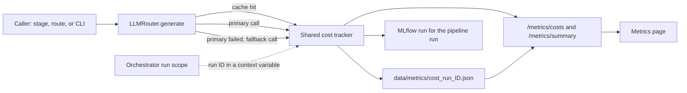

# Notes: Step 3.6, Real Cost and Usage Tracking

## Plan (2026-10-27, Claude)

### What a call record holds

| Field | Meaning |
|-------|---------|
| `timestamp` | When the call ended |
| `run_id` | The pipeline run ID, or empty for a call outside a run (for example a cover letter from its page) |
| `task_type` | The router task type value (`jd_extraction`, `cover_letter_writing`, ...) |
| `provider`, `model` | What served the call |
| `prompt_tokens`, `completion_tokens`, `total_tokens` | Token counts |
| `tokens_estimated` | True when the counts are a length estimate and not from the provider |
| `latency_ms` | Call time |
| `cache_hit` | True for a response cache hit (0 tokens, cost 0) |
| `fallback` | True when the primary failed and the fallback served the call |
| `error` | True for a failed attempt (0 tokens) |
| `cost_usd` | Cost from the price table; `None` when the model has no price |

No prompt text and no response text.

### Measure first

Today nothing is recorded, so the baseline is 0 records. The review checks the new numbers on one real run: the token counts from Ollama, the calls per stage, and the share of estimated counts.

## Observations (2026-10-27, Claude, code at `f629528`)

1. **No caller.** `CostTracker.track_call` (`src/metrics/cost_tracker.py:200`) has no caller outside the tests. `MLflowTracker.log_cost_summary` (`src/metrics/mlflow_tracker.py:222`) has no caller, and the pipeline does not use `MLflowTracker` at all.
2. **The Metrics page reads an empty tracker.** `src/api/routes/metrics.py:24` makes its own `CostTracker()`, and nothing writes to it. So the page always shows 0 calls. `/metrics/costs` returns the call count as `pipeline_runs` (line 48). `cost_per_application` is the constant 0.0 (`cost_tracker.py:340`).
3. **Many routers.** `create_router` or `LLMRouter(` is called 22 times in 12 files. Each caller has its own router. So the recorder must be one tracker for the process, not one tracker for each router. The router also has its own counters (`stats`, `router.py:905`), with a `_total_cost`.
4. **One path for generation.** Every generation call goes through `LLMRouter.generate` or `generate_async` (`router.py:647` and `:746`): the cache hit return (`:685`, `:783`), the primary call (`:689-703`), the fallback call (`:717-731`), and the error raise. Embeddings use `EmbeddingClient` directly (`src/api/routes/jobs.py:597`, `src/pipeline/stages.py:1128`), not the router.
5. **Four price tables (M8).** `cost_tracker.MODEL_PRICING` (`:81`), `claude_client.MODEL_PRICING` (`:32`), `gemini_client.MODEL_PRICING` (`:35`), and `cost_per_input` and `cost_per_output` in `config/model_config.yaml`. They do not agree: Claude Haiku 4.5 is 1.0 and 5.0 USD per million tokens in the tracker, and 0.8 and 4.0 in the client and the YAML. The tracker has no Gemini model and no Gemini provider. An unknown model gets the provider "ollama" and cost 0 (`cost_tracker.py:221-229`), so a Gemini call would count as a free local call. No price has a source or a date.
6. **Ollama token counts are estimates.** The client does not read `prompt_eval_count` and `eval_count` from the `/api/chat` response. It calls `/api/tokenize` one time for each message and one time for the reply, each with a 5 s timeout, and then uses length / 4 (`ollama_client.py:242-244` and `:328-342`). I do not know of an `/api/tokenize` endpoint in the Ollama API, so each call probably makes extra failed requests and then uses the estimate.
7. **Two task-type lists.** The router has 17 task types (`router.py:28`). The cost tracker has 6 (`cost_tracker.py:29`), with other names.
8. **Runs can overlap.** The API runs `orchestrator.run` in `asyncio.to_thread` (`src/api/routes/pipeline.py:250`), with no guard against a second run. `CostTracker.start_run` clears the call list (`cost_tracker.py:194`), so one shared tracker with `start_run` would delete the calls of the other run. `asyncio.to_thread` copies context variables into the worker thread, so a run ID in a context variable reaches the calls of that run.
9. **CLI runs are other processes.** `main.py:297` and `:393` run the pipeline in the CLI process. Its calls are not in the memory of the API process. Only a saved run file reaches the Metrics page.
10. **The Metrics page shows no tokens.** `apps/frontend-ts/src/app/metrics/page.tsx` shows cost, calls, the local share, and the 10 recent calls (task, provider, model, cost, time). The types are in `src/lib/types/api.ts:664`.
11. **The README has no cost number now.** The "80% cost reduction" claim is gone. `README.md:42` says that a local run has no per-token API cost. That is true for the default routes (all Ollama), but nothing measures it until this step.

## Decisions (2026-10-27)

The user accepted the plan and decisions 1 to 8 as written, and asked Claude to check the official prices before the handoff.

1. **Prices (M8).** The one price table is `config/model_config.yaml`, which already lists the allowed cloud models. Before the handoff, Claude reads the official Anthropic and Google pricing pages and writes the price of each catalog model with the URL and the date. The default routes are all Ollama (cost 0), so the cloud prices matter only for a cloud fallback or a cloud route that the user selects.
2. **Cache hit.** A cache hit is a call record with `cache_hit` true, 0 tokens, and cost 0. The cache hit rate is the cache hits divided by all records.
3. **Failed attempts.** A failed attempt is a record with `error` true and 0 tokens. Then the fallback count and the failure count are measured, not only the successes.
4. **Scope.** Only calls through `LLMRouter`. Embeddings stay out of scope and go to the limits in the docs. Local embeddings have no API cost.
5. **Storage.** In memory for the process (the last 1000 calls), and one JSON file for each pipeline run in `data/metrics/` (the existing `_save_run_summary` format, with the new fields). No database. The Metrics page shows the process totals since the backend started and the last saved run.
6. **MLflow.** One MLflow run for each pipeline run, in an experiment named `pipeline-runs`, made with `create_mlflow_tracker` as the eval reports do. It logs the calls, tokens, cache hit rate, fallback count, error count, cost, and the share of estimated counts, with the run ID, mode, and git SHA as tags. Fail open: an MLflow error is logged, and the pipeline result does not change.
7. **Task types.** The call record stores the router task type value. The 6-value enum in `cost_tracker.py` stays only if `get_cost_estimate` keeps a caller; today only the package exports use it.
8. **Stages and the real run.** One Cursor round in parts A1 to A7, with one commit each. Then the Claude review, then at most one fix round (stop rule). The real run in the review needs Ollama: Claude runs a short CLI run from WSL when Ollama answers there; if not, the user runs one from the Pipeline page.

### Price check (2026-10-27, Claude)

Standard (not batch) prices in USD per million tokens, from the official pages. The repository values are from `config/model_config.yaml`.

| Model | Input | Output | Repository now | Source |
|-------|------:|-------:|----------------|--------|
| `claude-sonnet-4-6` | 3.00 | 15.00 | 3.0 and 15.0 (correct) | Anthropic |
| `claude-opus-4-7` | 5.00 | 25.00 | 15.0 and 75.0 (wrong, the old Opus 4 and 4.1 price) | Anthropic |
| `claude-haiku-4-5-20251001` | 1.00 | 5.00 | 0.8 and 4.0 (wrong, the Haiku 3.5 price) | Anthropic |
| `gemini-2.5-flash` | 0.30 | 2.50 | 0.15 and 0.60 (wrong) | Google |
| `gemini-2.5-pro` | 1.25 (prompt of 200k tokens or less), 2.50 (more) | 10.00 (prompt of 200k tokens or less), 15.00 (more) | 1.25 and 10.0 (no tier) | Google |
| `gemini-2.0-flash` | not on the pricing page | not on the pricing page | 0.10 and 0.40 | Google deprecations page: deprecated, shutdown date 2026-06-01 (the earliest date) |

- Anthropic: `https://platform.claude.com/docs/en/about-claude/pricing` (read on 2026-10-27; the page shows no date). Prompt cache: a 5-minute cache write costs 1.25 times the base input price, and a cache hit costs 0.1 times the base input price. The client sends `cache_control: {"type": "ephemeral"}` (5 minutes) when the prompt cache setting is on (`claude_client.py:152`).
- Google: `https://ai.google.dev/gemini-api/docs/pricing` ("Last updated 2026-10-26 UTC"). The output price includes the thinking tokens. `https://ai.google.dev/gemini-api/docs/deprecations` ("Last updated 2026-10-22 UTC"): `gemini-2.0-flash` is deprecated, with the shutdown date 2026-06-01 and the replacement `gemini-3.6-flash`. The 2.5 models are not deprecated.

Results for the handoff (part of decision 1):

- Use the prices in the table. For `gemini-2.5-pro`, store both tiers and use the higher tier when the prompt has more than 200,000 tokens.
- Remove `gemini-2.0-flash` from the catalog, the Gemini client list, and their tests. It has no price and is past its shutdown date, so a call to it would fail. Do not add `gemini-3.6-flash` in this step (no route uses it, and adding a model is a separate decision).
- Two usage counts are missing today, so the cost is too low when they occur:
    - The Claude client reads only `input_tokens` and `output_tokens` (`claude_client.py:164-170`). With the prompt cache on, the API also returns `cache_creation_input_tokens` and `cache_read_input_tokens`. Record them and price them at 1.25 and 0.1 times the input price.
    - The Gemini client reads `prompt_token_count` and `candidates_token_count` (`gemini_client.py:170-189`). The 2.5 models also return `thoughts_token_count`, which Google bills as output. Count it in the completion tokens.

## Blockers / Questions

- None. The Step 3.6 round is with Cursor: `handoff.md`.
