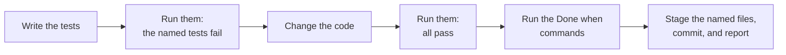

# Agent Brief: Step 3.7 Structured Output

Read this file and one spec handoff (`mh-4-*.md` to `mh-7-*.md`). Do not read other task files.

A spec handoff gives the required behavior, the tests to write, and the commands. It does not give the code. You write the tests and the code. The handoff runner applied MH-1 to MH-3; do not change their files unless the handoff names them.



## How to work

1. Read the handoff and the files that it names. Read `src/llm/structured.py` for the output models and `parse_structured`.
2. Write the tests first. Run them. The tests that the handoff says must fail must fail (`FAILED`, not `ERROR`).
3. Change the code. Run the tests again and see them all pass.
4. Run the "Done when" commands of the handoff. All must pass.
5. Stage only the files that the handoff names, with the `git add` command that it gives. Check the staged files. Commit with the message that the handoff gives. Do not push.
6. Stop and report: the commit hash, the test output before and after the code change, and anything that did not work.

## Rules

- Edit only the files that the handoff names.
- Each new function and method has a docstring with a description, `Args:`, and `Returns:` (where it returns a value), and type hints.
- Do not rename, move, or reformat code that the handoff does not name.
- Do not change a test that already exists, except the tests that the handoff names, in the way that it says.
- Do not change the prompts unless the handoff says so.
- Do not open `.env`, `.env.local`, or anything in `apps/backend-py/data/`.
- Do not start Ollama models, the app, a pipeline run, or `main.py eval`.
- Do not run `scripts/mypy_gate.py --update`.
- If a step does not work after three tries, stop and report. Do not guess.

## Where to run commands

From `apps/backend-py` in WSL. The project Python is `.venv/bin/python`.

Run one test file:

```bash
.venv/bin/python -m pytest tests/unit/test_structured_resume_pipeline.py -q
```

Use the test file of your handoff in place of this one. `pytest.ini` stops a run after 5 failures; when the handoff expects more failures in the red step, it adds `--maxfail=20`.
